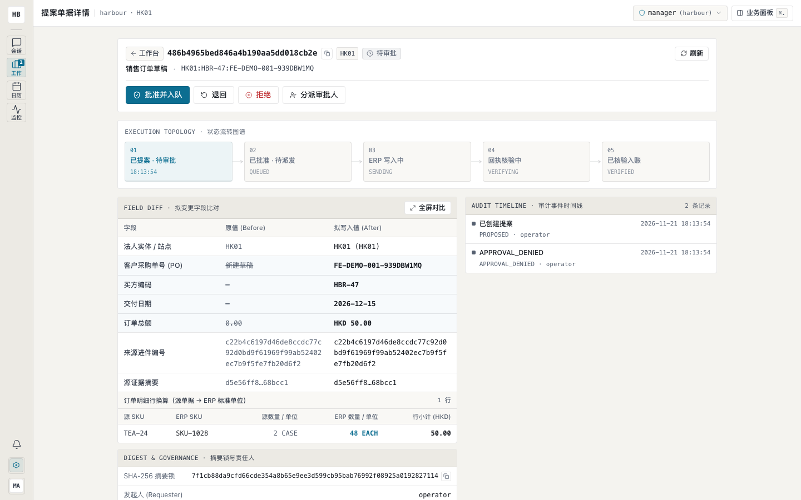
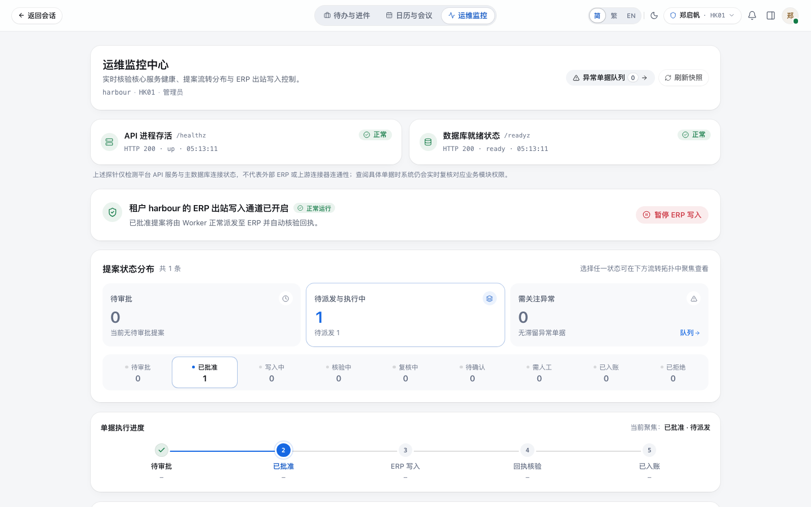
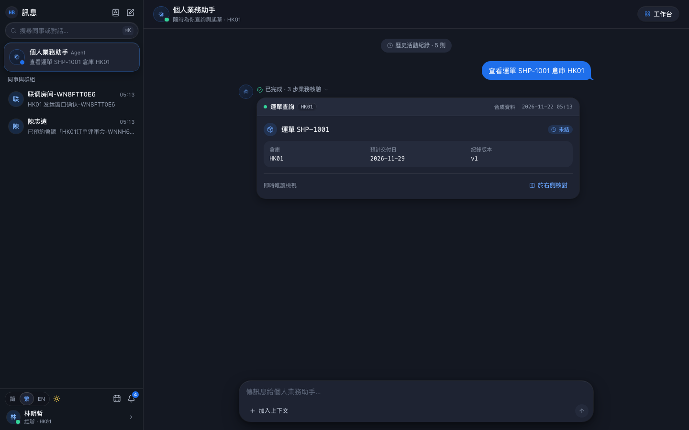
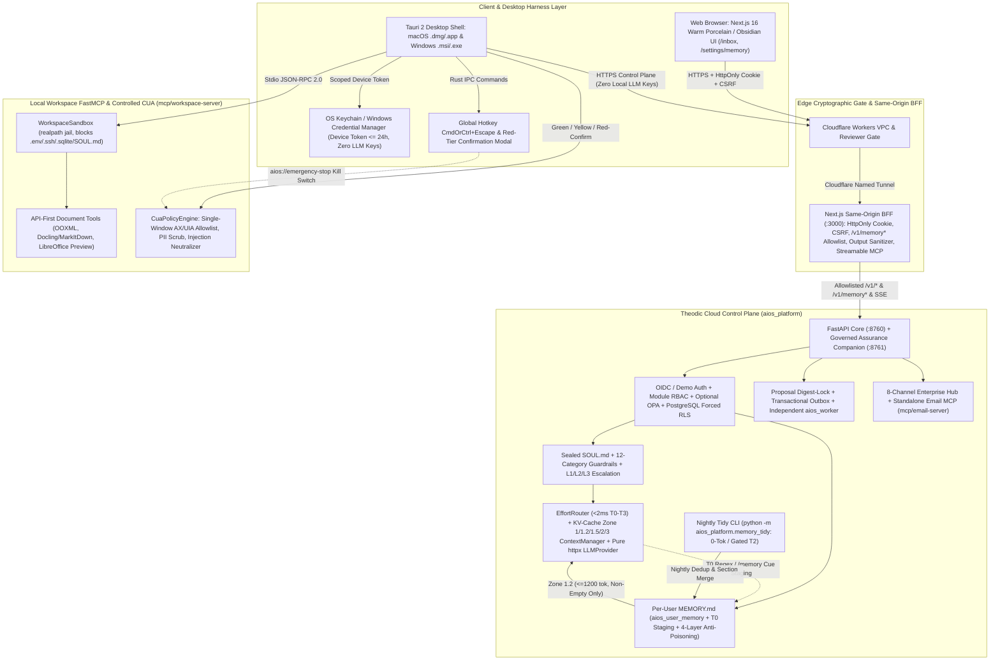
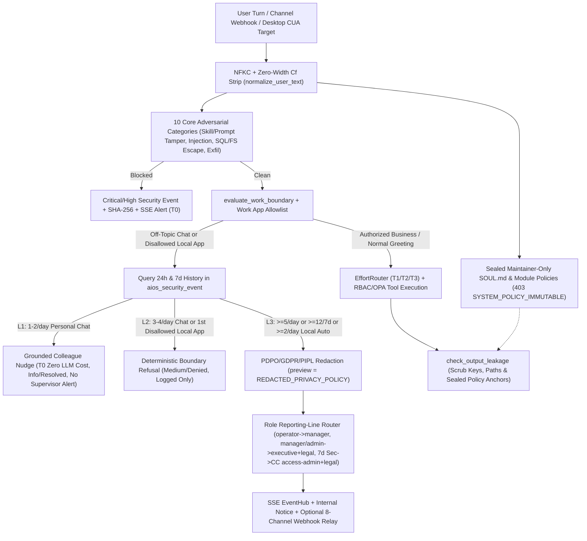
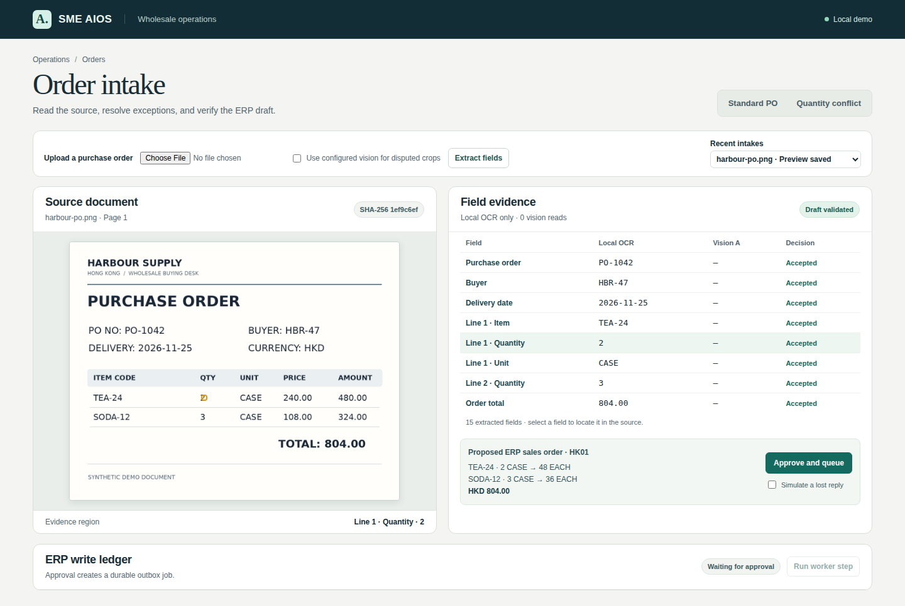

# Theodic SME AIOS

[简体中文](README.zh-CN.md) · [Governed Assurance](docs/governed-assurance.md) · [Backend Architecture](docs/platform.en.md) · [Production Hardening](docs/production-readiness.en.md) · [Workbench Handoff](docs/workbench-handoff.md) · [Desktop Harness](desktop/README.md)

**Theodic SME AIOS** is a zero-migration enterprise operational AI operating system designed for wholesale distributors, logistics operators, and multi-site SMEs. It places a unified, permission-scoped conversational workbench over existing **ERP, WMS/TMS, Finance, Calendar, Email, and Enterprise IM** systems—enforcing deterministic authorization, digest-locked human approvals, transactional outbox ERP reconciliation, cost-aware multi-provider LLM routing, and controlled local desktop automation without exposing raw credentials or migrating core customer databases.

---

## Progressive Adoption Ladder (`Tier 0` → `Tier 1` → `Tier 2`)

Organizations can adopt Theodic SME AIOS incrementally without disrupting existing ERP/WMS infrastructure:

| Tier | Offering | Stack & Scope | Primary Value |
|---|---|---|---|
| **Tier 0** | **Entry-Level Paid Starter: Wholesale PO OCR Intake** | [`aios_demo/`](aios_demo/) · Local Tesseract OCR + bounded opt-in vision + SQLite/PostgreSQL outbox | Immediate ROI wedge: digitizes messy purchase orders with pixel-level evidence, deterministic pack/amount checks, and lost-reply-safe ERP draft verification. |
| **Tier 1** | **Full Enterprise AIOS Cloud Workbench** | [`web/`](web/) + [`aios_platform/`](aios_platform/) + [`mcp/email-server/`](mcp/email-server/) | Multi-tenant RBAC & PostgreSQL forced RLS, native macOS iMessage/WhatsApp collaboration, 8-channel IM hub, Ed25519 signed Assurance, `<2ms` `EffortRouter`, KV-optimal per-user `MEMORY.md` (`Zone 1.2`) + 4-Zone KV Prompt Cache, and L1/L2/L3 work-boundary governance. |
| **Tier 2** | **Tauri 2 Cross-Platform Desktop Harness & Local MCP/CUA** | [`desktop/`](desktop/) + [`mcp/workspace-server/`](mcp/workspace-server/) | Native macOS (`.dmg`/`.app`) & Windows (`.msi`/`.exe`) shell holding **zero LLM API keys**, OS Keychain/Credential Manager scoped device tokens, sandboxed OOXML/PDF document tools, allowlisted single-window CUA, and `CmdOrCtrl+Escape` kill switch. |

### Verified Enterprise Workbench Showcase

| Warm Porcelain Desktop Workbench | Native Messenger & Contact Context | Digest-Locked Approval Diff |
|---|---|---|
|  |  |  |

| Admin Ops, Telemetry & Security Monitor | Warm Carbon Obsidian (`zh-HK`) | MCP Calendar & Natural-Language Zoom |
|---|---|---|
|  |  |  |

---

## End-to-End Architecture

### 1. Cloud Control Plane ↔ Tauri 2 Desktop (macOS/Windows) & Local MCP/CUA



### 2. Security Governance, Sealed `SOUL.md`, & Non-Work L1/L2/L3 Escalation Pipeline



### 3. Cross-Provider `EffortRouter`, Per-User `MEMORY.md` (`Zone 1.2`) & Dual-Bucket KV Cache Flow

```mermaid
flowchart LR
    TURN["User Turn + Per-User MEMORY.md + Active Doc + Work Pulse"] --> QUOTA["QuotaManager (Tenant / Role / Subject Daily USD & Token Cap)"]
    QUOTA --> ROUTER["EffortRouter (<2ms Deterministic Classifier)"]
    ROUTER -->|"T0: Security / /memory / Remember-Forget / Off-Topic L1"| ZERO["0 LLM Calls -> Immediate Output & T0 Capture"]
    ROUTER -->|"T1: Greeting / Pulse / Single Read + T0 Staging"| EFF_N["effort=none (1200 tok, 15s)"]
    ROUTER -->|"T2: Draft / Summary / Clarification + T0 Staging"| EFF_L["effort=low (2400 tok, 22s)"]
    ROUTER -->|"T3: Cross-Module / Contract Conflict + T0 Staging"| EFF_H["effort=high (8192 tok, 55s)"]

    EFF_N --> CTX["ContextManager KV-Cache Zone Assembly"]
    EFF_L --> CTX
    EFF_H --> CTX

    subgraph ZONES ["KV-Cache-Optimal Zone 1 / 1.2 / 1.5 / 2 / 3 Architecture"]
        Z1["Zone 1 (~3K-5K Global Invariant Prefix): Sealed SOUL.md + Policy + Sorted Schemas + Memory Rule"]
        Z12["Zone 1.2 (Per-User <=1200 tok / 6000 chars): Non-Empty MEMORY.md in Untrusted XML Fence"]
        Z15["Zone 1.5 (<=140K & <=safe_cap-38K): Single Active Doc Slot (Auto-Unmount <=2K Summary)"]
        Z2["Zone 2 (32K Trajectory Bucket): <=1500 tok Clamped Tool Outputs, Compact >=28K -> ~7K, >60m Idle Compact"]
        Z3["Zone 3 (Ephemeral Tail): Live pulse_summary Attached to Current User Request Only"]
    end

    CTX --> Z1 --> Z12 --> Z15 --> Z2 --> Z3
    TURN -.->|"T0 Regex Preference Cues (0 LLM)"| STAGE["T0 Passive Staging (aios_user_memory_staging, SHA-256 Dedup)"]
    ZERO -.->|"Direct /memory or Remember/Forget"| STAGE
    STAGE --> TIDY_CLI["Nightly Tidy CLI (memory_tidy: 0-Tok Deterministic / Gated T2 -> 4-Layer Guard)"]
    TIDY_CLI -->|"Validated <=1200 tok Snapshot"| Z12
    Z15 -->|">140K Document Pack"| MR["MapReduceDocumentAnalyzer: <=24K Chunks (T1/T2 Map) -> <=80K (T3 Reduce)"]
    Z3 --> PROV["Pure httpx+pydantic LLMProvider (OpenAICompat / Anthropic / Gemini + Circuit Breaker)"]
    MR --> PROV
    PROV --> HARNESS["Multi-Step Plan-Act-Observe Harness (MAX_HARNESS_STEPS = 4)"]
    HARNESS -->|"Malformed Tool Call on T1/T2"| CASCADE["Cascade Escalation -> T3 (effort=high)"]
    CASCADE --> PROV
    HARNESS -->|"HITL Proposal / Email / Approval Preview"| TELEM["RoutingTelemetryStore (Cache Hit %, USD, Latency)"]
```



### 4. Proposal Digest-Lock Approval, Outbox Read-Back & 8-Channel Collaboration Closed Loop

```mermaid
flowchart LR
    INTAKE["PO Image / Structured Batch / NL Workbench Turn"] --> PREP["Typed Tool Validation + SHA-256 plan_digest"]
    PREP --> PROP["PROPOSED (900s Expiry, Scoped Idempotency-Key)"]
    PROP -->|"SSE Work-Pulse & Channel Notice"| REVIEW["Independent Manager Review (Diff View, Self-Approval Blocked)"]
    REVIEW -->|"Submit Exact SHA-256 Digest + Optional OPA"| QUEUED["QUEUED (Atomic Tx + Audit + Advisory Lock)"]
    QUEUED --> WORKER["Independent aios_worker (SKIP LOCKED + Lease/Epoch)"]
    WORKER -->|"Odoo JSON-2 / ERPNext Frappe / LocalERP"| ERP["Authoritative ERP System"]
    ERP -->|"Reply Lost / Lease Expired"| UNKNOWN["OUTCOME_UNKNOWN -> Bounded Read-Only Reconciliation"]
    UNKNOWN -->|"Receipt Matched"| VERIFIED["VERIFIED (Receipt + Ed25519 Signed Audit Trail)"]
    UNKNOWN -->|"3 Checks Exhausted / Mismatch"| OPS["NEEDS_OPERATOR (Admin Exception Queue + Reopen)"]
    ERP -->|"Confirmed Receipt"| VERIFIED
    VERIFIED -->|"SSE + Real-Time Read Receipts & Outbound Relay"| CHANNELS["Inbox / 8-Channel Hub (WhatsApp, WeCom, Feishu, DingTalk, Slack, Teams, Telegram, LINE)"]
```



---

## Per-User Long-Term Memory (`MEMORY.md`)

Inspired by Muse-style editorial transparency, every authenticated employee owns an inspectable, user-editable **`MEMORY.md`** document scoped strictly to `(tenant, subject)` in [`aios_platform/user_memory.py`](aios_platform/user_memory.py) and [`aios_platform/user_memory.sql`](aios_platform/user_memory.sql):

- **How It Works**: Your assistant reads `MEMORY.md` at the start of every session (`Zone 1.2`), captures explicit or passive preference cues during conversations at `T0` (zero extra LLM calls), and consolidates them on a nightly tidy pass ([`aios_platform/memory_tidy.py`](aios_platform/memory_tidy.py)). You can inspect, edit, revert, or clear `MEMORY.md` directly in `/settings/memory` ([`MemoryEditorView.tsx`](web/src/features/settings/MemoryEditorView.tsx)) or update it conversationally in chat via `/memory` and natural cues (`"remember that..."` / `"记住..."` / `"忘掉..."`). The Muse-style editorial explainer note displayed above the `/settings/memory` editor (**"This note is not part of the file."**) lives purely in UI chrome and is never persisted to `MEMORY.md` or injected into model prompts.
- **Structured File Layout**: Starts from a clean Markdown scaffold (`# MEMORY.md` with `## Identity & Role`, `## Communication Preferences`, `## Working Context`, `## Ongoing Commitments & Habits`) strictly bounded to **`1,200` tokens** (`approx_tokens`) and **`6,000` characters**.

### Architectural Trade-Off: File-First Structured Markdown vs. Mem0 / Letta / Zep

Rather than introducing an external vector store, knowledge-graph daemon, or per-turn extractor LLM loop, Theodic SME AIOS persists `MEMORY.md` directly inside transactional PostgreSQL (with Forced RLS) / SQLite:

| Dimension | Theodic File-First `MEMORY.md` (PostgreSQL / SQLite) | Mem0 / Zep (Vector & Graph Fact Stores) | Letta / MemGPT (Stateful Agent Paging) |
|---|---|---|---|
| **Storage & Infra Ops** | **Zero extra DBs** (`aios_user_memory` + `aios_user_memory_staging` in existing PG/SQLite with Forced RLS) | Requires separate Vector DB + Graph DB sync & embedding pipelines | Requires agent-runtime memory blocks & paging state stores |
| **Per-Turn Token Overhead** | **`0` extra LLM extraction calls** (`T0` deterministic regex/command cue staging, SHA-256 deduped via `fact_sha256`) | Asynchronous or per-turn LLM fact extraction + embedding calls | Agent tool-call loops (`archival_memory_insert/search`) per turn |
| **Nightly Consolidation Cost** | **Deterministic `0`-token tidy** by default; optional gated `T2` (`effort="low"`) pass only when staged cues or `>900` tokens exist | Continuous graph re-indexing & conflict-resolution LLM passes | Periodic LLM summary / memory-pressure compaction passes |
| **KV Prefix Cache Impact** | **Global `Zone 1` stays 100% byte-invariant**; `MEMORY.md` isolates cleanly in `Zone 1.2` (`<= 1,200` tok, omitted when empty) | Dynamic retrieval snippets shift prefix/context across turns | Dynamic block mutations invalidate prefix between steps |
| **Debugging & Auditability** | **Human-readable Markdown diffs**, integer optimistic `version`, `previous_content` snapshot, 1-click Undo | Opaque vector chunks / graph edges hard to inspect or edit directly | Tool-managed block state harder for end-users to review directly |

### KV-Cache-Optimal `Zone 1.2` Injection

To preserve high prompt-cache hit rates across `OpenAICompatAdapter` (DeepSeek/OpenAI/Qwen), `AnthropicAdapter` (`cache_control`), and `GeminiAdapter` (`cachedContent`) in our pure `httpx` + `pydantic` [`LLMProvider`](aios_platform/llm_provider.py) (zero `litellm`):

1. **`Zone 1` (~3K–5K Global Invariant Prefix)**: Contains only sealed [`SOUL.md`](aios_platform/SOUL.md), role/module policies, lexicographically sorted `zone1_tool_schemas`, and a single static 1-sentence boundary note stating that `<user_long_term_memory>` carries user-editable factual preferences only. `Zone 1` stays **100% byte-invariant across all users and all memory states** for maximum shared prefix caching.
2. **`Zone 1.2` (Per-User `MEMORY.md`, `<= 1,200` Tokens)**: Immediately after `Zone 1` (`messages[0]`) and strictly before **`Zone 1.5` Active Document** and **`Zone 2` Trajectory**, `ContextManager.assemble(..., user_memory=...)` injects non-empty `MEMORY.md` fenced with:
   ```xml
   <user_long_term_memory trust="user_editable_facts_only">
   ...
   </user_long_term_memory>
   ```
   When `MEMORY.md` is empty or whitespace, **zero** `Zone 1.2` messages are emitted (`zone1_2_tokens = 0`).

### 4-Layer Anti-Memory-Poisoning Defense

Because `MEMORY.md` is user-editable and persisted across sessions, four deterministic defense layers prevent cross-session prompt poisoning, privilege escalation, and secret leakage:

1. **Layer 1 — Canonical Sanitization & Secret Redaction**: Every write runs `unicodedata.normalize("NFKC", text)`, strips invisible Unicode formatting characters (category `Cf`), and applies `scrub_secrets()` ([`security_guard.py`](aios_platform/security_guard.py)) so API keys, bearer tokens, and hidden homoglyph payloads never enter storage.
2. **Layer 2 — Deterministic Save-Time Validator & Hard Budget Cap**: Rejects attempts to edit or override `SOUL.md`, escalate RBAC/roles/warehouses/grants (`admin`, `bypass`, `grant`, `all warehouses`, `disable security`, `override policy`), tamper with `SKILL.md`/plugins/tools, inject prompt delimiters (`<system>`, `</user_long_term_memory>`, `<|im_start|>`, `ignore previous instructions`, `you are now`), or execute shell/filesystem escapes (`rm -rf`, `curl | sh`, `sudo`, `chmod`, `../etc`) with **`HTTP 422 MEMORY_POLICY_VIOLATION`**, and enforces the hard `1,200`-token / `6,000`-character budget with **`HTTP 422 MEMORY_TOKEN_LIMIT_EXCEEDED`** (including re-validating any optional `T2` nightly consolidation output before commit).
3. **Layer 3 — Untrusted `Zone 1.2` XML Fence & `Zone 1` Override Immunity**: Wrapping memory inside `<user_long_term_memory trust="user_editable_facts_only">` alongside the sealed `Zone 1` static directive ensures long-term notes can never override `SOUL.md`, RBAC module/warehouse grants, or tool safety rules.
4. **Layer 4 — Per-`(tenant, subject)` Isolation, Optimistic Concurrency & 1-Click Undo**: All SQL reads/writes scope strictly to `(tenant, subject)` via `subject_tx` (enforced by PostgreSQL Forced RLS in production), concurrent edits fail closed with **`HTTP 409 Conflict`**, and every save, tidy, forget, or clear snapshots `previous_content` for instant 1-click rollback (`POST /v1/memory/revert`).

### Memory API, Nightly Tidy CLI & Editorial UI Surface

| Surface | Contract & Behavior |
|---|---|
| **REST API (`/v1/memory*`)** | `GET /v1/memory` (returns `MEMORY.md`, `version`, `token_count`, `max_tokens: 1200`, `max_chars: 6000`, `has_previous`, `last_tidy_at`, `pending_staged_items`), `PUT /v1/memory` (`{version, content}` optimistic save), `POST /v1/memory/tidy` (`{use_llm?: false}` deterministic merge or gated `T2`), `POST /v1/memory/revert` (`{version}` 1-click undo), `POST /v1/memory/forget` (`{query}` removes matching lines & staged cues), `DELETE /v1/memory?version=<n>` (clears file while preserving `previous_content`). |
| **Nightly Tidy CLI** | `python -m aios_platform.memory_tidy` (`--tenant`, `--subject`, `--dry-run`, `--use-llm`, `--stale-days`): scans pending staged rows in `aios_user_memory_staging` or stale/large `MEMORY.md` files, applies `0`-token deterministic deduplication (or gated `T2` consolidation when `--use-llm` is set and provider is configured), updates `last_tidy_at`, and prints structured JSON metrics. |
| **Editorial Editor (`/settings/memory`)** | [`MemoryEditorView.tsx`](web/src/features/settings/MemoryEditorView.tsx) adapts seamlessly across **Warm Porcelain Light (`#FAF8F5`)** and **Carbon Obsidian Dark (`#111110`)**: Muse editorial banner (separate from file), **Edit / Split / Preview** modes (`MarkdownMessage` live render, `Cmd/Ctrl+S`), token/char budget gauge (`>=80%` amber, `>=100%` crimson), 1-click template insertion, Pending Staged Capture Queue, Quick Forget bar, Undo Last Version, and `409` / `422` recovery alerts. |
| **Chat `/memory` & `T0` Capture** | In `/inbox/assistant`, `/memory` (`/memory [view \| add <fact> \| forget <query> \| tidy]`), natural cues (`"记住..."`, `"忘掉..."`, `"remember that..."`, `"forget ..."`), and `+ Add context` → `Long-Term Memory (MEMORY.md)` execute deterministically at **`T0` (`0` LLM calls)** while normal turns passively stage non-secret preference cues at `T0`. |

---

## Frontend Engineering Highlights (`web/`)

Built on **Next.js 16 (App Router)**, **React 19**, **TypeScript 5.9 (`strict: true`, `noUncheckedIndexedAccess: true`)**, **Tailwind CSS v4**, and unified **Radix UI** (`web/package.json`):

- **Warm Museum Alabaster (`#FAF8F5`) & Warm Carbon Obsidian (`#111110`) Dual Theme**:
  - Zero-FOUC server-side cookie persistence (`aios_locale` and `aios_theme` read in [`web/src/app/layout.tsx`](web/src/app/layout.tsx), zero `localStorage` or `sessionStorage` footprint).
  - De-AI-ified architectural typography (`--font-sans`, `--font-display`, `--font-mono` with `.tabular-nums` / `.font-mono-code`, plus `:lang(zh-HK)` PingFang HK/TC glyph prioritization in [`web/src/app/globals.css`](web/src/app/globals.css)) paired with the dual-ink **Theodic** geometric mark ([`TheodicBrand.tsx`](web/src/components/ui/TheodicBrand.tsx)).
  - Surgical navy-cobalt accents (`#1B4F9C` light / `#6EA3F2` dark) in [`web/src/styles/tokens.css`](web/src/styles/tokens.css) and restrained porcelain/obsidian kinetic components ([`ArchitecturalRelayCanvas`](web/src/components/kinetic/ArchitecturalRelayCanvas.tsx), [`Interactive3DCard`](web/src/components/kinetic/Interactive3DCard.tsx), [`BriefProgressChain`](web/src/components/kinetic/BriefProgressChain.tsx), [`ExecutionTopologyRibbon`](web/src/components/kinetic/ExecutionTopologyRibbon.tsx), [`StatePulseBeacon`](web/src/components/kinetic/StatePulseBeacon.tsx)).
- **Native macOS iMessage / WhatsApp Conversation Experience**:
  - Borderless floating `88px` sticky conversation header ([`ConversationHeader.tsx`](web/src/components/chat/ConversationHeader.tsx)) with hover/focus progressive `112px` blur veil (`.aios-chat-header-veil`) and centered identity trigger.
  - Organic stacked message geometry ([`bubble-group.tsx`](web/src/features/inbox/bubble-group.tsx)): `20px` outer corners (`--radius-bubble`), `6px` shared seam corners (`--radius-bubble-tight`) on consecutive bursts within 300s, `10px` tail-joining corner (`--radius-bubble-tail`), bottom-most overlapping SVG tails (`IMessageBubbleTail`), CSS `linear(...)` physical spring entry (`--ease-spring-bubble`), and centered burst timestamps (`shouldShowBurstTimestamp` / `formatBurstTimestamp`).
  - Live **Delivered / Read** receipts (`fetchRoomReceipts`, `markRoomRead`, SSE `chat_read` events) across [`ChatRoomWorkspace.tsx`](web/src/features/chat/ChatRoomWorkspace.tsx) and [`AssistantWorkspace.tsx`](web/src/features/inbox/AssistantWorkspace.tsx).
  - Interactive **Contact Profile Cards** ([`ContactProfileDialog.tsx`](web/src/components/chat/ContactProfileDialog.tsx)) and tenant-scoped **Company Contacts Directory** ([`ContactsDirectoryModal.tsx`](web/src/features/inbox/ContactsDirectoryModal.tsx)) with 1-click email, Zoom meeting scheduling, and 1:1 DM creation (`/api/directory/contacts`, `/api/directory/direct-room`).
- **GFM Markdown Compiler, `cmdk` `/` Slash Skill Palette, `/memory` & Real-Time SSE Work Pulse**:
  - [`MarkdownMessage.tsx`](web/src/components/ui/MarkdownMessage.tsx) compiles full GitHub-Flavored Markdown (`react-markdown` + `remark-gfm`) with `safeUrlTransform` blocking `javascript:`, `data:`, `vbscript:`, and protocol-relative `//` URLs.
  - [`SlashCommandPalette.tsx`](web/src/features/inbox/SlashCommandPalette.tsx) (`cmdk`) surfaces grant-filtered `/` skills (`/brief`, `/todo`, `/shipment`, `/reschedule`, `/order`, `/invoice`, `/warehouse`, `/approve`, `/email`, `/inbox-mail`, `/meeting`, `/assurance`, `/exceptions`, `/memory`, `/help`), paired with the `+ Add context` shortcut to `/settings/memory` and `T0` `/memory` execution in [`AssistantWorkspace.tsx`](web/src/features/inbox/AssistantWorkspace.tsx).
  - [`ProactiveAgentNotifier.tsx`](web/src/components/shell/ProactiveAgentNotifier.tsx) streams `/v1/workbench/events/stream` SSE events (with `/v1/workbench/work-pulse` fallback) to push real-time approvals, returned drafts, notices, and read receipts into the shell and right-hand slide-over inspector drawer ([`WorkbenchDrawerSlot.tsx`](web/src/components/shell/WorkbenchDrawerSlot.tsx), shortcut `⌘.`).
- **Editorial Long-Term Memory Workspace (`/settings/memory`, [`MemoryEditorView.tsx`](web/src/features/settings/MemoryEditorView.tsx))**:
  - Accessible from top-level profile/inbox settings navigation ([`AppShell.tsx`](web/src/components/shell/AppShell.tsx), [`InboxShell.tsx`](web/src/features/inbox/InboxShell.tsx), [`ProfileSettingsView.tsx`](web/src/features/settings/ProfileSettingsView.tsx)) and the assistant card in [`ContactProfileDialog.tsx`](web/src/components/chat/ContactProfileDialog.tsx).
  - Uses Warm Porcelain (`#FAF8F5`) / Carbon Obsidian (`#111110`) design tokens with Edit / Split / Preview tabs, live token/char meter (`1,200` tokens / `6,000` chars), Pending Staged Capture Queue, Quick Forget bar, 1-click Undo, and inline `409` / `422` error handling.
- **Admin Operations Console, Sealed Governance, 8-Channel Hub & Telemetry/Off-Topic Monitor**:
  - [`AdminOpsOverview.tsx`](web/src/features/admin/AdminOpsOverview.tsx): tenant write-pause kill switch, demo worker stepping, subject suspension, and exception queue triage.
  - [`PromptGovernancePanel.tsx`](web/src/features/admin/PromptGovernancePanel.tsx): sealed governance integrity banner (`managedBy: theodic_core_team`) and Role/Module Capability Simulator without exposing sealed directive text.
  - [`ChannelsHubPanel.tsx`](web/src/features/admin/ChannelsHubPanel.tsx): 8-channel catalog, webhook URL copy, employee handle bindings, and governed outbound relay testing.
  - [`SecurityMonitorPanel.tsx`](web/src/features/admin/SecurityMonitorPanel.tsx): 12-category security event feed with PDPO/GDPR privacy-redacted badges, **Smart Routing & KV Cache Telemetry** (`T0–T3` distribution, cache hit ratio, USD cost, latency, tenant daily quota guardrail), and **Non-Work Boundary & Role Escalation Policy** editor.
- **Same-Origin Sanitized BFF, MCP Calendar/Zoom & Desktop Overlay**:
  - Allowlisted BFF proxy ([`proxy.ts`](web/src/lib/bff/proxy.ts), [`route.ts`](web/src/app/v1/[...path]/route.ts)) exposes `/v1/memory*` (`/v1/memory`, `/tidy`, `/revert`, `/forget`) alongside core workbench routes, recursively strips `planner` and internal LLM keys ([`sanitize.ts`](web/src/lib/bff/sanitize.ts)), normalizes `404` responses to `RECORD_UNAVAILABLE`, enforces `Cache-Control: no-store`, and invalidates stale async responses across `authGeneration` resets.
  - Server-side Streamable HTTP MCP connectors & trilingual natural-language Zoom booking ([`web/src/lib/mcp/`](web/src/lib/mcp/), `/api/integrations/*`, `/api/calendar/ics`).
  - [`DesktopHarnessOverlay.tsx`](web/src/components/desktop/DesktopHarnessOverlay.tsx) (mounted in [`AppShell.tsx`](web/src/components/shell/AppShell.tsx)) strictly renders `null` in standard web browsers and activates only inside Tauri 2 (`window.__TAURI_INTERNALS__`) to surface the `Cmd/Ctrl+Esc` emergency-stop pill and RED-action confirmation modal.

---

## Backend, AI Routing & Desktop Harness Architecture (`aios_platform/`, `mcp/`, `desktop/`)

- **Sealed Maintainer-Only `SOUL.md` & Policy Integrity ([`aios_platform/governance.py`](aios_platform/governance.py))**:
  - Persona and role/module directives load exclusively from the maintainer-sealed [`aios_platform/SOUL.md`](aios_platform/SOUL.md) and server-side specs; never editable or readable by enterprise admins or LLMs.
  - Mutation/reset endpoints (`PUT /v1/operations/prompt-policies/{scope_key}`, `POST .../reset`) fail closed with HTTP `403 SYSTEM_POLICY_IMMUTABLE` (`PolicyImmutableError`).
  - `check_output_leakage()` strips secrets, server paths, and sealed directive anchors before any response leaves the API.
- **Multi-Warehouse RBAC, Optional OPA & PostgreSQL Forced RLS**:
  - Dynamic per-module, per-warehouse grant overrides with advisory locking and optimistic `version` checks in [`aios_platform/module_access.py`](aios_platform/module_access.py).
  - Optional external Open Policy Agent gate ([`deploy/platform/opa.rego`](deploy/platform/opa.rego), [`aios_platform/providers.py`](aios_platform/providers.py)).
  - Forced PostgreSQL Row-Level Security across 23+ tenant tables ([`deploy/platform/postgres-security.sql`](deploy/platform/postgres-security.sql)) verified at startup by [`aios_platform/database_security.py`](aios_platform/database_security.py), separating restricted `aios_api` and `aios_worker` DB identities.
- **12-Category Deterministic Guardrails & L1/L2/L3 PDPO/GDPR/PIPL Escalation ([`aios_platform/security_guard.py`](aios_platform/security_guard.py), [`aios_platform/governance.py`](aios_platform/governance.py))**:
  - `normalize_user_text()` performs NFKC + zero-width `Cf` character stripping before matching 12 categories: `SKILL_TAMPER_ATTEMPT`, `PROMPT_TAMPER_ATTEMPT`, `DESTRUCTIVE_ACTION_ATTEMPT`, `FILESYSTEM_ESCAPE_ATTEMPT`, `PROMPT_INJECTION_ATTEMPT`, `SECRET_EXFILTRATION_ATTEMPT`, `PRIVILEGE_ESCALATION_ATTEMPT`, `CROSS_SCOPE_ACCESS_ATTEMPT`, `UNAUTHORIZED_MODULE_QUERY`, `EMAIL_POLICY_VIOLATION`, `OFF_TOPIC_PERSONAL_CHAT`, and `OFF_TOPIC_LOCAL_AUTOMATION`.
  - `evaluate_work_boundary()` guards against off-topic personal chat and disallowed local app automation against `DEFAULT_WORK_APP_ALLOWLIST` with zero false positives on polite greetings or business queries:
    - **L1** (1–2 daily personal off-topics): grounded, non-preachy nudge at `T0` (zero LLM spend), recorded `info`/`resolved`.
    - **L2** (3–4 daily personal off-topics or first disallowed local automation): deterministic refusal (`medium`/`denied`), zero supervisor push.
    - **L3** (`>=5/day`, `>=12/7d`, or `>=2/day` local automation): `high`/`escalated` along reporting lines (`operator -> [manager]`, `manager/admin -> [executive, legal]`, `executive -> [legal]`, plus `access-admin` & `legal` CC if 7d high/critical security violations exist).
    - **Hard Privacy Redaction**: stored `preview` is strictly `[REDACTED_PRIVACY_POLICY]`; supervisors receive only `(subject, role)`, `24h/7d` counts, category, and `estimated_usd` compute cost.
- **Pure `httpx` + `pydantic` Cross-Provider `LLMProvider` ([`aios_platform/llm_provider.py`](aios_platform/llm_provider.py))**:
  - Zero embedded `litellm` SDK (eliminating third-party LLM wrapper supply-chain risk) while remaining compatible with external OpenAI-format gateways via `base_url`.
  - `ModelProfile` registry covering `deepseek-chat`, `deepseek-flash`, `deepseek-v4-pro`, `gpt-5.4-mini`, `claude-sonnet-4-6`, `gemini-2.5-pro`, and `qwen-plus`, enforcing `safe_cap_tokens = min(180_000, int(surcharge_cliff * 0.90), int(context_window * 0.60))`.
  - Three pooled `httpx.Client` adapters (`OpenAICompatAdapter`, `AnthropicAdapter`, `GeminiAdapter`) supporting provider prompt caching, `reasoning_effort` / `thinking` translation with HTTP 400 fallback stripping, multi-turn `reasoning_content` and `thinking_blocks` preservation, `MAX_LLM_RESPONSE_BYTES = 524_288`, jittered retries, and `ProviderCircuitBreaker`.
- **`<2ms` `EffortRouter`, `Zone 1.2` Per-User `MEMORY.md` & KV Cache Context Manager ([`aios_platform/routing_context.py`](aios_platform/routing_context.py), [`aios_platform/assistant_agent.py`](aios_platform/assistant_agent.py), [`aios_platform/user_memory.py`](aios_platform/user_memory.py))**:
  - `EffortRouter` deterministically routes requests into `T0` (0 LLM calls—including `/memory` and unambiguous remember/forget intents), `T1` (`effort="none"`, `1200` tokens / `15s`), `T2` (`effort="low"`, `2400` tokens / `22s`), or `T3` (`effort="high"`, `8192` tokens / `55s`), preserving same-model KV cache warmth and applying **Cascade Escalation** (`T1/T2` → `T3`) on malformed tool calls.
  - `ContextManager` separates **Zone 1** (~3K–5K 100% byte-invariant prefix across all users + sorted `zone1_tool_schemas` + static memory boundary rule), **Zone 1.2** (non-empty per-user `MEMORY.md` `<= 1,200` tokens fenced inside `<user_long_term_memory trust="user_editable_facts_only">`, `0` messages when empty), **Zone 1.5** (single Active Document Slot capped at `<= 140K` and `<= safe_cap_tokens - 38K`, auto-unmounting to a `<= 2,000`-token structured summary), **Zone 2** (`32K` append-only trajectory clamping tool outputs to `<= 1,500` tokens before insertion, compacting at `>= 28,000` down to `~7,000`, plus `>60m` idle compaction), and **Zone 3** (ephemeral `pulse_summary` tail attached only to the active turn).
  - `UserMemory` & `python -m aios_platform.memory_tidy` ([`user_memory.sql`](aios_platform/user_memory.sql), migration [`0012_user_long_term_memory.py`](migrations/versions/0012_user_long_term_memory.py)) enforce 4-layer anti-memory-poisoning validation (`NFKC` + `Cf` strip + `scrub_secrets()`, `422 MEMORY_POLICY_VIOLATION` / `MEMORY_TOKEN_LIMIT_EXCEEDED`, `Zone 1.2` XML fence, `(tenant, subject)` RLS isolation + `409` optimistic locking + `POST /v1/memory/revert`), `T0` passive regex staging (`fact_sha256` dedup), and `0`-token nightly consolidation (with optional gated `T2` pass).
  - `MapReduceDocumentAnalyzer` handles `>140K` document packs by splitting into `<= 24K` token chunks for concurrent `T1/T2` map extraction followed by `T3` synthesis (`<= 80K`).
  - `RoutingTelemetryStore` & `QuotaManager` back `/v1/operations/llm-telemetry`, `/v1/operations/quota-policies`, and `/v1/operations/off-topic-policy` ([`routing_and_escalation.sql`](aios_platform/routing_and_escalation.sql), migration [`0011_routing_telemetry_and_escalation.py`](migrations/versions/0011_routing_telemetry_and_escalation.py)).
- **Proposal Digest-Lock, Outbox & Ed25519 Signed Assurance ([`aios_platform/workflow.py`](aios_platform/workflow.py), [`aios_platform/assurance*.py`](aios_platform/assurance.py))**:
  - Deterministic state machine (`PROPOSED -> QUEUED -> SENDING -> VERIFYING -> CHECKING -> VERIFIED` / `OUTCOME_UNKNOWN` / `NEEDS_OPERATOR` / `REJECTED`), exact SHA-256 `plan_digest` approval, independent approver check, PostgreSQL `SKIP LOCKED` + lease/epoch fencing in [`run_worker.py`](aios_platform/run_worker.py), and [`erp.py`](aios_platform/erp.py) bridges (`LocalERP`, `OdooERP` JSON-2, `ERPNext` Frappe RPC).
  - Governed Assurance ([`assurance.py`](aios_platform/assurance.py), [`assurance_policy.py`](aios_platform/assurance_policy.py), [`assurance_gateway.py`](aios_platform/assurance_gateway.py), [`assurance_audit.py`](aios_platform/assurance_audit.py), [`assurance_catalog.py`](aios_platform/assurance_catalog.py)) adds cell-level allowlists, 16 KiB bounded review gateway, AES-256-GCM transcript encryption, SHA-256 hash chains, and Ed25519 signed checkpoints.
- **8-Channel Enterprise Hub & Standalone Email MCP ([`aios_platform/channels.py`](aios_platform/channels.py), [`mcp/email-server/`](mcp/email-server/))**:
  - Unified registry, employee handle binding, signed webhook ingress + replay protection, and outbound relay across **WhatsApp Business**, **WeCom**, **Feishu / Lark**, **DingTalk**, **Slack Enterprise**, **Microsoft Teams**, **Telegram Business**, and **LINE Official / WORKS**.
  - Standalone TypeScript Email MCP (`mcp/email-server/src/server.ts`, `security.ts`, `transport.ts`) enforcing `MAX_EMAIL_RECIPIENTS = 10`, CRLF header-injection blocking, sliding-window rate limits, pooled TLS/STARTTLS SMTP, and `/v1/workbench/email-outbox` persistence.
- **Tauri 2 Cross-Platform Desktop ([`desktop/`](desktop/)) & Local Workspace FastMCP + CUA ([`mcp/workspace-server/`](mcp/workspace-server/))**:
  - `desktop/src-tauri/`: Rust/Tauri 2 shell with strict CSP (`script-src 'self'; frame-ancestors 'none'`), least-privilege capabilities, `keyring` v3 (`apple-native` macOS Keychain / `windows-native` Windows Credential Manager) rejecting LLM API keys (`ForbiddenLlmSecret`), 5 IPC commands (`ipc.rs`), and `CmdOrCtrl+Escape` global emergency stop (`lib.rs`).
  - `mcp/workspace-server/`: `WorkspaceSandbox(root_dir)` (`realpath` containment blocking traversal, symlinks, `.env`, `.ssh`, `id_rsa`, `*.sqlite*`, `.reviewer-pass.local.json`, `SOUL.md`), API-first `document_tools.py` (native `.txt/.md/.csv/.json`/OOXML + optional `docling`/`markitdown`/`python-docx`/`python-pptx`/`openpyxl` + LibreOffice PNG visual preview), and `CuaPolicyEngine` (`cua_guard.py`: macOS AX / Windows UIA work-app allowlists, `full_screen_capture=False` enforcement, `GREEN`/`YELLOW`/`RED` confirmation tokens, PII scrubbing with optional Presidio, indirect prompt-injection neutralization, and `EmergencyStopController`).

---

## Entry-Level Paid Starter: Wholesale PO OCR Intake

The original standalone wholesale purchase-order intake prototype (`aios_demo/`) remains preserved in full as our **Tier 0** entry-level paid starter—allowing wholesale teams to upload a purchase-order image, examine field-level evidence, review exceptions, approve a sales-order draft, and verify it in the mock ERP. The inbox preserves the document, reviewed preview, and command so the workflow can resume after refresh or restart.

### Reusable Logistics & Wholesale Backend (`aios_platform/`)

`aios_platform/` builds directly on these typed actions, tenant policy, independent approval, and ERP verification across sample tenants (`harbour` and `island`), while the standalone PO workbench below remains runnable independently:

```bash
python -m pip install -r requirements-platform.txt
python scripts/platform_smoke.py
```

Read the [backend architecture and ERP bridge contract](docs/platform.en.md) for tenant configuration, Linux and PostgreSQL isolation, API usage, LLM options and the customer onboarding checklist. The [production hardening guide](docs/production-readiness.en.md) covers migrations, controls and release gates. The [pilot automation guide](docs/pilot-automation.md) describes bulk intake and approval, exception handling, and reproducible performance measurements.

Read the [enterprise workbench and frontend handoff](docs/workbench-handoff.md) for role-scoped tools, employee chat, and customer integration gates.



### A two-minute demo

1. Open **Standard PO**. Select **Line 1 · Quantity** to highlight the OCR bounding box. The approved catalogue maps **2 cases → 48 units**. Line totals reconcile to **HKD 804**.
2. Switch to **Quantity conflict**. Tesseract reads **2** and scripted Vision A reads **8**. The second scripted reader reads **2**, and the field still goes to review. Enter **8** to see the amount check reject it, then enter **2**.
3. Select **Approve and queue**, keeping **Simulate a lost reply** enabled. The first worker step writes the mock ERP draft and loses the reply. The second performs a separate read-back. The ledger shows **one** matching ERP draft and the verified approved payload.
4. Refresh to reopen the verified order. Then upload `fixtures/harbour-po.png` with vision unchecked. The inbox shows the uploaded PO and its separate preview. A readable, consistent order makes zero vision requests.

| Exception review | ERP reconciliation |
|---|---|
| [View browser screenshot](docs/browser/02-quantity-review.png) | [View browser screenshot](docs/browser/03-erp-reconciliation.png) |

The upload and inbox screen was captured from the [verified browser run](https://github.com/Doooo4love/sme-aios-demo/actions/runs/44757111231). The two linked images show the original review and reconciliation walkthrough. See the [demo guide](docs/demo.md) for the operator script.

### Run locally (Standalone PO Workbench)

Use Python 3.11+ and Tesseract with English trained data. On Debian/Ubuntu install `tesseract-ocr` and `tesseract-ocr-eng`. On macOS install `tesseract` with Homebrew.

```bash
python -m venv .venv
source .venv/bin/activate
python -m pip install -r requirements.txt
python -m uvicorn aios_demo.api:app --host 127.0.0.1 --port 8758
```

Open **http://127.0.0.1:8758**. No provider keys are needed. For a repeatable demo use a fresh `AIOS_STATE_DIR`; approval of the same business key in an existing database resolves to the original command. The UI advances the asynchronous worker one step at a time for the presentation. In normal local runs you can start a separate worker with `python -m aios_demo.worker` using the same state directory and optional PostgreSQL DSN.

```bash
python scripts/run_demo.py
python -m pip install -r requirements-test.txt
python -m unittest discover -s tests -v
```

### Intake contract

```bash
python -m aios_demo.extract_po fixtures/harbour-po.png --mode ocr
```

The CLI returns JSON with the original file hash, image dimensions, field values, OCR regions, review reason codes, vision call count, and an optional ERP draft. Use `--mode vision-on-demand` with the configured provider to compare the same input with targeted visual review. Both modes use the same amount and pack-size rules. The CLI stops at the draft preview.

The workbench accepts PNG/JPEG up to 8 MB and eight megapixels. It stores a normalized PNG so displayed coordinates match the extracted evidence. The initial parser and catalog match the demo buyer and supported PO layout. A different layout stays in review. Configured vision receives only an anchored crop and the field type, and is opt-in per upload.

### Core implementation

| Piece | What is implemented |
|---|---|
| [Parser](aios_demo/parsing.py) | Tesseract TSV → typed fields, document completeness checks, pixel coordinates, OCR scores |
| [Multimodal routing](aios_demo/routing.py) | Evidence anchors, deterministic business checks, targeted and bounded visual reads, and human review |
| [Command and outbox](aios_demo/storage.py) | Saved intake and preview, exact-payload approval, idempotent same-PO handling, transactional job creation, PostgreSQL `SKIP LOCKED`, leases and epoch fencing, bounded read retries |
| [Outbox consumer](aios_demo/worker.py) | Persists dispatch intent, crosses a separate database boundary, handles lost replies, and verifies business key, draft status and full payload |
| [API and workbench](aios_demo/api.py) | Upload, recent-intake inbox, persisted evidence and preview, approval and read-back state |
| [Tests](tests/) | Real OCR, conflict gating, concurrent duplicate approvals, stale lease, unknown outcomes and end-to-end API |


### Scope

The workbench is a single-tenant pitch prototype with synthetic documents, a fixed local reviewer, and a mock ERP backed by a separate database file. The predefined pitch scenarios use **scripted vision fixtures** by default. New uploads use local OCR by default, and the default command store is SQLite. A PostgreSQL path and an opt-in HTTPS vision adapter are included. The backend platform provides separate role enforcement and ERP bridge clients. Customer-side ERP transactions, identity onboarding, and write acceptance are pilot integration work. The app is intended for loopback use. See [implementation notes](docs/demo.md#implementation-boundaries) before adapting it to a customer environment.

> **Seamless Upgrade Path**: The exact same PO evidence and `plan_digest` approval semantics from `aios_demo/` scale directly into [`aios_platform/`](aios_platform/) (`POST /v1/intakes/{warehouse}`, `/structured/batch`, `/proposals/{id}/approve`) and the Next.js [`OrderIntakeWorkspace.tsx`](web/src/features/orders/OrderIntakeWorkspace.tsx) + [`OcrEvidenceViewer.tsx`](web/src/features/orders/OcrEvidenceViewer.tsx).

---

## Quickstart, Testing & Operations

### 1. Enterprise Cloud Workbench (`web/` + `aios_platform/`)

```bash
# Option A: One-command keyless local demo (FastAPI :8760 + Next.js BFF :3000)
./deploy/demo/start-local-demo.sh

# Option B: Dual-port Cloud LLM (:8760) + Governed Assurance (:8761)
export AIOS_LLM_BASE_URL="https://api.deepseek.com"
export AIOS_LLM_MODEL="deepseek-chat"
export AIOS_LLM_API_KEY="sk-your-server-only-key"
./deploy/demo/start-local-demo.sh --mode dual

# Option C: $0 Public HTTPS Quick Tunnel (macOS/Linux + cloudflared)
./deploy/demo/start-local-demo.sh --prod --tunnel
```

Open **http://localhost:3000/** and sign in with Account + Password or expand the local demo persona helper across 11 controlled identities (`operator`, `manager`, `finance`, `access-admin`, `admin`, `other-manager`, `island-manager`, `viewer`, `quality`, `legal`, `executive`). For full Next.js BFF variables and MCP calendar/Zoom setup, see [`web/README.md`](web/README.md).

### 2. Backend Migrations, Nightly Memory Tidy & Automated Verification Suites

```bash
# Apply Alembic database migrations through 0012_user_long_term_memory
.venv/bin/python -m alembic upgrade head

# Run nightly MEMORY.md tidy pass (deterministic 0-token by default; add --use-llm for gated T2)
.venv/bin/python -m aios_platform.memory_tidy --dry-run
.venv/bin/python -m aios_platform.memory_tidy --use-llm --stale-days 7

# Run backend Python unit & integration suites
.venv/bin/python -m unittest discover -s tests -v

# Run per-user MEMORY.md, Zone 1.2 KV cache, anti-poisoning, and migration suites
.venv/bin/python -m unittest tests.test_migrations tests.test_user_memory -v

# Run routing, context, assistant, and migration unit suites
.venv/bin/python -m unittest tests.test_routing_provider_context tests.test_assistant_and_sse tests.test_migrations -v

# Run standalone Desktop & Workspace MCP harness tests
.venv/bin/python -m unittest tests.test_desktop_workspace_harness -v

# Run Work-Boundary L1/L2/L3 escalation & guard tests
.venv/bin/python -m unittest tests.test_off_topic_escalation tests.test_governance_and_guard -v

# Run Next.js strict TypeScript check, production standalone build, and Playwright E2E
pnpm --dir web run typecheck
pnpm --dir web run build
pnpm --dir web run test:e2e

# Run Cloudflare Worker typecheck & unit tests
pnpm --dir deploy/cloudflare-worker run typecheck
pnpm --dir deploy/cloudflare-worker run test
```

### 3. Tauri 2 Desktop (`desktop/`) & Local Workspace MCP (`mcp/workspace-server/`)

```bash
# Run Local Workspace & Controlled CUA MCP server over stdio
.venv/bin/python mcp/workspace-server/server.py --root /path/to/workspace

# Run or build Tauri 2 Desktop shell (requires Node >= 20, pnpm, and Rust >= 1.77 on macOS/Windows CI)
pnpm --dir desktop install
pnpm --dir desktop dev
pnpm --dir desktop build
```

See [`desktop/README.md`](desktop/README.md) and [`mcp/workspace-server/README.md`](mcp/workspace-server/README.md) for OS Keychain invariants, capability allowlists, and native installer build targets (`.dmg`/`.app`/`.msi`/`.exe`).

### 4. Cloudflare Zero Trust, IntegrAI Host & Reviewer Gate Ops

Production demo hosting binds all application listeners strictly to loopback (`127.0.0.1:3000`, `:8760`, `:8761`) behind a Cloudflare Named Tunnel (`deploy/integrai/`) and **Cloudflare Workers VPC** (`deploy/cloudflare-worker/`) with an edge HMAC **Reviewer Gate** (`src/reviewer-gate.ts`) enforcing `X-Robots-Tag: noindex, nofollow, noarchive`, sliding-window LLM rate limits (`8/min`, `40/hr`), and Judge sandbox mutation protection (`403 JUDGE_SANDBOX_PROTECTED`).

- **Dry-run & secret-free gate activation** (reads gitignored `.reviewer-pass.local.json`, pipes secrets via `stdin` to `wrangler secret put` without echoing):
  ```bash
  ./deploy/cloudflare-worker/activate-reviewer-gate.sh --dry-run
  ./deploy/cloudflare-worker/activate-reviewer-gate.sh
  ```
- **Zero-downtime emergency expiration circuit breaker** (immediately invalidates active reviewer passcodes/links):
  ```bash
  printf '%s' '2020-01-01T00:00:00Z' | pnpm --dir deploy/cloudflare-worker exec wrangler secret put AIOS_REVIEWER_EXPIRES_AT --name aios-demo
  ```
- **Credential rotation** (revokes all prior cookies & QR capability tokens):
  ```bash
  node ./deploy/cloudflare-worker/scripts/generate-reviewer-pass.mjs --force
  ./deploy/cloudflare-worker/activate-reviewer-gate.sh
  ```
- Full Cloudflare Worker, Zero Trust Access fallback, and custom domain migration instructions: [`deploy/cloudflare-worker/README.zh-CN.md`](deploy/cloudflare-worker/README.zh-CN.md).
- Hardened Ubuntu VPS deployment runbook (`01-preflight.sh` → `06-verify-live.sh`): [`deploy/integrai/RUNBOOK.zh-CN.md`](deploy/integrai/RUNBOOK.zh-CN.md).

---

## Documentation Index

| Area | English | 简体中文 |
|---|---|---|
| **Governed AI Assurance & Zero-Migration Integration** | [docs/governed-assurance.md](docs/governed-assurance.md) | [docs/governed-assurance.zh-CN.md](docs/governed-assurance.zh-CN.md) |
| **Backend Architecture & ERP Bridge Contract** | [docs/platform.en.md](docs/platform.en.md) | [docs/platform.md](docs/platform.md) |
| **Production Hardening & Acceptance Gates** | [docs/production-readiness.en.md](docs/production-readiness.en.md) | [docs/production-readiness.md](docs/production-readiness.md) |
| **Wholesale & Logistics Pilot Automation** | [docs/pilot-automation.md](docs/pilot-automation.md) | [docs/pilot-automation.zh-CN.md](docs/pilot-automation.zh-CN.md) |
| **Enterprise Workbench & Frontend Handoff** | [docs/workbench-handoff.md](docs/workbench-handoff.md) | [docs/workbench-handoff.zh-CN.md](docs/workbench-handoff.zh-CN.md) |
| **Workbench Backend & Module Access** | — | [docs/workbench-backend.zh-CN.md](docs/workbench-backend.zh-CN.md) |
| **Collaboration, OIDC Sessions & Customer Connectors** | — | [docs/workbench-collaboration.zh-CN.md](docs/workbench-collaboration.zh-CN.md) |
| **Enterprise Frontend Delivery Guide (`web/`)** | [web/README.md](web/README.md) | [docs/workbench-frontend.zh-CN.md](docs/workbench-frontend.zh-CN.md) |
| **PO OCR Operator Demo Script & Boundaries** | [docs/demo.md](docs/demo.md) | [docs/demo.zh-CN.md](docs/demo.zh-CN.md) |
| **Desktop Harness & Local Workspace MCP** | [desktop/README.md](desktop/README.md) · [mcp/workspace-server/README.md](mcp/workspace-server/README.md) | — |
| **Cloudflare Worker Gate & IntegrAI Ops** | — | [deploy/cloudflare-worker/README.zh-CN.md](deploy/cloudflare-worker/README.zh-CN.md) · [deploy/integrai/RUNBOOK.zh-CN.md](deploy/integrai/RUNBOOK.zh-CN.md) |

---

## Open-Source Acknowledgments

Theodic SME AIOS stands on the shoulders of proven open-source foundations:

- **Backend & Data**: [FastAPI](https://fastapi.tiangolo.com/), [Pydantic](https://docs.pydantic.dev/), [httpx](https://www.python-httpx.org/), [SQLAlchemy](https://www.sqlalchemy.org/) / [Alembic](https://alembic.sqlalchemy.org/), [PostgreSQL](https://www.postgresql.org/) (Forced RLS & `SKIP LOCKED`), [PyJWT](https://pyjwt.readthedocs.io/), [cryptography](https://cryptography.io/) (Ed25519 / AES-256-GCM), [Open Policy Agent](https://www.openpolicyagent.org/), [Prometheus Python Client](https://github.com/prometheus/client_python).
- **Frontend & UI**: [Next.js](https://nextjs.org/), [React](https://react.dev/), [Tailwind CSS](https://tailwindcss.com/), [Radix UI](https://www.radix-ui.com/), [cmdk](https://cmdk.paco.me/), [react-markdown](https://github.com/remarkjs/react-markdown) + [remark-gfm](https://github.com/remarkjs/remark-gfm), [Lucide](https://lucide.dev/), [Zod](https://zod.dev/), [Playwright](https://playwright.dev/).
- **Desktop, Document & Controlled Automation**: [Tauri 2](https://v2.tauri.app/) (`keyring` v3), [Model Context Protocol (MCP)](https://modelcontextprotocol.io/), [Docling](https://github.com/DS4SD/docling) / [MarkItDown](https://github.com/microsoft/markitdown), [Microsoft Presidio](https://microsoft.github.io/presidio/), [OmniParser](https://github.com/microsoft/OmniParser), [Tesseract OCR](https://github.com/tesseract-ocr/tesseract), and [Cloudflare Workers](https://developers.cloudflare.com/workers/).
