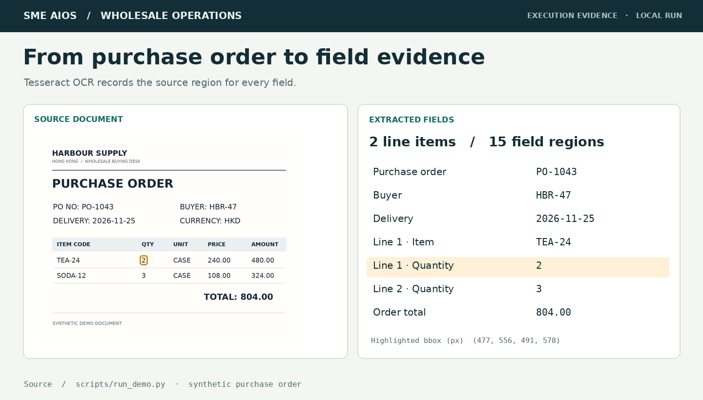
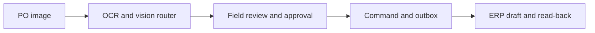

# SME AIOS · Wholesale order intake

An auditable prototype that turns a wholesale customer's purchase order into a verified sales-order draft. The reviewer handles only disputed fields. The outbox preserves the approved draft and lets a separate worker resolve ambiguous ERP responses.



## A two-minute demo

1. Open **Standard PO**. Select **Line 1 · Quantity** to highlight the OCR bounding box. The approved catalogue maps **2 cases → 48 units**. Line totals reconcile to **HKD 804**.
2. Switch to **Quantity conflict**. Tesseract reads **2** and scripted Vision A reads **8**. The second scripted reader reads **2**, and the field still goes to review. Enter **8** to see the amount check reject it, then enter **2**.
3. Select **Approve and queue**, keeping **Simulate a lost reply** enabled. The first worker step writes the mock ERP draft and loses the reply. The second performs a separate read-back. The ledger shows **one** matching ERP draft and the verified approved payload.

| Exception review | ERP reconciliation |
|---|---|
| [View execution evidence](docs/images/02-quantity-review.png) | [View execution evidence](docs/images/03-erp-reconciliation.png) |

The images above are rendered from a local execution of the repository code. The [verification workflow](.github/workflows/demo.yml) also captures the interactive browser flow via Playwright. See [the demo guide](docs/demo.md) for the operator script and interpretation.

## Run locally

Use Python 3.11+ and Tesseract with English trained data. On Debian/Ubuntu install `tesseract-ocr` and `tesseract-ocr-eng`. On macOS install `tesseract` with Homebrew.

```bash
python -m venv .venv
source .venv/bin/activate
python -m pip install -r requirements.txt
python -m uvicorn aios_demo.api:app --host 127.0.0.1 --port 8758
```

Open **http://127.0.0.1:8758**. No provider keys are needed. For a repeatable demo use a fresh `AIOS_STATE_DIR`; approval of the same business key in an existing database resolves to the original command. The UI advances the asynchronous worker one step at a time for the presentation. In normal local runs you can start a separate worker with `python -m aios_demo.worker` using the same state directory and optional PostgreSQL DSN.

```bash
python scripts/run_demo.py
python -m pip install -r requirements-test.txt
python -m unittest discover -s tests -v
```

## Core implementation

| Piece | What is implemented |
|---|---|
| [Parser](aios_demo/parsing.py) | Tesseract TSV → typed fields, document completeness checks, pixel coordinates, OCR scores |
| [Multimodal routing](aios_demo/routing.py) | Cropped evidence, pluggable model readers, second-pass escalation, human confirmation, Decimal totals and case conversion |
| [Command and outbox](aios_demo/storage.py) | Exact-payload digest, idempotent same-PO approval, transactional job creation, PostgreSQL `SKIP LOCKED`, leases and epoch fencing, bounded read retries |
| [Outbox consumer](aios_demo/worker.py) | Persists dispatch intent, crosses a separate database boundary, handles lost replies, and verifies business key, draft status and full payload |
| [API and workbench](aios_demo/api.py) | Preview, review, approve, worker-step, command status and evidence view |
| [Tests](tests/) | Real OCR, conflict gating, concurrent duplicate approvals, stale lease, unknown outcomes and end-to-end API |



## Scope

This is a single-tenant pitch prototype with synthetic documents, a fixed local reviewer, and a mock ERP backed by a separate database file. Default vision responses are **scripted fixtures**, and the default command store is SQLite. A PostgreSQL path and an opt-in HTTPS vision adapter are included. Real ERP connectors, identity and role enforcement, and automatic production writes remain integration work. The app is intended for loopback use. See [implementation notes](docs/demo.md#implementation-boundaries) before adapting it to a customer environment.
