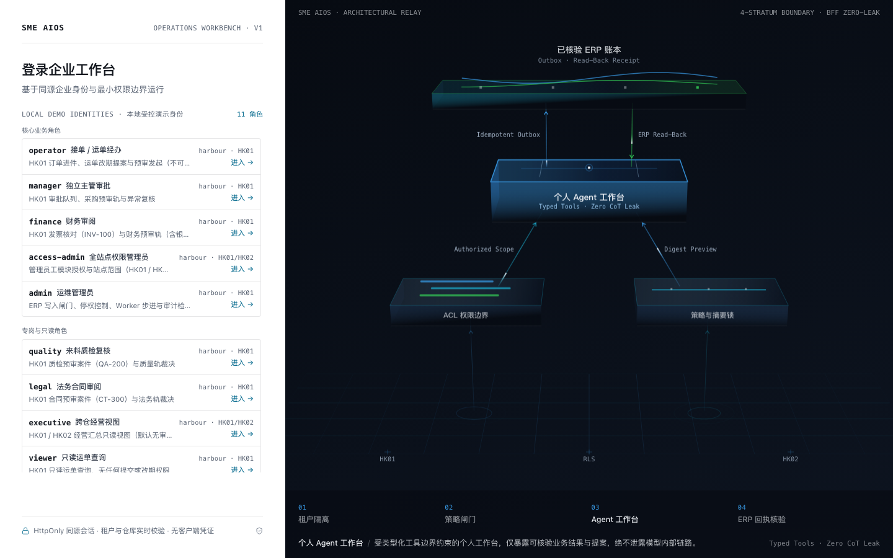
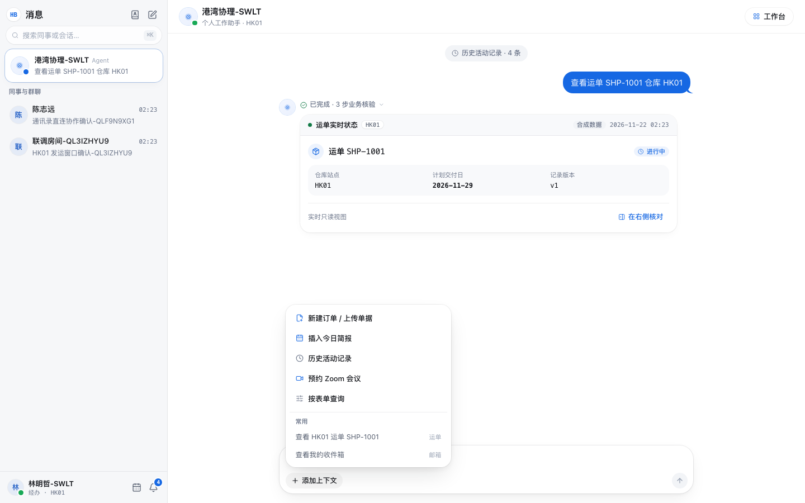
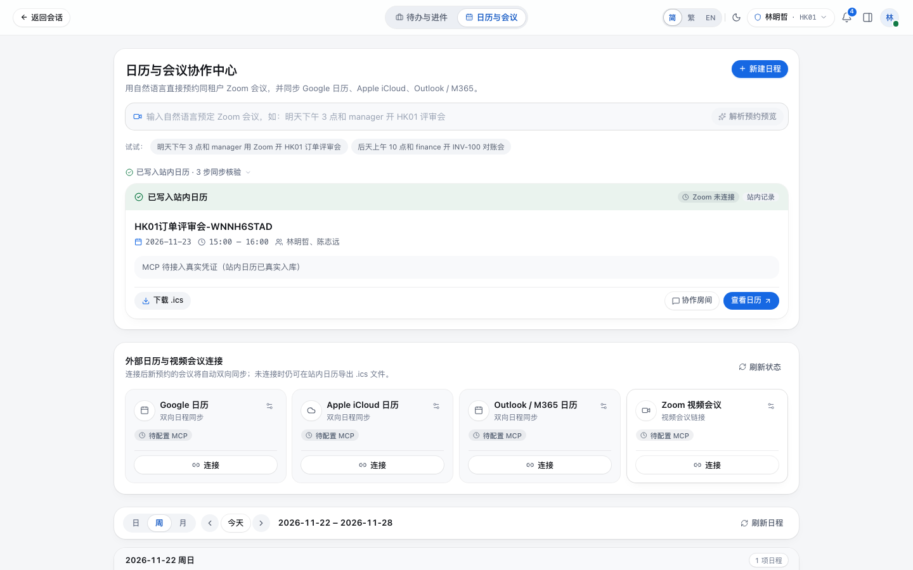
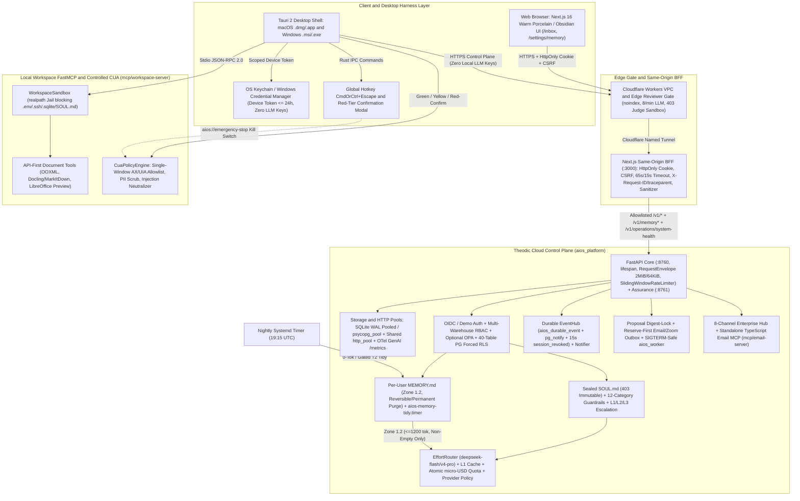
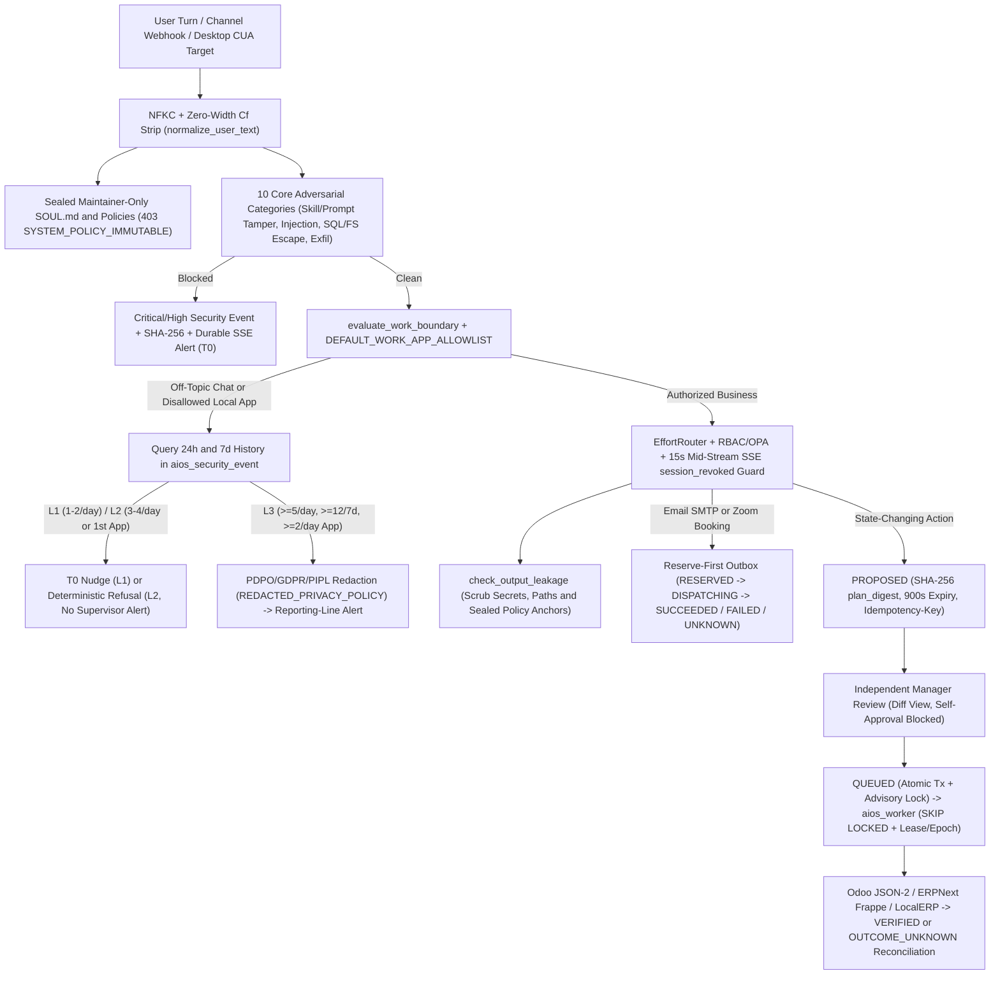

# Theodic SME AIOS

[简体中文](README.zh-CN.md) · [Live Demo](https://aios-demo.hk-demo.workers.dev) · [Governed Assurance](docs/governed-assurance.md) · [Backend Architecture](docs/platform.en.md) · [Production Hardening](docs/production-readiness.en.md) · [Workbench Handoff](docs/workbench-handoff.md) · [Desktop Harness](desktop/README.md) · [Enterprise Eval](scripts/enterprise_eval.py)

**Theodic SME AIOS** is a zero-migration enterprise operational AI operating system built for wholesale distributors, logistics operators, and multi-site SMEs. It places a unified, permission-scoped conversational workbench over existing **ERP, WMS/TMS, Finance, Calendar, Email, and Enterprise IM** systems—enforcing deterministic multi-warehouse RBAC, sealed `SOUL.md` governance, digest-locked human approvals, transactional outbox ERP reconciliation, FinOps-hardened pure `httpx + pydantic` multi-provider LLM routing (zero `litellm` dependency), per-user KV-optimal `MEMORY.md`, and controlled local Tauri 2 desktop automation without exposing raw credentials or migrating core databases.

---

## Executive Architecture Overview & Measured Enterprise Scorecard

Every core claim across security, KV cache invariance, FinOps savings, SQLite WAL concurrency, multi-provider failover, SSE replay, and P0/P1 enterprise controls is verified deterministically with zero external API keys via [`scripts/enterprise_eval.py`](scripts/enterprise_eval.py) and our full automated test suites:

- **Enterprise Readiness Eval ([`scripts/enterprise_eval.py --json`](scripts/enterprise_eval.py))**: **`7 / 7` gates passed** in `0.908s` (`zero_api_keys_required: true`, `litellm_absent: true`).
- **Automated Verification Suites & Expanded CI ([`.github/workflows/demo.yml`](.github/workflows/demo.yml))**: **`192` Python tests** (`unittest discover -s tests`: `187` passed, `5` skipped PostgreSQL DSN / optional harness tests, `0` failures); PostgreSQL 16 Forced RLS role verification (`test_postgres_enterprise`); Next.js `web/` `next typegen && tsc --noEmit && next build` (`0` TS errors, `14/14` static pages / `31` routes + `26/26` Playwright E2E checks); `mcp/email-server` `typecheck` & build clean; Cloudflare Worker `typecheck` & **`20/20`** unit tests pass.

| Evaluation Gate / Engineering Domain | Verified Measurement (`scripts/enterprise_eval.py --json`) | Architectural Mechanism & Source |
|---|---|---|
| **1. Security, Sealed `SOUL.md` & Anti-Poisoning Recall** | **`100%` block recall (`44 / 44` blocked, `0` missed, `0` false positives across 3 benign controls)**; `403 SYSTEM_POLICY_IMMUTABLE`; empty persisted `MEMORY.md` on poison attempts | `27` adversarial chat probes, `14` `MEMORY.md` poisoning payloads, `3` output leakage probes across [`security_guard.py`](aios_platform/security_guard.py), [`governance.py`](aios_platform/governance.py), and [`user_memory.py`](aios_platform/user_memory.py) |
| **2. KV-Cache `Zone 1` Byte-Invariance** | **`100%` prefix & tool-schema invariance (`72 / 72` assemblies, `0` mismatches)** across `2` tenants, `6` subjects, `4` roles, toggling `MEMORY.md` (`Zone 1.2`) & switching `ActiveDocumentRef` (`Zone 1.5`) | Static sealed `SOUL.md` + sorted `zone1_tool_schemas` isolated ahead of `Zone 1.2` XML fence and `Zone 1.5` in [`ContextManager`](aios_platform/routing_context.py) |
| **3. FinOps Cost & Token Optimization** | **L1 Cache**: `24.277 ms -> 0.488 ms` (**`49.75x` speedup**, **`100.0%` marginal USD saved**, `6,720` tokens saved); **Tool Compaction**: `25,487 -> 3,740` chars (**`85.33%` char / `85.31%` token reduction**); **80% Soft Budget**: `0.85` utilization downgrades `T3 (high, 8,192 tok) -> T1 (none, 1,200 tok)` in `1` SQL query (`0` hot-path DDL); **Anthropic Guard**: skips `cache_control` `< 3,600` chars | [`BoundedResponseCache`](aios_platform/response_cache.py), [`compact_tool_observation`](aios_platform/response_cache.py), [`QuotaManager`](aios_platform/routing_context.py), and [`AnthropicAdapter`](aios_platform/llm_provider.py) |
| **4. Multi-Provider Failover & Circuit Breaker** | Automatic `deepseek -> openai` failover (`3` primary + `3` fallback HTTP calls); `open` short-circuit -> `half_open` probe -> `closed` recovery | Pure `httpx + pydantic` [`LLMProvider`](aios_platform/llm_provider.py) (`deepseek-flash` default / `deepseek-v4-pro` escalation) + [`ProviderCircuitBreaker`](aios_platform/llm_provider.py) (zero `litellm`) |
| **5. 16-Thread SQLite WAL Contention Benchmark** | `sqlite-wal-pooled` (`wal` mode): **`480` concurrent ops** (`240` writes + `240` reads across `16` threads), **`0` `SQLITE_BUSY` errors**, **`P50 = 0.041 ms`**, **`P95 = 2.338 ms`**, **`6,620.3 ops/sec`** | Thread-local pooled SQLite WAL + `(st_dev, st_ino)` reopen + `psycopg_pool` on PostgreSQL in [`aios_demo/storage.py`](aios_demo/storage.py) |
| **6. Observability, Body Bounds & SSE Replay** | `/v1/workbench/turns` accepts `180,000 B` (`2 MiB` ceiling) & rejects oversize (`413`); standard routes enforce `65,536 B` (`413` on `/v1/memory`, `/v1/actions`, `/v1/tasks`); `X-Request-Id` & `traceparent` echoed; `Last-Event-ID` replays missed events | [`RequestEnvelope`](aios_platform/observability.py), [`EventHub.since_event`](aios_platform/events.py), and [`events_stream`](aios_platform/workbench.py) |
| **7. P0/P1 Enterprise Hardening Controls** | **Concurrent `micro-USD` Cap**: `8` threads against `$0.010` (`10,000` `micro-USD`) -> `2` approved / `6` rejected (`8,000 <= 10,000` settled); **Reserve-First Outbox**: in-flight `409`, `SUCCEEDED` replay, `UNKNOWN` retry blocked; **Provider Policy**: `PROVIDER_POLICY_DENIED` (`0` disallowed failover HTTP calls); **Durable Cross-Hub SSE**: cross-process replay + mid-stream `session_revoked` close; **Permanent Memory Purge**: `previous_content = NULL`, `0` staging rows | [`QuotaManager.reserve_budget`](aios_platform/routing_context.py), [`GovernanceService.reserve_external_action`](aios_platform/governance.py), [`TenantProviderPolicyStore`](aios_platform/routing_context.py), [`EventHub.bind_workflow`](aios_platform/events.py), and [`UserMemoryStore.clear(..., permanent=True)`](aios_platform/user_memory.py) |

---

## Assistant Work Boundary and Public Web Search

[Assistant tool and access guide](docs/harness-tools.zh-CN.md) covers calculation, timezone conversion, attachment and CSV checks, and employee-scoped calendar, proposals, and knowledge.

Access Admin follows the same personal-chat policy as other roles. The boundary runs before external tools and model calls. It checks personal intent, explicit business purpose, and short follow-ups against the most recent user turn. Ordinary greetings and tasks such as sourcing PS5 stock for the store can proceed. Personal shopping, leisure, entertainment, wellness, and similar requests enter the existing L1/L2/L3 reminder and escalation flow. Client-provided history can add a reminder. It cannot authorize a tool or clear an explicit policy denial.

| Local regression result | Measurement |
|---|---:|
| Overall accuracy | **99.25%** (133/134) |
| Non-work recall | **98.57%** (69/70) |
| Work and greeting false positives | **0 observed** (0/64) |
| Classifier-only load | **20,000** evaluations, 16 worker threads, 0 decision mismatches, **0.138 ms p95**, about **9,595 evaluations/s** |

The [synthetic fixture](fixtures/work_boundary_eval.tsv) covers Simplified Chinese, Traditional Chinese including Cantonese, and English across four role levels. One public sports-score question was missed. These are local Python 3.12.14 measurements on a curated regression set developed alongside the rules. Production traffic accuracy, API throughput, and provider latency require separate measurement. Reproduce locally with:

```bash
python scripts/work_boundary_eval.py --requests 20000 --workers 16
python -m unittest discover -s tests -p test_public_search.py -v
```

**Public web search** runs on the assistant gateway after the work-boundary check. An opted-in tenant and an account with `agent.web_search` can use `/web Hong Kong cold chain suppliers` or start a turn with “search the web”. The gateway also applies tenant provider policy and shared tenant rate and FinOps quotas. It sends the bounded query alone to the [DeepSeek Search API](https://api-docs.deepseek.com/api/search/), with results formatted as links and snippets. Attachments, conversation history and known sensitive patterns are excluded. Search snippets stay out of automatic model context. A busy or unavailable provider yields a status message and the request is not retried automatically.

Enable on the assistant API only with `AIOS_WEB_SEARCH_TENANTS` (comma-separated tenant IDs) and a dedicated secret mounted via `AIOS_WEB_SEARCH_API_KEY_FILE` or injected as `AIOS_WEB_SEARCH_API_KEY`. Enable only the approved provider region and public data class. The demo grant is held by `harbour/access-admin`; in production, administrators can override access per employee. A verified OIDC `aios_grants` claim supplies the baseline if there is no explicit module override. The tool is disabled by default. Set an organization budget and complete a staged provider smoke test before enabling live traffic.

The existing harness handles policies and results. [Pydantic AI](https://ai.pydantic.dev/toolsets/) provides typed toolsets for future multi-tool orchestration. [SearXNG](https://docs.searxng.org/dev/search_api.html) is a self-hosted option with a JSON API and upstream engine operations. The first adapter uses the managed Search API to reuse the current stack and avoid an extra service. The transport tests simulate provider responses.

---

## Live Interactive Demo & Screenshots Showcase

Experience the deployed enterprise stack at the **Live Demo**: **[https://aios-demo.hk-demo.workers.dev](https://aios-demo.hk-demo.workers.dev)**

- **Edge Security & Cloudflare Workers VPC Gate ([`deploy/cloudflare-worker/`](deploy/cloudflare-worker/))**: All origin services bind strictly to loopback (`127.0.0.1:3000`, `:8760`, `:8761`) behind a Cloudflare Named Tunnel (`deploy/integrai/`) and **Cloudflare Workers VPC**. The edge HMAC **Reviewer Gate** ([`src/reviewer-gate.ts`](deploy/cloudflare-worker/src/reviewer-gate.ts)) enforces `X-Robots-Tag: noindex, nofollow, noarchive`, IP sliding-window LLM turn rate limits (`8/min`, `40/hr`), mutation limits (`30/min`), and Judge sandbox mutation protection (`403 JUDGE_SANDBOX_PROTECTED`).
- **23 Verified Visual Regression Screenshots**: Captured across desktop (`1440×900`) and mobile (`390×844`) viewports in `zh-CN`, `zh-HK`, and `en` across Warm Museum Alabaster (`#FAF8F5`) and Warm Carbon Obsidian (`#111110`) themes inside [`web/e2e/screenshots/`](web/e2e/screenshots/).

| Warm Porcelain Desktop Workbench | Native Messenger & Contact Context | Digest-Locked Approval Diff |
|---|---|---|
|  |  |  |

| Admin Ops, Telemetry & Security Monitor | Warm Carbon Obsidian (`zh-HK`) | MCP Calendar & Natural-Language Zoom |
|---|---|---|
|  |  |  |

---

## Progressive Adoption Ladder (`Tier 0 -> Tier 1 -> Tier 2 -> Tier 3`)

Organizations can adopt Theodic SME AIOS incrementally without disrupting existing ERP/WMS infrastructure:

| Tier | Offering | Stack & Modules | Core Engineering & Operational Value |
|---|---|---|---|
| **Tier 0** | **OCR Purchase-Order Starter** | [`aios_demo/`](aios_demo/) · Local Tesseract OCR + bounded opt-in vision + SQLite/PostgreSQL outbox | Immediate ROI wedge: digitizes messy purchase orders with pixel-level bounding-box evidence, deterministic pack/amount rules, and lost-reply-safe ERP draft reconciliation (`http://127.0.0.1:8758`). |
| **Tier 1** | **Team Workbench** | [`web/`](web/) + [`aios_platform/`](aios_platform/) (`workflow.py`, `module_access.py`, `chat.py`, `channels.py`) | Multi-tenant, multi-warehouse RBAC, native macOS iMessage/WhatsApp collaboration with Delivered/Read receipts, 8-channel IM hub, `/` slash skills, and digest-locked human approvals. |
| **Tier 2** | **Smart-Routed & Memory AIOS** | [`routing_context.py`](aios_platform/routing_context.py), [`response_cache.py`](aios_platform/response_cache.py), [`user_memory.py`](aios_platform/user_memory.py), [`memory_tidy.py`](aios_platform/memory_tidy.py) | `<2ms` `EffortRouter` (`T0–T3`, `deepseek-flash` default / `deepseek-v4-pro` escalation), 4-Zone KV cache (`Zone 1` invariant prefix), `L1` `BoundedResponseCache` pre-budget hit, atomic `micro-USD` `QuotaManager` + `80%` soft-budget downgrade, `TenantProviderPolicyStore`, per-user `MEMORY.md` (`Zone 1.2`) + reversible/`permanent=true` purge + 4-layer anti-poisoning, L1/L2/L3 escalation, and `aios-memory-tidy.timer`. |
| **Tier 3** | **Full Multi-Provider Desktop/Cloud Enterprise** | [`llm_provider.py`](aios_platform/llm_provider.py), [`http_pool.py`](aios_platform/http_pool.py), [`observability.py`](aios_platform/observability.py), [`assurance.py`](aios_platform/assurance.py), [`desktop/`](desktop/), [`mcp/`](mcp/) | Pure `httpx + pydantic` adapters + circuit-breaker failovers, `0013_enterprise_hardening` 40-table PostgreSQL Forced RLS (`aios_api`/`aios_worker`) + `database_security_status` drift probe, reserve-first Email/Zoom outbox (`aios_external_action_outbox`), durable `EventHub` (`aios_durable_event` + `pg_notify`) + 15s `session_revoked` SSE guard, OTel GenAI + Prometheus `/metrics`, Ed25519 Governed Assurance (`:8761`), TypeScript Email MCP, and Tauri 2 desktop harness with sandboxed local OOXML/PDF + single-window CUA. |

---

## Consolidated End-to-End Architecture

### 1. Cloud Control Plane, Resilience Mesh & Local Tauri 2 / MCP Topology



### 2. FinOps Cost Pipeline, 4-Zone KV Context & Multi-Provider Failover Flow

```mermaid
flowchart LR
    TURN["User Turn + Per-User MEMORY.md + Active Doc + Pulse"] --> ROUTER["EffortRouter (<2ms T0-T3 Classifier)"]
    ROUTER -->|"T0: Security / /memory / Remember-Forget / L1 Nudge"| ZERO["0 LLM Calls -> Immediate Reply and T0 Staging"]
    ROUTER -->|"T1/T2/T3"| L1["L1 BoundedResponseCache (Checked Before Planner and Budget Consumption)"]
    L1 -->|"Hit (0.49ms, 100% USD Saved)"| ZERO
    L1 -->|"Miss"| QUOTA["QuotaManager (Atomic micro-USD Reserve/Settle + Fail-Closed Cap + 80% Soft Downgrade)"]
    QUOTA --> POLICY["TenantProviderPolicyStore (Allowed Providers, Regions, Residency, Max Tier)"]
    POLICY --> CTX["ContextManager 4-Zone Assembly"]

    subgraph ZONES ["KV-Cache-Optimal Zone 1 / 1.2 / 1.5 / 2 / 3 Architecture"]
        Z1["Zone 1 (~3K-5K 100% Byte-Invariant Prefix): Sealed SOUL.md + Policy + Sorted Schemas + Boundary Rule"]
        Z12["Zone 1.2 (<=1200 tok / 6000 chars): Non-Empty MEMORY.md in Untrusted XML Fence"]
        Z15["Zone 1.5 (<=140K and <=safe_cap-38K): Single Active Doc Slot (Auto-Unmount <=2K Summary)"]
        Z2["Zone 2 (32K Trajectory Bucket): <=1500 tok Clamped Outputs, >=28K->~7K and >60m Idle Compaction"]
        Z3["Zone 3 (Ephemeral Tail): Live pulse_summary Attached to Current Request Only"]
    end

    CTX --> Z1 --> Z12 --> Z15 --> Z2 --> Z3
    Z15 -->|">140K Document Pack"| MR["MapReduceDocumentAnalyzer (Per-Tenant Semaphore(2): <=24K T1/T2 Map -> <=80K T3 Reduce)"]
    Z3 --> PROV["Pure httpx LLMProvider (deepseek-flash 1M/200K Peak-OffPeak + deepseek-v4-pro T3)"]
    MR --> PROV
    PROV -->|"Primary Error / Policy-Allowed Fallback"| CB["ProviderCircuitBreaker -> Ordered Fallback Failover"]
    CB --> PROV
    PROV --> HARNESS["55s Deadline Multi-Step Harness (MAX_HARNESS_STEPS=4) + compact_tool_observation"]
    HARNESS -->|"Malformed Tool Call on T1/T2"| CASCADE["Cascade Escalation -> T3 (effort=high)"]
    CASCADE --> PROV
    HARNESS -->|"Reply / HITL Proposal"| TELEM["SQL GROUP BY RoutingTelemetryStore (P50/P95, Cache Savings) + OTel GenAI /metrics"]
```



### 3. Security Governance, Sealed `SOUL.md`, L1/L2/L3 Escalation & Outbox Closed Loop



---

## Six Integrated Core Architecture Pillars

### Pillar 1: Security, RBAC, Sealed `SOUL.md` & Human-in-the-Loop Governance

- **Sealed Maintainer-Only `SOUL.md` ([`aios_platform/governance.py`](aios_platform/governance.py), [`aios_platform/SOUL.md`](aios_platform/SOUL.md))**: Core persona and role/module policies load exclusively from maintainer-sealed `SOUL.md` and server-side `PromptScopeSpec` definitions. Enterprise admins and LLMs can neither read nor edit them (`PUT /v1/operations/prompt-policies/{scope_key}` and `POST .../reset` fail closed with `HTTP 403 SYSTEM_POLICY_IMMUTABLE` / `PolicyImmutableError`), while `check_output_leakage()` scrubs secrets, server paths, and sealed anchors before replies leave the API.
- **Multi-Warehouse RBAC, Optional OPA & All-40-Table PostgreSQL Forced RLS**: [`aios_platform/module_access.py`](aios_platform/module_access.py) enforces per-module, per-warehouse grant overrides with advisory locking, `version` optimistic checks, and `403 ACCESS_CHANGED` live re-validation; optional Open Policy Agent checks ([`deploy/platform/opa.rego`](deploy/platform/opa.rego), [`providers.py`](aios_platform/providers.py)); PostgreSQL 16 compatibility via [`migrations/env.py`](migrations/env.py) widening `alembic_version.version_num` to `VARCHAR(64)` ahead of [`0013_enterprise_hardening`](migrations/versions/0013_enterprise_hardening.py); and [`deploy/platform/postgres-security.sql`](deploy/platform/postgres-security.sql) applies `ENABLE` + `FORCE ROW LEVEL SECURITY`, strict append-only `aios_llm_telemetry` (`REVOKE UPDATE, DELETE, TRUNCATE`), and least-privilege `aios_api` / `aios_worker` grants across **all `40` tenant tables** (`EXPECTED_RLS_TABLES`), verified by [`database_security.py`](aios_platform/database_security.py) (`verify_database` + non-raising `database_security_status()` drift probe surfaced on `/v1/operations/system-health`).
- **12-Category Guardrails & L1/L2/L3 PDPO/GDPR/PIPL Escalation ([`security_guard.py`](aios_platform/security_guard.py), [`governance.py`](aios_platform/governance.py))**: `normalize_user_text()` strips NFKC/zero-width `Cf` characters before evaluating 10 core adversarial categories (`SKILL_TAMPER_ATTEMPT`, `PROMPT_TAMPER_ATTEMPT`, `DESTRUCTIVE_ACTION_ATTEMPT`, `FILESYSTEM_ESCAPE_ATTEMPT`, `PROMPT_INJECTION_ATTEMPT`, `SECRET_EXFILTRATION_ATTEMPT`, `PRIVILEGE_ESCALATION_ATTEMPT`, `CROSS_SCOPE_ACCESS_ATTEMPT`, `UNAUTHORIZED_MODULE_QUERY`, `EMAIL_POLICY_VIOLATION`) plus 2 work-boundary categories (`OFF_TOPIC_PERSONAL_CHAT`, `OFF_TOPIC_LOCAL_AUTOMATION`). `evaluate_work_boundary()` applies `DEFAULT_WORK_APP_ALLOWLIST` to evaluate local app requests: **L1** issues a `T0` zero-LLM colleague nudge (`info`/`resolved`), **L2** returns a deterministic boundary refusal (`medium`/`denied`, no alert), and **L3** (`>=5/day`, `>=12/7d`, or `>=2/day` local app automation) escalates along reporting lines (`operator -> [manager]`, `manager/admin -> [executive, legal]`, `executive -> [legal]`, CC `access-admin` + `legal` on 7d high/critical anomalies) while forcing `preview = "[REDACTED_PRIVACY_POLICY]"`.
- **Proposal Digest-Lock, Reserve-First External Outbox & Ed25519 Governed Assurance ([`workflow.py`](aios_platform/workflow.py), [`governance.py`](aios_platform/governance.py), [`assurance.py`](aios_platform/assurance.py))**: Enforces `PROPOSED -> QUEUED -> SENDING -> VERIFYING -> CHECKING -> VERIFIED` (or `OUTCOME_UNKNOWN` / `NEEDS_OPERATOR` / `REJECTED`), exact SHA-256 `plan_digest` approval, self-approval blocking, PostgreSQL `SKIP LOCKED` + lease/epoch fencing (`run_worker.py`), and `LocalERP` / `OdooERP` (JSON-2) / `ERPNext` (Frappe RPC) bridges ([`erp.py`](aios_platform/erp.py)). **Reserve-First External Outbox (`aios_external_action_outbox`)** adds `GovernanceService.reserve_external_action` & `finalize_external_action` (`RESERVED` / `DISPATCHING` / `SUCCEEDED` / `FAILED` / `UNKNOWN`, with canonical `request_sha256` payload-conflict `409`, active-lease `409`, `UNKNOWN` retry block `409`, and `SUCCEEDED` cached receipt replay) protecting [`email/send`](web/src/app/api/integrations/email/send/route.ts) SMTP and [`zoom/book`](web/src/app/api/integrations/zoom/book/route.ts) Zoom scheduling against duplicate external side effects. Dedicated Governed Assurance (`:8761`, [`assurance_policy.py`](aios_platform/assurance_policy.py), [`assurance_gateway.py`](aios_platform/assurance_gateway.py), [`assurance_audit.py`](aios_platform/assurance_audit.py), [`assurance_catalog.py`](aios_platform/assurance_catalog.py)) adds cell-level allowlists, 16 KiB review gateway, AES-256-GCM transcript encryption, SHA-256 hash chains, and Ed25519 signed checkpoints.

### Pillar 2: FinOps Cost Optimization & 4-Zone KV Cache

- **Pure `httpx + pydantic` Multi-Provider `LLMProvider` ([`aios_platform/llm_provider.py`](aios_platform/llm_provider.py))**: Zero `litellm` SDK dependency—eliminating third-party LLM wrapper supply-chain exposure while supporting external OpenAI-format gateways via `base_url`. Retired `deepseek-chat` (`deprecated=True`) is replaced cleanly by **`deepseek-flash`** (`1M` context window, `200K` surcharge cliff, official 2026 Peak `01:00–04:00` & `06:00–10:00` UTC Mon–Fri `$0.30/$0.006/$1.20` vs 50% Off-Peak `$0.15/$0.003/$0.60` per 1M tokens, `cn-hk`) as `DEFAULT_LLM_MODEL`, with **`deepseek-v4-pro`** (`1M` ctx, `200K` cliff, `$1.32/$0.044/$3.96` Peak / `$0.66/$0.022/$1.98` Off-Peak, `AIOS_LLM_PRO_MODEL`) for T3 escalation alongside `gpt-5.4-mini`, `claude-sonnet-4-6`, `gemini-2.5-pro`, and `qwen-plus`, `AIOS_MODEL_PRICING_JSON` overrides, `estimate_cost_micro_usd()`, `safe_cap_tokens = min(180_000, int(surcharge_cliff * 0.90), int(context_window * 0.60))`, `MAX_LLM_RESPONSE_BYTES = 524_288`, HTTP 400 strip-and-retry, multi-turn `reasoning_content`/`thinking_blocks`, and `ProviderCircuitBreaker` (`failure_threshold=5`, `recovery_timeout_s=30.0`).
- **Tenant Provider / Residency Policy (`aios_tenant_provider_policy`)**: [`TenantProviderPolicyStore`](aios_platform/routing_context.py) (`GET/PUT /v1/operations/provider-policy`) enforces per-tenant `allowed_providers`, `allowed_regions`, `blocked_data_classes`, `allow_failover`, and `max_tier` across both primary and failover paths, failing closed with `HTTP 403 PROVIDER_POLICY_DENIED` before dispatching external traffic.
- **`<2ms` `EffortRouter`, Per-Turn `55s` Deadline & Cascade Escalation ([`routing_context.py`](aios_platform/routing_context.py), [`assistant_agent.py`](aios_platform/assistant_agent.py))**: Classifies turns into `T0` (`0` LLM calls—security blocks, `/memory`, unambiguous remember/forget, L1 nudges), `T1` (`effort="none"`, `1,200` max tokens / `15s`), `T2` (`effort="low"`, `2,400` max tokens / `22s`), and `T3` (`effort="high"`, `8,192` max tokens / `55s`), preserves same-model KV warmth, escalates `T1/T2 -> T3` on malformed tool calls, and enforces `AIOS_TURN_DEADLINE_SECONDS=55` tool-loop deadlines plus per-tenant `threading.Semaphore(2)` around `MapReduceDocumentAnalyzer`.
- **`L1` Pre-Budget `BoundedResponseCache` & `compact_tool_observation` ([`aios_platform/response_cache.py`](aios_platform/response_cache.py))**: Checked **before planner and budget consumption** (right after security guardrail & off-topic checks), the thread-safe LRU + TTL cache (`max_entries=512`, `ttl_seconds=180.0`) isolates read-only queries by `(tenant, subject, role, locale, memory_version, active_doc_sha, normalized_query_hash)` (`49.75x` speedup, `100%` marginal USD saved) and invalidates cleanly via `invalidate_subject()`. Inside `MAX_HARNESS_STEPS = 4`, `compact_tool_observation(..., max_chars=2400)` retains `ESSENTIAL_BUSINESS_KEYS` (`85.33%` char / `85.31%` token reduction).
- **Atomic Fixed-Point `micro-USD` Budget Reservation, Fail-Closed Quota & SQL `GROUP BY` Telemetry**: `QuotaManager` (`aios_budget_reservation`) replaces race-prone post-hoc accounting with atomic `reserve_budget` / `settle_budget` / `release_budget` under SQLite `BEGIN IMMEDIATE` / PostgreSQL `pg_advisory_xact_lock`, enforcing **fail-closed** daily USD/token caps alongside `80%` `soft_cap_active` (`T3 -> T1`) downgrades (`1` SQL query, `0` hot-path DDL), while `RoutingTelemetryStore.summary()` aggregates `T0–T3`, token, and cost totals via SQL `SUM`/`COUNT`/`GROUP BY`. `AnthropicAdapter` keeps `ANTHROPIC_PROMPT_CACHE_MIN_CHARS = 3600` and `OpenAICompatAdapter` derives deterministic `prompt_cache_key` hashes.
- **4-Zone KV Prompt Architecture (`ContextManager` & `MapReduceDocumentAnalyzer`)**:
  1. **`Zone 1` (~3K–5K Global Invariant Prefix)**: Sealed `SOUL.md`, role/module directives, sorted `zone1_tool_schemas`, and a static 1-sentence `<user_long_term_memory>` boundary note—**100% byte-invariant** across users and memory states.
  2. **`Zone 1.2` (`<= 1,200` Tokens)**: Non-empty per-user `MEMORY.md` wrapped inside `<user_long_term_memory trust="user_editable_facts_only">` (`0` messages when empty).
  3. **`Zone 1.5` (`<= 140K` & `<= safe_cap - 38K`)**: Single Active Document Slot with automatic `<= 2,000`-token structured unmount summary; packs `> 140K` tokens route through semaphore-bounded `MapReduceDocumentAnalyzer` (`<= 24K` concurrent `T1/T2` map chunks -> `<= 80K` `T3` synthesis).
  4. **`Zone 2` (`32K` Trajectory Bucket) & `Zone 3` (Ephemeral Tail)**: Tool outputs clamped to `<= 1,500` tokens before insertion; hysteresis compaction at `>= 28,000` -> `~7,000` tokens plus `> 60m` idle compaction; live `pulse_summary` attached exclusively to the active turn in `Zone 3`.

### Pillar 3: Per-User Long-Term Editable `MEMORY.md` & Nightly Consolidation

- **File-First Transactional Markdown ([`aios_platform/user_memory.py`](aios_platform/user_memory.py), [`aios_platform/user_memory.sql`](aios_platform/user_memory.sql), migration [`0012_user_long_term_memory.py`](migrations/versions/0012_user_long_term_memory.py))**: Every employee owns a `(tenant, subject)`-scoped `MEMORY.md` structured around `# MEMORY.md` (`Identity & Role`, `Communication Preferences`, `Working Context`, `Ongoing Commitments & Habits`) bounded to `MAX_MEMORY_TOKENS = 1200` and `MAX_MEMORY_CHARS = 6000`.
- **4-Layer Anti-Memory-Poisoning Defense**:
  1. `unicodedata.normalize("NFKC", text)`, `Cf` invisible-character stripping, and `scrub_secrets()` before persistence.
  2. Deterministic save-time validator rejecting `SOUL.md` overrides, RBAC/warehouse grants (`admin`, `bypass`, `grant`, `all warehouses`), `SKILL.md` tampering, prompt delimiters (`<system>`, `</user_long_term_memory>`, `<|im_start|>`), and shell/FS escapes (`HTTP 422 MEMORY_POLICY_VIOLATION` / `MEMORY_TOKEN_LIMIT_EXCEEDED`), including re-validation of gated `T2` tidy outputs.
  3. `Zone 1.2` `<user_long_term_memory trust="user_editable_facts_only">` isolation + `Zone 1` static immunity.
  4. Strict `(tenant, subject)` `subject_tx` / PostgreSQL Forced RLS isolation, `HTTP 409 Conflict` optimistic version locking, and reversible `previous_content` snapshot 1-click undo (`POST /v1/memory/revert`) alongside opt-in **`permanent=true`** hard purge (`DELETE /v1/memory?permanent=true` and `POST /v1/memory/forget` with `permanent=true`), which wipes `previous_content = NULL`, hard-deletes `aios_user_memory_staging`, invalidates L1 cache, and logs metadata-only `MEMORY_PURGED_PERMANENT` / `MEMORY_FORGET_PERMANENT` audit events.
- **`T0` Staging, `/v1/memory*` API & Nightly `aios-memory-tidy.timer`**: Supports `/memory [view|add|forget|tidy]`, bilingual NL cues (`"remember that..."`, `"记住..."`, `"忘掉..."`), passive `fact_sha256`-deduped `T0` regex staging into `aios_user_memory_staging`, full REST routes (`GET/PUT/DELETE /v1/memory`, `POST /v1/memory/{tidy,revert,forget}`), and hardened systemd oneshot + timer ([`aios-memory-tidy.service`](deploy/integrai/systemd/aios-memory-tidy.service), [`aios-memory-tidy.timer`](deploy/integrai/systemd/aios-memory-tidy.timer) triggering daily at `19:15:00 UTC` / `03:15 HKT` with `RandomizedDelaySec=120`, `Persistent=true`, `MemoryMax=256M`, `ProtectSystem=strict`).

### Pillar 4: Production Resilience & Observability

- **SQLite WAL Thread-Local Pooling & PostgreSQL `psycopg_pool` ([`aios_demo/storage.py`](aios_demo/storage.py), [`requirements-postgres.txt`](requirements-postgres.txt))**: Thread-local pooled SQLite connections (`check_same_thread=False`, weak-tracked registry closed cleanly on shutdown), once-per-`(resolved_path, inode)` locked `WAL` / `SYNCHRONOUS=NORMAL` / `TEMP_STORE=MEMORY` / `cache_size=-16000` init, `(st_dev, st_ino)` stale-inode reopen detection, `:memory:` WAL skip, and lazy `psycopg_pool.ConnectionPool` (`min_size=1`, `max_size=16`, `timeout=5.0`, reporting `engine_mode`: `sqlite-wal-pooled`, `postgres-pooled`, etc.).
- **Shared Pooled HTTP Client & Clean Shutdown ([`aios_platform/http_pool.py`](aios_platform/http_pool.py), [`api.py`](aios_platform/api.py), [`run_worker.py`](aios_platform/run_worker.py))**: Outbound adapters (`providers.py`, `browser.py`, `channels.py`, `governance.py`) share `get_http_client()` (`max_connections=32`, `max_keepalive_connections=16`, `keepalive_expiry=30.0`, `follow_redirects=False`, `trust_env=False`). FastAPI `lifespan` gracefully closes `assistant_agent`, `close_all_http_clients()`, and DB pools; `run_worker.py` handles `SIGTERM`/`SIGINT` cleanly with per-tenant `0.5s -> 5.0s` exponential backoff.
- **Durable Cross-Process `EventHub` (`aios_durable_event` + `pg_notify`), `Last-Event-ID` Replay & 15s Mid-Stream SSE Revocation ([`events.py`](aios_platform/events.py), [`workbench.py`](aios_platform/workbench.py), [`ProactiveAgentNotifier.tsx`](web/src/components/shell/ProactiveAgentNotifier.tsx))**: `EventHub.bind_workflow(workflow)` atomically persists published events into `aios_durable_event` (sequential `seq` per tenant) and executes `SELECT pg_notify('aios_events', ?)` on PostgreSQL so `since_event()` and `recent()` replay seamlessly across API worker processes and restarts; `/v1/workbench/events/stream` executes `is_revoked()` (checking `refresh_actor`, `workflow.is_suspended`, and `app.state.browser_sessions`) before buffered delivery and on every `15s` heartbeat—emitting `event: session_revoked` (`{"reason": "ACCESS_REVOKED"}`) and closing immediately upon suspension or logout. Client `ProactiveAgentNotifier` pauses fallback polling when hidden, refreshes immediately on `visibilitychange`, and uses exponential backoff (`1.5s -> 30s`) with `±25%` jitter.
- **Bounded Payloads, Rate Limiting, W3C Trace Context & OTel GenAI / Prometheus ([`observability.py`](aios_platform/observability.py))**: `RequestEnvelope` bounds `/v1/workbench/turns` to `2,097,152` bytes (`2 MiB`) and all other mutating `/v1/` JSON endpoints to `65,536` bytes (`413` on overflow, binary streams preserved); `SlidingWindowRateLimiter` enforces `AIOS_API_RATE_LIMIT_RPM=600` and `AIOS_TURNS_RATE_LIMIT_RPM=120` (`429 RATE_LIMITED` + `Retry-After`); echoes/validates `X-Request-Id` and W3C `traceparent` via `contextvars` (matched by Next.js BFF [`proxy.ts`](web/src/lib/bff/proxy.ts) `65s`/`15s` `AbortController` timeouts); exports Prometheus metrics (`aios_http_requests`, `aios_http_duration_seconds`, `aios_llm_calls_total`, `aios_llm_tokens_total`, `aios_llm_cost_usd_total`, `aios_llm_cache_events_total`, `aios_circuit_breaker_state`, `aios_rate_limit_rejections_total`) on Bearer-protected `/metrics`, emits `gen_ai.*` structured logs + optional `opentelemetry.trace` spans (`AIOS_OTEL_GENAI=1`), and exposes admin-only `GET /v1/operations/system-health` (including `schema_security` from `database_security_status()` and `provider_policy`).

### Pillar 5: Editorial Light/Dark iMessage UX, Omnichannel & Admin FinOps Console

- **Warm Museum Alabaster (`#FAF8F5`) & Warm Carbon Obsidian (`#111110`) ([`web/src/styles/tokens.css`](web/src/styles/tokens.css), [`layout.tsx`](web/src/app/layout.tsx), [`globals.css`](web/src/app/globals.css))**: Built on Next.js 16 (App Router), React 19, TypeScript 5.9 (`strict`, `noUncheckedIndexedAccess`), Tailwind CSS v4, and Radix UI with zero-FOUC SSR cookie persistence (`aios_locale`, `aios_theme`, zero `localStorage`), `:lang(zh-HK)` PingFang HK/TC typography, surgical cobalt accents (`#1B4F9C` light / `#6EA3F2` dark), symmetric Light/Dark sent bubbles (`#1D1C1A` light / Dark Porcelain `#ECE8E1` with `--bubble-sent-ink` dark), shared `.aios-input` / `.aios-select` controls, `prefers-reduced-motion`-safe popover/modal exit transitions, dual-ink geometric [`TheodicBrand.tsx`](web/src/components/ui/TheodicBrand.tsx), and restrained kinetic surfaces ([`ArchitecturalRelayCanvas.tsx`](web/src/components/kinetic/ArchitecturalRelayCanvas.tsx), [`Interactive3DCard.tsx`](web/src/components/kinetic/Interactive3DCard.tsx), [`BriefProgressChain.tsx`](web/src/components/kinetic/BriefProgressChain.tsx), [`ExecutionTopologyRibbon.tsx`](web/src/components/kinetic/ExecutionTopologyRibbon.tsx), [`StatePulseBeacon.tsx`](web/src/components/kinetic/StatePulseBeacon.tsx)).
- **Native macOS iMessage / WhatsApp Collaboration & Editorial Memory UI**: Floating `88px` sticky conversation header + `112px` scroll-reactive `blur(20px)` progressive blur veil ([`ConversationHeader.tsx`](web/src/components/chat/ConversationHeader.tsx)), unified 1:1 DM peer identity resolution across [`InboxShell.tsx`](web/src/features/inbox/InboxShell.tsx) and [`ChatRoomWorkspace.tsx`](web/src/features/chat/ChatRoomWorkspace.tsx), organic stacked bubbles (`20px`/`6px`/`10px` radii, SVG tails, spring physics in [`bubble-group.tsx`](web/src/features/inbox/bubble-group.tsx)), live **Delivered / Read** receipts, company contacts & profile cards ([`ContactsDirectoryModal.tsx`](web/src/features/inbox/ContactsDirectoryModal.tsx), [`ContactProfileDialog.tsx`](web/src/components/chat/ContactProfileDialog.tsx)), GFM [`MarkdownMessage.tsx`](web/src/components/ui/MarkdownMessage.tsx) (`safeUrlTransform`), `cmdk` `/` palette ([`SlashCommandPalette.tsx`](web/src/features/inbox/SlashCommandPalette.tsx)), slide-over drawer (`⌘.`, [`WorkbenchDrawerSlot.tsx`](web/src/components/shell/WorkbenchDrawerSlot.tsx)), mobile safe-area navigation ([`AppShell.tsx`](web/src/components/shell/AppShell.tsx)), and `/settings/memory` ([`MemoryEditorView.tsx`](web/src/features/settings/MemoryEditorView.tsx)) featuring Muse-style Edit/Split/Preview modes, token budget gauge, Pending Staged Capture Queue, Quick Forget, 1-click Undo, and inline `permanent=true` erase checkboxes.
- **8-Channel Enterprise Hub & Admin FinOps/Resilience Console**: [`ChannelsHubPanel.tsx`](web/src/features/admin/ChannelsHubPanel.tsx) & [`channels.py`](aios_platform/channels.py) connect **WhatsApp Business, WeCom, Feishu / Lark, DingTalk, Slack Enterprise, Microsoft Teams, Telegram Business, and LINE Official / WORKS** with signed webhook verification and replay protection. [`SecurityMonitorPanel.tsx`](web/src/features/admin/SecurityMonitorPanel.tsx) pairs zero-overflow mobile/desktop 12-category privacy-redacted security feeds and work-boundary escalation policy controls with **Smart Routing & KV Cache Telemetry** (`T0–T3` mix, `P50`/`P95` latency, `Est. Cache Savings`, daily quota policies) and the admin-gated **`admin-system-resilience-card`** (`db_engine_mode`, `schema_security`, `provider_policy`, provider circuit states, `l1_cache` stats, active SSE subscribers, rate-limit rejections, OTel GenAI status), alongside [`AdminOpsOverview.tsx`](web/src/features/admin/AdminOpsOverview.tsx) and [`PromptGovernancePanel.tsx`](web/src/features/admin/PromptGovernancePanel.tsx).
- **Same-Origin Sanitized BFF, Reserve-First Outbox Routes & Streamable MCP Calendar/Zoom**: Allowlisted proxy ([`proxy.ts`](web/src/lib/bff/proxy.ts), [`route.ts`](web/src/app/v1/[...path]/route.ts), [`sanitize.ts`](web/src/lib/bff/sanitize.ts)) strips internal `planner`/LLM metadata, enforces `Cache-Control: no-store`, drops stale `authGeneration` responses, wraps [`email/send`](web/src/app/api/integrations/email/send/route.ts) & [`zoom/book`](web/src/app/api/integrations/zoom/book/route.ts) with reserve-first outbox idempotency (`409` on conflict/in-flight/`UNKNOWN`), bridges Streamable HTTP MCP calendars & trilingual Zoom booking ([`web/src/lib/mcp/`](web/src/lib/mcp/)), and conditionally activates [`DesktopHarnessOverlay.tsx`](web/src/components/desktop/DesktopHarnessOverlay.tsx) strictly inside Tauri 2 (`window.__TAURI_INTERNALS__`).

### Pillar 6: Cross-Platform Tauri 2 Desktop Harness, Sandboxed Workspace MCP & Email MCP

- **Tauri 2 Desktop Shell ([`desktop/`](desktop/), [`desktop/README.md`](desktop/README.md))**: Native macOS (`.dmg`/`.app`) & Windows (`.msi`/`.exe`) shell holding **zero LLM API keys**; `keyring` v3 (`apple-native` / `windows-native`) stores short-lived device tokens (`<=24h`) while actively rejecting LLM key prefixes (`sk-`, `AIza`, `ForbiddenLlmSecret`); strict CSP (`script-src 'self'; frame-ancestors 'none'`); 5 Rust IPC commands (`ipc.rs`); and global `CmdOrCtrl+Escape` kill switch emitting `aios://emergency-stop` (`lib.rs`).
- **Local Workspace FastMCP & Controlled CUA ([`mcp/workspace-server/`](mcp/workspace-server/), [`mcp/workspace-server/README.md`](mcp/workspace-server/README.md))**: `WorkspaceSandbox(root_dir)` ([`sandbox.py`](mcp/workspace-server/sandbox.py)) enforces `os.path.realpath` containment blocking traversal, symlinks, `.env`, `.ssh`, `id_rsa`, `*.sqlite*`, `.reviewer-pass.local.json`, and `SOUL.md`. [`document_tools.py`](mcp/workspace-server/document_tools.py) prefers API-first parsing/generation (native `.txt`/`.md`/`.csv`/`.json`/OOXML + optional `docling`/`markitdown`/`python-docx`/`python-pptx`/`openpyxl` + LibreOffice PNG preview). [`cua_guard.py`](mcp/workspace-server/cua_guard.py) enforces macOS AX / Windows UIA work-app allowlists, `full_screen_capture=False`, `GREEN`/`YELLOW`/`RED` confirmation tokens, PII scrubbing (optional Presidio), indirect prompt-injection sanitization, and `EmergencyStopController` ([`server.py`](mcp/workspace-server/server.py)).
- **Standalone TypeScript Email MCP ([`mcp/email-server/`](mcp/email-server/))**: `server.ts`, `security.ts`, and `transport.ts` enforce `MAX_EMAIL_RECIPIENTS = 10`, CRLF header-injection blocking, per-sender `SlidingWindowRateLimiter`, pooled TLS/STARTTLS `nodemailer` dispatch, and `/v1/workbench/email-outbox` persistence.

---

## Open-Source Adopt-vs-Build Rationale

| Layer | Choice Made | Rejected Alternative | Rationale |
|---|---|---|---|
| **LLM Gateway & Adapters** | **Built: Pure `httpx + pydantic` adapters + `ProviderCircuitBreaker`** | `litellm` | Zero third-party wrapper supply-chain surface (`0` external SDK wrappers), exact KV cache boundary control (`Anthropic >= 3,600`-char guard, OpenAI `prompt_cache_key`, Gemini `cachedContent`), deterministic HTTP 400 retry stripping, and direct ordered failover. |
| **PostgreSQL Connection Pooling** | **Adopted: `psycopg-pool` (`ConnectionPool` min=1, max=16)** | Custom thread pool or heavy ORM pooling | Native `psycopg` v3 connection pool with `timeout=5.0`, clean graceful fallback when absent, and zero interference with Forced RLS `set_config` transaction scoping. |
| **Telemetry & Distributed Tracing** | **Adopted: `prometheus-client` + optional `opentelemetry.trace` bridge** | Heavy vendor APM agents | Lightweight `CollectorRegistry` `/metrics` scraping, zero-dependency `gen_ai.*` structured logs (`X-Request-Id` / `traceparent`), and opt-in OTel GenAI span enrichment (`AIOS_OTEL_GENAI=1`) without mandatory collector overhead. |
| **Persistence & Long-Term Memory** | **Built: Pooled SQLite WAL + File-First `MEMORY.md` (`aios_user_memory`)** | Mem0 / Letta / Zep | Zero extra vector/graph infrastructure; `0` per-turn extraction LLM calls via `T0` staging; `100%` byte-invariant `Zone 1` prefix (`MEMORY.md` isolated in `Zone 1.2`); human-readable Markdown diffs with `409` optimistic locking & 1-click Undo. |
| **App, MCP & Desktop Stack** | **Adopted: FastAPI + Next.js 16 · Node `nodemailer` · FastMCP/stdio · Tauri 2** | Electron / heavy monolithic RPA | Proven async/SSR split (`output: "standalone"` + same-origin BFF), hardened TypeScript SMTP pool (`mcp/email-server`), stdio JSON-RPC workspace isolation (`mcp/workspace-server`), and native memory-light Tauri 2 shell (`desktop/`). |

---

## Entry-Level Paid Starter: Wholesale PO OCR Intake (`Tier 0`, `aios_demo/`)

The standalone wholesale purchase-order intake starter (`aios_demo/`) remains preserved in full as **Tier 0**—allowing wholesale teams to upload a purchase-order image, inspect pixel-level OCR evidence, resolve exceptions, approve a sales-order draft, and verify it in the mock ERP with refresh/restart persistence.

### Reusable Logistics & Wholesale Backend (`aios_platform/`)

`aios_platform/` scales these exact typed actions, tenant policies, independent approvals, and ERP reconciliation semantics across sample tenants (`harbour` and `island`), while the standalone PO workbench remains runnable independently:

```bash
python -m pip install -r requirements-platform.txt
python scripts/platform_smoke.py
```

Read the [backend architecture and ERP bridge contract](docs/platform.en.md), [production hardening guide](docs/production-readiness.en.md), [pilot automation guide](docs/pilot-automation.md), and [enterprise workbench handoff](docs/workbench-handoff.md).


### A Two-Minute Demo

1. Open **Standard PO**. Select **Line 1 · Quantity** to highlight the OCR bounding box. The approved catalogue maps **2 cases -> 48 units**. Line totals reconcile to **HKD 804**.
2. Switch to **Quantity conflict**. Tesseract reads **2** and scripted Vision A reads **8**. The second scripted reader reads **2**, and the field still goes to review. Enter **8** to see the amount check reject it, then enter **2**.
3. Select **Approve and queue**, keeping **Simulate a lost reply** enabled. The first worker step writes the mock ERP draft and loses the reply. The second performs a separate read-back. The ledger shows **one** matching ERP draft and the verified approved payload.
4. Refresh to reopen the verified order. Then upload `fixtures/harbour-po.png` with vision unchecked. A readable, consistent order makes zero vision requests.

| Exception review | ERP reconciliation |
|---|---|
| [View browser screenshot](docs/browser/02-quantity-review.png) | [View browser screenshot](docs/browser/03-erp-reconciliation.png) |

The upload and inbox screen was captured from the [verified browser run](https://github.com/Doooo4love/sme-aios-demo/actions/runs/44757111231). See the [demo guide](docs/demo.md) for the operator script.

### Run Locally (Standalone PO Workbench)

Use Python 3.11+ and Tesseract with English trained data (`tesseract-ocr` + `tesseract-ocr-eng` on Debian/Ubuntu; `brew install tesseract` on macOS):

```bash
python -m venv .venv
source .venv/bin/activate
python -m pip install -r requirements.txt
python -m uvicorn aios_demo.api:app --host 127.0.0.1 --port 8758
```

Open **http://127.0.0.1:8758** (no provider keys needed). Use a fresh `AIOS_STATE_DIR` for repeatable demos, or start a separate worker with `python -m aios_demo.worker` sharing the same state directory and optional `AIOS_POSTGRES_DSN`.

```bash
python scripts/run_demo.py
python -m pip install -r requirements-test.txt
python -m unittest discover -s tests -v
```

### Intake Contract & Core Implementation

```bash
python -m aios_demo.extract_po fixtures/harbour-po.png --mode ocr
```

The CLI returns JSON with file hash, image dimensions, field values, OCR regions, review reason codes, vision call count, and optional ERP draft (`--mode vision-on-demand` uses targeted field crops). The workbench accepts PNG/JPEG up to 8 MB and eight megapixels.

| Piece | What is implemented |
|---|---|
| [Parser](aios_demo/parsing.py) | Tesseract TSV -> typed fields, document completeness checks, pixel coordinates, OCR scores |
| [Multimodal routing](aios_demo/routing.py) | Evidence anchors, deterministic business checks, targeted and bounded visual reads, human review |
| [Command and outbox](aios_demo/storage.py) | Thread-local pooled SQLite WAL & lazy `psycopg_pool`, exact-payload approval, idempotency, PostgreSQL `SKIP LOCKED`, leases/epoch fencing |
| [Outbox consumer](aios_demo/worker.py) | Persists dispatch intent, crosses a separate DB boundary, handles lost replies, verifies business key, status & payload |
| [API and workbench](aios_demo/api.py) | Upload, recent-intake inbox, persisted evidence and preview, approval and read-back state |
| [Tests](tests/) | Real OCR, conflict gating, concurrent duplicate approvals, 16-thread WAL contention, stale lease, unknown outcomes |


### Scope & Upgrade Path

`aios_demo/` is a single-tenant pitch starter with synthetic documents, a fixed local reviewer, and a separate mock ERP DB (see [implementation notes](docs/demo.md#implementation-boundaries)). Its exact PO evidence and `plan_digest` approval semantics scale seamlessly into [`aios_platform/`](aios_platform/) (`POST /v1/intakes/{warehouse}`, `/structured/batch`, `/proposals/{id}/approve`) and Next.js [`OrderIntakeWorkspace.tsx`](web/src/features/orders/OrderIntakeWorkspace.tsx) + [`OcrEvidenceViewer.tsx`](web/src/features/orders/OcrEvidenceViewer.tsx).

---

## Quickstart, Environment Reference, Enterprise Eval & Operations

### 1. Enterprise Cloud Workbench (`web/` + `aios_platform/`)

```bash
# Option A: One-command keyless local demo (FastAPI :8760 + Next.js BFF :3000)
./deploy/demo/start-local-demo.sh

# Option B: Dual-port Cloud LLM (:8760) + Governed Assurance (:8761)
export AIOS_LLM_BASE_URL="https://api.deepseek.com"
export AIOS_LLM_MODEL="deepseek-flash"
export AIOS_LLM_API_KEY="sk-your-server-only-key"
./deploy/demo/start-local-demo.sh --mode dual

# Option C: $0 Public HTTPS Quick Tunnel (macOS/Linux + cloudflared)
./deploy/demo/start-local-demo.sh --prod --tunnel
```

Open **http://localhost:3000/** and sign in with Account + Password or expand the local demo persona helper across 11 controlled identities (`operator`, `manager`, `finance`, `access-admin`, `admin`, `other-manager`, `island-manager`, `viewer`, `quality`, `legal`, `executive`). For full Next.js BFF variables and MCP calendar/Zoom setup, see [`web/README.md`](web/README.md).

### 2. Core Server-Only Environment Reference

Secrets support `*_FILE` injection (e.g. `AIOS_LLM_API_KEY_FILE`, `AIOS_PLATFORM_DSN_FILE`). Never expose backend secrets with `NEXT_PUBLIC_*`.

| Variable | Default / Scope | Purpose |
|---|---|---|
| `AIOS_PROFILE` / `AIOS_PLATFORM_DSN` | `oidc` / SQLite fallback in `demo` | Switches `demo` vs `oidc` (PostgreSQL `psycopg_pool` + 40-table Forced RLS) runtime |
| `AIOS_LLM_PROVIDER` / `AIOS_LLM_MODEL` / `AIOS_LLM_PRO_MODEL` / `AIOS_LLM_BASE_URL` / `AIOS_LLM_API_KEY` | `deepseek-flash` (`https://api.deepseek.com`) | Primary pure `httpx + pydantic` adapter (`deepseek-flash` default, optional `deepseek-v4-pro` T3 escalation) + optional `AIOS_MODEL_PRICING_JSON` overrides |
| `AIOS_LLM_FALLBACK_PROVIDER` / `AIOS_LLM_FALLBACK_MODEL` / `AIOS_LLM_FALLBACK_BASE_URL` / `AIOS_LLM_FALLBACK_API_KEY` | Optional | Ordered failover providers wired into `LLMProvider.with_fallbacks(...)` + `ProviderCircuitBreaker` (subject to `TenantProviderPolicyStore`) |
| `AIOS_TURN_DEADLINE_SECONDS` / `AIOS_API_RATE_LIMIT_RPM` / `AIOS_TURNS_RATE_LIMIT_RPM` | `55` / `600` / `120` | Per-turn tool-loop deadline + per-key sliding-window mutation rate limits (`429 RATE_LIMITED` + `Retry-After`) |
| `AIOS_OTEL_GENAI` / `AIOS_METRICS_TOKEN` | `1` / Optional (`>=32` chars) | Enables optional `opentelemetry.trace` GenAI spans and Bearer-protected Prometheus `/metrics` |
| `AIOS_BROWSER_ORIGIN` / `AIOS_BROWSER_SESSION_KEY` / `AIOS_DEMO_SECRET` | Same-origin BFF | Cookie signing (`__Host-aios_session`), CSRF & origin enforcement |
| `AIOS_SMTP_HOST` / `AIOS_SMTP_PORT` / `AIOS_SMTP_USER` / `AIOS_SMTP_PASS` / `AIOS_SMTP_FROM` | Port `587` (TLS/STARTTLS) | Pooled SMTP transport for [`mcp/email-server/`](mcp/email-server/) |
| `AIOS_CHANNEL_<ID>_WEBHOOK_SECRET` / `AIOS_MCP_CHANNEL_<ID>_URL` | Per-channel | Signed webhook ingress & outbound MCP relay across the 8 enterprise IM channels |

### 3. Enterprise Eval, Automated Tests, Migrations & Nightly `systemd` Timer

```bash
# Run deterministic, zero-API-key 7-gate Enterprise Readiness Eval
python scripts/enterprise_eval.py --json

# Run full backend Python test suite (192 tests)
python -m unittest discover -s tests -v

# Run targeted resilience, FinOps, outbox/SSE revocation, PG RLS, MEMORY.md, routing, desktop & boundary suites
python -m unittest tests.test_enterprise_readiness tests.test_finops_and_failover tests.test_infra_resilience -v
python -m unittest tests.test_outbox_and_revocation tests.test_postgres_enterprise tests.test_migrations tests.test_user_memory -v
python -m unittest tests.test_routing_provider_context tests.test_assistant_and_sse tests.test_desktop_workspace_harness tests.test_off_topic_escalation tests.test_governance_and_guard -v

# Apply Alembic migrations through 0013_enterprise_hardening (PG alembic_version VARCHAR(64) safe)
python -m alembic upgrade head

# Run nightly MEMORY.md consolidation manually (0-token deterministic default; --use-llm for gated T2)
python -m aios_platform.memory_tidy --dry-run
python -m aios_platform.memory_tidy --use-llm --stale-days 7

# Install & verify hardened systemd nightly timer (19:15:00 UTC / 03:15 HKT)
sudo systemctl enable --now aios-memory-tidy.timer
systemctl status aios-memory-tidy.timer aios-memory-tidy.service

# Next.js strict TypeScript, standalone build, and Playwright E2E
pnpm --dir web run typecheck
pnpm --dir web run build
pnpm --dir web run test:e2e

# Standalone Email MCP & Cloudflare Worker checks (mirrors .github/workflows/demo.yml matrix)
pnpm --dir mcp/email-server run typecheck && pnpm --dir mcp/email-server run build
pnpm --dir deploy/cloudflare-worker run typecheck && pnpm --dir deploy/cloudflare-worker run test
```

CI ([`.github/workflows/demo.yml`](.github/workflows/demo.yml) & [`.github/workflows/deepseek-smoke.yml`](.github/workflows/deepseek-smoke.yml)) executes the full `192`-test Python suite, `enterprise_eval.py` (`7/7` gates), idempotent Alembic migrations + PostgreSQL 16 `aios_api`/`aios_worker` Forced RLS verification (`test_postgres_enterprise`), Next.js `web-ci`, `edge-mcp-ci` (Cloudflare Worker + Email MCP), and `deepseek-flash` smoke checks.

### 4. Tauri 2 Desktop (`desktop/`) & Local Workspace MCP (`mcp/workspace-server/`)

```bash
# Run Local Workspace & Controlled CUA MCP server over stdio
python mcp/workspace-server/server.py --root /path/to/workspace

# Run or build Tauri 2 Desktop shell (requires Node >= 20, pnpm, and Rust >= 1.77 on macOS/Windows)
pnpm --dir desktop install
pnpm --dir desktop dev
pnpm --dir desktop build
```

See [`desktop/README.md`](desktop/README.md) and [`mcp/workspace-server/README.md`](mcp/workspace-server/README.md) for OS Keychain invariants, capability allowlists, and native installer build targets (`.dmg`/`.app`/`.msi`/`.exe`).

### 5. Cloudflare Zero Trust, IntegrAI Host & Reviewer Gate Ops

All live demo application listeners bind strictly to loopback (`127.0.0.1:3000`, `:8760`, `:8761`) behind a Cloudflare Named Tunnel ([`deploy/integrai/`](deploy/integrai/)) and **Cloudflare Workers VPC** ([`deploy/cloudflare-worker/`](deploy/cloudflare-worker/)), guarded by [`src/reviewer-gate.ts`](deploy/cloudflare-worker/src/reviewer-gate.ts).

```bash
# Dry-run & secret-free gate activation (reads gitignored .reviewer-pass.local.json via stdin)
./deploy/cloudflare-worker/activate-reviewer-gate.sh --dry-run
./deploy/cloudflare-worker/activate-reviewer-gate.sh

# Zero-downtime emergency expiration circuit breaker (invalidates all active reviewer passes)
printf '%s' '2020-01-01T00:00:00Z' | pnpm --dir deploy/cloudflare-worker exec wrangler secret put AIOS_REVIEWER_EXPIRES_AT --name aios-demo

# Credential rotation (revokes all prior cookies & QR tokens)
node ./deploy/cloudflare-worker/scripts/generate-reviewer-pass.mjs --force
./deploy/cloudflare-worker/activate-reviewer-gate.sh
```

Full Cloudflare Worker, Zero Trust Access fallback, and Ubuntu VPS runbook (`01-preflight.sh` -> `06-verify-live.sh`): [`deploy/cloudflare-worker/README.zh-CN.md`](deploy/cloudflare-worker/README.zh-CN.md) · [`deploy/integrai/RUNBOOK.zh-CN.md`](deploy/integrai/RUNBOOK.zh-CN.md).

---

## Documentation Index

| Area | English | 简体中文 |
|---|---|---|
| **Governed AI Assurance & Zero-Migration Integration** | [docs/governed-assurance.md](docs/governed-assurance.md) | [docs/governed-assurance.zh-CN.md](docs/governed-assurance.zh-CN.md) |
| **Backend Architecture & ERP Bridge Contract** | [docs/platform.en.md](docs/platform.en.md) | [docs/platform.md](docs/platform.md) |
| **Production Hardening & Acceptance Gates** | [docs/production-readiness.en.md](docs/production-readiness.en.md) | [docs/production-readiness.md](docs/production-readiness.md) |
| **Wholesale & Logistics Pilot Automation** | [docs/pilot-automation.md](docs/pilot-automation.md) | [docs/pilot-automation.zh-CN.md](docs/pilot-automation.zh-CN.md) |
| **Enterprise Workbench & Frontend Handoff** | [docs/workbench-handoff.md](docs/workbench-handoff.md) | [docs/workbench-handoff.zh-CN.md](docs/workbench-handoff.zh-CN.md) |
| **Commercial Pricing & Localization Strategy** | [docs/pricing-and-localization-report.md](docs/pricing-and-localization-report.md) | [docs/pricing-and-localization-report.zh-CN.md](docs/pricing-and-localization-report.zh-CN.md) |
| **Workbench Backend & Module Access** | — | [docs/workbench-backend.zh-CN.md](docs/workbench-backend.zh-CN.md) |
| **Collaboration, OIDC Sessions & Customer Connectors** | — | [docs/workbench-collaboration.zh-CN.md](docs/workbench-collaboration.zh-CN.md) |
| **Enterprise Frontend Delivery Guide (`web/`)** | [web/README.md](web/README.md) | [docs/workbench-frontend.zh-CN.md](docs/workbench-frontend.zh-CN.md) |
| **PO OCR Operator Demo Script & Boundaries** | [docs/demo.md](docs/demo.md) | [docs/demo.zh-CN.md](docs/demo.zh-CN.md) |
| **Desktop Harness & Local Workspace MCP** | [desktop/README.md](desktop/README.md) · [mcp/workspace-server/README.md](mcp/workspace-server/README.md) | — |
| **Cloudflare Worker Gate & IntegrAI Ops** | — | [deploy/cloudflare-worker/README.zh-CN.md](deploy/cloudflare-worker/README.zh-CN.md) · [deploy/integrai/RUNBOOK.zh-CN.md](deploy/integrai/RUNBOOK.zh-CN.md) |

---

## Open-Source Acknowledgments

Theodic SME AIOS builds upon proven open-source foundations:

- **Backend, Resilience & Data**: [FastAPI](https://fastapi.tiangolo.com/), [Pydantic](https://docs.pydantic.dev/), [httpx](https://www.python-httpx.org/), [SQLAlchemy](https://www.sqlalchemy.org/) / [Alembic](https://alembic.sqlalchemy.org/), [PostgreSQL](https://www.postgresql.org/) (Forced RLS & `SKIP LOCKED`), [psycopg-pool](https://www.psycopg.org/psycopg3/docs/advanced/pool.html), [PyJWT](https://pyjwt.readthedocs.io/), [cryptography](https://cryptography.io/) (Ed25519 / AES-256-GCM), [Open Policy Agent](https://www.openpolicyagent.org/), [Prometheus Python Client](https://github.com/prometheus/client_python), and [OpenTelemetry Python](https://opentelemetry.io/docs/languages/python/).
- **Frontend & UI**: [Next.js](https://nextjs.org/), [React](https://react.dev/), [Tailwind CSS](https://tailwindcss.com/), [Radix UI](https://www.radix-ui.com/), [cmdk](https://cmdk.paco.me/), [react-markdown](https://github.com/remarkjs/react-markdown) + [remark-gfm](https://github.com/remarkjs/remark-gfm), [Lucide](https://lucide.dev/), [Zod](https://zod.dev/), and [Playwright](https://playwright.dev/).
- **Desktop, Document, Email & Edge Automation**: [Tauri 2](https://v2.tauri.app/) (`keyring` v3), [Model Context Protocol (MCP)](https://modelcontextprotocol.io/), [Nodemailer](https://nodemailer.com/), [Docling](https://github.com/DS4SD/docling) / [MarkItDown](https://github.com/microsoft/markitdown), [Microsoft Presidio](https://microsoft.github.io/presidio/), [OmniParser](https://github.com/microsoft/OmniParser), [Tesseract OCR](https://github.com/tesseract-ocr/tesseract), and [Cloudflare Workers](https://developers.cloudflare.com/workers/).
