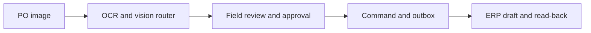

# SME AIOS · Wholesale order intake

A working prototype for wholesale purchase-order intake. Upload a purchase-order image, examine field-level evidence, review exceptions, approve a sales-order draft, and verify it in the mock ERP. The inbox preserves the document, reviewed preview, and command so the workflow can resume after refresh or restart.

## Backend platform

The reusable logistics and wholesale backend lives in `aios_platform/`. It shares typed actions,
tenant policy, independent approval and ERP verification across two sample tenants. The PO workbench
below remains available as a standalone demo.

```bash
python -m pip install -r requirements-platform.txt
python scripts/platform_smoke.py
```

Read the [backend architecture and ERP bridge contract](docs/platform.md) for tenant configuration,
Linux and PostgreSQL isolation, API usage, LLM options and the customer onboarding checklist.


## A two-minute demo

1. Open **Standard PO**. Select **Line 1 · Quantity** to highlight the OCR bounding box. The approved catalogue maps **2 cases → 48 units**. Line totals reconcile to **HKD 804**.
2. Switch to **Quantity conflict**. Tesseract reads **2** and scripted Vision A reads **8**. The second scripted reader reads **2**, and the field still goes to review. Enter **8** to see the amount check reject it, then enter **2**.
3. Select **Approve and queue**, keeping **Simulate a lost reply** enabled. The first worker step writes the mock ERP draft and loses the reply. The second performs a separate read-back. The ledger shows **one** matching ERP draft and the verified approved payload.
4. Refresh to reopen the verified order. Then upload `fixtures/harbour-po.png` with vision unchecked. The inbox shows the uploaded PO and its separate preview. A readable, consistent order makes zero vision requests.

| Exception review | ERP reconciliation |
|---|---|
| [View browser screenshot](docs/browser/02-quantity-review.png) | [View browser screenshot](docs/browser/03-erp-reconciliation.png) |

The upload and inbox screen was captured from the [verified browser run](https://github.com/Doooo4love/sme-aios-demo/actions/runs/44757111231). The two linked images show the original review and reconciliation walkthrough. See the [demo guide](docs/demo.md) for the operator script.

## Run locally

Use Python 3.11+ and Tesseract with English trained data. On Debian/Ubuntu install `tesseract-ocr` and `tesseract-ocr-eng`. On macOS install `tesseract` with Homebrew.

```bash
python -m venv .venv
source .venv/bin/activate
python -m pip install -r requirements.txt
python -m uvicorn aios_demo.api:app --host 127.0.0.1 --port 8758
```

Open **http://127.0.0.1:8758**. No provider keys are needed. For a repeatable demo use a fresh `AIOS_STATE_DIR`; approval of the same business key in an existing database resolves to the original command. The UI advances the asynchronous worker one step at a time for the presentation. In normal local runs you can start a separate worker with `python -m aios_demo.worker` using the same state directory and optional PostgreSQL DSN.

```bash
python scripts/run_demo.py
python -m pip install -r requirements-test.txt
python -m unittest discover -s tests -v
```

## Intake contract

```bash
python -m aios_demo.extract_po fixtures/harbour-po.png --mode ocr
```

The CLI returns JSON with the original file hash, image dimensions, field values, OCR regions, review reason codes, vision call count, and an optional ERP draft. Use `--mode vision-on-demand` with the configured provider to compare the same input with targeted visual review. Both modes use the same amount and pack-size rules. The CLI stops at the draft preview.

The workbench accepts PNG/JPEG up to 8 MB and eight megapixels. It stores a normalized PNG so displayed coordinates match the extracted evidence. The initial parser and catalog match the demo buyer and supported PO layout. A different layout stays in review. Configured vision receives only an anchored crop and the field type, and is opt-in per upload.

## Core implementation

| Piece | What is implemented |
|---|---|
| [Parser](aios_demo/parsing.py) | Tesseract TSV → typed fields, document completeness checks, pixel coordinates, OCR scores |
| [Multimodal routing](aios_demo/routing.py) | Evidence anchors, deterministic business checks, targeted and bounded visual reads, and human review |
| [Command and outbox](aios_demo/storage.py) | Saved intake and preview, exact-payload approval, idempotent same-PO handling, transactional job creation, PostgreSQL `SKIP LOCKED`, leases and epoch fencing, bounded read retries |
| [Outbox consumer](aios_demo/worker.py) | Persists dispatch intent, crosses a separate database boundary, handles lost replies, and verifies business key, draft status and full payload |
| [API and workbench](aios_demo/api.py) | Upload, recent-intake inbox, persisted evidence and preview, approval and read-back state |
| [Tests](tests/) | Real OCR, conflict gating, concurrent duplicate approvals, stale lease, unknown outcomes and end-to-end API |



## Scope

This is a single-tenant pitch prototype with synthetic documents, a fixed local reviewer, and a mock ERP backed by a separate database file. The predefined pitch scenarios use **scripted vision fixtures** by default. New uploads use local OCR by default, and the default command store is SQLite. A PostgreSQL path and an opt-in HTTPS vision adapter are included. Real ERP connectors, identity and role enforcement, and automatic production writes remain integration work. The app is intended for loopback use. See [implementation notes](docs/demo.md#implementation-boundaries) before adapting it to a customer environment.
