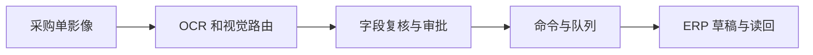

# SME AIOS · 批发订单接入

[English](README.md) · [受控 AI 预审与部署交接](docs/governed-assurance.zh-CN.md)

上传采购单、检查字段证据、处理异常、审批销售订单草稿，然后在本地 ERP 沙盒核对写入。收件箱保存原单、已复核预览和命令。刷新或重启后可继续处理。

## 后端平台

`aios_platform/` 为物流和批发共用后端，包含类型化动作、租户策略、独立审批及 ERP 核对。两个合成租户使用不同主数据。下方采购单工作台可独立运行。

```bash
python -m pip install -r requirements-platform.txt
python scripts/platform_smoke.py
```

[后端架构及 ERP 合同](docs/platform.md)涵盖租户配置、Linux 和 PostgreSQL 隔离、API、模型与客户接入。[生产加固指南](docs/production-readiness.md)涵盖迁移、操作控制和上线条件。[试点自动化指南](docs/pilot-automation.zh-CN.md)说明批量接单、审批、异常处理和可复现的效率测试。

[企业工作台与前端交接](docs/workbench-handoff.zh-CN.md)包含岗位工具、员工聊天及生产接入边界。


## 两分钟演示

1. 打开 **Standard PO**，点选 **Line 1 · Quantity** 查看 OCR 框。目录将 2 箱转换成 48 件，采购单总额核对为 HKD 804。
2. 切换 **Quantity conflict**。Tesseract 读取 2，脚本模拟的视觉模型 A 读出 8，模型 B 读出 2。系统继续要求复核。输入 8 会触发行金额错误，改为 2 后通过。
3. 点 **Approve and queue**，保持 **Simulate a lost reply** 勾选。Worker 第一步写入沙盒后模拟丢回复，第二步单独读回。账本显示只有一份匹配草稿。
4. 刷新页面重新查看已核对的单据，再上传 `fixtures/harbour-po.png`。清晰且一致的样张走本地 OCR，视觉模型调用数为零。

| 异常复核 | ERP 写后核对 |
|---|---|
| [浏览器截图](docs/browser/02-quantity-review.png) | [浏览器截图](docs/browser/03-erp-reconciliation.png) |

收件箱截图来自 [CI 浏览器实跑](https://github.com/Doooo4love/sme-aios-demo/actions/runs/44757111231)。[演示手册](docs/demo.zh-CN.md)提供讲解步骤。

## 本地运行

使用 Python 3.11+ 和 Tesseract 英文数据。Debian／Ubuntu 可安装 `tesseract-ocr` 与 `tesseract-ocr-eng`，macOS 可通过 Homebrew 安装 `tesseract`。

```bash
python -m venv .venv
source .venv/bin/activate
python -m pip install -r requirements.txt
python -m uvicorn aios_demo.api:app --host 127.0.0.1 --port 8758
```

打开 **http://127.0.0.1:8758**。默认无需模型密钥。用新的 `AIOS_STATE_DIR` 可重复演示，同一个业务键在原库中会返回已有命令。演示工作台可以逐步推进 Worker。独立运行时，API 和 `python -m aios_demo.worker` 使用同一状态目录及可选 PostgreSQL DSN。

```bash
python scripts/run_demo.py
python -m pip install -r requirements-test.txt
python -m unittest discover -s tests -v
```

## 接单合同

```bash
python -m aios_demo.extract_po fixtures/harbour-po.png --mode ocr
```

CLI 返回 JSON，包含原文件哈希、尺寸、字段值、OCR 区域、复核原因、模型调用次数和可选草稿。配置服务商后可用 `--mode vision-on-demand` 检查争议字段。两种模式复用金额与箱件规则，CLI 输出止于草稿预览。

工作台接受不超过 8 MB、800 万像素的 PNG／JPEG，并存储标准化 PNG 以保持坐标一致。当前解析和目录按演示买方和单据版式配置，未知版式进入复核。启用视觉模型时，每次仅发送定位后的裁剪和字段类型。

## 核心实现

| 模块 | 已实现能力 |
|---|---|
| [解析器](aios_demo/parsing.py) | Tesseract TSV 转成类型化字段、完整性检查、像素位置、评分 |
| [多模态路由](aios_demo/routing.py) | 证据定位、业务规则、定向和限额视觉读取、人工复核 |
| [命令与 outbox](aios_demo/storage.py) | 保存输入和预览、摘要审批、幂等、事务入队、PostgreSQL `SKIP LOCKED`、租约、epoch 和有限读回 |
| [消费者](aios_demo/worker.py) | 持久化派发步骤、跨独立数据库写入、丢回复恢复、校验草稿状态和完整内容 |
| [API 与工作台](aios_demo/api.py) | 上传、收件箱、存储证据和预览、审批和回执状态 |
| [测试](tests/) | 本地 OCR、冲突门禁、并发重复审批、过期租约、未知结果和端到端 API |



## 适用范围

工作台采用合成单据、固定本地审核人和独立 ERP 沙盒库，预设场景默认使用脚本模拟视觉模型。新上传默认本地 OCR，命令库默认 SQLite，可选 PostgreSQL 和 HTTPS 视觉接口。后端平台另有权限控制及 ERP bridge 客户端。客户 ERP 事务、身份对接和写入验收属于试点集成。[实现边界](docs/demo.zh-CN.md#实现边界)

员工级工作台模块、Agent 越权处理与上线步骤见[工作台后端与授权](docs/workbench-backend.zh-CN.md)。
