# Theodic SME AIOS · 企业运营级 AI 操作系统

[English](README.md) · [在线演示](https://aios-demo.hk-demo.workers.dev) · [受控 AI 预审与部署交接](docs/governed-assurance.zh-CN.md) · [后端架构及 ERP 合同](docs/platform.md) · [生产加固指南](docs/production-readiness.md) · [企业工作台与前端交接](docs/workbench-handoff.zh-CN.md) · [桌面端架构](desktop/README.md) · [企业级评测脚本](scripts/enterprise_eval.py)

**Theodic SME AIOS** 是面向批发贸易、跨境物流与多仓中小企业的**零迁移企业运营级 AI 操作系统**。它在企业现有 **ERP、WMS/TMS、财务系统、日程会议、企业邮箱与即时通讯** 之上构建统一的多端受控工作台——通过确定性多仓 RBAC、密封 `SOUL.md` 治理、摘要锁人工审批、事务 Outbox 写后核对、纯 `httpx + pydantic` 无第三方包装 SDK 的跨厂商智能路由（**零 `litellm` 依赖**）、KV 缓存最优每用户 `MEMORY.md` 以及零本地模型密钥的 Tauri 2 桌面沙盒，在不暴露原始凭据、不改造核心业务库的前提下实现可审计、可撤权、可急停的企业级 AI 运营闭环。

---

## 高管架构概览与实测评分卡（Measured Enterprise Scorecard）

安全防线、KV 前缀字节不变性、FinOps 成本压缩、SQLite WAL 高并发、跨厂商故障转移、SSE 断线重放与 P0/P1 企业控制面均已通过零外部 API 密钥的确定性评测引擎 [`scripts/enterprise_eval.py`](scripts/enterprise_eval.py) 与全量自动化测试套件完成实测验证：

- **企业就绪度评测（[`scripts/enterprise_eval.py --json`](scripts/enterprise_eval.py)）**：**`7 / 7` 核心门禁全数通过**，耗时 `0.908s`（`zero_api_keys_required: true`，`litellm_absent: true`）。
- **全栈自动化验证套件与扩展 CI 矩阵（[`.github/workflows/demo.yml`](.github/workflows/demo.yml)）**：Python 后端 **`192` 项测试**（`unittest discover -s tests`：`187` 通过、`5` 项需真实 Postgres DSN / 可选套件跳过、`0` 失败）；PostgreSQL 16 强制 RLS 角色核验（`test_postgres_enterprise`）；`web/` 严格模式 `next typegen && tsc --noEmit && next build`（`0` TS 错误、`14/14` 静态页 / `31` 路由及 `26/26` Playwright 端到端回归）；`mcp/email-server` 编译通过；Cloudflare Worker 类型检查与 **`20/20`** 单元测试全通过。

| 评测门禁 / 工程域 | 实测指标（`scripts/enterprise_eval.py --json`） | 核心工程机制与源码路径 |
|---|---|---|
| **1. 安全护栏、密封 `SOUL.md` 与防记忆投毒** | **`100%` 拦截召回率（`44 / 44` 全阻断、`0` 漏报、`3` 项正常业务对照 `0` 误报）**；`403 SYSTEM_POLICY_IMMUTABLE`；投毒样本落库保持为空 | 覆盖 `27` 条对抗对话、`14` 条 `MEMORY.md` 投毒载荷与 `3` 条输出泄露探针（[`security_guard.py`](aios_platform/security_guard.py)、[`governance.py`](aios_platform/governance.py)、[`user_memory.py`](aios_platform/user_memory.py)） |
| **2. KV 缓存 `Zone 1` 字节不变性** | **`100%` 前缀与工具 Schema 字节一致（`72 / 72` 次组装、`0` 次失配）**，跨 `2` 租户、`6` 主体、`4` 角色及动态切换 `MEMORY.md`（`Zone 1.2`）与 `ActiveDocumentRef`（`Zone 1.5`） | 密封 `SOUL.md` 与字典序 `zone1_tool_schemas` 严格锁定在 `Zone 1`，隔离于 `Zone 1.2` XML 围栏与 `Zone 1.5` 之前（[`ContextManager`](aios_platform/routing_context.py)） |
| **3. FinOps 成本与 Token 压缩** | **L1 响应缓存**：`24.277 ms -> 0.488 ms`（**提速 `49.75x`**、**边际美元降本 `100.0%`**、省 `6,720` tokens）；**工具结果紧凑化**：`25,487 -> 3,740` 字符（**缩减 `85.33%` 字符 / `85.31%` Token**）；**80% 软预算降档**：`0.85` 利用率单次 SQL 触发 `T3 (8,192 tok) -> T1 (1,200 tok)`（`0` 热路径 DDL）；**Anthropic 防惩罚**：`< 3,600` 字符跳过 `cache_control` | [`BoundedResponseCache`](aios_platform/response_cache.py)、[`compact_tool_observation`](aios_platform/response_cache.py)、[`QuotaManager`](aios_platform/routing_context.py) 与 [`AnthropicAdapter`](aios_platform/llm_provider.py) |
| **4. 跨厂商故障转移与熔断恢复** | 自动完成 `deepseek -> openai` 无缝切换（`3` 次主路径 + `3` 次备路径 HTTP）；准确记录 `open` 短路 -> `half_open` 探测 -> `closed` 恢复 | 纯 `httpx + pydantic` [`LLMProvider`](aios_platform/llm_provider.py)（默认 `deepseek-flash` / `deepseek-v4-pro` 升级）与 [`ProviderCircuitBreaker`](aios_platform/llm_provider.py)（零 `litellm`） |
| **5. 16 线程 SQLite WAL 并发压测** | `sqlite-wal-pooled`（`wal` 模式）：**`480` 次并发操作**（`16` 线程 `240` 写 + `240` 读），**`0` 次 `SQLITE_BUSY` 报错**，**`P50 = 0.041 ms`**、**`P95 = 2.338 ms`**、吞吐 **`6,620.3 ops/sec`** | 线程局部连接池 + `(st_dev, st_ino)` 失效重连 + PostgreSQL `psycopg_pool`（[`aios_demo/storage.py`](aios_demo/storage.py)） |
| **6. 可观测性、请求体封顶与 SSE 重放** | `/v1/workbench/turns` 放行 `180,000 B` 大文档负载（`2 MiB` 上限）并拦截超限（`413`）；其余接口强制 `65,536 B` 上限（`/v1/memory`、`/v1/actions`、`/v1/tasks` 均返回 `413`）；透传 `X-Request-Id` 与 `traceparent`；`Last-Event-ID` 精确重放漏帧 | [`RequestEnvelope`](aios_platform/observability.py)、[`EventHub.since_event`](aios_platform/events.py) 与 [`events_stream`](aios_platform/workbench.py) |
| **7. P0/P1 企业级并发与隔离控制** | **并发定点 `micro-USD` 封顶**：`8` 线程并发抢占 `$0.010`（`10,000` `micro-USD`）上限 -> `2` 放行 / `6` 拒批（实际结算 `8,000 <= 10,000`）；**Reserve-First 外部 Outbox**：拦截并发冲突 `409`、重放 `SUCCEEDED` 缓存并阻断 `UNKNOWN` 盲目重试；**厂商/驻留策略**：`PROVIDER_POLICY_DENIED` 阻断越权区域备选（`0` 次外呼）；**跨进程 SSE 重放与吊销**：双 Hub 共享 DB 重放 + 吊销实时发送 `session_revoked` 关流；**永久记忆擦除**：清空 `previous_content` 与 `0` 条暂存残留 | [`QuotaManager.reserve_budget`](aios_platform/routing_context.py)、[`GovernanceService.reserve_external_action`](aios_platform/governance.py)、[`TenantProviderPolicyStore`](aios_platform/routing_context.py)、[`EventHub.bind_workflow`](aios_platform/events.py) 与 [`UserMemoryStore.clear(..., permanent=True)`](aios_platform/user_memory.py) |

---

## 在线交互演示与界面实景

立即体验已上线部署的企业演示入口：**[https://aios-demo.hk-demo.workers.dev](https://aios-demo.hk-demo.workers.dev)**

- **边缘安全与 Cloudflare Workers VPC 门禁（[`deploy/cloudflare-worker/`](deploy/cloudflare-worker/)）**：后端全量端口严格仅监听回环地址（`127.0.0.1:3000`、`:8760`、`:8761`），通过 Cloudflare Named Tunnel（`deploy/integrai/`）与 **Cloudflare Workers VPC** 对外提供受控访问；边缘 HMAC **Reviewer Gate**（[`src/reviewer-gate.ts`](deploy/cloudflare-worker/src/reviewer-gate.ts)）强制注入 `X-Robots-Tag: noindex, nofollow, noarchive`、IP 滑动窗口模型限流（`8 次/分`、`40 次/时`）、变更限流（`30 次/分`）及 Judge 沙盒管理写操作拦截（`403 JUDGE_SANDBOX_PROTECTED`）。
- **23 张端到端实测界面截图**：完整覆盖桌面端（`1440×900`）与移动端（`390×844`）、简体中文 / 香港繁体 / 英文三语、Warm Museum Alabaster（`#FAF8F5`）浅色与 Warm Carbon Obsidian（`#111110`）深色主题（存放于 [`web/e2e/screenshots/`](web/e2e/screenshots/)）。

| Warm Porcelain 3D 登录舞台 | 原生双栏会话与联系上下文 | 摘要锁审批前后差异视图 |
|---|---|---|
| 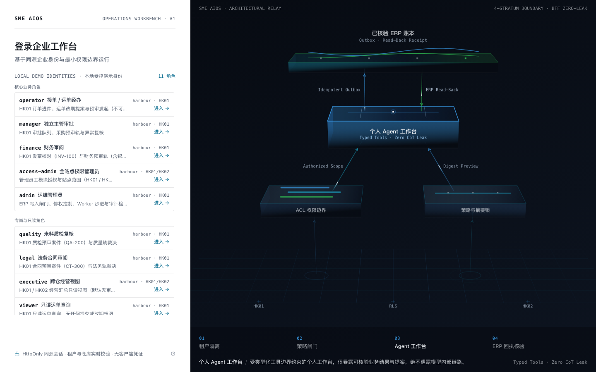 | 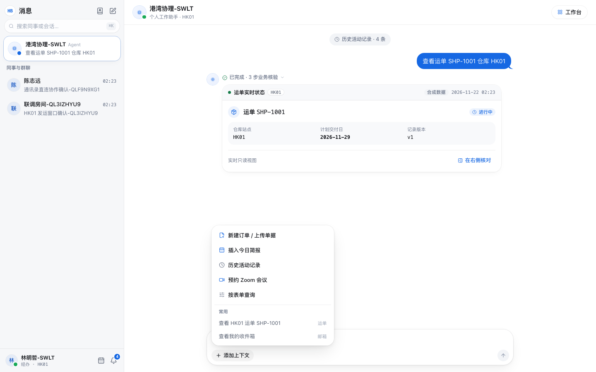 | 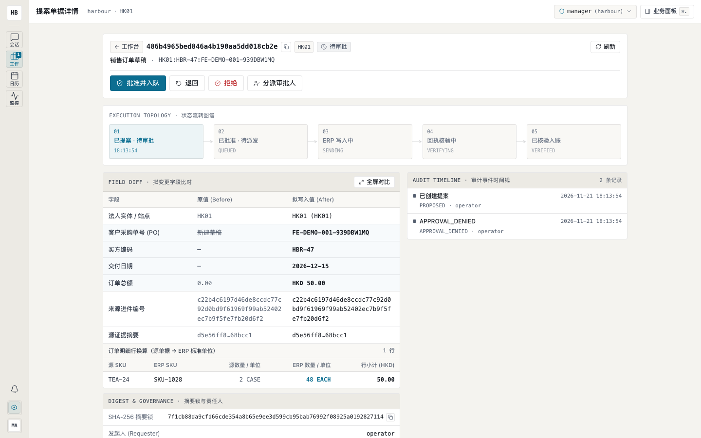 |

| 运维控制台与安全/路由遥测 | Warm Carbon Obsidian 深色 (`zh-HK`) | 服务端 MCP 日历与自然语言 Zoom 订会 |
|---|---|---|
| 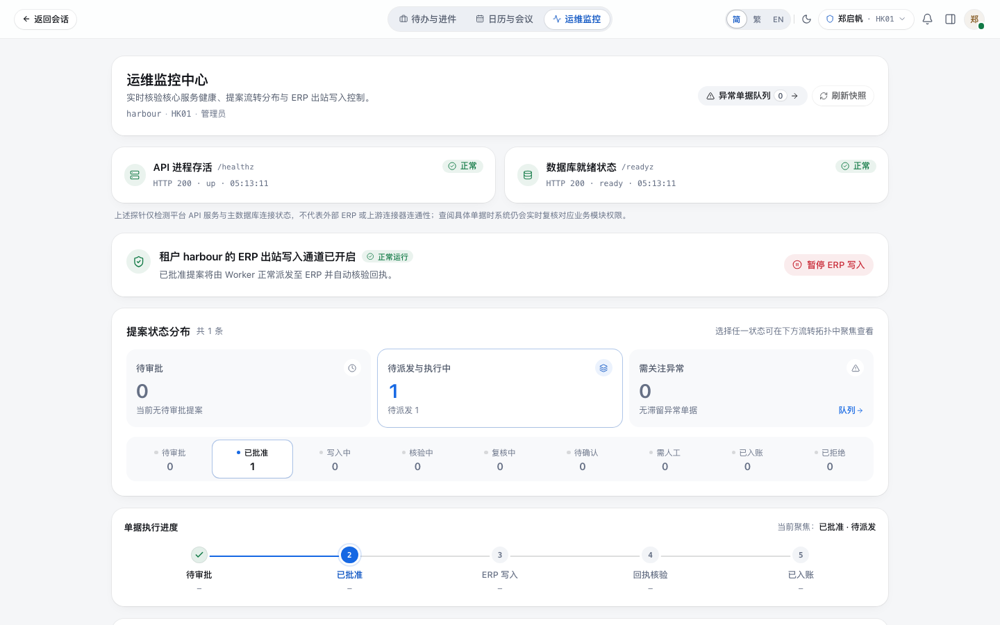 | 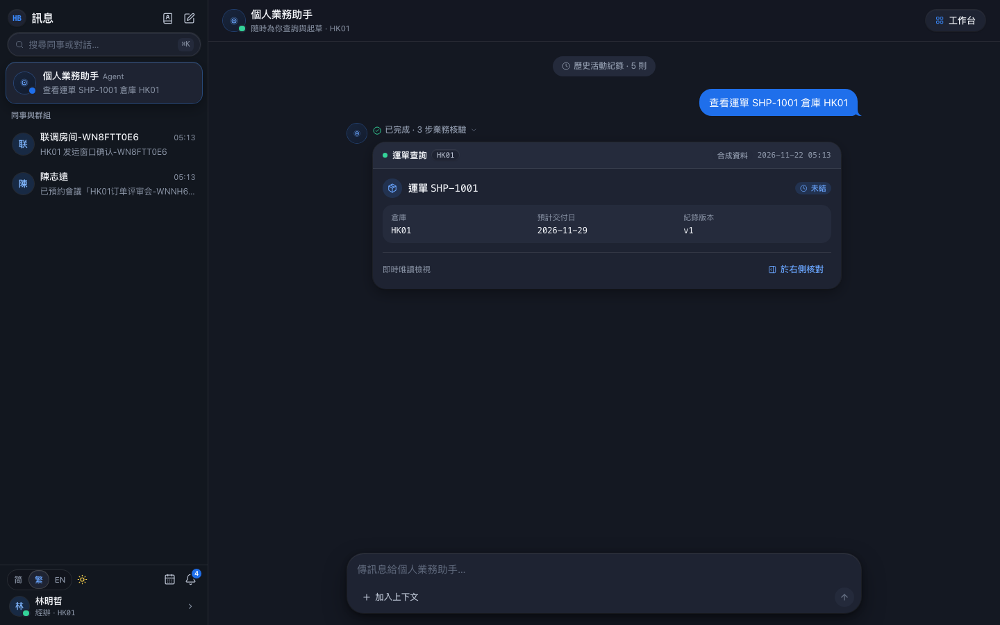 | 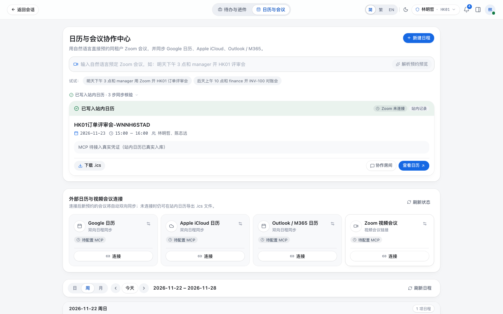 |

---

## 渐进式交付阶梯（`Tier 0 -> Tier 1 -> Tier 2 -> Tier 3`）

企业可按信息化与组织治理成熟度分阶段平滑接入，核心 ERP/WMS 数据库零改动：

| 阶梯 | 交付形态 | 技术栈与核心模块 | 商业价值与工程能力 |
|---|---|---|---|
| **Tier 0** | **OCR 采购单接单起点** | [`aios_demo/`](aios_demo/) · 本地 Tesseract OCR + 按需裁剪视觉复核 + SQLite/PostgreSQL Outbox | 低门槛快速见效：用像素级 OCR 证据框、确定性箱件与金额规则、以及丢回复可恢复的 ERP 写后核对取代手工录单（`http://127.0.0.1:8758`）。 |
| **Tier 1** | **企业团队协作工作台** | [`web/`](web/) + [`aios_platform/`](aios_platform/)（`workflow.py`、`module_access.py`、`chat.py`、`channels.py`） | 多租户多仓 RBAC、原生 macOS iMessage/WhatsApp 双栏协作（含实时已送达/已读回执）、8 渠道企业 IM 中枢、`/` 斜杠技能指令与摘要锁人工审批。 |
| **Tier 2** | **智能路由与个人长期记忆 AIOS** | [`routing_context.py`](aios_platform/routing_context.py)、[`response_cache.py`](aios_platform/response_cache.py)、[`user_memory.py`](aios_platform/user_memory.py)、[`memory_tidy.py`](aios_platform/memory_tidy.py) | `<2ms` `EffortRouter`（`T0–T3`、默认 `deepseek-flash` / `deepseek-v4-pro` 升级）、4 区 KV 缓存（`Zone 1` 不变前缀）、`L1` 预算前命中、原子 `micro-USD` `QuotaManager` + `80%` 软预算降档、`TenantProviderPolicyStore`、每用户 `MEMORY.md`（`Zone 1.2`）+ 可撤回/`permanent=true` 永久擦除 + 4 层防投毒、L1/L2/L3 越界升级与 `aios-memory-tidy.timer`。 |
| **Tier 3** | **全跨厂商云端/桌面企业版** | [`llm_provider.py`](aios_platform/llm_provider.py)、[`http_pool.py`](aios_platform/http_pool.py)、[`observability.py`](aios_platform/observability.py)、[`assurance.py`](aios_platform/assurance.py)、[`desktop/`](desktop/)、[`mcp/`](mcp/) | 纯 `httpx + pydantic` 多厂商适配器与熔断自动故障转移、`0013_enterprise_hardening` 全 40 表 PostgreSQL 强制 RLS（`aios_api`/`aios_worker`）+ `database_security_status` 漂移探针、Reserve-First 邮件/Zoom 外部 Outbox（`aios_external_action_outbox`）、跨进程持久 `EventHub`（`aios_durable_event` + `pg_notify`）+ 15s `session_revoked` 实时关流、OTel GenAI 与 Prometheus `/metrics`、Ed25519 受控预审（`:8761`）、独立 Email MCP 与零本地模型密钥 Tauri 2 桌面沙盒 CUA。 |

---

## 受控 Agent 工作台工具、工作边界与 Office/PDF 文档套件

除 ERP 审批流外，助理工作台还提供确定性内置工具、逐员工授权的企业工具集与独立子进程 Office/PDF 解析及工作报告导出——全部位于模型与外部工具调用前的工作边界护栏之下，并共用统一工具目录校验（[Agent 工具与权限指南](docs/harness-tools.zh-CN.md) · [Office／PDF 文档与工作报告](docs/office-documents-and-reports.zh-CN.md)）。

### 1. 模型前工作边界护栏与本地回归基准

Access Admin 使用与其他角色一致的私人闲聊策略。后端会在调用模型或外部工具前检查明确的私人意图、企业用途与最近一条用户消息中的承接线索：日常寒暄与门店采购 PS5 等工作请求放行，私人购物、旅游、影视娱乐、健身等非工作请求进入现有 L1/L2/L3 提醒与升级流程；客户端提交的历史仅辅助识别追问，不能用于工具授权或清除显式策略拒绝。

| 本地回归指标（[`work_boundary_eval.tsv`](fixtures/work_boundary_eval.tsv)） | 实测结果（Python 3.12.14） |
|---|---:|
| 总体准确率 | **99.25%**（`133 / 134`） |
| 非工作内容召回率 | **98.57%**（`69 / 70`） |
| 工作请求与寒暄误拦率 | **本次观测 0%**（`0 / 64`） |
| 分类器并发压测 | **20,000** 次判定、**16** 线程、**0** 次结果漂移、**p95 0.138 ms**、约 **9,595 次/秒** |

[合成测试集](fixtures/work_boundary_eval.tsv)覆盖简体中文、繁体中文及粤语、英语、四种角色层级与多轮追问（漏判的是一条缺少企业用途说明的英文足球赛果提问）。因测试用例随规则同步开发，线上流量的准确率、端到端吞吐与真实检索延迟仍需独立度量。本地复现命令见 [`scripts/work_boundary_eval.py`](scripts/work_boundary_eval.py)。

### 2. 内置实用工具与逐员工个人权限（`agent-web` / `agent-collaboration` / `agent-knowledge` / `agent-documents`）

工具描述、参数校验与执行共用同一套目录，在读取企业数据前与回包前双重鉴权。显式模块配置优先于经验证的 OIDC `aios_grants` 基线；撤销权限后保留空授权而非回退到身份默认权限；仓库权限与已验证身份仓库取交集。员工个人授权仅作用于该员工的 Agent，人工日历与提案界面仍沿用原有访问规则；新增工具卡内容不自动注入后续模型上下文，活动记录仅保留哈希与状态。

| 模块 / 作用域 | 权限键与命令入口 | 能力、限额与安全边界 |
|---|---|---|
| **内置基础工具**（登录即可使用） | `/calc` · `/time` · `/find` · `/csv` | 进程内 38 位精度 `Decimal` 计算（`/calc`）与带时区偏移量的 IANA 时区换算（`/time`）。`/find` 与 `/csv` 接受最高 `256 KB` UTF-8 TXT/Markdown/CSV/TSV（仅随指令发往自有后端）；`/find` 最多返回 `5` 条带行号摘录，`/csv` 校验行/列/缺失值（上限 `64` 列、`10,000` 数据行）。 |
| **`agent-web`**（`scope="personal"`） | `agent.web_search` · `/web <检索词>` | **公开网页搜索**：通过工作边界、租户供应商策略及共享速率/FinOps 配额校验后，仅向 [DeepSeek Search API](https://api-docs.deepseek.com/api/search/) 发送限长检索词（剥离附件、会话历史与敏感模式），返回链接与摘要且不自动写入后续模型上下文；上游繁忙或失败时返回状态且不自动重试（传输测试使用模拟响应）。默认关闭（需配置 `AIOS_WEB_SEARCH_TENANTS` 与 `AIOS_WEB_SEARCH_API_KEY` / `AIOS_WEB_SEARCH_API_KEY_FILE`；演示授权归属 `harbour/access-admin`），上线前应设企业预算并完成预发布冒烟。 |
| **`agent-collaboration`**（`scope="personal"`） | `agent.calendar_read` · `agent.tasks_read` · `/agenda` · `/submitted` | **本人日历与已提交提案**：`/agenda 2026-11-25` 按香港时间查询本人参与的内部日程；`/submitted 5` 按提交人及既有提案范围查询本人已提交提案。 |
| **`agent-knowledge`**（仓库级作用域） | `agent.knowledge_read` · `/knowledge <仓库> <检索词>` | **内部知识检索**：返回已授权仓库的 `source_id`、`title`、`section` 与 `excerpt`（演示内置 `HK01`/`HK02` 合成 SOP）。生产环境需在已固定的 `WorkspaceSource` 上启用 `AIOS_WORKSPACE_KNOWLEDGE=1` 并实现 `POST /workspace/knowledge-search`（请求仅含 `tenant`、`subject`、`warehouse`、`query`、`limit`），客户索引需在排序前按调用人、仓库与文档 ACL 过滤，AIOS 返回前再校范围并在查询在途撤权时丢弃结果。 |
| **`agent-documents`**（`scope="personal"`） | `agent.documents_parse` · `agent.report_export` · `/find` · `/report` | **Office/PDF 子进程解析与工作报告导出**：解析与导出可逐员工独立授权并设到期时间；导出仓库汇总需同时具备对应仓库的经营汇总读取权限。详见下文。 |

### 3. Office/PDF 子进程提取与工作报告导出（`PDF` / `DOCX` / `XLSX` / `CSV`）

- **沙盒化 Office/PDF 提取（`agent.documents_parse`）**：支持 `PDF`、`DOCX`、`XLSX`、`PPTX`，单文件上限 **5 MB**、提取文本上限 **120,000** 字符、PDF/幻灯片上限 **60** 页；`/find` 命中附带页码、段落、幻灯片或工作表行号。PDF 优先直读文本层，纯图页通过 `pypdfium2` + `Tesseract` 本地 OCR 回退（每次最多 **5** 页，`AIOS_DOCUMENT_OCR_LANGUAGES=eng+chi_sim+chi_tra`；当前回归已覆盖英文扫描页，中英混排需结合客户样本验收）。OOXML 校验压缩项数量、解压上限、文件类型、宏与嵌入对象。解析运行在独立子进程中，配合净化环境变量、临时目录、资源限制与 **17 秒** 超时（生产高频接收外部文件时应进一步隔离解析进程的操作系统账号、文件系统与网络）；原文件、提取正文与报告二进制均不落库，权限审计仅记录事件与格式。
- **结构化工作报告导出（`agent.report_export`）**：`/report mine <格式>` 按香港当天统计个人日程、待审批与已提交提案；`/report <仓库> <格式>` 提取已授权仓库的未结运单与快照日期。支持 **`PDF`**、**`DOCX`**、**`XLSX`**（保留数值单元格类型）与 **`CSV`**（带 UTF-8 BOM）。`PDF` 通过 `fpdf2` 嵌入中文字体子集（默认查找 `fonts-noto-cjk`，可通过 `AIOS_REPORT_FONT` 与 `AIOS_REPORT_FONT_INDEX` 指定；若缺失字体，其余三种格式仍可正常导出）。
- **启用方式**：默认关闭且无需数据库迁移。在工作台 API 虚拟环境安装 `requirements-platform-documents.txt`，设置 `AIOS_DOCUMENT_TOOLS_ENABLED=1` 并核实真实仓库数据源配置即可。

---

## 全栈统一架构视图

### 1. 云端控制面、高可用连接池与 Tauri 2 / 本地 MCP 端到端拓扑

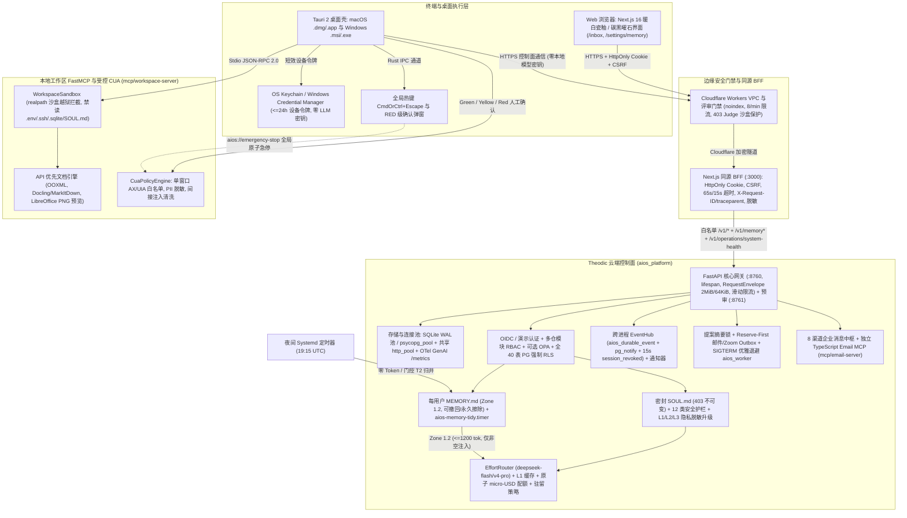

### 2. FinOps 成本治理、4 区 KV 提示词缓存与多厂商故障转移流水线

```mermaid
flowchart LR
    TURN["员工回合 + 每用户 MEMORY.md + 挂载文档 + 工作脉冲"] --> ROUTER["EffortRouter (<2ms 确定性路由分类器)"]
    ROUTER -->|"T0: 安全拦截 / /memory / 记住与忘掉 / L1 提醒"| ZERO["0 次模型调用 -> 即时响应与 T0 暂存"]
    ROUTER -->|"T1 / T2 / T3"| L1["L1 BoundedResponseCache (在 Planner 与预算扣减之前校验)"]
    L1 -->|"命中 (0.49ms, 100% 美元降本)"| ZERO
    L1 -->|"未命中"| QUOTA["QuotaManager (原子 micro-USD 预占/结算 + 失败关闭封顶 + 80% 软降档)"]
    QUOTA --> POLICY["TenantProviderPolicyStore (厂商/区域/数据驻留/最高 Tier 门禁)"]
    POLICY --> CTX["ContextManager 4 区上下文组装"]

    subgraph ZONES ["KV 缓存最优 Zone 1 / 1.2 / 1.5 / 2 / 3 分区架构"]
        Z1["Zone 1 (~3K-5K 100% 字节不变前缀): 密封 SOUL.md + 策略 + 字典序 Schema + 边界规则"]
        Z12["Zone 1.2 (<=1200 tok / 6000 字符): 非空 MEMORY.md 包裹于非信任 XML 围栏"]
        Z15["Zone 1.5 (<=140K 且 <=safe_cap-38K): 单文档挂载槽 (卸载生成 <=2K 结构化摘要)"]
        Z2["Zone 2 (32K 轨迹桶): <=1500 tok 工具裁剪, >=28K->~7K 滞回压缩与 >60m 闲置压缩"]
        Z3["Zone 3 (瞬态尾部): 实时 pulse_summary 仅附着当次请求 (永不入库污染前缀)"]
    end

    CTX --> Z1 --> Z12 --> Z15 --> Z2 --> Z3
    Z15 -->|">140K 超大文档包"| MR["MapReduceDocumentAnalyzer (每租户 Semaphore(2): <=24K T1/T2 Map -> <=80K T3 Reduce)"]
    Z3 --> PROV["纯 httpx LLMProvider (deepseek-flash 1M/200K 峰谷定价 + deepseek-v4-pro 升级)"]
    MR --> PROV
    PROV -->|"主厂商报错或策略允许的备选"| CB["ProviderCircuitBreaker -> 有序备选厂商故障转移"]
    CB --> PROV
    PROV --> HARNESS["55s 回合总限期执行器 (MAX_HARNESS_STEPS=4) + compact_tool_observation"]
    HARNESS -->|"T1/T2 工具调用畸形触发级联升级"| CASCADE["Cascade Escalation -> T3 (effort=high)"]
    CASCADE --> PROV
    HARNESS -->|"最终回复 / HITL 审批提案"| TELEM["SQL GROUP BY RoutingTelemetryStore (P50/P95, 缓存节省) + OTel GenAI /metrics"]
```

### 3. 安全治理、密封 `SOUL.md`、L1/L2/L3 隐私分级升级与 Outbox 写后核对闭环

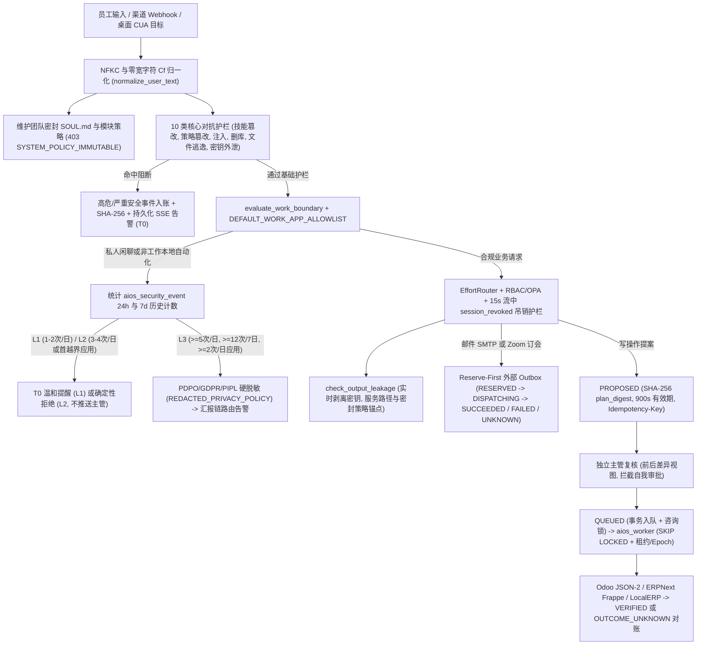

---

## 六大核心工程支柱

### 支柱一：安全治理、多仓 RBAC、密封 `SOUL.md` 与人机协同审批（HITL）

- **密封不可变 `SOUL.md`（[`aios_platform/governance.py`](aios_platform/governance.py)、[`aios_platform/SOUL.md`](aios_platform/SOUL.md)）**：系统人格与角色/模块策略仅从维护团队密封的 `SOUL.md` 与服务端 `PromptScopeSpec` 加载，企业管理员与大模型均不可读写；`PUT /v1/operations/prompt-policies/{scope_key}` 与 `POST .../reset` 恒返回 `HTTP 403 SYSTEM_POLICY_IMMUTABLE`（`PolicyImmutableError`），配合 `check_output_leakage()` 在响应出口剥离密钥、服务路径与密封锚点。
- **多仓模块 RBAC、可选 OPA 与全 40 表 PostgreSQL 强制 RLS**：[`aios_platform/module_access.py`](aios_platform/module_access.py) 支持按模块/仓库动态赋权、咨询锁与乐观锁 `version` 校验（越权变更即时触发 `403 ACCESS_CHANGED`）；支持可选 OPA 策略网关（[`deploy/platform/opa.rego`](deploy/platform/opa.rego)、[`providers.py`](aios_platform/providers.py)）；[`migrations/env.py`](migrations/env.py) 在 PostgreSQL 16 下于 [`0013_enterprise_hardening`](migrations/versions/0013_enterprise_hardening.py) 迁移前自动将 `alembic_version.version_num` 扩宽至 `VARCHAR(64)`；[`deploy/platform/postgres-security.sql`](deploy/platform/postgres-security.sql) 对**全部 `40` 张租户表**（`EXPECTED_RLS_TABLES`）启用 `ENABLE` + `FORCE ROW LEVEL SECURITY`、严格仅追加 `aios_llm_telemetry`（`REVOKE UPDATE, DELETE, TRUNCATE`）及 `aios_api` / `aios_worker` 最小权限分离，并由 [`database_security.py`](aios_platform/database_security.py)（`verify_database` 与无异常漂移探针 `database_security_status()`，直通 `/v1/operations/system-health`）持续核验。
- **12 类确定性护栏与 L1/L2/L3 PDPO/GDPR/PIPL 升级（[`security_guard.py`](aios_platform/security_guard.py)、[`governance.py`](aios_platform/governance.py)）**：`normalize_user_text()` 先执行 NFKC 归一化与零宽字符 `Cf` 剥离，覆盖 10 类对抗安全事件（`SKILL_TAMPER_ATTEMPT`、`PROMPT_TAMPER_ATTEMPT`、`DESTRUCTIVE_ACTION_ATTEMPT`、`FILESYSTEM_ESCAPE_ATTEMPT`、`PROMPT_INJECTION_ATTEMPT`、`SECRET_EXFILTRATION_ATTEMPT`、`PRIVILEGE_ESCALATION_ATTEMPT`、`CROSS_SCOPE_ACCESS_ATTEMPT`、`UNAUTHORIZED_MODULE_QUERY`、`EMAIL_POLICY_VIOLATION`）及 2 类工作边界事件（`OFF_TOPIC_PERSONAL_CHAT`、`OFF_TOPIC_LOCAL_AUTOMATION`）。`evaluate_work_boundary()` 基于 `DEFAULT_WORK_APP_ALLOWLIST` 确保正常寒暄与业务查询零误报：**L1** 走 `T0` 温和提醒（`info`/`resolved`），**L2** 确定性拒绝（`medium`/`denied`，不上报），**L3**（`>=5次/日`、`>=12次/7日` 或 `>=2次/日` 本地自动化）按汇报链自动路由（`operator -> [manager]`、`manager/admin -> [executive, legal]`、`executive -> [legal]`，近 7 日存在高危安全异常则抄送 `access-admin` 与 `legal`）且强制写入 `preview = "[REDACTED_PRIVACY_POLICY]"`。
- **提案摘要锁、Reserve-First 外部 Outbox 与 Ed25519 受控预审（[`workflow.py`](aios_platform/workflow.py)、[`governance.py`](aios_platform/governance.py)、[`assurance.py`](aios_platform/assurance.py)）**：完整状态机（`PROPOSED -> QUEUED -> SENDING -> VERIFYING -> CHECKING -> VERIFIED` / `OUTCOME_UNKNOWN` / `NEEDS_OPERATOR` / `REJECTED`）、精确 SHA-256 `plan_digest`、禁止自我审批、PostgreSQL `SKIP LOCKED` + 租约/Epoch 栅栏（[`run_worker.py`](aios_platform/run_worker.py)）及 `LocalERP` / `OdooERP` / `ERPNext` 适配器（[`erp.py`](aios_platform/erp.py)）。**Reserve-First 外部动作 Outbox（`aios_external_action_outbox`）** 通过 [`GovernanceService.reserve_external_action`](aios_platform/governance.py) 与 `finalize_external_action`（`RESERVED`/`DISPATCHING`/`SUCCEEDED`/`FAILED`/`UNKNOWN`，载荷哈希冲突 `409`、在途租约冲突 `409`、`UNKNOWN` 阻塞盲目重试 `409` 及 `SUCCEEDED` 幂等回执重放）护航 [`email/send`](web/src/app/api/integrations/email/send/route.ts) SMTP 发信与 [`zoom/book`](web/src/app/api/integrations/zoom/book/route.ts) Zoom 订会，杜绝外部副作用重复触发。独立受控预审伴生服务（`:8761`，[`assurance_policy.py`](aios_platform/assurance_policy.py)、[`assurance_gateway.py`](aios_platform/assurance_gateway.py)、[`assurance_audit.py`](aios_platform/assurance_audit.py)、[`assurance_catalog.py`](aios_platform/assurance_catalog.py)）提供单元格白名单、16 KiB 边界网关、AES-256-GCM 密文审计链与 Ed25519 签名检查点。

### 支柱二：FinOps 成本优化与 4 区 KV 提示词缓存

- **纯 `httpx + pydantic` 跨厂商 `LLMProvider`（[`aios_platform/llm_provider.py`](aios_platform/llm_provider.py)）**：**零 `litellm` SDK 依赖**，彻底消除第三方模型包装库供应链风险，同时支持通过 `base_url` 对接兼容网关。已退役 `deepseek-chat`（标记 `deprecated=True`）由 **`deepseek-flash`**（`1M` 上下文、`200K` 阶梯阈值、2026 官方峰谷定价：工作日 `01:00–04:00` 与 `06:00–10:00` UTC 峰值 `$0.30/$0.006/$1.20`、非峰值半价 `$0.15/$0.003/$0.60`/百万 Token、`cn-hk`）作为 `DEFAULT_LLM_MODEL` 全面接棒，并内置 **`deepseek-v4-pro`**（`1M` 上下文、`200K` 阈值、峰值 `$1.32/$0.044/$3.96` / 谷值 `$0.66/$0.022/$1.98`、`AIOS_LLM_PRO_MODEL`）供 T3 升级，兼容 `gpt-5.4-mini`、`claude-sonnet-4-6`、`gemini-2.5-pro` 与 `qwen-plus`，支持 `AIOS_MODEL_PRICING_JSON` 动态覆写、`estimate_cost_micro_usd()`、`safe_cap_tokens = min(180_000, int(surcharge_cliff * 0.90), int(context_window * 0.60))`、`MAX_LLM_RESPONSE_BYTES = 524_288` 流式封顶、HTTP 400 自动剥离重试、多轮 `reasoning_content` / `thinking_blocks` 透传以及 `ProviderCircuitBreaker` 熔断器。
- **租户厂商 / 数据驻留策略（`aios_tenant_provider_policy`）**：[`TenantProviderPolicyStore`](aios_platform/routing_context.py)（`GET/PUT /v1/operations/provider-policy`）在主路径与备选故障转移链路同步校验 `allowed_providers`、`allowed_regions`、`blocked_data_classes`、`allow_failover` 与 `max_tier`，越权调用在发包前即失败关闭并拦截为 `HTTP 403 PROVIDER_POLICY_DENIED`。
- **`<2ms` `EffortRouter`、`55s` 回合总限期与级联升级（[`routing_context.py`](aios_platform/routing_context.py)、[`assistant_agent.py`](aios_platform/assistant_agent.py)）**：在 2 毫秒内将请求路由为 `T0`（0 次模型调用）、`T1`（`effort="none"`，`1,200` tokens / `15s`）、`T2`（`effort="low"`，`2,400` tokens / `22s`）或 `T3`（`effort="high"`，`8,192` tokens / `55s`），保持同模型前缀缓存温度，在 `T1/T2` 工具调用畸形时触发 **Cascade Escalation** 升级至 `T3`，并执行 `AIOS_TURN_DEADLINE_SECONDS=55` 回合总超时与每租户 `threading.Semaphore(2)` `MapReduce` 并发限流。
- **`L1` 预算前 `BoundedResponseCache` 与 `compact_tool_observation`（[`aios_platform/response_cache.py`](aios_platform/response_cache.py)）**：在安全护栏与工作边界放行后、**先于 Planner 与预算扣减执行校验**；按 `(tenant, subject, role, locale, memory_version, active_doc_sha, normalized_query_hash)` 隔离纯只读问答（实测提速 **`49.75x`**、边际美元节省 **`100%`**），并在 `/memory` 变更时调用 `invalidate_subject()` 精准失效。在 `MAX_HARNESS_STEPS = 4` 多步循环内，[`compact_tool_observation`](aios_platform/response_cache.py)（`max_chars=2400`）保留 `ESSENTIAL_BUSINESS_KEYS`，将冗长 JSON 稳定压缩 **`85.33%`** 字符（**`85.31%`** Token）。
- **原子定点 `micro-USD` 预算预占、失败关闭配额与 SQL `GROUP BY` 遥测**：`QuotaManager`（`aios_budget_reservation`）通过 SQLite `BEGIN IMMEDIATE` / PostgreSQL `pg_advisory_xact_lock` 实现原子 `reserve_budget` / `settle_budget` / `release_budget` 与**失败关闭（fail-closed）**配额封顶，同时保留 `>= 80%` `soft_cap_active` 自动降档（`T3 -> T1`，单次 SQL、`0` 热路径 DDL）；`RoutingTelemetryStore.summary()` 全量采用 SQL `SUM`/`COUNT`/`GROUP BY` 聚合。`AnthropicAdapter` 保持 `ANTHROPIC_PROMPT_CACHE_MIN_CHARS = 3600` 防护，`OpenAICompatAdapter` 为 OpenAI 自动注入确定性 `prompt_cache_key`。
- **4 区 KV 提示词缓存结构（`ContextManager` 与 `MapReduceDocumentAnalyzer`）**：
  1. **`Zone 1`（~3K–5K 全局字节不变前缀）**：仅包含密封 `SOUL.md`、模块策略、字典序 `zone1_tool_schemas` 与 1 句静态记忆边界说明——**全租户全员 100% 字节一致**。
  2. **`Zone 1.2`（`<= 1,200` Tokens）**：非空个人 `MEMORY.md` 包裹于 `<user_long_term_memory trust="user_editable_facts_only">` 紧随 `Zone 1` 注入（空文件零注入）。
  3. **`Zone 1.5`（`<= 140K` 且 `<= safe_cap - 38K`）**：单文档挂载槽，切换文档时自动卸载为 `<= 2,000` Token 结构化摘要；超 `140K` 文档包自动进入并发信号量限流的 `MapReduceDocumentAnalyzer`（`<= 24K` 并发 `T1/T2` Map 抽取 -> `<= 80K` `T3` Reduce 综合）。
  4. **`Zone 2`（`32K` 轨迹桶）与 `Zone 3`（瞬态尾部）**：工具结果入桶前裁剪至 `<= 1,500` Token，`>= 28,000` Token 滞回压缩至 `~7,000`，闲置 `> 60m` 自动压缩；实时 `pulse_summary` 仅作为 `Zone 3` 瞬态尾部附着当前请求。

### 支柱三：每用户可编辑长期记忆（`MEMORY.md`）与夜间自动整洁

- **文件优先的事务型 Markdown（[`aios_platform/user_memory.py`](aios_platform/user_memory.py)、[`user_memory.sql`](aios_platform/user_memory.sql)、迁移 [`0012_user_long_term_memory.py`](migrations/versions/0012_user_long_term_memory.py)）**：每位员工在 `(tenant, subject)` 维度拥有可读可编的 `MEMORY.md`（四节标准骨架，上限 `MAX_MEMORY_TOKENS = 1200`、`MAX_MEMORY_CHARS = 6000`）。
- **4 层防记忆投毒与权限越狱防线**：
  1. `NFKC` + 零宽字符 `Cf` 剥离 + `scrub_secrets()` 抹除密钥。
  2. 保存期确定性校验拦截 `SOUL.md` 覆盖、RBAC/仓库提权、`SKILL.md` 篡改、提示词边界注入标签及 Shell/文件系统逃逸（`HTTP 422 MEMORY_POLICY_VIOLATION` / `MEMORY_TOKEN_LIMIT_EXCEEDED`），所有门控 `T2` 整理结果亦需复检通过方可落库。
  3. `Zone 1.2` 非信任 XML 围栏隔离与 `Zone 1` 静态边界免疫。
  4. `(tenant, subject)` `subject_tx` / PostgreSQL 强制 RLS 行级隔离、`HTTP 409 Conflict` 乐观版本锁，以及默认的 `previous_content` 快照一键撤回（`POST /v1/memory/revert`）与可选 **`permanent=true` 永久擦除**（`DELETE /v1/memory?permanent=true` 与 `POST /v1/memory/forget` 传入 `permanent=true` 时直接清空 `previous_content = NULL`、硬删除 `aios_user_memory_staging` 待归并记录、失效 L1 缓存并记录仅含元数据的 `MEMORY_PURGED_PERMANENT` / `MEMORY_FORGET_PERMANENT` 审计日志）。
- **`T0` 零开销捕获、`/v1/memory*` 与夜间 `systemd` 定时任务**：支持 `/memory [view|add|forget|tidy]`、中英自然语言（`"记住..."`、`"忘掉..."`、`"remember that..."`）、`fact_sha256` 去重被动暂存、完整 `/v1/memory*` REST 接口（`GET/PUT/DELETE /v1/memory`、`POST /v1/memory/{tidy,revert,forget}`），以及加固版夜间定时器（[`aios-memory-tidy.service`](deploy/integrai/systemd/aios-memory-tidy.service) 与 [`aios-memory-tidy.timer`](deploy/integrai/systemd/aios-memory-tidy.timer)：每日 `19:15:00 UTC` / `03:15 HKT` 触发，`RandomizedDelaySec=120`、`Persistent=true`、`MemoryMax=256M`、`ProtectSystem=strict`）。

### 支柱四：生产级高可用、存储连接池与全链路可观测性

- **SQLite WAL 线程连接池与 PostgreSQL `psycopg_pool`（[`aios_demo/storage.py`](aios_demo/storage.py)、[`requirements-postgres.txt`](requirements-postgres.txt)）**：SQLite 采用线程局部连接池（`check_same_thread=False` + 弱引用注册表退出自动关闭）、按 `(resolved_path, inode)` 加锁一次性初始化 `WAL` / `SYNCHRONOUS=NORMAL` / `TEMP_STORE=MEMORY` / `cache_size=-16000`、`(st_dev, st_ino)` 失效文件句柄自动重连及 `:memory:` 豁免；PostgreSQL 路径启用懒加载 `psycopg_pool.ConnectionPool`（`min_size=1`、`max_size=16`、`timeout=5.0`），对外暴露 `engine_mode`（如 `sqlite-wal-pooled`、`postgres-pooled`）。
- **共享 `http_pool` 与进程优雅生命周期（[`aios_platform/http_pool.py`](aios_platform/http_pool.py)、[`api.py`](aios_platform/api.py)、[`run_worker.py`](aios_platform/run_worker.py)）**：`providers.py`、`browser.py`、`channels.py`、`governance.py` 复用 `get_http_client()`（`max_connections=32`、`max_keepalive_connections=16`、`keepalive_expiry=30.0`、`follow_redirects=False`、`trust_env=False`）。FastAPI `lifespan` 在退出时统一释放 `assistant_agent`、`close_all_http_clients()` 与数据库连接；`run_worker.py` 捕获 `SIGTERM`/`SIGINT` 并实施按租户隔离的 `0.5s -> 5.0s` 指数退避。
- **跨进程持久 `EventHub`（`aios_durable_event` + `pg_notify`）、`Last-Event-ID` 重放与 `15s` 流中吊销（[`events.py`](aios_platform/events.py)、[`workbench.py`](aios_platform/workbench.py)、[`ProactiveAgentNotifier.tsx`](web/src/components/shell/ProactiveAgentNotifier.tsx)）**：`EventHub.bind_workflow(workflow)` 将发布事件原子写入 `aios_durable_event`（租户维度顺序 `seq`）并在 PostgreSQL 上执行 `SELECT pg_notify('aios_events', ?)`，使 `since_event()` 与 `recent()` 在多 API 进程或重启后仍可无缝续传；`/v1/workbench/events/stream` 在回放前及每 `15s` 心跳周期内执行 `is_revoked()`（复核 `refresh_actor`、`workflow.is_suspended` 与 `app.state.browser_sessions`），一旦停权或注销即刻推送 `event: session_revoked`（`{"reason": "ACCESS_REVOKED"}`）并强制断流。前端 `ProactiveAgentNotifier` 在标签页不可见时暂停轮询、切回可见即刻补拉并通过 `1.5s -> 30s`（`±25%` 抖动）指数退避重连。
- **请求体封顶、滑动窗口限流、W3C 链路追踪与 OTel GenAI / Prometheus（[`observability.py`](aios_platform/observability.py)）**：`RequestEnvelope` 将 `/v1/workbench/turns` 限制在 `2,097,152` 字节（`2 MiB`）、其余 `/v1/` 写接口限制在 `65,536` 字节（超限返回 `413`，保留二进制上传通道）；`SlidingWindowRateLimiter` 强制 `AIOS_API_RATE_LIMIT_RPM=600` 与 `AIOS_TURNS_RATE_LIMIT_RPM=120`（`429 RATE_LIMITED` + `Retry-After`）；校验并回传 `X-Request-Id` 与 W3C `traceparent` 至 `contextvars`（协同 Next.js BFF [`proxy.ts`](web/src/lib/bff/proxy.ts) 的 `65s`/`15s` `AbortController` 超时控制）；在 Bearer 鉴权的 `/metrics` 输出 `aios_http_requests`、`aios_http_duration_seconds`、`aios_llm_calls_total`、`aios_llm_tokens_total`、`aios_llm_cost_usd_total`、`aios_llm_cache_events_total`、`aios_circuit_breaker_state` 与 `aios_rate_limit_rejections_total`，同步输出 `gen_ai.*` 结构化日志与可选 `opentelemetry.trace` Span（`AIOS_OTEL_GENAI=1`），并在管理员专属接口 `GET /v1/operations/system-health` 中同步输出 `schema_security`（`database_security_status()`）与 `provider_policy`。

### 支柱五：编辑级浅/深双主题 iMessage 协作界面、全渠道中枢与 FinOps 管理台

- **Warm Museum Alabaster（`#FAF8F5`）与 Warm Carbon Obsidian（`#111110`）（[`web/src/styles/tokens.css`](web/src/styles/tokens.css)、[`layout.tsx`](web/src/app/layout.tsx)、[`globals.css`](web/src/app/globals.css)）**：基于 Next.js 16（App Router）、React 19、TypeScript 5.9（`strict`、`noUncheckedIndexedAccess`）、Tailwind CSS v4 与 Radix UI；服务端 Cookie 持久化 `aios_locale`/`aios_theme` 实现零闪烁首屏（**零 `localStorage`**）、`:lang(zh-HK)` 港繁字形优先、外科级钴蓝强调色（浅色 `#1B4F9C` / 深色 `#6EA3F2`）、浅/深对称发送气泡（浅色 `#1D1C1A` / 深色暖瓷釉 `#ECE8E1` 配 `--bubble-sent-ink`）、统一 `.aios-input` / `.aios-select` 控件、严格 `prefers-reduced-motion` 动效退场安全、双墨色几何品牌标识 [`TheodicBrand.tsx`](web/src/components/ui/TheodicBrand.tsx) 与克制物理动效（[`ArchitecturalRelayCanvas.tsx`](web/src/components/kinetic/ArchitecturalRelayCanvas.tsx)、[`Interactive3DCard.tsx`](web/src/components/kinetic/Interactive3DCard.tsx)、[`BriefProgressChain.tsx`](web/src/components/kinetic/BriefProgressChain.tsx)、[`ExecutionTopologyRibbon.tsx`](web/src/components/kinetic/ExecutionTopologyRibbon.tsx)、[`StatePulseBeacon.tsx`](web/src/components/kinetic/StatePulseBeacon.tsx)）。
- **原生 macOS iMessage / WhatsApp 协作与 `/settings/memory` 编辑台**：悬浮 `88px` 对话顶栏 + `112px` 滚动响应 `blur(20px)` 渐进磨砂面纱（[`ConversationHeader.tsx`](web/src/components/chat/ConversationHeader.tsx)）、统一 1:1 私聊对端身份解析（[`InboxShell.tsx`](web/src/features/inbox/InboxShell.tsx) 与 [`ChatRoomWorkspace.tsx`](web/src/features/chat/ChatRoomWorkspace.tsx)）、有机堆叠气泡（`20px`/`6px`/`10px` 圆角与 SVG 尾翼，[`bubble-group.tsx`](web/src/features/inbox/bubble-group.tsx)）、实时 **已送达 / 已读** 回执、企业通讯录与名片弹窗（[`ContactsDirectoryModal.tsx`](web/src/features/inbox/ContactsDirectoryModal.tsx)、[`ContactProfileDialog.tsx`](web/src/components/chat/ContactProfileDialog.tsx)）、安全 GFM 渲染（[`MarkdownMessage.tsx`](web/src/components/ui/MarkdownMessage.tsx)）、`cmdk` `/` 斜杠面板（[`SlashCommandPalette.tsx`](web/src/features/inbox/SlashCommandPalette.tsx)）、右侧滑出抽屉（`⌘.`，[`WorkbenchDrawerSlot.tsx`](web/src/components/shell/WorkbenchDrawerSlot.tsx)）、移动端底部安全区适配（[`AppShell.tsx`](web/src/components/shell/AppShell.tsx)）及 `/settings/memory`（[`MemoryEditorView.tsx`](web/src/features/settings/MemoryEditorView.tsx)：编辑/分栏/预览、Token 仪表、待归并队列、Quick Forget、一键撤回与内联 `permanent=true` 永久擦除选项）。
- **8 渠道企业中枢与 FinOps / 系统韧性监控台**：[`ChannelsHubPanel.tsx`](web/src/features/admin/ChannelsHubPanel.tsx) 与 [`channels.py`](aios_platform/channels.py) 统一打通 **WhatsApp Business、企业微信 WeCom、飞书/Lark、钉钉 DingTalk、Slack Enterprise、Microsoft Teams、Telegram Business、LINE Official/WORKS**（含签名验证与防重放）；[`SecurityMonitorPanel.tsx`](web/src/features/admin/SecurityMonitorPanel.tsx) 集成 390px 零横向溢出自适应筛选项、12 类脱敏安全审计流、非工作行为升级策略编辑器、**智能路由与 KV 缓存遥测**（`T0–T3` 占比、`P50`/`P95` 时延、`Est. Cache Savings` 预估缓存节省、日配额治理）以及管理员专属 **`admin-system-resilience-card`**（展示 `db_engine_mode`、`schema_security`、`provider_policy`、厂商熔断状态、`l1_cache` 命中统计、SSE 活跃连接数、限流拦截次数与 OTel GenAI 状态），配合 [`AdminOpsOverview.tsx`](web/src/features/admin/AdminOpsOverview.tsx) 与 [`PromptGovernancePanel.tsx`](web/src/features/admin/PromptGovernancePanel.tsx) 构成完整运维控制台。
- **同源脱敏 BFF、Reserve-First 集成路线与 Streamable MCP 日历/Zoom 订会**：白名单代理（[`proxy.ts`](web/src/lib/bff/proxy.ts)、[`route.ts`](web/src/app/v1/[...path]/route.ts)、[`sanitize.ts`](web/src/lib/bff/sanitize.ts)）剥离内部 `planner`/模型键、强制 `Cache-Control: no-store`、按 `authGeneration` 丢弃跨账号迟到响应，为 [`email/send`](web/src/app/api/integrations/email/send/route.ts) 与 [`zoom/book`](web/src/app/api/integrations/zoom/book/route.ts) 接入 Reserve-First Outbox 幂等护栏（载荷冲突/在途/`UNKNOWN` 统一拦截 `409`），接入三语自然语言 Zoom 订会与 MCP 日历同步（[`web/src/lib/mcp/`](web/src/lib/mcp/)），并仅在 Tauri 2 环境下挂载 [`DesktopHarnessOverlay.tsx`](web/src/components/desktop/DesktopHarnessOverlay.tsx)。

### 支柱六：Tauri 2 跨平台桌面端、沙盒化工作区 MCP 与独立 Email MCP

- **Tauri 2 桌面端（[`desktop/`](desktop/)、[`desktop/README.md`](desktop/README.md)）**：原生 macOS（`.dmg`/`.app`）与 Windows（`.msi`/`.exe`）外壳**零本地 LLM 密钥**；`keyring` v3（`apple-native` / `windows-native`）仅保存短效设备令牌（`<=24h`）并主动拒绝 `sk-`/`AIza` 等模型密钥前缀（`ForbiddenLlmSecret`）；配置严格 CSP、最小化 Capability 权限、5 个 Rust IPC 命令（`ipc.rs`）与 `CmdOrCtrl+Escape` 全局急停热键（`lib.rs` 发送 `aios://emergency-stop`）。
- **本地工作区 FastMCP 与受控 CUA（[`mcp/workspace-server/`](mcp/workspace-server/)、[`mcp/workspace-server/README.md`](mcp/workspace-server/README.md)）**：[`sandbox.py`](mcp/workspace-server/sandbox.py) 的 `WorkspaceSandbox` 基于 `os.path.realpath` 阻断路径穿越、软链接逃逸及 `.env`/`.ssh`/`id_rsa`/`*.sqlite*`/`.reviewer-pass.local.json`/`SOUL.md` 读取；[`document_tools.py`](mcp/workspace-server/document_tools.py) 优先使用 API 解析/生成 OOXML/PDF 与 LibreOffice PNG 预览；[`cua_guard.py`](mcp/workspace-server/cua_guard.py) 实施 macOS AX / Windows UIA 办公应用白名单、强制单窗口采集（`full_screen_capture=False`）、`GREEN`/`YELLOW`/`RED` 分级确认令牌、PII 脱敏、间接注入清洗与 `EmergencyStopController`（[`server.py`](mcp/workspace-server/server.py)）。
- **独立 TypeScript Email MCP（[`mcp/email-server/`](mcp/email-server/)）**：`server.ts`、`security.ts` 与 `transport.ts` 实现 `MAX_EMAIL_RECIPIENTS = 10` 上限、CRLF 邮件头注入拦截、按发件人 `SlidingWindowRateLimiter` 限流、连接池化 TLS/STARTTLS `nodemailer` 发信以及 `/v1/workbench/email-outbox` 审计联动。

---

## 开源生态“自研 vs. 选型”技术决策矩阵

| 技术分层 | Theodic 最终架构选型 | 放弃的替代方案 | 核心工程与 FinOps 决策理由 |
|---|---|---|---|
| **大模型网关与多厂商适配器** | **自研：纯 `httpx + pydantic` 适配器 + `ProviderCircuitBreaker`** | `litellm` | **零第三方模型封装 SDK 依赖**与供应链暴露面；对各厂商缓存机制进行像素级控制（Anthropic `>=3,600` 字符防写入溢价、OpenAI `prompt_cache_key`、Gemini `cachedContent`）；支持 HTTP 400 参数自动剥离重试与有序备选切换。 |
| **PostgreSQL 连接池** | **采用：`psycopg-pool`（`ConnectionPool` min=1, max=16）** | 自建连接池或重型 ORM 池 | 原生 `psycopg` v3 连接池支持 `timeout=5.0`、缺省时优雅降级直连，且与强制 RLS 事务内 `set_config` 上下文完全兼容。 |
| **遥测指标与分布式追踪** | **采用：`prometheus-client` + 可选 `opentelemetry.trace` 桥接** | 重型商业 APM Agent | 轻量级 `CollectorRegistry` `/metrics` 指标暴露 + 零依赖 `gen_ai.*` 结构化日志（关联 `X-Request-Id` / `traceparent`），并支持按需开启 OTel GenAI Span（`AIOS_OTEL_GENAI=1`）。 |
| **持久化与个人长期记忆** | **自研：连接池化 SQLite WAL + 文件优先 `MEMORY.md`（`aios_user_memory`）** | Mem0 / Letta / Zep | 零额外向量库/图数据库运维负担；`T0` 正则与命令捕获实现 **0 次每轮抽取模型调用**；`Zone 1` 前缀保持 **100% 字节不变**（`MEMORY.md` 隔离于 `Zone 1.2`）；具备人类可读 Markdown Diff、`409` 乐观锁与一键撤回。 |
| **Web、MCP 与桌面端栈** | **采用：FastAPI + Next.js 16 · Node `nodemailer` · FastMCP/stdio · Tauri 2** | Electron / 重型一体式 RPA | 成熟前后端分离与同源 BFF（`output: "standalone"`）、原生连接池化 TypeScript 邮件 MCP（`mcp/email-server`）、stdio JSON-RPC 沙盒隔离（`mcp/workspace-server`）以及极轻内存占用的 Tauri 2 桌面外壳（`desktop/`）。 |

### 工作台工具、公开搜索与文档处理开源取舍

| 能力领域 | 当前选型 | 评估 / 演进备选 | 工程与合规取舍理由 |
|---|---|---|---|
| **工具编排与目录治理** | **内置工具目录 + Pydantic + 审批账本** | [`Pydantic AI`](https://ai.pydantic.dev/toolsets/) · [MCP Tools](https://github.com/modelcontextprotocol/modelcontextprotocol/blob/main/docs/specification/2025-11-25/server/tools.mdx) | 当前直接复用既有 RBAC、FinOps 预算与摘要锁账本；`Pydantic AI` 类型化工具集适合后续多工具编排，固定可信 MCP 服务器可按员工授权对接外部团队平台。 |
| **公开网页搜索** | **托管 [DeepSeek Search API](https://api-docs.deepseek.com/api/search/)** | [`SearXNG`](https://docs.searxng.org/dev/search_api.html) | 复用现有 API 技术栈并省去额外搜索服务运维；需要自托管与上游搜索引擎控制时可选 `SearXNG` JSON API。 |
| **Office / PDF 解析与导出** | **`python-docx` · `python-pptx` · `openpyxl` · `pypdfium2` · `Tesseract` · `fpdf2`** | [`MarkItDown`](https://github.com/microsoft/markitdown) · [`Docling`](https://docling-project.github.io/docling/usage/supported_formats/) · [`Gotenberg`](https://gotenberg.dev/docs/about) | 轻量级库（`python-docx`、`python-pptx`、只读缓存公式值的 `openpyxl`、`pypdfium2` + `Tesseract`、`fpdf2` 中文字体子集）显著压缩 17 秒子进程沙盒依赖；复杂 PDF 版面/表格重建可选桌面已试配的 `MarkItDown`/`Docling`，高保真 Office 转 PDF 可独立部署受限 `Gotenberg` 服务。 |
| **细粒度 ACL、长任务与追踪** | **SQLite/PG RBAC · 同步读 + 幂等 Outbox · `gen_ai.*` + OTel** | [`OpenFGA`](https://github.com/openfga/openfga.dev/blob/docs-next/docs-site/modeling/roles-and-permissions.mdx) · [`Temporal`](https://docs.temporal.io/durable-execution) · [`OpenTelemetry`](https://github.com/open-telemetry/semantic-conventions-genai/blob/main/docs/gen-ai/execute-tool.md) | 现由数据库规则执行员工与仓库范围，多团队/项目/文档关系型 ACL 可引入 `OpenFGA`；跨进程暂停恢复批处理长任务可选 `Temporal`（写入仍需幂等键）；`OpenTelemetry` GenAI 语义规范追踪工具名、时延与状态码，同时将原始查询与文档摘录排除在默认属性之外。 |

---

## 最小化付费服务起点：批发采购单 OCR 接单工作台（`Tier 0` · `aios_demo/`）

原独立批发采购单原型（`aios_demo/`）作为 **Tier 0** 最小化付费服务起点完整保留：支持上传采购单、检查像素级字段证据、处理数量冲突异常、审批销售订单草稿，然后在本地 ERP 沙盒核对写入。收件箱完整保存原单、已复核预览与命令，刷新或重启后均可继续处理。

### 物流与批发共用后端（`aios_platform/`）

`aios_platform/` 直接复用并扩展这些类型化动作、租户策略、独立审批及 ERP 核对语义（内置合成租户 `harbour` 与 `island`），而下方采购单工作台可完全独立运行：

```bash
python -m pip install -r requirements-platform.txt
python scripts/platform_smoke.py
```

详情请参阅[后端架构及 ERP 合同](docs/platform.md)、[生产加固指南](docs/production-readiness.md)、[试点自动化指南](docs/pilot-automation.zh-CN.md)以及[企业工作台与前端交接](docs/workbench-handoff.zh-CN.md)。

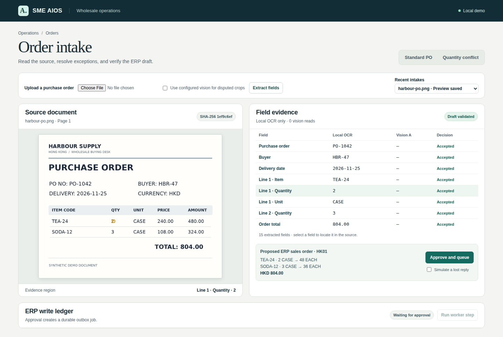

### 两分钟演示

1. 打开 **Standard PO**，点选 **Line 1 · Quantity** 查看 OCR 定位框。目录将 **2 箱** 转换成 **48 件**，采购单总额核对为 **HKD 804**。
2. 切换 **Quantity conflict**。Tesseract 读取 **2**，脚本模拟的视觉模型 A 读出 **8**，模型 B 读出 **2**，系统仍按冲突门禁要求复核。输入 **8** 会触发行金额校验拦截，改为 **2** 后通过。
3. 点 **Approve and queue**，保持 **Simulate a lost reply** 勾选。Worker 第一步写入沙盒后模拟丢回复，第二步执行独立读回校验，账本仅记录一份匹配草稿。
4. 刷新页面重新查看已核对的单据，再上传 `fixtures/harbour-po.png`。清晰且一致的样张仅走本地 OCR，视觉模型调用数为零。

| 异常复核 | ERP 写后核对 |
|---|---|
| [浏览器截图](docs/browser/02-quantity-review.png) | [浏览器截图](docs/browser/03-erp-reconciliation.png) |

收件箱截图来自 [CI 浏览器实跑](https://github.com/Doooo4love/sme-aios-demo/actions/runs/44757111231)，完整操作脚本见[演示手册](docs/demo.zh-CN.md)。

### 本地运行（独立采购单工作台）

需安装 Python 3.11+ 与 Tesseract 英文训练数据（Debian/Ubuntu 安装 `tesseract-ocr` 与 `tesseract-ocr-eng`；macOS 使用 `brew install tesseract`）：

```bash
python -m venv .venv
source .venv/bin/activate
python -m pip install -r requirements.txt
python -m uvicorn aios_demo.api:app --host 127.0.0.1 --port 8758
```

访问 **http://127.0.0.1:8758**（默认无需模型密钥）。使用全新 `AIOS_STATE_DIR` 可重复演示，也可独立启动 Worker（`python -m aios_demo.worker`）共用同一状态目录及可选 `AIOS_POSTGRES_DSN`。

```bash
python scripts/run_demo.py
python -m pip install -r requirements-test.txt
python -m unittest discover -s tests -v
```

### 接单合同与核心实现

```bash
python -m aios_demo.extract_po fixtures/harbour-po.png --mode ocr
```

CLI 返回包含原文件哈希、尺寸、字段值、OCR 区域、复核原因、模型调用次数和可选草稿的 JSON（传入 `--mode vision-on-demand` 可对争议字段触发裁剪复核）。工作台支持不超过 8 MB / 800 万像素的 PNG/JPEG。

| 模块 | 已实现能力 |
|---|---|
| [解析器](aios_demo/parsing.py) | Tesseract TSV 转成类型化字段、完整性检查、像素位置、评分 |
| [多模态路由](aios_demo/routing.py) | 证据定位、业务规则、定向和限额视觉读取、人工复核 |
| [命令与 outbox](aios_demo/storage.py) | 线程连接池化 SQLite WAL 与懒加载 `psycopg_pool`、摘要审批、幂等、PostgreSQL `SKIP LOCKED`、租约/Epoch 栅栏 |
| [消费者](aios_demo/worker.py) | 持久化派发步骤、跨独立数据库写入、丢回复恢复、校验草稿状态和完整内容 |
| [API 与工作台](aios_demo/api.py) | 上传、收件箱、存储证据和预览、审批和回执状态 |
| [测试](tests/) | 本地 OCR、冲突门禁、并发重复审批、16 线程 WAL 压测、过期租约与未知结果对账 |

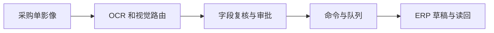

### 适用范围与平滑演进路径

`aios_demo/` 为单租户合成样张起点原型（详见[实现边界](docs/demo.zh-CN.md#实现边界)）。其 PO 证据定位与 `plan_digest` 摘要锁审批语义已无缝融入 [`aios_platform/`](aios_platform/)（`POST /v1/intakes/{warehouse}`、`/structured/batch`、`/proposals/{id}/approve`）与 Next.js 前端的 [`OrderIntakeWorkspace.tsx`](web/src/features/orders/OrderIntakeWorkspace.tsx) 及 [`OcrEvidenceViewer.tsx`](web/src/features/orders/OcrEvidenceViewer.tsx)。

---

## 快速启动、环境变量参考、企业评测与线上运维

### 1. 企业云端工作台（`web/` + `aios_platform/`）

```bash
# 方式 A：零密钥单进程本地演示（FastAPI :8760 + Next.js BFF :3000）
./deploy/demo/start-local-demo.sh

# 方式 B：双端口云端大模型（:8760）+ 受控预审（:8761）
export AIOS_LLM_BASE_URL="https://api.deepseek.com"
export AIOS_LLM_MODEL="deepseek-flash"
export AIOS_LLM_API_KEY="sk-your-server-only-key"
./deploy/demo/start-local-demo.sh --mode dual

# 方式 C：$0 公网 HTTPS 临时隧道演示（macOS/Linux + cloudflared）
./deploy/demo/start-local-demo.sh --prod --tunnel
```

访问 **http://localhost:3000/** 即可使用账号密码登录，或展开演示账号助手快速体验全部 11 个受控企业身份（`operator`、`manager`、`finance`、`access-admin`、`admin`、`other-manager`、`island-manager`、`viewer`、`quality`、`legal`、`executive`）。Next.js BFF 环境变量与外部 MCP 日历/Zoom 接入配置见 [`web/README.md`](web/README.md)。

### 2. 核心服务端环境变量参考

全部敏感凭据均支持 `*_FILE` 文件路径注入（如 `AIOS_LLM_API_KEY_FILE`、`AIOS_PLATFORM_DSN_FILE`），严禁将任何服务端密钥暴露为 `NEXT_PUBLIC_*`。

| 环境变量 | 默认值 / 作用域 | 用途说明 |
|---|---|---|
| `AIOS_PROFILE` / `AIOS_PLATFORM_DSN` | `oidc` / `demo` 模式回退 SQLite | 切换 `demo` 与 `oidc`（PostgreSQL `psycopg_pool` + 全 40 表强制 RLS）运行模式 |
| `AIOS_LLM_PROVIDER` / `AIOS_LLM_MODEL` / `AIOS_LLM_PRO_MODEL` / `AIOS_LLM_BASE_URL` / `AIOS_LLM_API_KEY` | `deepseek-flash`（`https://api.deepseek.com`） | 主路径纯 `httpx + pydantic` 大模型适配器（默认 `deepseek-flash`，可选 `deepseek-v4-pro` T3 升级）及 `AIOS_MODEL_PRICING_JSON` 价格覆写 |
| `AIOS_LLM_FALLBACK_PROVIDER` / `AIOS_LLM_FALLBACK_MODEL` / `AIOS_LLM_FALLBACK_BASE_URL` / `AIOS_LLM_FALLBACK_API_KEY` | 可选 | 配置有序故障转移备选模型，受 `TenantProviderPolicyStore` 驻留门禁约束并注入熔断器 |
| `AIOS_TURN_DEADLINE_SECONDS` / `AIOS_API_RATE_LIMIT_RPM` / `AIOS_TURNS_RATE_LIMIT_RPM` | `55` / `600` / `120` | 单回合工具循环总超时与按客户端滑动窗口写限流（超限返回 `429 RATE_LIMITED` 与 `Retry-After`） |
| `AIOS_OTEL_GENAI` / `AIOS_METRICS_TOKEN` | `1` / 可选（`>=32` 字符） | 控制 `opentelemetry.trace` GenAI Span 桥接及 Bearer 鉴权的 Prometheus `/metrics` |
| `AIOS_BROWSER_ORIGIN` / `AIOS_BROWSER_SESSION_KEY` / `AIOS_DEMO_SECRET` | 同源 BFF 会话 | `__Host-aios_session` 加密签名、CSRF 与浏览器 Origin 校验 |
| `AIOS_SMTP_HOST` / `AIOS_SMTP_PORT` / `AIOS_SMTP_USER` / `AIOS_SMTP_PASS` / `AIOS_SMTP_FROM` | 端口 `587`（TLS/STARTTLS） | [`mcp/email-server/`](mcp/email-server/) 邮件连接池传输配置 |
| `AIOS_CHANNEL_<ID>_WEBHOOK_SECRET` / `AIOS_MCP_CHANNEL_<ID>_URL` | 按渠道配置 | 8 大企业 IM 渠道入站验签密钥与出站 MCP 中继地址 |
| `AIOS_WEB_SEARCH_TENANTS` / `AIOS_WEB_SEARCH_API_KEY` / `AIOS_WEB_SEARCH_API_KEY_FILE` | 默认关闭 | 配置启用 `agent-web`（`/web`）的租户白名单（支持 `AIOS_WEB_SEARCH_TENANTS_FILE`）与 DeepSeek Search 独立密钥 |
| `AIOS_WORKSPACE_KNOWLEDGE` | `0`（演示合成 SOP） | 设为 `1` 后在固定 `WorkspaceSource` 上调用 `POST /workspace/knowledge-search` 供 `agent-knowledge`（`/knowledge`）检索 |
| `AIOS_DOCUMENT_TOOLS_ENABLED` / `AIOS_REPORT_FONT` / `AIOS_REPORT_FONT_INDEX` / `AIOS_DOCUMENT_OCR_LANGUAGES` | `0` / Noto Sans CJK / `""` | 启用 Office/PDF 解析与报告导出（需 `requirements-platform-documents.txt`）、指定 PDF 中文字体与索引、开启 `Tesseract` 扫描页 OCR（如 `eng+chi_sim+chi_tra`，上限 5 页） |

### 3. 企业就绪度评测、自动化回归、迁移与夜间 `systemd` 定时任务

```bash
# 运行零外部 API 密钥的 7 门禁企业就绪度评测基准
python scripts/enterprise_eval.py --json

# 运行本地工作边界分类器并发基准（20,000 次判定，16 线程）
python scripts/work_boundary_eval.py --requests 20000 --workers 16

# 运行后端全量单元测试与集成测试（192+ 项）
python -m unittest discover -s tests -v

# 运行企业就绪度、FinOps 故障转移、Outbox/SSE 吊销、PG RLS、MEMORY.md、路由、桌面与越界专项测试
python -m unittest tests.test_enterprise_readiness tests.test_finops_and_failover tests.test_infra_resilience -v
python -m unittest tests.test_outbox_and_revocation tests.test_postgres_enterprise tests.test_migrations tests.test_user_memory -v
python -m unittest tests.test_routing_provider_context tests.test_assistant_and_sse tests.test_desktop_workspace_harness tests.test_off_topic_escalation tests.test_governance_and_guard -v
python -m unittest tests.test_public_search tests.test_harness_tools tests.test_documents_and_reports -v

# 执行 Alembic 数据库迁移至 0013_enterprise_hardening（PG 自动安全扩宽 alembic_version 至 VARCHAR(64)）
python -m alembic upgrade head

# 手动运行夜间 MEMORY.md 整理任务（默认 0-Token 确定性归并；附加 --use-llm 启用门控 T2）
python -m aios_platform.memory_tidy --dry-run
python -m aios_platform.memory_tidy --use-llm --stale-days 7

# 启用并核查加固版夜间 systemd 定时器（每日 19:15:00 UTC / 03:15 HKT）
sudo systemctl enable --now aios-memory-tidy.timer
systemctl status aios-memory-tidy.timer aios-memory-tidy.service

# 前端严格 TypeScript 类型检查、Standalone 构建与 Playwright 端到端回归
pnpm --dir web run typecheck
pnpm --dir web run build
pnpm --dir web run test:e2e

# 独立 Email MCP 与 Cloudflare Worker 类型及单元测试（与 .github/workflows/demo.yml 矩阵一致）
pnpm --dir mcp/email-server run typecheck && pnpm --dir mcp/email-server run build
pnpm --dir deploy/cloudflare-worker run typecheck && pnpm --dir deploy/cloudflare-worker run test
```

CI 流水线（[`.github/workflows/demo.yml`](.github/workflows/demo.yml) 与 [`.github/workflows/deepseek-smoke.yml`](.github/workflows/deepseek-smoke.yml)）已覆盖全量 `192` 项 Python 测试、`enterprise_eval.py`（`7/7` 门禁）、PostgreSQL 16 幂等迁移与 `aios_api`/`aios_worker` 强制 RLS 角色验证（`test_postgres_enterprise`）、Next.js `web-ci`、`edge-mcp-ci`（Cloudflare Worker + Email MCP）以及 `deepseek-flash` 冒烟验证。

### 4. Tauri 2 桌面端（`desktop/`）与本地工作区 MCP（`mcp/workspace-server/`）

```bash
# 通过 stdio 运行本地工作区与受控 CUA MCP 服务
python mcp/workspace-server/server.py --root /path/to/workspace

# 启动或打包 Tauri 2 跨平台桌面壳（需在 macOS/Windows 安装 Node >= 20、pnpm 与 Rust >= 1.77）
pnpm --dir desktop install
pnpm --dir desktop dev
pnpm --dir desktop build
```

OS Keychain 设备令牌约束、最小权限 Capability 与 `.dmg`/`.app`/`.msi`/`.exe` 构建细节请参阅 [`desktop/README.md`](desktop/README.md) 与 [`mcp/workspace-server/README.md`](mcp/workspace-server/README.md)。

### 5. Cloudflare Zero Trust、IntegrAI 云主机与评审门禁运维

所有生产演示应用端口均严格锁定于回环地址（`127.0.0.1:3000`、`:8760`、`:8761`），经由 Cloudflare Named Tunnel（[`deploy/integrai/`](deploy/integrai/)）与 **Cloudflare Workers VPC**（[`deploy/cloudflare-worker/`](deploy/cloudflare-worker/)）暴露给授权评审方（[`src/reviewer-gate.ts`](deploy/cloudflare-worker/src/reviewer-gate.ts)）。

```bash
# 本地 Dry-Run 校验与无回显推流推送密钥（读取 .reviewer-pass.local.json 经 stdin 写入）
./deploy/cloudflare-worker/activate-reviewer-gate.sh --dry-run
./deploy/cloudflare-worker/activate-reviewer-gate.sh

# 零停机紧急到期熔断（立即作废当前全部评审口令与签名直链）
printf '%s' '2020-01-01T00:00:00Z' | pnpm --dir deploy/cloudflare-worker exec wrangler secret put AIOS_REVIEWER_EXPIRES_AT --name aios-demo

# 一键轮换密钥与口令（吊销历史 Cookie 与旧版二维码令牌）
node ./deploy/cloudflare-worker/scripts/generate-reviewer-pass.mjs --force
./deploy/cloudflare-worker/activate-reviewer-gate.sh
```

完整 Worker 部署、Zero Trust Access 回切及 Ubuntu 宿主机加固发布手册（`01-preflight.sh` -> `06-verify-live.sh`）见 [`deploy/cloudflare-worker/README.zh-CN.md`](deploy/cloudflare-worker/README.zh-CN.md) 与 [`deploy/integrai/RUNBOOK.zh-CN.md`](deploy/integrai/RUNBOOK.zh-CN.md)。

---

## 文档索引

| 领域 | 简体中文 | English |
|---|---|---|
| **受控 AI 预审与零迁移接入** | [docs/governed-assurance.zh-CN.md](docs/governed-assurance.zh-CN.md) | [docs/governed-assurance.md](docs/governed-assurance.md) |
| **后端架构与 ERP 桥接合同** | [docs/platform.md](docs/platform.md) | [docs/platform.en.md](docs/platform.en.md) |
| **生产加固与上线验收门禁** | [docs/production-readiness.md](docs/production-readiness.md) | [docs/production-readiness.en.md](docs/production-readiness.en.md) |
| **批发与物流试点自动化指南** | [docs/pilot-automation.zh-CN.md](docs/pilot-automation.zh-CN.md) | [docs/pilot-automation.md](docs/pilot-automation.md) |
| **企业工作台与前端交接规范** | [docs/workbench-handoff.zh-CN.md](docs/workbench-handoff.zh-CN.md) | [docs/workbench-handoff.md](docs/workbench-handoff.md) |
| **商业定价矩阵与零 FDE 本地化战略** | [docs/pricing-and-localization-report.zh-CN.md](docs/pricing-and-localization-report.zh-CN.md) | [docs/pricing-and-localization-report.md](docs/pricing-and-localization-report.md) |
| **工作台后端与模块授权机制** | [docs/workbench-backend.zh-CN.md](docs/workbench-backend.zh-CN.md) | — |
| **员工协作、同源会话与客户连接器** | [docs/workbench-collaboration.zh-CN.md](docs/workbench-collaboration.zh-CN.md) | — |
| **企业工作台前端交付指南（`web/`）** | [docs/workbench-frontend.zh-CN.md](docs/workbench-frontend.zh-CN.md) | [web/README.md](web/README.md) |
| **Agent 工作台工具、个人授权与知识检索** | [docs/harness-tools.zh-CN.md](docs/harness-tools.zh-CN.md) | — |
| **Office/PDF 文档解析与工作报告导出** | [docs/office-documents-and-reports.zh-CN.md](docs/office-documents-and-reports.zh-CN.md) | — |
| **采购单 OCR 演示脚本与实现边界** | [docs/demo.zh-CN.md](docs/demo.zh-CN.md) | [docs/demo.md](docs/demo.md) |
| **桌面端 Harness 与本地工作区 MCP** | — | [desktop/README.md](desktop/README.md) · [mcp/workspace-server/README.md](mcp/workspace-server/README.md) |
| **Cloudflare 评审门禁与 IntegrAI 运维** | [deploy/cloudflare-worker/README.zh-CN.md](deploy/cloudflare-worker/README.zh-CN.md) · [deploy/integrai/RUNBOOK.zh-CN.md](deploy/integrai/RUNBOOK.zh-CN.md) | — |

---

## 开源致谢

Theodic SME AIOS 的构建受益于以下优秀开源生态：

- **后端、高可用与数据层**：[FastAPI](https://fastapi.tiangolo.com/)、[Pydantic](https://docs.pydantic.dev/)、[httpx](https://www.python-httpx.org/)、[SQLAlchemy](https://www.sqlalchemy.org/) / [Alembic](https://alembic.sqlalchemy.org/)、[PostgreSQL](https://www.postgresql.org/)（强制 RLS 与 `SKIP LOCKED`）、[psycopg-pool](https://www.psycopg.org/psycopg3/docs/advanced/pool.html)、[PyJWT](https://pyjwt.readthedocs.io/)、[cryptography](https://cryptography.io/)（Ed25519 / AES-256-GCM）、[Open Policy Agent](https://www.openpolicyagent.org/)、[Prometheus Python Client](https://github.com/prometheus/client_python) 以及 [OpenTelemetry Python](https://opentelemetry.io/docs/languages/python/)。
- **前端与交互体验**：[Next.js](https://nextjs.org/)、[React](https://react.dev/)、[Tailwind CSS](https://tailwindcss.com/)、[Radix UI](https://www.radix-ui.com/)、[cmdk](https://cmdk.paco.me/)、[react-markdown](https://github.com/remarkjs/react-markdown) + [remark-gfm](https://github.com/remarkjs/remark-gfm)、[Lucide](https://lucide.dev/)、[Zod](https://zod.dev/) 以及 [Playwright](https://playwright.dev/)。
- **桌面端、文档、邮件与边缘自动化**：[Tauri 2](https://v2.tauri.app/)（`keyring` v3）、[Model Context Protocol (MCP)](https://modelcontextprotocol.io/)、[Nodemailer](https://nodemailer.com/)、[Docling](https://github.com/DS4SD/docling) / [MarkItDown](https://github.com/microsoft/markitdown)、[Microsoft Presidio](https://microsoft.github.io/presidio/)、[OmniParser](https://github.com/microsoft/OmniParser)、[Tesseract OCR](https://github.com/tesseract-ocr/tesseract) 以及 [Cloudflare Workers](https://developers.cloudflare.com/workers/)。
