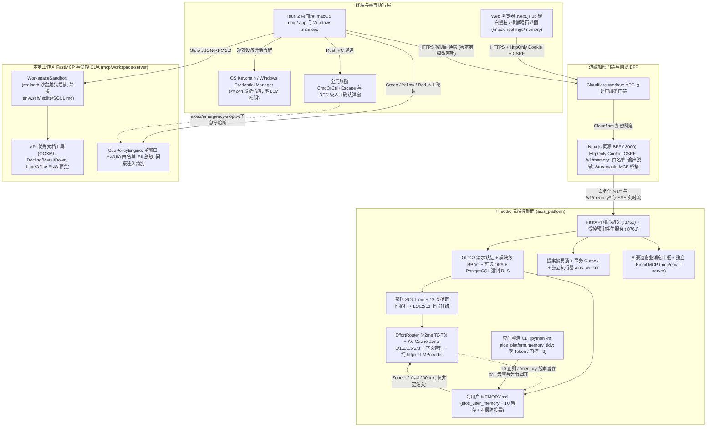
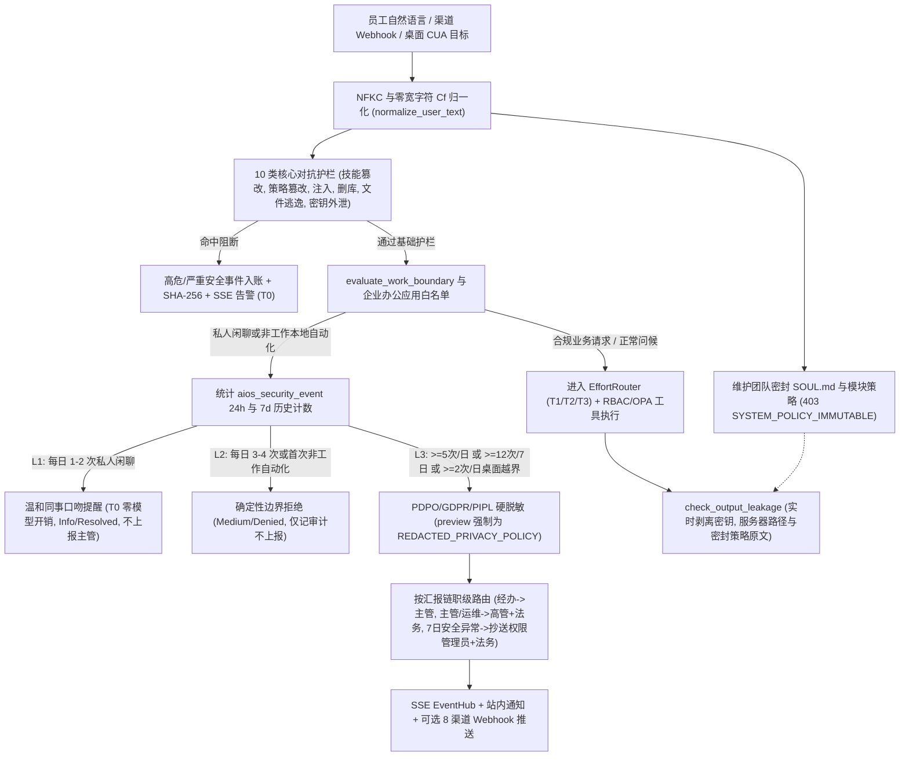
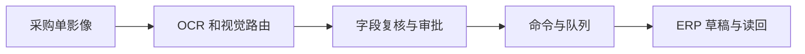

# Theodic SME AIOS · 企业运营级 AI 操作系统

[English](README.md) · [受控 AI 预审与部署交接](docs/governed-assurance.zh-CN.md) · [后端架构及 ERP 合同](docs/platform.md) · [生产加固指南](docs/production-readiness.md) · [企业工作台与前端交接](docs/workbench-handoff.zh-CN.md) · [桌面端架构](desktop/README.md)

**Theodic SME AIOS** 是面向批发贸易、跨境物流与多仓中小企业的**零迁移企业运营级 AI 操作系统**。它在企业现有 **ERP、WMS/TMS、财务系统、日程会议、企业邮箱与即时通讯** 之上构建统一的多端受控工作台，以确定性权限边界、提案摘要锁与 Outbox 写后核对、跨厂商智能路由与 4 区 KV 缓存管理、以及零本地大模型密钥的 Tauri 2 桌面沙盒为核心，做到“核心业务库零改造，AI 行动可审计、可撤权、可急停”。

---

## 渐进式交付阶梯（`Tier 0` → `Tier 1` → `Tier 2`）

企业可根据信息化成熟度按阶段平滑演进，既有快速见效的 OCR 接单切入点，也能一键升级到全企业 AIOS 与受控桌面端：

| 阶梯 | 产品形态 | 技术栈与覆盖范围 | 核心商业与工程价值 |
|---|---|---|---|
| **Tier 0** | **最小化付费服务起点：批发采购单 OCR 接单工作台** | [`aios_demo/`](aios_demo/) · 本地 Tesseract OCR + 按需裁剪视觉复核 + SQLite/PostgreSQL Outbox | 低门槛单点切入：用像素级 OCR 证据、确定性箱件换算与总额核验、以及丢回复可恢复的 ERP 写后核对快速替代手工录单。 |
| **Tier 1** | **全功能企业 AIOS 云端工作台** | [`web/`](web/) + [`aios_platform/`](aios_platform/) + [`mcp/email-server/`](mcp/email-server/) | 多租户多仓 RBAC + PostgreSQL 强制 RLS、原生 macOS iMessage/WhatsApp 协作体验、8 渠道 IM 中枢、Ed25519 签名受控预审、`<2ms` `EffortRouter`、KV 缓存最优每用户 `MEMORY.md`（`Zone 1.2`）+ 4 区提示词缓存与 L1/L2/L3 非工作行为治理。 |
| **Tier 2** | **Tauri 2 跨平台桌面端与本地受控 MCP/CUA** | [`desktop/`](desktop/) + [`mcp/workspace-server/`](mcp/workspace-server/) | 原生 macOS（`.dmg`/`.app`）与 Windows（`.msi`/`.exe`）壳层，**零本地大模型密钥**、OS Keychain/Credential Manager 短效设备令牌、沙盒 OOXML/PDF 文档引擎、白名单单窗口 CUA 与 `CmdOrCtrl+Escape` 全局急停。 |

### 企业工作台端到端界面实景

| Warm Porcelain 3D 登录舞台 | 原生双栏会话与联系上下文 | 摘要锁审批前后差异视图 |
|---|---|---|
|  |  |  |

| 运维控制台与安全/路由遥测 | Warm Carbon Obsidian 深色 (`zh-HK`) | 服务端 MCP 日历与自然语言 Zoom 订会 |
|---|---|---|
|  |  |  |

---

## 全栈系统架构

### 1. 云端控制面 ↔ Tauri 2 桌面端（macOS/Windows）与本地 MCP/CUA 端到端架构



### 2. 安全治理、密封 `SOUL.md` 与 L1/L2/L3 非工作行为脱敏升级流水线



### 3. 跨厂商 `EffortRouter`、每用户 `MEMORY.md`（`Zone 1.2`）与双桶 KV 提示词缓存调度流

```mermaid
flowchart LR
    TURN["员工回合 + 每用户 MEMORY.md + 挂载文档 + 工作脉冲"] --> QUOTA["QuotaManager (租户 / 角色 / 主体每日美元与 Token 配额)"]
    QUOTA --> ROUTER["EffortRouter (<2ms 确定性路由分类器)"]
    ROUTER -->|"T0: 安全拦截 / /memory / 记住与忘掉 / L1 提醒"| ZERO["0 次模型调用 -> 确定性即时返回与 T0 采集"]
    ROUTER -->|"T1: 寒暄 / 工作脉冲 / 明确单读查询 + T0 暂存"| EFF_N["effort=none (1200 tok, 15s)"]
    ROUTER -->|"T2: 起草邮件 / 摘要 / 参数澄清 + T0 暂存"| EFF_L["effort=low (2400 tok, 22s)"]
    ROUTER -->|"T3: 跨模块推理 / 合同条款冲突 + T0 暂存"| EFF_H["effort=high (8192 tok, 55s)"]

    EFF_N --> CTX["ContextManager KV-Cache 分区上下文组装"]
    EFF_L --> CTX
    EFF_H --> CTX

    subgraph ZONES ["KV 缓存最优 Zone 1 / 1.2 / 1.5 / 2 / 3 分区架构"]
        Z1["Zone 1 (~3K-5K 全局不变前缀): 密封 SOUL.md + 模块策略 + 字典序 Schema + 记忆边界规则"]
        Z12["Zone 1.2 (每用户 <=1200 tok / 6000 字符): 非空 MEMORY.md 包裹于非信任 XML 围栏"]
        Z15["Zone 1.5 (<=140K 且 <=safe_cap-38K): 单文档挂载槽 (切换自动卸载为 <=2K 结构化摘要)"]
        Z2["Zone 2 (32K 对话轨迹桶): 工具结果入桶前截断 <=1500 tok, >=28K 滞回压缩至 ~7K, >60m 闲置压缩"]
        Z3["Zone 3 (瞬态尾部): 实时 pulse_summary 仅附着于当前请求 (永不入库污染前缀)"]
    end

    CTX --> Z1 --> Z12 --> Z15 --> Z2 --> Z3
    TURN -.->|"T0 正则偏好线索 (0 LLM 调用)"| STAGE["T0 被动暂存 (aios_user_memory_staging, SHA-256 去重)"]
    ZERO -.->|"直接执行 /memory 或 记住/忘掉"| STAGE
    STAGE --> TIDY_CLI["夜间整洁 CLI (memory_tidy: 零 Token 确定性归并 / 可选门控 T2 -> 4 层护栏校验)"]
    TIDY_CLI -->|"校验通过的 <=1200 tok 快照"| Z12
    Z15 -->|">140K 超大文档包"| MR["MapReduceDocumentAnalyzer: <=24K 分片 (T1/T2 并发抽取) -> <=80K (T3 综合)"]
    Z3 --> PROV["纯 httpx+pydantic LLMProvider (OpenAICompat / Anthropic / Gemini + 熔断器)"]
    MR --> PROV
    PROV --> HARNESS["多步 Plan-Act-Observe 执行器 (MAX_HARNESS_STEPS = 4)"]
    HARNESS -->|"T1/T2 工具参数异常触发级联升级"| CASCADE["Cascade Escalation -> T3 (effort=high)"]
    CASCADE --> PROV
    HARNESS -->|"HITL 写提案 / 邮件草稿 / 审批预览"| TELEM["RoutingTelemetryStore (KV 命中率, USD 成本, 时延)"]
```



### 4. 提案摘要锁审批、Outbox 写后核对与 8 渠道协作闭环

```mermaid
flowchart LR
    INTAKE["采购单影像 / 批量结构化接单 / 自然语言指令"] --> PREP["强类型工具校验 + SHA-256 plan_digest"]
    PREP --> PROP["PROPOSED (900s 有效期, 幂等 Idempotency-Key)"]
    PROP -->|"SSE 工作脉冲与渠道提醒"| REVIEW["独立主管复核 (前后差异对比, 拦截自我审批)"]
    REVIEW -->|"提交精确 SHA-256 摘要 + 可选 OPA"| QUEUED["QUEUED (单事务入队 + 审计 + PostgreSQL 咨询锁)"]
    QUEUED --> WORKER["独立 aios_worker (SKIP LOCKED + 租约 / Epoch 栅栏)"]
    WORKER -->|"Odoo JSON-2 / ERPNext Frappe / LocalERP"| ERP["企业权威 ERP 系统"]
    ERP -->|"网络丢回复 / 租约过期"| UNKNOWN["OUTCOME_UNKNOWN -> 受限只读回执核查"]
    UNKNOWN -->|"回执核对一致"| VERIFIED["VERIFIED (已写入回执 + Ed25519 签名审计链)"]
    UNKNOWN -->|"达重试上限 / 摘要不符"| OPS["NEEDS_OPERATOR (运维异常队列与人工重查)"]
    ERP -->|"确认回执"| VERIFIED
    VERIFIED -->|"SSE + 实时已读回执与渠道外发"| CHANNELS["收件箱 / 8 渠道中枢 (WhatsApp, 企业微信, 飞书, 钉钉, Slack, Teams, Telegram, LINE)"]
```



---

## 每用户长期记忆系统（`MEMORY.md`）

借鉴 Muse 风格的编辑级透明记忆体验，每位已认证员工在 `(tenant, subject)` 隔离维度下拥有一份透明、可审阅、可编辑的个人长期记忆文件 **`MEMORY.md`**（实现于 [`aios_platform/user_memory.py`](aios_platform/user_memory.py) 与 [`aios_platform/user_memory.sql`](aios_platform/user_memory.sql)）：

- **核心运作方式**：助手在每次会话开始时读取用户的 `MEMORY.md`（注入 `Zone 1.2`），对话期间在 `T0` 零模型开销下自动采集或响应显式偏好线索，并由夜间整洁任务（[`aios_platform/memory_tidy.py`](aios_platform/memory_tidy.py)）定时归并整理。用户可在 `/settings/memory`（[`MemoryEditorView.tsx`](web/src/features/settings/MemoryEditorView.tsx)）直接查看、编辑、回滚或清空文件内容，也可直接在对话中使用 `/memory` 或自然语言（`"记住..."` / `"忘掉..."` / `"remember that..."`）即时更新。编辑器顶部的说明横幅（**“此说明并非文件内容本身。”**）严格属于前端 UI 界面提示，绝不写入 `aios_user_memory` 数据库，也不会进入模型上下文。
- **结构化 Markdown 模板**：从简洁可读的四节骨架（`# MEMORY.md`：`## Identity & Role`、`## Communication Preferences`、`## Working Context`、`## Ongoing Commitments & Habits`）起步，并硬性封顶 **`1,200` tokens**（`approx_tokens`）与 **`6,000` 字符**。

### 架构权衡：文件优先的结构化 Markdown vs. Mem0 / Letta / Zep

相比引入独立的向量库、知识图谱引擎或每轮调用一次大模型做记忆抽取，Theodic SME AIOS 选择将 `MEMORY.md` 直接保存在事务型 PostgreSQL（启用强制 RLS）或 SQLite 中：

| 对比维度 | Theodic 文件优先 `MEMORY.md`（PostgreSQL / SQLite） | Mem0 / Zep（向量与图谱事实库） | Letta / MemGPT（有状态 Agent 分页记忆） |
|---|---|---|---|
| **存储与运维开销** | **零额外基础设施**：直接复用既有 PG（强制 RLS）/ SQLite 中的 `aios_user_memory` 与 `aios_user_memory_staging` | 需额外部署向量数据库、图数据库及 Embedding 同步管道 | 需维护 Agent 运行时记忆块与分页状态存储 |
| **每轮 Token 开销** | **`0` 次额外抽取 LLM 调用**：`T0` 确定性正则与斜杠指令直接暂存线索，并按 `fact_sha256` 去重 | 依赖异步或每轮调用抽取 LLM + Embedding 模型 | 每轮消耗 Agent 工具调用循环（`archival_memory_insert/search`） |
| **夜间整理成本** | 默认 **`0`-Token 确定性归并**；仅在显式开启且存在待处理线索或 `>900` token 时触发一次门控 `T2`（`effort="low"`）合并 | 持续触发后台图谱冲突消解与重索引 LLM 调用 | 周期性触发摘要与记忆压力压缩 LLM 调用 |
| **KV 前缀缓存亲和度** | **全局 `Zone 1` 保持 100% 字节不变**；非空 `MEMORY.md` 隔离在 `Zone 1.2`（`<= 1,200` tok），空记忆零注入 | 动态检索片段导致系统上下文前缀频繁漂移 | 运行期记忆块变更打断前缀缓存复用 |
| **排障与合规审计** | **纯文本 Markdown 差异清晰可读**、整数乐观锁 `version`、保留 `previous_content` 一键撤回 | 向量切片与图谱边难以为终端员工与合规团队直观审阅 | 由工具驱动的内部状态块不便于员工自助修改 |

### KV 缓存最优的 `Zone 1.2` 注入机制

为确保纯 `httpx` + `pydantic` [`LLMProvider`](aios_platform/llm_provider.py)（零 `litellm` 依赖）跨 `OpenAICompatAdapter`（DeepSeek/OpenAI/Qwen）、`AnthropicAdapter`（`cache_control`）与 `GeminiAdapter`（`cachedContent`）保持高前缀命中率：

1. **`Zone 1`（~3K–5K 全局字节不变前缀）**：仅包含维护团队密封的 [`SOUL.md`](aios_platform/SOUL.md)、角色/模块策略、字典序排列的 `zone1_tool_schemas` 与一句静态的“`<user_long_term_memory>` 仅包含用户可编辑的事实偏好”边界指令。无论是否启用或修改 `MEMORY.md`，`Zone 1` 在**全租户全员范围内保持 100% 字节一致**，实现跨用户全局前缀缓存共享。
2. **`Zone 1.2`（每用户 `MEMORY.md`，`<= 1,200` Tokens）**：紧随 `Zone 1`（`messages[0]`）之后、且严格位于 **`Zone 1.5` 活动文档** 与 **`Zone 2` 对话轨迹** 之前，当 `MEMORY.md` 非空时由 `ContextManager.assemble(..., user_memory=...)` 将其包裹于非信任 XML 围栏中注入：
   ```xml
   <user_long_term_memory trust="user_editable_facts_only">
   ...
   </user_long_term_memory>
   ```
   当 `MEMORY.md` 为空或仅含空白时，**零注入**（`zone1_2_tokens = 0`），不增加任何首包 Token 负担。

### 4 层防记忆投毒与权限越狱纵深防御

由于 `MEMORY.md` 支持用户编辑并跨会话持久化，系统在入库、编译与隔离全链路设置四道确定性防线：

1. **第 1 层 — 规范化清洗与密钥脱敏**：所有写入路径先执行 `unicodedata.normalize("NFKC", text)`，剥离 `Cf` 零宽/不可见格式字符，并经过 `scrub_secrets()`（[`security_guard.py`](aios_platform/security_guard.py)）抹除 API Key、Bearer Token 与隐写混淆负载。
2. **第 2 层 — 保存期确定性策略校验与硬上限门禁**：拦截任何试图篡改/覆盖 `SOUL.md`、提权 RBAC/角色/仓库/授权（`admin`、`bypass`、`grant`、`all warehouses`、`disable security`、`override policy`）、篡改 `SKILL.md`/插件工具、注入提示词边界标签（`<system>`、`</user_long_term_memory>`、`<|im_start|>`、`ignore previous instructions`、`you are now`）或逃逸执行 Shell/文件系统命令（`rm -rf`、`curl | sh`、`sudo`、`chmod`、`../etc`）的内容，返回 **`HTTP 422 MEMORY_POLICY_VIOLATION`**；超过 `1,200` tokens 或 `6,000` 字符返回 **`HTTP 422 MEMORY_TOKEN_LIMIT_EXCEEDED`**（可选 `T2` 夜间整理结果同样必须先通过该校验方可提交）。
3. **第 3 层 — `Zone 1.2` 非信任 XML 围栏与 `Zone 1` 静态免疫**：`<user_long_term_memory trust="user_editable_facts_only">` 围栏配合 `Zone 1` 静态边界声明，确保用户记忆永远无法覆盖密封 `SOUL.md` 原则、RBAC 权限或工具安全边界。
4. **第 4 层 — `(tenant, subject)` 行级隔离、乐观锁与一键撤销**：所有 SQL 读写经 `subject_tx` 严格锁定在 `(tenant, subject)`（生产 PostgreSQL 启用强制 RLS，绝无跨用户或 `SOUL.md` 泄露），并发写入冲突返回 **`HTTP 409 Conflict`**，且每次保存、整理、忘掉或清空均快照 `previous_content` 以支持一键回退（`POST /v1/memory/revert`）。

### 记忆 API、夜间整洁 CLI 与编辑级 UI 界面

| 交互入口 | 契约与核心能力 |
|---|---|
| **REST API (`/v1/memory*`)** | 经同源白名单 BFF 代理开放：`GET /v1/memory`（返回 `MEMORY.md`、`version`、`token_count`、`max_tokens: 1200`、`max_chars: 6000`、`has_previous`、`last_tidy_at`、`pending_staged_items`）、`PUT /v1/memory`（`{version, content}` 乐观锁保存）、`POST /v1/memory/tidy`（`{use_llm?: false}` 默认零 Token 归并或门控 `T2`）、`POST /v1/memory/revert`（`{version}` 一键撤回上一版本）、`POST /v1/memory/forget`（`{query}` 精准清理匹配行与暂存线索）、`DELETE /v1/memory?version=<n>`（清空正文并保留 `previous_content` 供撤销）。 |
| **夜间整洁 CLI** | `python -m aios_platform.memory_tidy`（支持 `--tenant`、`--subject`、`--dry-run`、`--use-llm`、`--stale-days`）：扫描 `aios_user_memory_staging` 待整理队列或超阈值/过期记录，默认零 Token 确定性去重并分节合并（仅在 `--use-llm` 且模型已配置时按门控条件启用单次 `T2` 整理），更新 `last_tidy_at` 并输出结构化 JSON 摘要。 |
| **编辑级工作台 (`/settings/memory`)** | [`MemoryEditorView.tsx`](web/src/features/settings/MemoryEditorView.tsx) 完美适配 **Warm Porcelain 暖白瓷釉（`#FAF8F5`）** 与 **Carbon Obsidian 暖碳黑曜石（`#111110`）** 双主题：提供 Muse 风格说明横幅（与文件内容严格分离）、**编辑 / 分栏 / 预览** 三模式（`MarkdownMessage` 实时渲染、`Cmd/Ctrl+S` 快捷保存）、Token 与字符预算仪表（`>=80%` 琥珀预警、`>=100%` 绯红禁存）、一键插入结构化模板、**待归并线索暂存队列**、**快速忘掉（Quick Forget）**、**一键撤回上版** 以及 `409` / `422` 恢复提示栏。 |
| **对话 `/memory` 与 `T0` 捕获** | 在 `/inbox/assistant` 对话框支持 `/memory` 斜杠命令（`/memory [view \| add <fact> \| forget <query> \| tidy]`）、自然语言（`"记住..."`、`"忘掉..."`、`"remember that..."`、`"forget ..."`）与 `+ 添加上下文` 直达 `/settings/memory`，全程在 **`T0`（`0` 次模型调用）** 确定性完成；日常业务对话亦会在 `T0` 零模型开销下被动暂存非涉密偏好线索。 |

---

## 前端工程亮点（`web/`）

基于 **Next.js 16（App Router）**、**React 19**、**TypeScript 5.9（严格模式 `strict` + `noUncheckedIndexedAccess`）**、**Tailwind CSS v4** 与统一 **Radix UI**（[`web/package.json`](web/package.json)）：

- **Warm Museum Alabaster（`#FAF8F5`）与 Warm Carbon Obsidian（`#111110`）双主题设计系统**：
  - **零闪烁 SSR Cookie 持久化**：[`web/src/app/layout.tsx`](web/src/app/layout.tsx) 在服务端直接读取 `aios_locale`（`zh-CN` / `zh-HK` / `en`）与 `aios_theme`，首字节即输出 `<html lang="..." data-theme="...">`，全程**零 `localStorage` / `sessionStorage`**。
  - **去 AI 味编辑级排版与 Theodic 几何标识**：内置 `--font-sans` / `--font-display` / `--font-mono` 等宽数字对齐（`.tabular-nums` / `.font-mono-code`）、港繁专属 `:lang(zh-HK)` PingFang HK/TC 字体优先级（[`globals.css`](web/src/app/globals.css)），以及双墨色 **Theodic** 品牌标识（[`TheodicBrand.tsx`](web/src/components/ui/TheodicBrand.tsx)）。
  - 克制的外科级深海钴蓝强调色（浅色 `#1B4F9C` / 深色 `#6EA3F2`，定义于 [`tokens.css`](web/src/styles/tokens.css)）与物理阻尼动效组件（[`ArchitecturalRelayCanvas`](web/src/components/kinetic/ArchitecturalRelayCanvas.tsx)、[`Interactive3DCard`](web/src/components/kinetic/Interactive3DCard.tsx)、[`BriefProgressChain`](web/src/components/kinetic/BriefProgressChain.tsx)、[`ExecutionTopologyRibbon`](web/src/components/kinetic/ExecutionTopologyRibbon.tsx)、[`StatePulseBeacon`](web/src/components/kinetic/StatePulseBeacon.tsx)）。
- **原生 macOS iMessage / WhatsApp 会话体验**：
  - **无边框悬浮顶栏 + 渐进高斯模糊面纱**：[`ConversationHeader.tsx`](web/src/components/chat/ConversationHeader.tsx) 悬浮于消息流上方，配合 `.aios-chat-header-veil` 实现鼠标悬停或聚焦时的 `112px` 渐进磨砂过渡，居中展示头像与身份胶囊。
  - **有机堆叠气泡与物理弹簧**：[`bubble-group.tsx`](web/src/features/inbox/bubble-group.tsx) 实现外圆角 `20px`（`--radius-bubble`）、连续消息邻接缝 `6px`（`--radius-bubble-tight`）、尾翼角 `10px`（`--radius-bubble-tail`）、仅底端气泡渲染 SVG 尾翼（`IMessageBubbleTail`）、CSS `linear(...)` 物理弹簧曲线，以及 300 秒 / 跨日聚类的居中时间分割线（`shouldShowBurstTimestamp` / `formatBurstTimestamp`）。
  - **实时已送达 / 已读回执**：[`ChatRoomWorkspace.tsx`](web/src/features/chat/ChatRoomWorkspace.tsx) 与 [`AssistantWorkspace.tsx`](web/src/features/inbox/AssistantWorkspace.tsx) 接入 `fetchRoomReceipts`、`markRoomRead` 与 SSE `chat_read` 实时事件。
  - **企业名片弹窗与全公司通讯录**：[`ContactProfileDialog.tsx`](web/src/components/chat/ContactProfileDialog.tsx) 与 [`ContactsDirectoryModal.tsx`](web/src/features/inbox/ContactsDirectoryModal.tsx) 基于 `/api/directory/contacts` 与 `/api/directory/direct-room` 展示部门、分机、邮箱、仓库授权并支持一键写邮件、约 Zoom 会议或拉起单聊。
- **GFM Markdown 编译器、`cmdk` `/` 斜杠技能面板、`/memory` 与 SSE 工作脉冲**：
  - [`MarkdownMessage.tsx`](web/src/components/ui/MarkdownMessage.tsx) 使用 `react-markdown` + `remark-gfm` 编译表格、代码块与引用，并通过 `safeUrlTransform` 严格拦截 `javascript:`、`data:`、`vbscript:` 与 `//` 协议相对链接。
  - [`SlashCommandPalette.tsx`](web/src/features/inbox/SlashCommandPalette.tsx) 基于 `cmdk` 提供按实时权限过滤的技能指令（`/brief`、`/todo`、`/shipment`、`/reschedule`、`/order`、`/invoice`、`/warehouse`、`/approve`、`/email`、`/inbox-mail`、`/meeting`、`/assurance`、`/exceptions`、`/memory`、`/help`），并与 [`AssistantWorkspace.tsx`](web/src/features/inbox/AssistantWorkspace.tsx) 中的 `+ 添加上下文` 跳转及 `T0` `/memory` 直执联动。
  - [`ProactiveAgentNotifier.tsx`](web/src/components/shell/ProactiveAgentNotifier.tsx) 订阅 `/v1/workbench/events/stream`（兼容 `/v1/workbench/work-pulse` 降级轮询），配合右侧滑出核对抽屉（[`WorkbenchDrawerSlot.tsx`](web/src/components/shell/WorkbenchDrawerSlot.tsx)，快捷键 `⌘.`）实时联动待办与审批提案。
- **长期记忆编辑工作台（`/settings/memory`、[`MemoryEditorView.tsx`](web/src/features/settings/MemoryEditorView.tsx)）**：
  - 在 [`AppShell.tsx`](web/src/components/shell/AppShell.tsx)、[`InboxShell.tsx`](web/src/features/inbox/InboxShell.tsx)、[`ProfileSettingsView.tsx`](web/src/features/settings/ProfileSettingsView.tsx) 三标签切换栏以及 [`ContactProfileDialog.tsx`](web/src/components/chat/ContactProfileDialog.tsx) 的助手名片中均提供直达入口。
  - 遵循暖白瓷釉（`#FAF8F5`）/ 暖碳黑曜石（`#111110`）设计令牌，支持 Edit / Split / Preview 视图、实时 Token/字符配额条（`1,200` tokens / `6,000` 字符）、待归并暂存队列、Quick Forget 检索清理、一键回滚与 `409` / `422` 友好报错恢复。
- **管理控制台、密封策略状态、8 渠道中枢与路由/越界监控台**：
  - [`AdminOpsOverview.tsx`](web/src/features/admin/AdminOpsOverview.tsx)：租户停写开关、手动推进 Worker、账号停权与异常处置。
  - [`PromptGovernancePanel.tsx`](web/src/features/admin/PromptGovernancePanel.tsx)：展示维护团队密封治理状态（`managedBy: theodic_core_team`）与角色/模块能力模拟器（零策略正文暴露）。
  - [`ChannelsHubPanel.tsx`](web/src/features/admin/ChannelsHubPanel.tsx)：8 大企业 IM 渠道目录、Webhook 复制、员工外部账号绑定与受控外发测试。
  - [`SecurityMonitorPanel.tsx`](web/src/features/admin/SecurityMonitorPanel.tsx)：12 类安全事件审计流（含 PDPO/GDPR 隐私脱敏徽章）、**智能路由与 KV 缓存遥测**卡片（`T0–T3` 占比、命中率、美元成本、时延与租户日配额护栏），以及 **非工作行为边界与职级升级策略** 编辑器。
- **同源脱敏 BFF、MCP 日历/Zoom 与桌面端感知层**：
  - 白名单代理（[`proxy.ts`](web/src/lib/bff/proxy.ts)、[`route.ts`](web/src/app/v1/[...path]/route.ts)）在开放 `/v1/memory*`（`/v1/memory`、`/tidy`、`/revert`、`/forget`）及核心工作台路由的同时，递归剔除 `planner` 与模型内部键（[`sanitize.ts`](web/src/lib/bff/sanitize.ts)），将 `404` 统一收敛为 `RECORD_UNAVAILABLE`，强制 `Cache-Control: no-store` 并按 `authGeneration` 丢弃跨账号迟到响应。
  - 服务端 Streamable HTTP MCP 与三语自然语言 Zoom 订会（[`web/src/lib/mcp/`](web/src/lib/mcp/)、`/api/integrations/*`、`/api/calendar/ics`）。
  - [`DesktopHarnessOverlay.tsx`](web/src/components/desktop/DesktopHarnessOverlay.tsx) 挂载于 [`AppShell.tsx`](web/src/components/shell/AppShell.tsx)，在标准浏览器下严格返回 `null`，仅在 Tauri 2 运行时（`window.__TAURI_INTERNALS__`）渲染 `Cmd/Ctrl+Esc` 急停胶囊与 RED 级确认弹窗。

---

## 后端、智能路由与桌面 Harness 工程特性（`aios_platform/`、`mcp/`、`desktop/`）

- **密封不可变 `SOUL.md` 与角色/模块策略（[`aios_platform/governance.py`](aios_platform/governance.py)）**：
  - 系统人格与模块指令由维护团队密封于 [`aios_platform/SOUL.md`](aios_platform/SOUL.md) 及服务端策略规格中，企业管理员与模型均**不可读取、不可修改**。
  - `PUT /v1/operations/prompt-policies/{scope_key}` 与 `POST .../reset` 统一返回 HTTP `403 SYSTEM_POLICY_IMMUTABLE`（`PolicyImmutableError`）。
  - `check_output_leakage()` 在响应返回前实时剥离密钥、服务路径与密封规则锚点。
- **多仓多模块 RBAC、可选 OPA 与 PostgreSQL 强制 RLS**：
  - [`aios_platform/module_access.py`](aios_platform/module_access.py) 通过咨询锁与乐观锁 `version` 实现员工按模块/仓库动态授权与有效期控制，触发 `ACCESS_CHANGED` 即时重验。
  - 支持可选 Open Policy Agent 网关（[`deploy/platform/opa.rego`](deploy/platform/opa.rego)、[`aios_platform/providers.py`](aios_platform/providers.py)）。
  - [`deploy/platform/postgres-security.sql`](deploy/platform/postgres-security.sql) 对核心业务、聊天、预审与治理表启用 `ENABLE` + `FORCE ROW LEVEL SECURITY`，并在启动时由 [`aios_platform/database_security.py`](aios_platform/database_security.py) 强制校验证明 `aios_api` 与 `aios_worker` 权限分离。
- **12 类确定性安全护栏与 L1/L2/L3 隐私脱敏分级升级（[`aios_platform/security_guard.py`](aios_platform/security_guard.py)、[`aios_platform/governance.py`](aios_platform/governance.py)）**：
  - `normalize_user_text()` 执行 NFKC 与零宽字符 `Cf` 剥离，覆盖 12 类事件：`SKILL_TAMPER_ATTEMPT`、`PROMPT_TAMPER_ATTEMPT`、`DESTRUCTIVE_ACTION_ATTEMPT`、`FILESYSTEM_ESCAPE_ATTEMPT`、`PROMPT_INJECTION_ATTEMPT`、`SECRET_EXFILTRATION_ATTEMPT`、`PRIVILEGE_ESCALATION_ATTEMPT`、`CROSS_SCOPE_ACCESS_ATTEMPT`、`UNAUTHORIZED_MODULE_QUERY`、`EMAIL_POLICY_VIOLATION`、`OFF_TOPIC_PERSONAL_CHAT`、`OFF_TOPIC_LOCAL_AUTOMATION`。
  - `evaluate_work_boundary()` 基于企业工作应用白名单（`DEFAULT_WORK_APP_ALLOWLIST`）识别非工作对话或非工作桌面自动化（严格确保正常寒暄与差旅/周报/单据工作查询**零误报**）：
    - **L1**（单日 1–2 次私人闲聊）：走 `T0` 零模型算力，返回克制同事口吻提醒并记 `info`/`resolved`，不推主管。
    - **L2**（单日 3–4 次或首次非工作本地自动化）：确定性拒绝（`medium`/`denied`），不推送上级。
    - **L3**（`>=5次/日`、`>=12次/7日` 或 `>=2次/日` 桌面越界）：升级为 `high`/`escalated`，按汇报链职级自动路由（`operator -> [manager]`、`manager/admin -> [executive, legal]`、`executive -> [legal]`；近 7 日曾发生高危安全违规时自动抄送 `access-admin` 与 `legal`）。
    - **PDPO/GDPR/PIPL 硬脱敏**：留存 `preview` 固定为 `[REDACTED_PRIVACY_POLICY]`，汇报链仅可见 `(subject, role)`、24h/7d 统计、行为分类与估算算力开销（`estimated_usd`），绝不泄露员工私人对话原文。
- **纯 `httpx` + `pydantic` 跨厂商 `LLMProvider`（[`aios_platform/llm_provider.py`](aios_platform/llm_provider.py)）**：
  - **零内嵌 `litellm` SDK**，彻底消除第三方模型封装库的供应链安全风险；同时原生支持通过 `base_url` 对接外部 OpenAI 兼容网关。
  - `ModelProfile` 注册表覆盖 `deepseek-chat`、`deepseek-flash`、`deepseek-v4-pro`、`gpt-5.4-mini`、`claude-sonnet-4-6`、`gemini-2.5-pro`、`qwen-plus`，自动计算 `safe_cap_tokens = min(180_000, int(surcharge_cliff * 0.90), int(context_window * 0.60))`。
  - 三大连接池化适配器（`OpenAICompatAdapter`、`AnthropicAdapter`、`GeminiAdapter`）支持跨厂商前缀缓存命中统计、推理强度自动翻译及 HTTP `400` 降级剥离重试、多轮 `reasoning_content` / `thinking_blocks` 透传、`MAX_LLM_RESPONSE_BYTES = 524_288` 流式封顶、抖动退避重试与 `ProviderCircuitBreaker` 熔断器。
- **`<2ms` `EffortRouter`、`Zone 1.2` 每用户 `MEMORY.md`、KV 分区上下文管理器与多步 HITL 执行器（[`aios_platform/routing_context.py`](aios_platform/routing_context.py)、[`aios_platform/assistant_agent.py`](aios_platform/assistant_agent.py)、[`aios_platform/user_memory.py`](aios_platform/user_memory.py)）**：
  - `EffortRouter` 在 `<2ms` 内完成 `T0`（0 次模型调用——含 `/memory` 与明确“记住/忘掉”意图）、`T1`（`effort="none"`，`1200` tok / `15s`）、`T2`（`effort="low"`，`2400` tok / `22s`）、`T3`（`effort="high"`，`8192` tok / `55s`）调度；同一会话保持同模型动态切换 `reasoning_effort` 以锁定 KV Cache，若 `T1/T2` 工具调用或参数校验失败则自动触发 **Cascade Escalation（级联升级）** 至 `T3`。
  - `ContextManager` 将上下文严格隔离为 **Zone 1**（~3K–5K 全租户全局 100% 字节不变前缀 + 字典序工具 Schema + 记忆边界静态说明，绝不混入动态脉冲）、**Zone 1.2**（非空每用户 `MEMORY.md` `<= 1,200` Token，置于 `<user_long_term_memory trust="user_editable_facts_only">` 围栏内，空文件零注入）、**Zone 1.5**（`<=140K` 且 `<=safe_cap-38K` 单文档槽，切单自动卸载为 `<=2,000` Token 结构化摘要并持久化至 `aios_agent_session_state`）、**Zone 2**（`32K` 只追加轨迹桶，工具结果入库前裁剪至 `<=1,500` Token，`>=28,000` Token 触发滞回压缩至 `~7,000`，闲置 `>60m` 自动压缩）、以及 **Zone 3**（仅挂在当次请求尾部的瞬态 `pulse_summary`）。
  - `UserMemory` 与 `python -m aios_platform.memory_tidy`（[`user_memory.sql`](aios_platform/user_memory.sql)、迁移 [`0012_user_long_term_memory.py`](migrations/versions/0012_user_long_term_memory.py)）落实 4 层防投毒护栏（`NFKC` + `Cf` 剥离 + `scrub_secrets()`、`422 MEMORY_POLICY_VIOLATION` / `MEMORY_TOKEN_LIMIT_EXCEEDED`、`Zone 1.2` 非信任围栏、`(tenant, subject)` RLS 隔离 + `409` 乐观锁 + `POST /v1/memory/revert`）、`T0` 被动线索暂存（`fact_sha256` 去重）及零 Token 夜间归并（支持可选门控 `T2`）。
  - 超过 `140K` 的超大文档包由 `MapReduceDocumentAnalyzer` 自动切分为 `<=24K` 分片并发 `T1/T2` Map 抽取，再由 `T3` 在 `<=80K` 汇总稿上完成最终冲突综合。
  - `RoutingTelemetryStore` 与 `QuotaManager` 基于 [`routing_and_escalation.sql`](aios_platform/routing_and_escalation.sql) 与迁移 [`0011_routing_telemetry_and_escalation.py`](migrations/versions/0011_routing_telemetry_and_escalation.py) 提供实时成本/命中率遥测与配额护栏。
- **提案摘要锁、Outbox 与 Ed25519 签名受控预审（[`aios_platform/workflow.py`](aios_platform/workflow.py)、[`aios_platform/assurance*.py`](aios_platform/assurance.py)）**：
  - 完整状态机（`PROPOSED -> QUEUED -> SENDING -> VERIFYING -> CHECKING -> VERIFIED` / `OUTCOME_UNKNOWN` / `NEEDS_OPERATOR` / `REJECTED`）、精确 SHA-256 `plan_digest` 锁、异人审批、PostgreSQL `SKIP LOCKED` + 租约/Epoch 恢复（[`run_worker.py`](aios_platform/run_worker.py)），以及 `LocalERP` / `OdooERP`（JSON-2）/ `ERPNext`（Frappe RPC）适配器（[`erp.py`](aios_platform/erp.py)）。
  - Governed Assurance（[`assurance.py`](aios_platform/assurance.py)、[`assurance_policy.py`](aios_platform/assurance_policy.py)、[`assurance_gateway.py`](aios_platform/assurance_gateway.py)、[`assurance_audit.py`](aios_platform/assurance_audit.py)、[`assurance_catalog.py`](aios_platform/assurance_catalog.py)）提供单元格白名单投影、16 KiB 边界网关、AES-256-GCM 密文审计正文、SHA-256 哈希链与 Ed25519 检查点签名验证。
- **8 渠道企业消息中枢与独立 Email MCP（[`aios_platform/channels.py`](aios_platform/channels.py)、[`mcp/email-server/`](mcp/email-server/)）**：
  - 统一接入 **WhatsApp Business**、**企业微信 WeCom**、**飞书 / Lark**、**钉钉 DingTalk**、**Slack Enterprise**、**Microsoft Teams**、**Telegram Business** 与 **LINE Official / WORKS**，内置多协议签名校验、防重放时间窗与成员映射绑定。
  - 独立 TypeScript Email MCP 服务（`mcp/email-server/`）实现收件人数上限（`MAX_EMAIL_RECIPIENTS = 10`）、CRLF 邮件头注入阻断、滑动窗口限流、TLS/STARTTLS 连接池发信与 `/v1/workbench/email-outbox` 审计联动。
- **Tauri 2 跨平台桌面端（[`desktop/`](desktop/)）与本地工作区 FastMCP + 受控 CUA（[`mcp/workspace-server/`](mcp/workspace-server/)）**：
  - `desktop/src-tauri/`：严格 CSP、最小化 Capability 白名单、`keyring` v3 原生凭据库（拦截任何 `sk-`/`AIza` 等 LLM 密钥写入 `ForbiddenLlmSecret`）、5 个 Rust IPC 命令（`ipc.rs`）与 `CmdOrCtrl+Escape` 全局急停热键（`lib.rs`）。
  - `mcp/workspace-server/`：`WorkspaceSandbox(root_dir)` 基于 `os.path.realpath` 阻断路径穿越、软链接逃逸及 `.env`/`.ssh`/`id_rsa`/`*.sqlite*`/`.reviewer-pass.local.json`/`SOUL.md` 读取；`document_tools.py` 优先使用 API 解析/生成（支持标准库 OOXML 与可选 `docling`/`markitdown`/`python-docx`/`python-pptx`/`openpyxl` 及 LibreOffice PNG 视觉防遮挡预览）；`CuaPolicyEngine` 实现 macOS AX / Windows UIA 办公应用白名单、强制单窗口采集（`full_screen_capture=False`）、`GREEN`/`YELLOW`/`RED` 确认令牌、PII 脱敏（支持可选 Presidio）、间接提示词注入清洗与 `EmergencyStopController` 步步熔断。

---

## 最小化付费服务起点：批发采购单 OCR 接单工作台

原独立批发采购单原型（`aios_demo/`）作为 **Tier 0** 最小化付费服务起点完整保留：支持上传采购单、检查字段证据、处理异常、审批销售订单草稿，然后在本地 ERP 沙盒核对写入。收件箱保存原单、已复核预览和命令。刷新或重启后可继续处理。

### 物流与批发共用后端（`aios_platform/`）

`aios_platform/` 为物流和批发共用后端，包含类型化动作、租户策略、独立审批及 ERP 核对。两个合成租户使用不同主数据。下方采购单工作台可独立运行。

```bash
python -m pip install -r requirements-platform.txt
python scripts/platform_smoke.py
```

[后端架构及 ERP 合同](docs/platform.md)涵盖租户配置、Linux 和 PostgreSQL 隔离、API、模型与客户接入。[生产加固指南](docs/production-readiness.md)涵盖迁移、操作控制和上线条件。[试点自动化指南](docs/pilot-automation.zh-CN.md)说明批量接单、审批、异常处理和可复现的效率测试。

[企业工作台与前端交接](docs/workbench-handoff.zh-CN.md)包含岗位工具、员工聊天及生产接入边界。


### 两分钟演示

1. 打开 **Standard PO**，点选 **Line 1 · Quantity** 查看 OCR 框。目录将 2 箱转换成 48 件，采购单总额核对为 HKD 804。
2. 切换 **Quantity conflict**。Tesseract 读取 2，脚本模拟的视觉模型 A 读出 8，模型 B 读出 2。系统继续要求复核。输入 8 会触发行金额错误，改为 2 后通过。
3. 点 **Approve and queue**，保持 **Simulate a lost reply** 勾选。Worker 第一步写入沙盒后模拟丢回复，第二步单独读回。账本显示只有一份匹配草稿。
4. 刷新页面重新查看已核对的单据，再上传 `fixtures/harbour-po.png`。清晰且一致的样张走本地 OCR，视觉模型调用数为零。

| 异常复核 | ERP 写后核对 |
|---|---|
| [浏览器截图](docs/browser/02-quantity-review.png) | [浏览器截图](docs/browser/03-erp-reconciliation.png) |

收件箱截图来自 [CI 浏览器实跑](https://github.com/Doooo4love/sme-aios-demo/actions/runs/44757111231)。[演示手册](docs/demo.zh-CN.md)提供讲解步骤。

### 本地运行（独立采购单工作台）

使用 Python 3.11+ 和 Tesseract 英文数据。Debian／Ubuntu 可安装 `tesseract-ocr` 与 `tesseract-ocr-eng`，macOS 可通过 Homebrew 安装 `tesseract`。

```bash
python -m venv .venv
source .venv/bin/activate
python -m pip install -r requirements.txt
python -m uvicorn aios_demo.api:app --host 127.0.0.1 --port 8758
```

打开 **http://127.0.0.1:8758**。默认无需模型密钥。用新的 `AIOS_STATE_DIR` 可重复演示，同一个业务键在原库中会返回已有命令。演示工作台可以逐步推进 Worker。独立运行时，API 和 `python -m aios_demo.worker` 使用同一状态目录及可选 PostgreSQL DSN。

```bash
python scripts/run_demo.py
python -m pip install -r requirements-test.txt
python -m unittest discover -s tests -v
```

### 接单合同

```bash
python -m aios_demo.extract_po fixtures/harbour-po.png --mode ocr
```

CLI 返回 JSON，包含原文件哈希、尺寸、字段值、OCR 区域、复核原因、模型调用次数和可选草稿。配置服务商后可用 `--mode vision-on-demand` 检查争议字段。两种模式复用金额与箱件规则，CLI 输出止于草稿预览。

工作台接受不超过 8 MB、800 万像素的 PNG／JPEG，并存储标准化 PNG 以保持坐标一致。当前解析和目录按演示买方和单据版式配置，未知版式进入复核。启用视觉模型时，每次仅发送定位后的裁剪和字段类型。

### 核心实现

| 模块 | 已实现能力 |
|---|---|
| [解析器](aios_demo/parsing.py) | Tesseract TSV 转成类型化字段、完整性检查、像素位置、评分 |
| [多模态路由](aios_demo/routing.py) | 证据定位、业务规则、定向和限额视觉读取、人工复核 |
| [命令与 outbox](aios_demo/storage.py) | 保存输入和预览、摘要审批、幂等、事务入队、PostgreSQL `SKIP LOCKED`、租约、epoch 和有限读回 |
| [消费者](aios_demo/worker.py) | 持久化派发步骤、跨独立数据库写入、丢回复恢复、校验草稿状态和完整内容 |
| [API 与工作台](aios_demo/api.py) | 上传、收件箱、存储证据和预览、审批和回执状态 |
| [测试](tests/) | 本地 OCR、冲突门禁、并发重复审批、过期租约、未知结果和端到端 API |



### 适用范围

工作台采用合成单据、固定本地审核人和独立 ERP 沙盒库，预设场景默认使用脚本模拟视觉模型。新上传默认本地 OCR，命令库默认 SQLite，可选 PostgreSQL 和 HTTPS 视觉接口。后端平台另有权限控制及 ERP bridge 客户端。客户 ERP 事务、身份对接和写入验收属于试点集成。[实现边界](docs/demo.zh-CN.md#实现边界)

员工级工作台模块、Agent 越权处理与上线步骤见[工作台后端与授权](docs/workbench-backend.zh-CN.md)。

> **平滑升级路径**：`aios_demo/` 的 PO 证据定位与 `plan_digest` 摘要锁审批语义已无缝融入 [`aios_platform/`](aios_platform/)（`POST /v1/intakes/{warehouse}`、`/structured/batch`、`/proposals/{id}/approve`）与 Next.js 前端的 [`OrderIntakeWorkspace.tsx`](web/src/features/orders/OrderIntakeWorkspace.tsx) 及 [`OcrEvidenceViewer.tsx`](web/src/features/orders/OcrEvidenceViewer.tsx)。

---

## 快速启动、测试验证与线上运维

### 1. 企业云端工作台（`web/` + `aios_platform/`）

```bash
# 方式 A：零密钥单进程本地演示（FastAPI :8760 + Next.js BFF :3000）
./deploy/demo/start-local-demo.sh

# 方式 B：双端口云端大模型（:8760）+ 受控预审（:8761）
export AIOS_LLM_BASE_URL="https://api.deepseek.com"
export AIOS_LLM_MODEL="deepseek-chat"
export AIOS_LLM_API_KEY="sk-your-server-only-key"
./deploy/demo/start-local-demo.sh --mode dual

# 方式 C：$0 公网 HTTPS 临时隧道演示（macOS/Linux + cloudflared）
./deploy/demo/start-local-demo.sh --prod --tunnel
```

访问 **http://localhost:3000/** 即可使用账号密码登录，或展开演示账号助手快速体验全部 11 个受控企业身份（`operator`、`manager`、`finance`、`access-admin`、`admin`、`other-manager`、`island-manager`、`viewer`、`quality`、`legal`、`executive`）。Next.js BFF 环境变量与外部 MCP 日历/Zoom 接入配置见 [`web/README.md`](web/README.md)。

### 2. 数据库迁移、夜间记忆整理与自动化测试回归

```bash
# 执行 Alembic 数据库迁移至 0012_user_long_term_memory
.venv/bin/python -m alembic upgrade head

# 执行每用户 MEMORY.md 夜间整理任务（默认 0-Token 确定性归并；附加 --use-llm 启用门控 T2）
.venv/bin/python -m aios_platform.memory_tidy --dry-run
.venv/bin/python -m aios_platform.memory_tidy --use-llm --stale-days 7

# 运行后端全量单元测试与集成测试
.venv/bin/python -m unittest discover -s tests -v

# 运行每用户 MEMORY.md、Zone 1.2 KV 缓存、防投毒与数据库迁移专项测试
.venv/bin/python -m unittest tests.test_migrations tests.test_user_memory -v

# 运行路由、4 区上下文、智能助手与数据库迁移专项测试
.venv/bin/python -m unittest tests.test_routing_provider_context tests.test_assistant_and_sse tests.test_migrations -v

# 运行桌面端与本地工作区 MCP Harness 专项测试
.venv/bin/python -m unittest tests.test_desktop_workspace_harness -v

# 运行非工作行为 L1/L2/L3 升级与安全护栏专项测试
.venv/bin/python -m unittest tests.test_off_topic_escalation tests.test_governance_and_guard -v

# 运行前端严格 TypeScript 类型检查、Standalone 构建与 Playwright 端到端回归
pnpm --dir web run typecheck
pnpm --dir web run build
pnpm --dir web run test:e2e

# 运行 Cloudflare Worker 类型检查与单元测试
pnpm --dir deploy/cloudflare-worker run typecheck
pnpm --dir deploy/cloudflare-worker run test
```

### 3. Tauri 2 桌面端（`desktop/`）与本地工作区 MCP（`mcp/workspace-server/`）

```bash
# 通过 stdio 运行本地工作区与受控 CUA MCP 服务
.venv/bin/python mcp/workspace-server/server.py --root /path/to/workspace

# 启动或打包 Tauri 2 跨平台桌面壳（需在 macOS/Windows CI 或本机安装 Node >= 20、pnpm 与 Rust >= 1.77）
pnpm --dir desktop install
pnpm --dir desktop dev
pnpm --dir desktop build
```

关于 OS Keychain 设备令牌约束、最小权限 Capability 与 macOS/Windows 安装包构建细节，请参阅 [`desktop/README.md`](desktop/README.md) 与 [`mcp/workspace-server/README.md`](mcp/workspace-server/README.md)。

### 4. Cloudflare Zero Trust、IntegrAI 云主机与评审门禁运维

生产演示部署将全部应用端口严格锁定在回环地址（`127.0.0.1:3000`、`:8760`、`:8761`），通过 Cloudflare Named Tunnel（[`deploy/integrai/`](deploy/integrai/)）与 **Cloudflare Workers VPC**（[`deploy/cloudflare-worker/`](deploy/cloudflare-worker/)）对外提供服务；边缘端 **Reviewer Gate**（`src/reviewer-gate.ts`）强制附带 `X-Robots-Tag: noindex, nofollow, noarchive`、基于 IP 的 LLM 滑动限流（`8/min`、`40/hr`）以及 Judge 沙盒管理写操作拦截（`403 JUDGE_SANDBOX_PROTECTED`）。

- **本地 Dry-Run 校验与无回显推流推送密钥**（读取已忽略的 `.reviewer-pass.local.json`，通过 `stdin` 写入 `wrangler secret put`）：
  ```bash
  ./deploy/cloudflare-worker/activate-reviewer-gate.sh --dry-run
  ./deploy/cloudflare-worker/activate-reviewer-gate.sh
  ```
- **零停机紧急到期熔断**（立即作废当前全部评审口令与签名直链）：
  ```bash
  printf '%s' '2020-01-01T00:00:00Z' | pnpm --dir deploy/cloudflare-worker exec wrangler secret put AIOS_REVIEWER_EXPIRES_AT --name aios-demo
  ```
- **一键轮换密钥与口令**（吊销历史 Cookie 与旧版二维码令牌）：
  ```bash
  node ./deploy/cloudflare-worker/scripts/generate-reviewer-pass.mjs --force
  ./deploy/cloudflare-worker/activate-reviewer-gate.sh
  ```
- 完整 Worker 部署、Zero Trust Access 回切与正式域名迁移说明见 [`deploy/cloudflare-worker/README.zh-CN.md`](deploy/cloudflare-worker/README.zh-CN.md)；Ubuntu 宿主机加固发布手册（`01-preflight.sh` → `06-verify-live.sh`）见 [`deploy/integrai/RUNBOOK.zh-CN.md`](deploy/integrai/RUNBOOK.zh-CN.md)。

---

## 文档索引

| 领域 | 简体中文 | English |
|---|---|---|
| **受控 AI 预审与零迁移接入** | [docs/governed-assurance.zh-CN.md](docs/governed-assurance.zh-CN.md) | [docs/governed-assurance.md](docs/governed-assurance.md) |
| **后端架构与 ERP 桥接合同** | [docs/platform.md](docs/platform.md) | [docs/platform.en.md](docs/platform.en.md) |
| **生产加固与上线验收门禁** | [docs/production-readiness.md](docs/production-readiness.md) | [docs/production-readiness.en.md](docs/production-readiness.en.md) |
| **批发与物流试点自动化指南** | [docs/pilot-automation.zh-CN.md](docs/pilot-automation.zh-CN.md) | [docs/pilot-automation.md](docs/pilot-automation.md) |
| **企业工作台与前端交接规范** | [docs/workbench-handoff.zh-CN.md](docs/workbench-handoff.zh-CN.md) | [docs/workbench-handoff.md](docs/workbench-handoff.md) |
| **工作台后端与模块授权机制** | [docs/workbench-backend.zh-CN.md](docs/workbench-backend.zh-CN.md) | — |
| **员工协作、同源会话与客户连接器** | [docs/workbench-collaboration.zh-CN.md](docs/workbench-collaboration.zh-CN.md) | — |
| **企业工作台前端交付指南（`web/`）** | [docs/workbench-frontend.zh-CN.md](docs/workbench-frontend.zh-CN.md) | [web/README.md](web/README.md) |
| **采购单 OCR 演示脚本与实现边界** | [docs/demo.zh-CN.md](docs/demo.zh-CN.md) | [docs/demo.md](docs/demo.md) |
| **桌面端 Harness 与本地工作区 MCP** | — | [desktop/README.md](desktop/README.md) · [mcp/workspace-server/README.md](mcp/workspace-server/README.md) |
| **Cloudflare 评审门禁与 IntegrAI 运维** | [deploy/cloudflare-worker/README.zh-CN.md](deploy/cloudflare-worker/README.zh-CN.md) · [deploy/integrai/RUNBOOK.zh-CN.md](deploy/integrai/RUNBOOK.zh-CN.md) | — |

---

## 开源致谢

Theodic SME AIOS 的构建受益于以下优秀开源生态：

- **后端、安全与数据层**：[FastAPI](https://fastapi.tiangolo.com/)、[Pydantic](https://docs.pydantic.dev/)、[httpx](https://www.python-httpx.org/)、[SQLAlchemy](https://www.sqlalchemy.org/) / [Alembic](https://alembic.sqlalchemy.org/)、[PostgreSQL](https://www.postgresql.org/)（强制 RLS 与 `SKIP LOCKED`）、[PyJWT](https://pyjwt.readthedocs.io/)、[cryptography](https://cryptography.io/)（Ed25519 / AES-256-GCM）、[Open Policy Agent](https://www.openpolicyagent.org/)、[Prometheus Python Client](https://github.com/prometheus/client_python)。
- **前端与交互体验**：[Next.js](https://nextjs.org/)、[React](https://react.dev/)、[Tailwind CSS](https://tailwindcss.com/)、[Radix UI](https://www.radix-ui.com/)、[cmdk](https://cmdk.paco.me/)、[react-markdown](https://github.com/remarkjs/react-markdown) + [remark-gfm](https://github.com/remarkjs/remark-gfm)、[Lucide](https://lucide.dev/)、[Zod](https://zod.dev/)、[Playwright](https://playwright.dev/)。
- **桌面端、文档解析与受控自动化**：[Tauri 2](https://v2.tauri.app/)（`keyring` v3）、[Model Context Protocol (MCP)](https://modelcontextprotocol.io/)、[Docling](https://github.com/DS4SD/docling) / [MarkItDown](https://github.com/microsoft/markitdown)、[Microsoft Presidio](https://microsoft.github.io/presidio/)、[OmniParser](https://github.com/microsoft/OmniParser)、[Tesseract OCR](https://github.com/tesseract-ocr/tesseract) 以及 [Cloudflare Workers](https://developers.cloudflare.com/workers/)。
