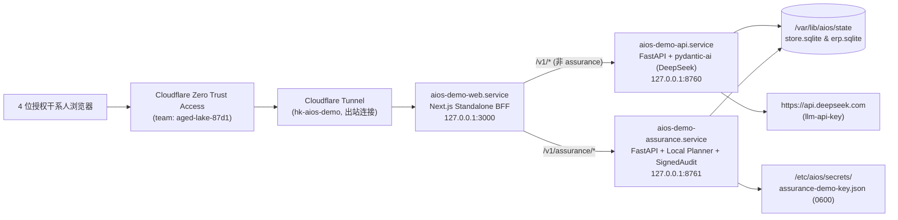

# IntegrAI 生产演示部署与运维手册（阿里云国际香港 + Cloudflare Zero Trust）

> 本文档为 **IntegrAI Enterprise Workbench** 在阿里云国际轻量应用服务器（香港）上的标准生产级运维手册，配套自动化脚本位于 `deploy/integrai/`，Linux `x86_64` 前端构建流水线位于 `.github/workflows/release-linux-x64.yml`。

---

## 0. 目标基础设施、架构与不可违背的安全铁律

### 0.1 目标环境基线

| 维度 | 约定值 / 基线 |
| --- | --- |
| 云服务器 | 阿里云国际轻量应用服务器 `Ubuntu-ljhj`（香港） |
| 实例 ID / 公网 IPv4 | `c59ca5dbed224e8982a9418ecd1b1a29` / `47.242.128.179` |
| 操作系统与架构 | Ubuntu 24.04 LTS（**Linux `x86_64`**） |
| 规格 | 2 vCPU / 2 GiB RAM + 2 GiB Swap（`vm.swappiness=10`） / 40 GiB 磁盘 |
| 低权限运行用户 | `aios-demo`（无 root 权限、非交互登录 shell） |
| 基础运行时 | Node.js 22、Python 3（含 `venv`/`pip`）、Tesseract OCR、SQLite3、`fail2ban`、`ufw` |
| Cloudflare Zero Trust 团队 | `aged-lake-87d1` |
| 复用 Access 策略名 | `SME AIOS Demo - Authorized Stakeholders` |
| 授权访问邮箱（严格 4 位） | `ysunfw@connect.ust.hk`、`hfmchen@connect.ust.hk`、`bzhengah@connect.ust.hk`、`hylaubc@connect.ust.hk` |
| Cloudflare Tunnel 名称 | `hk-aios-demo` |
| 公网子域名约定 | `integrai.<已确认根域名>`（**严禁假设 `integrai.com` 归用户所有**，必须替换为你 Cloudflare 账号下真实托管的根域名） |

### 0.2 双进程隔离拓扑（Section 5 架构）



### 0.3 六条不可违背的安全与运维铁律

1. **纯回环监听，零公网业务端口**：`3000`、`8760`、`8761` **仅绑定 `127.0.0.1`**；阿里云防火墙**永远不放开** `80`/`443`/`3000`/`8760`/`8761`；TCP `22` 仅在**第二个终端验证 SSH 公钥登录成功**后，收紧至运维机当前公网 IPv4 `/32`。
2. **零密钥回显与零弱口令**：绝不在脚本、终端日志、shell 历史、`git` 仓库或阿里云 Cloud Assistant 命令中出现任何 DeepSeek API Key、Cloudflare Tunnel Token、Assurance 私钥、`AIOS_DEMO_SECRET`、`AIOS_BROWSER_SESSION_KEY` 或登录密码；**严禁使用默认弱密码 `aios2026`**。
3. **双进程严格隔离**：`:8760`（Cloud LLM）绝不加载 `AIOS_ASSURANCE_DEMO_KEY_FILE`；`:8761`（Assurance）绝不加载 `AIOS_LLM_API_KEY*`；二者通过 `/etc/aios/demo-common.env` 共享 `AIOS_PLATFORM_STATE_DIR` 与 `AIOS_BROWSER_SESSION_KEY`，实现同源会话互通。
4. **严禁跨架构搬运前端产物**：开发机为 Mac ARM64，服务器为 Linux `x86_64`（`sharp` 等包含原生 `.node` 二进制）。**绝不能把 Mac 上的 `web/.next/standalone` 拷到服务器**，必须使用 GitHub Actions `.github/workflows/release-linux-x64.yml` 产出的 Linux `x86_64` 发布包（或经内存检查后的宿主机 `--build-local`）。
5. **先挂 Access 门禁，再放 Tunnel 公网路由**：必须在 Cloudflare Zero Trust 先为 `integrai.<已确认根域名>` 绑定仅含上述 4 位邮箱的 Access 应用，**确认策略生效后**再把 Tunnel Public Hostname 指向 `http://127.0.0.1:3000`。
6. **绝不无故清空状态库**：禁止在生产演示环境运行 `--reset-state` 或删除 `/var/lib/aios/state/{store,erp}.sqlite`；日常备份使用 WAL 安全的 `sqlite3 .backup`，恢复演练只在隔离临时目录中进行。

---

## 第 1 节：宿主机只读预检（Preflight）

在改动任何配置之前，先以只读方式核验宿主机基线（脚本绝不修改任何系统状态，也绝不读取或打印 `/etc/aios/` 中的任何密钥文件内容）：

```bash
# 如仓库尚未拉取到本机，可先只检出或上传 deploy/integrai/01-preflight.sh
sudo ./deploy/integrai/01-preflight.sh
```

**通过标准**：
- 内核与架构为 `Linux x86_64`，系统为 `Ubuntu 24.04`
- `id aios-demo` 存在且非 `uid=0`
- Swap 约 `2 GiB` 已启用，`vm.swappiness=10`
- `node -v` 为 `v22.x`，`python3`（含 `venv`/`pip`）、`tesseract`（含 `eng`）、`sqlite3`、`git`、`curl`、`tar`、`sha256sum` 均就绪
- `fail2ban` 为 `active`
- `ss -lntup` 中 `80`/`443`/`3000`/`8760`/`8761` 无公网或 `0.0.0.0`/`[::]` 监听
- 根分区剩余空间 `>= 15%`（建议 `>= 20%`）

---

## 第 2 节：SSH 公钥登录验证与云防火墙 `/32` 锁闭

> **防锁死操作顺序铁律**：必须严格按 **2.1 → 2.2 → 2.3 → 2.4** 执行，且整个过程保留第一个已登录的 root/sudo SSH 终端不断开！

### 2.1 部署运维公钥

在运维本机确认你有一对独立管理的 Ed25519 SSH 密钥后，将公钥写入服务器运维账号（例如 `ubuntu` 或 `root` 的 `~/.ssh/authorized_keys`，权限 `0700` 目录 + `0600` 文件）：

```bash
# 在运维本机执行（将 <admin-user> 替换为你的管理账号）
ssh-copy-id -i ~/.ssh/id_ed25519.pub <admin-user>@47.242.128.179
```

### 2.2 开第二个终端实测公钥登录与 `sudo`

**在禁用密码登录或收紧云防火墙之前**，另开一个新终端窗口验证非密码登录：

```bash
ssh -o PasswordAuthentication=no -o KbdInteractiveAuthentication=no -i ~/.ssh/id_ed25519 <admin-user>@47.242.128.179
sudo -v
```

仅当第二个终端**确认密钥免密/口令短语登录成功且 `sudo` 正常**后，才允许进入 2.3！

### 2.3 禁用 SSH 密码登录（在第一个终端执行，保持连接不关）

```bash
sudo tee /etc/ssh/sshd_config.d/99-integrai-hardening.conf >/dev/null <<'EOF'
PubkeyAuthentication yes
PasswordAuthentication no
KbdInteractiveAuthentication no
ChallengeResponseAuthentication no
PermitEmptyPasswords no
PermitRootLogin prohibit-password
MaxAuthTries 4
X11Forwarding no
AllowTcpForwarding no
EOF

sudo sshd -t
sudo systemctl reload ssh
```

再次开**第三个终端窗口**确认密钥登录仍然可用，并确认密码登录被拒绝：

```bash
ssh -o PubkeyAuthentication=no -o PreferredAuthentications=password <admin-user>@47.242.128.179
# 预期：Permission denied (publickey).
```

### 2.4 阿里云轻量应用服务器防火墙锁闭

登录阿里云国际轻量应用服务器控制台，找到实例 `Ubuntu-ljhj`（`c59ca5dbed224e8982a9418ecd1b1a29`）→ **防火墙**：

1. 先在运维本机查询当前出口公网 IPv4：`curl -4 -fsS https://ifconfig.me`（记为 `<OPERATOR_IPV4>`）。
2. 将 TCP `22` 规则的来源限制为 `<OPERATOR_IPV4>/32`。
3. **删除或确认不存在**任何 `80`、`443`、`3000`、`8760`、`8761` 入站放行规则。
4. 保持原有终端不断开，新开一个 SSH 会话确认 `<OPERATOR_IPV4>` 仍可连接 TCP `22`。
   - *应急说明*：若日后运维机公网 IP 变更，直接在阿里云控制台将 TCP `22` 来源更新为新 `/32` 即可，切勿开放 `0.0.0.0/0` 或通过 Cloud Assistant 传输密钥。

---

## 第 3 节：宿主机安全加固（UFW、fail2ban、Swap）

> 再次确认：所有应用业务入口走 `cloudflared` 主动**出站**连接 Cloudflare 边缘，宿主机入站只需允许受控 SSH。

```bash
# 1. 核对 Swap 与 vm.swappiness=10
swapon --show
sysctl vm.swappiness
# 如尚未持久化 vm.swappiness=10：
echo 'vm.swappiness=10' | sudo tee /etc/sysctl.d/99-integrai-swap.conf >/dev/null
sudo sysctl --system

# 2. UFW 默认拒绝入站、允许出站、仅放行受控 SSH（与阿里云 /32 双层防护）
sudo ufw default deny incoming
sudo ufw default allow outgoing
sudo ufw limit 22/tcp comment 'Rate-limited SSH (paired with Aliyun /32 firewall)'
# 确认绝对不执行 ufw allow 80/443/3000/8760/8761
sudo ufw enable
sudo ufw status verbose

# 3. 核对 fail2ban 运行状态
sudo systemctl enable --now fail2ban
sudo fail2ban-client status sshd
```

---

## 第 4 节：初始化虚拟环境、密钥与 Assurance 签名私钥

### 4.1 确定固定发布 Commit SHA 与确认域名

1. 在本地仓库或 GitHub 确认要发布的**完整 40 位 Commit SHA**（例如 `git rev-parse HEAD`），记为 `<RELEASE_SHA>`。
2. 确认已在 Cloudflare DNS 托管的真实根域名，确定本次访问域名：`https://integrai.<已确认根域名>`（例如 `https://integrai.your-real-domain.com`；**严禁使用 `integrai.com`**）。

### 4.2 首次引导后端仓库与 `/opt/aios/.venv`

由于生成 Assurance 私钥需要调用 `/opt/aios/.venv/bin/python -m aios_platform.assurance_audit keygen`，首次部署先执行 `--prepare-venv`：

```bash
# 如宿主机尚未克隆仓库，可先执行：
sudo git clone https://github.com/Doooo4love/sme-aios-demo.git /opt/aios
sudo /opt/aios/deploy/integrai/03-deploy-release.sh \
  --prepare-venv \
  --sha <40位完整Commit-SHA>
```

该步骤会：
- 将 `/opt/aios` 固定检出到 `<40位完整Commit-SHA>`（detached HEAD）
- 创建 `/opt/aios/.venv` 并安装 `requirements-platform.txt` 与 `requirements-platform-harness.txt`
- 将 `/opt/aios` 权限设为 `root:aios-demo`（服务进程仅可读执行，不可改写代码）

### 4.3 交互式初始化密钥、环境变量与 Assurance 私钥

> **必须在交互式 SSH 终端执行**（绝不可通过阿里云 Cloud Assistant 或非交互日志管道传递密码或 API Key）。

```bash
sudo /opt/aios/deploy/integrai/02-init-secrets.sh \
  --origin https://integrai.<已确认根域名>
```

脚本执行细节与安全保证：
- 通过 `read -rs` 静默录入 **DeepSeek API Key**（写入 `/etc/aios/secrets/llm-api-key`，权限 `0600`，属主 `aios-demo:aios-demo`）和**高强度演示登录密码**（`>=14` 位、含至少 3 类字符，强制拒绝 `aios2026` 等弱密码，绝不回显或进入历史记录）。
- 自动生成随机 `AIOS_DEMO_SECRET`（`>=32` 位且**不含 `.`**）与 `AIOS_BROWSER_SESSION_KEY`（64 位十六进制 = 32 字节）。
- **Assurance 私钥原子安装**：以 `root` 在 `mktemp -d`（`0700`）临时目录中执行：
  ```bash
  /opt/aios/.venv/bin/python -m aios_platform.assurance_audit keygen \
    "$TMP/assurance-demo-key.json" \
    --public-out "$TMP/assurance-demo-key.pub.json"
  ```
  再通过 `install -o aios-demo -g aios-demo -m 0600` 原子安装至 `/etc/aios/secrets/assurance-demo-key.json`（彻底避免低权限 `aios-demo` 尝试向 `root:aios-demo 0750` 目录建文件失败的问题），并保存不含私钥的公钥指纹文件 `/etc/aios/secrets/assurance-demo-key.pub.json` 供独立审计校验。
- 默认**不覆盖**已存在的密钥与 `assurance-demo-key.json`；如需轮换，请显式传入 `--rotate`（全量）、`--rotate-password`（仅登录密码）或 `--rotate-llm-key`（仅 DeepSeek Key）。
- 原子写入 4 个严格隔离的环境文件（均为 `0640 root:aios-demo`）：

| 文件 | 服务 | 关键变量与隔离规则 |
| --- | --- | --- |
| `/etc/aios/demo-common.env` | `:8760` + `:8761` 共享 | `AIOS_PROFILE=demo`、`AIOS_PLATFORM_STATE_DIR=/var/lib/aios/state`、`AIOS_BROWSER_ORIGIN`、`AIOS_DEMO_SECRET`、`AIOS_BROWSER_SESSION_KEY` |
| `/etc/aios/demo-api.env` | `:8760`（Cloud LLM） | `AIOS_PLANNER=demo`、`AIOS_WORKBENCH_PLANNER=pydantic-ai`、`AIOS_LLM_BASE_URL=https://api.deepseek.com`、`AIOS_LLM_MODEL=deepseek-chat`、`AIOS_LLM_API_KEY_FILE=/etc/aios/secrets/llm-api-key`（**严禁加载 Assurance 私钥**） |
| `/etc/aios/demo-assurance.env` | `:8761`（Assurance） | `AIOS_PLANNER=demo`、`AIOS_WORKBENCH_PLANNER=local`、`AIOS_ASSURANCE_DEMO_KEY_FILE=/etc/aios/secrets/assurance-demo-key.json`（**严禁加载外部 LLM 密钥**） |
| `/etc/aios/demo-web.env` | `:3000`（Next.js BFF） | `AIOS_API_BASE_URL=http://127.0.0.1:8760`、`AIOS_ASSURANCE_API_BASE_URL=http://127.0.0.1:8761`、`AIOS_BROWSER_ORIGIN`、`AIOS_ENABLE_DEMO_AUTH=1`、`AIOS_DEMO_SECRET`、`AIOS_DEMO_LOGIN_PASSWORD`、`AIOS_OIDC_LOGIN_ENABLED=0` |

---

## 第 5 节：Linux `x86_64` 前端构建与固定 SHA 发布

### 5.1 推荐路径（方案 A）：GitHub Actions 构建 Linux `x86_64` 发布包

1. 打开 GitHub 仓库 → **Actions** → **Build IntegrAI Web Release (Linux x86_64)**（对应 `.github/workflows/release-linux-x64.yml`）。
2. 点击 **Run workflow**，在 `ref` 输入框填入本次要发布的**完整 40 位 Commit SHA**（零密钥注入，自动执行 `tsc --noEmit` + `pnpm build` + Linux `x86_64` ELF `.node` 原生模块核验 + `server.js` 布局核验）。
3. 构建完成后下载 Artifact `aios-web-linux-x64-<12位短SHA>`，解压得到：
   - `aios-web-linux-x64-<12位短SHA>.tar.gz`
   - `SHA256SUMS`
   - `RELEASE_METADATA.json`
4. 通过 `scp` 上传到服务器临时目录（如 `/tmp/integrai-release/`）：
   ```bash
   scp aios-web-linux-x64-<short-sha>.tar.gz SHA256SUMS <admin-user>@47.242.128.179:/tmp/integrai-release/
   ```
5. 在服务器上执行固定 SHA 发布（并可顺带安装启用 SQLite 每日定时备份）：
   ```bash
   sudo /opt/aios/deploy/integrai/03-deploy-release.sh \
     --sha <40位完整Commit-SHA> \
     --web-tarball /tmp/integrai-release/aios-web-linux-x64-<short-sha>.tar.gz \
     --enable-backup-timer
   ```

### 5.2 备选路径（方案 B）：宿主机 Linux `x86_64` 本地构建

仅当网络受限无法使用 GitHub Actions、且宿主机已安装 `pnpm 11` 与具备足够可用内存+Swap（脚本自动校验 `MemAvailable + SwapFree >= 1536 MiB`）时使用：

```bash
sudo /opt/aios/deploy/integrai/03-deploy-release.sh \
  --sha <40位完整Commit-SHA> \
  --build-local \
  --enable-backup-timer
```

### 5.3 发布自动验证内容与 `MemoryMax` 实测调优

`03-deploy-release.sh` 会自动完成并校验：
- 校验 `SHA256SUMS` 与 `RELEASE_METADATA.json` 中的 `arch=linux-x86_64`、`commit_sha==<TARGET_SHA>`
- 拒绝任何 Darwin/ARM64 `.node` 二进制，校验 `server.js` 语法（`node --check`）及 `.next/static`
- 将前端发布至不可变目录 `/opt/aios-web/releases/<short-sha>-<utc-ts>/`，记录 `/opt/aios-web/previous`，并**原子切换** `/opt/aios-web/current`
- 安装 `aios-demo-api.service`、`aios-demo-assurance.service`、`aios-demo-web.service`（全部 `NoNewPrivileges=yes`、`ProtectSystem=strict`、`UMask=0077`、`--no-access-log`）
- 依次验证 `127.0.0.1:8760/readyz`、`127.0.0.1:8761/readyz`、`127.0.0.1:3000/readyz` 及 `ss -lntup` 纯回环绑定

**内存上限实测观测**（初始配置：`api=256M`、`assurance=192M`、`web=256M`）：

```bash
# 在模拟完整业务流程（含 OCR 进件、DeepSeek 助手对话、Assurance 预审）后观测实测峰值：
systemctl show -p MemoryCurrent -p MemoryPeak \
  aios-demo-api.service aios-demo-assurance.service aios-demo-web.service

# 如某服务 MemoryPeak 接近上限 80%，用 drop-in 温和微调（切勿盲目写死过低导致 OOMKill）：
# sudo systemctl edit aios-demo-api.service
```

---

## 第 6 节：Cloudflare Zero Trust Access 门禁与 Tunnel（`hk-aios-demo`）

> **绝对顺序**：必须先完成 **6.1（Access 策略绑定）**，再执行 **6.2（宿主机运行 Tunnel）** 和 **6.3（放开 Public Hostname 路由）**，确保域名从暴露的第一秒起就处于 Zero Trust 认证保护之下！

### 6.1 第一步：在 Cloudflare Zero Trust 绑定 Access 应用（先建门禁！）

登录 Cloudflare Zero Trust Dashboard（确认当前团队为 **`aged-lake-87d1`**）：

1. 核对复用策略 **Access → Policies → `SME AIOS Demo - Authorized Stakeholders`**，确认其 **Include** 规则严格且仅包含以下 4 个邮箱（无任何 wildcard、无 Bypass、无 Everyone）：
   - `ysunfw@connect.ust.hk`
   - `hfmchen@connect.ust.hk`
   - `bzhengah@connect.ust.hk`
   - `hylaubc@connect.ust.hk`
2. 进入 **Access → Applications → Add an application → Self-hosted**：
   - **Application name**：`IntegrAI Enterprise Workbench Demo`
   - **Session Duration**：建议 `12 hours`（或 `24 hours`，与演示周期匹配）
   - **Application domain**：填写准确域名 `integrai.<已确认根域名>`（Path 留空，覆盖整个站点含 `/login`、`/api/*`、`/v1/*`、`/readyz`）
   - **Policies**：挂载上述复用策略 `SME AIOS Demo - Authorized Stakeholders`
   - **CORS / Cookie settings**：保持 `HttpOnly` 开启、`SameSite=Lax`
3. 保存并确认应用状态为 **Active**。

### 6.2 第二步：宿主机安装并启动 `cloudflared`（Tunnel `hk-aios-demo`）

1. 在 Cloudflare Zero Trust → **Networks → Tunnels** 找到（或创建）Cloudflared Tunnel **`hk-aios-demo`**。
2. 在宿主机安装官方 `cloudflared` apt 仓库并安装 `cloudflared`：
   ```bash
   sudo mkdir -p --mode=0755 /usr/share/keyrings
   curl -fsSL https://pkg.cloudflare.com/cloudflare-main.gpg | sudo tee /usr/share/keyrings/cloudflare-main.gpg >/dev/null
   echo 'deb [signed-by=/usr/share/keyrings/cloudflare-main.gpg] https://pkg.cloudflare.com/cloudflared noble main' | \
     sudo tee /etc/apt/sources.list.d/cloudflared.list >/dev/null
   sudo apt-get update && sudo apt-get install -y cloudflared
   cloudflared --version
   ```
3. **无痕录入 Tunnel Token**（避免 Token 进入 `~/.bash_history`、`ps aux` 或云助手日志）：
   ```bash
   # 在交互式 SSH 会话中关闭历史记录，使用 read -rs 静默读取后安装为 systemd 服务
   set +o history
   printf 'Paste Cloudflare Tunnel token for hk-aios-demo (hidden): '
   IFS= read -rs CF_TUNNEL_TOKEN
   printf '\n'
   sudo cloudflared service install "${CF_TUNNEL_TOKEN}"
   unset CF_TUNNEL_TOKEN
   set -o history

   # 核验 systemd unit 权限仅 root 可读，并确认服务健康运行
   sudo chmod 0600 /etc/systemd/system/cloudflared.service
   sudo systemctl daemon-reload
   sudo systemctl enable --now cloudflared
   sudo systemctl status cloudflared --no-pager
   ```
   > 若希望更进一步避免 systemd 命令行携带 token，可将 token 写入 `/etc/cloudflared/token.env`（`0600 root:root`：`TUNNEL_TOKEN=...`），在 systemd drop-in 中使用 `EnvironmentFile=/etc/cloudflared/token.env` 与 `ExecStart=/usr/bin/cloudflared --no-autoupdate tunnel run`。

### 6.3 第三步：配置 Tunnel Public Hostname 路由

仅在确认 **6.1 Access 应用已 Active** 且 **6.2 `hk-aios-demo` 显示 Healthy** 后：

1. 进入 **Networks → Tunnels → `hk-aios-demo` → Public Hostname → Add a public hostname**：
   - **Subdomain**：`integrai`
   - **Domain**：`<已确认根域名>`
   - **Path**：留空
   - **Service Type**：`HTTP`
   - **URL**：`127.0.0.1:3000`
2. 保存后在 Cloudflare DNS 核对已生成 Proxied（橙云）CNAME 记录：`integrai.<已确认根域名>` → `<tunnel-id>.cfargotunnel.com`。

---

## 第 7 节：Cloudflare 缓存旁路（Cache Bypass）、TLS 与 WAF 限流核验

在 Cloudflare Zone（`<已确认根域名>`）下完成并复核以下三项边缘策略：

### 7.1 Cache Rules（强制绕过所有动态接口缓存）

进入 **Caching → Cache Rules → Create rule**：
- **Rule name**：`IntegrAI Bypass Dynamic API & BFF`
- **When incoming requests match**：
  ```text
  (http.host eq "integrai.<已确认根域名>" and (
    starts_with(http.request.uri.path, "/api/") or
    starts_with(http.request.uri.path, "/v1/") or
    http.request.uri.path eq "/healthz" or
    http.request.uri.path eq "/readyz"
  ))
  ```
- **Cache eligibility**：选择 **Bypass cache**
- 保存并启用。

### 7.2 SSL/TLS 边缘安全设置

进入 **SSL/TLS**：
- **Edge Certificates → Always Use HTTPS**：开启（On）
- **Minimum TLS Version**：`TLS 1.2`
- **Automatic HTTPS Rewrites**：开启（On）
- **HSTS**：仅在你确认整个根域均可安全使用 HTTPS 时按需启用；切勿盲目对未确认子域开启 `includeSubDomains` + `preload`。

### 7.3 WAF Rate Limiting（登录防爆破 & DeepSeek 成本防护）

进入 **Security → WAF → Rate limiting rules**：
1. **登录接口限流**（配合 BFF 内置内存滑动窗口双层防护）：
   - 路径匹配：`http.host eq "integrai.<已确认根域名>" and (http.request.uri.path eq "/api/auth/login" or http.request.uri.path eq "/api/auth/demo-login")`
   - 阈值：例如每 `10 seconds` 超过 `10` 次请求（按 IP 计数）→ **Block**（或 Managed Challenge）。
2. **Cloud LLM 助手接口限流**（防护 DeepSeek 异常刷量）：
   - 路径匹配：`http.host eq "integrai.<已确认根域名>" and http.request.uri.path eq "/v1/workbench/turns"`
   - 阈值：例如每 `10 seconds` 超过 `10` 次请求 → **Block**（配合后端 `AIOS_PLANNER_CALLS_PER_MINUTE=60`）。
3. 保存后通过单次真实登录与异常重试验证限流计数器在 WAF Analytics 中可见（不要用生产管理员账号触发长时间封禁）。

---

## 第 8 节：SQLite 每日热备、磁盘告警与隔离恢复演练

### 8.1 安装并启用每日定时备份（WAL 安全 `.backup`）

如第 5 节尚未传入 `--enable-backup-timer`，可手动安装并启用：

```bash
sudo install -o root -g root -m 0644 \
  /opt/aios/deploy/integrai/systemd/aios-sqlite-backup.service \
  /opt/aios/deploy/integrai/systemd/aios-sqlite-backup.timer \
  /etc/systemd/system/
sudo systemctl daemon-reload
sudo systemctl enable --now aios-sqlite-backup.timer
systemctl list-timers aios-sqlite-backup.timer --no-pager
```

### 8.2 立即手动触发一次热备并核验

```bash
sudo systemctl start aios-sqlite-backup.service
sudo journalctl -u aios-sqlite-backup.service -n 40 --no-pager
```

备份规则核验：
- 同时使用 `sqlite3 -cmd ".timeout 15000" ... ".backup ..."` 热备 `store.sqlite` 与 `erp.sqlite`（不中断线上服务）
- 自动对每个快照文件执行 `PRAGMA integrity_check;` 并生成 `SHA256SUMS`
- 自动保留近 `14` 天快照（且永远至少保留最近 2 份有效快照）
- 当备份盘剩余空间 `< 15%` 时写入 `[ALERT]` 与 syslog 告警；`< 5%` 时安全中止以免打满系统盘

### 8.3 执行隔离恢复演练（绝不触碰线上状态库）

```bash
sudo -u aios-demo /opt/aios/deploy/integrai/05-restore-drill.sh
```

演练脚本强制在 `/tmp/aios-restore-drill.XXXXXX`（`0700`）临时目录中校验 `SHA256SUMS`、`PRAGMA integrity_check`、`PRAGMA quick_check`、`PRAGMA foreign_key_check` 及表结构行数统计，退出时自动销毁临时目录，**全程绝不写入或覆盖 `/var/lib/aios/state`**。

---

## 第 9 节：线上验收、回滚预案与验收留痕清单

### 9.1 自动化线上验收脚本

```bash
sudo /opt/aios/deploy/integrai/06-verify-live.sh \
  --public-origin https://integrai.<已确认根域名>
```

脚本自动核验且**绝不打印任何密码、Cookie 值或 CSRF Token**：
1. `:8760`、`:8761`、`:3000` 全部 `/healthz` 与 `/readyz` 返回 HTTP `200`
2. `ss -lnt` 确认三端口仅监听 `127.0.0.1`
3. `/login` 响应包含 `Referrer-Policy: no-referrer`、`X-Content-Type-Options: nosniff`、`X-Frame-Options: DENY`
4. 伪造 `Origin: https://evil.invalid` 返回 `403` 且带 `Cache-Control: no-store`
5. 默认弱密码 `aios2026` 被拒绝（HTTP `401`）
6. 正确登录返回 `__Host-aios_session` 且同时具备 `Secure`、`HttpOnly`、`SameSite=Lax`、`Path=/`、无 `Domain=`，并带 `Cache-Control: no-store`
7. `GET /v1/workbench/capabilities` 返回 `200`、`Cache-Control: no-store`，且**不含 `planner` 及任何禁止透出字段**
8. `GET /v1/assurance/cases` 复用同一会话 Cookie 成功路由至 `:8761` 并返回 `200`、`no-store`、零禁止字段
9. `DELETE /v1/session` 正常注销清理测试会话（HTTP `204`）
10. 未认证访问公网 `https://integrai.<已确认根域名>/{login,readyz,v1/me}` 均被 Cloudflare Access 拦截（HTTP `302` 跳转 `aged-lake-87d1.cloudflareaccess.com` 或 `401`/`403`）

### 9.2 一键原子回滚预案（保留 SQLite 业务数据）

若新版本上线后发现异常，立刻执行原子回滚（回退 `/opt/aios-web/current` 到 `previous` 并回退 `/opt/aios` 到 `.previous-sha`，**绝不触碰 `/var/lib/aios/state`**）：

```bash
sudo /opt/aios/deploy/integrai/03-deploy-release.sh --rollback
sudo /opt/aios/deploy/integrai/06-verify-live.sh \
  --public-origin https://integrai.<已确认根域名>
```

> 若仅需回退至任意历史已保留发布目录，可手工查看 `ls -la /opt/aios-web/releases/`，使用 `ln -s <目标目录> /opt/aios-web/.current.fix && mv -Tf /opt/aios-web/.current.fix /opt/aios-web/current && sudo systemctl restart aios-demo-web.service`。

### 9.3 最终验收留痕清单（严禁在截屏或日志中泄露任何凭据）

| # | 验收项 | 核验命令 / 位置 | 状态 |
| --- | --- | --- | --- |
| 1 | 宿主机基线只读预检全部 PASS | `sudo ./deploy/integrai/01-preflight.sh` | [ ] |
| 2 | SSH 公钥登录正常、密码登录已禁用 | 新终端 `ssh -o PubkeyAuthentication=no ...` 被拒 | [ ] |
| 3 | 阿里云防火墙 TCP 22 仅放行 `/32`，业务端口全关 | 阿里云控制台防火墙截图（遮蔽敏感信息） | [ ] |
| 4 | UFW 与 fail2ban 均 `active` | `sudo ufw status verbose && sudo fail2ban-client status sshd` | [ ] |
| 5 | 4 个 env 文件权限 `0640 root:aios-demo`，2 个私钥文件 `0600 aios-demo:aios-demo` | `01-preflight.sh` 第 8 节输出（零内容输出） | [ ] |
| 6 | 固定 40 位 Commit SHA 与 Linux `x86_64` 包校验通过 | `03-deploy-release.sh` 输出 + `RELEASE_METADATA.json` | [ ] |
| 7 | 三服务均 `active` 且仅监听 `127.0.0.1:{3000,8760,8761}` | `sudo ss -lntup` + `systemctl is-active` | [ ] |
| 8 | Cloudflare Access 应用已绑定精确 4 位授权邮箱 | Zero Trust 控制台策略核对 + 无痕浏览器未登录被拦截 | [ ] |
| 9 | Cloudflare Cache Bypass (`/api/*`, `/v1/*`) 与 WAF 限流生效 | Cloudflare 规则列表 + 响应头 `Cache-Control: no-store` | [ ] |
| 10 | 4 位授权邮箱之一完成端到端登录、AI 助手（DeepSeek）与 Assurance 预审验收 | 浏览器实测（DevTools 确认无 `capabilities.planner` 与敏感字段） | [ ] |
| 11 | SQLite 每日定时热备已启用且隔离恢复演练通过 | `04-sqlite-backup.sh` + `05-restore-drill.sh` 全绿 | [ ] |
| 12 | `06-verify-live.sh --public-origin https://integrai.<已确认根域名>` 全部 PASS | 终端输出留痕（无任何密码/Token/Cookie） | [ ] |
