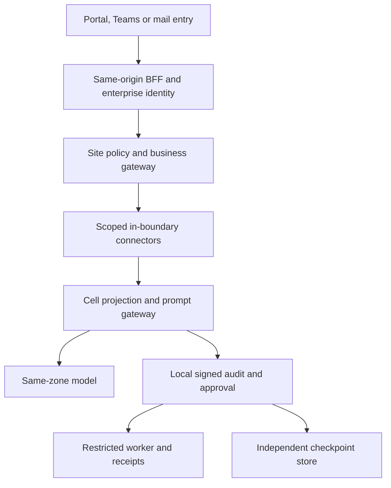

# Governed AI operations and frontend handoff

[简体中文](governed-assurance.zh-CN.md)

AIOS coordinates processes across ERP, WMS, QMS, CRM, HCM and collaboration tools. Existing applications retain authoritative business records and transactions. AIOS owns mappings, cases, approval tracks, signed evidence and execution receipts. Zero core migration means customer applications and databases continue operating in place. AIOS has its own database and rollout. Identity, connectors and mappings still need configuration.

## Scope

| Goal | Baseline | Delivered here | Customer release gate |
|---|---|---|---|
| Use data with protected fields hidden | Tenant RLS, domain grants, warehouse and object checks | `assurance_policy.py` checks tenant, site, case and actor grant, then applies a field allowlist and separate employee/model cell restrictions. Unknown fields are omitted | Actual classification, source views, legal entities and factories, cross-domain relationships and inference restrictions |
| Intercept prompts in real time | Typed tool gateway | `assurance_gateway.py` accepts predefined review tasks. A configured same-zone provider receives only authorized facts and permitted finding codes. The response must match the fixed enum contract | Customer internal provider, document isolation and extraction, adversarial evaluation, and egress verification |
| Purchasing, incoming quality and contracts | Sales drafts, independent approval and ERP outbox | `assurance.py` adds policy-based routing, parallel tracks, separation of approvers, snapshot and source revision checks, concurrent decisions, holds and rejection. Three synthetic cases exercise the paths | Actual purchasing thresholds, inspection standards, approved clause templates and evidence mapping. External writes require separate per-action certification |
| Input and output audit | Transactional events and request IDs | `assurance_audit.py` encrypts exact bounded provider bytes with AES-GCM, chains event digests with SHA-256, signs using Ed25519, and exposes checkpoints and offline verification. The application database role can append but lacks audit body read and update rights | Independent signer and WORM checkpoints, key rotation, dual-control forensic access and tested backups |
| Discovery and connectors | REST tools and selected ERP bridge | `assurance_catalog.py` drafts field classifications and object relationships from local OpenAPI, PostgreSQL/SQLite metadata or Excel-exported CSV headers. Sales, purchasing, production, expense, contract and HR have discovery templates | Business owners approve field semantics, ownership, lifecycle and write-back. Native XLSX, Kafka consumption, RPA and production collaboration connectors remain integration work |

Source-side RLS and column grants narrow access first. The gateway then enforces the intersection of an employee's readable cells and the model allowlist. A trusted policy can further deny specific cells, including separately for model use. Use scoped source views or APIs wherever available. The model never receives a general SQL connection. OWASP describes prompt injection as a risk that requires independent authorization and output controls. [PostgreSQL RLS](https://www.postgresql.org/docs/16/ddl-rowsecurity.html) · [View privilege behavior](https://www.postgresql.org/docs/16/sql-createview.html) · [OWASP prompt injection](https://genai.owasp.org/llmrisk/llm01-prompt-injection/)

## Deployment boundaries



| Topology | Data flow | Acceptance |
|---|---|---|
| On premises | IdP, BFF, connectors, model, database, keys, backup and observability stay inside the enterprise. Verify imported images and model weights in a staging area. Block public egress at runtime | Run offline, test DNS and proxy restrictions, check telemetry destinations, load and restore |
| Dedicated private cloud | Customer VPC or private cloud, private endpoints and customer KMS/HSM. Model and audit store stay inside the approved zone | Verify endpoints, data location, private DNS, operator access and backup |
| Multi-factory hybrid | Each factory has its own data plane, model gateway, signed ledger and keys. Central control distributes signed policies and collects approved minimal service health. Raw case data, embeddings, logs and prompts stay local by default | Private network or workload identity with mTLS, offline site operation and recovery drills. Reconcile policies and source receipts after reconnect. Cross-site actions need explicit grants |

The code verifies tenant, site, case ID and configured zone. A zone label constrains application routing. Firewalls, workload authentication, backups and telemetry boundaries require deployment tests. When Teams or hosted mail is outside the approved boundary, use customer-approved links and status notices containing no sensitive fields. An isolated deployment can use an internal portal or messaging service. [SPIFFE architecture](https://spiffe.io/docs/latest/spire-about/) · [Microsoft Graph permissions](https://learn.microsoft.com/en-us/graph/permissions-overview)

## Reviews, prompts and audit

- **Purchasing** checks supplier approval, quote count, currency and amount. The sample uses minor units with a separate finance track for non-HKD. **Incoming quality** validates sample size, defects and certificates. A critical defect or missing certificate sets `HELD`. **Contracts** use already-extracted clause facts to route to legal and, if needed, procurement. Full document extraction remains an input.
- Rules supply required tracks. A model supplies suggestions. Each required track has an independent approver, with separate actors across tracks. Requesters cannot approve their own work. A source revision change calls for a fresh review. `APPROVED` means internal approval completed. ERP execution still requires a connected restricted worker and a source receipt.
- The provider input is persisted before the call and bounded output is encrypted before publication. There is a 16 KiB output limit. Oversize responses are rejected with size and digest evidence. Blocked employee prompts retain a reason and fingerprint. Failed calls record failure. A crash before the response is journaled may leave an input with an unknown outcome. A production provider boundary must reconcile such calls. The provider and audit DB do not share a transaction.
- Signatures and hashes enable tamper detection. An independently retained signed anchor detects truncation through its sequence. A latest checkpoint kept only in the same database does not prove against database rollback. Use a separate signing identity, separate encryption and signing keys, WORM retention and restricted forensic access for deployment. Normal logs, browser telemetry and notifications carry no transcript bodies. [Ed25519](https://www.rfc-editor.org/rfc/rfc8032) · [WORM Object Lock example](https://docs.aws.amazon.com/AmazonS3/latest/userguide/object-lock.html)

## Zero-core-migration integration

| Interface | First-customer design |
|---|---|
| REST/OpenAPI, ERP/CRM/HCM | Register the contract and permission scope. Read with delegated or narrowly scoped service identities. Bind previews to source versions. Use idempotency keys and read-back for approved writes. Confirm actual system APIs |
| SQL databases | Dedicated read-only credentials, schema/table allowlist, source views, parameterized queries, timeouts and audit. Current CLI reflects metadata without reading business rows. Keep arbitrary production SQL outside model tools |
| Kafka/CDC | Start with approved event contracts. Consider Debezium and outbox routing when needed. Define source versions, event IDs, dead-letter handling, replay and snapshot reconciliation. External destinations require coordinated idempotency |
| Excel | Draft mappings from CSV headers. File ingestion needs version checks, an isolation boundary, no macro execution, formula and area validation, concurrency controls and row-level receipts |
| RPA | Use a dedicated approved action when supported APIs are absent. Scope bot access by site, system and action. Verify the receipt and stop on UI drift |
| Mail and Teams | Use the customer's identity or approved bot. Link work back to the BFF. Reauthorize channel events and parameters, deduplicate and isolate attachments |

The sequence is **approved inventory → metadata snapshot → draft classification and relationships → human validation of semantics and ownership → shadow trial → scoped reads → limited writes**. CLI output is `review_required` with `executable=false` and every field hidden by default. Compare fingerprints before policy release. Start with one site, source and workflow. Consider open-source Temporal when long waits, cross-system compensation or SLA escalation warrant it. Preserve the PostgreSQL outbox for short transactions. [OpenAPI](https://spec.openapis.org/oas/) · [SQLAlchemy reflection](https://docs.sqlalchemy.org/en/20/core/reflection.html) · [Kafka semantics](https://kafka.apache.org/documentation/#semantics) · [Debezium Outbox](https://debezium.io/documentation/reference/stable/transformations/outbox-event-router.html) · [Temporal Activities](https://docs.temporal.io/activities)

## Frontend handoff

| Screen | Contract and interaction |
|---|---|
| Case | `GET /v1/assurance/cases/{reference}`. Display only supplied fields. Separate evidence, rules, model suggestions and human decisions. Missing fields are unavailable |
| Submit review | `POST /v1/assurance/cases/{reference}/reviews` with `client_id` and optional controlled `instruction`. Reuse the key on retries and obtain a new key for a new instruction or source version. GET the same path for history and continue with `next` |
| Approval tracks | `GET /v1/assurance/reviews/{id}` lists `tracks, decisions, state, stale, snapshot, expires_at, expired`. POST `track, action, snapshot` to `/v1/assurance/reviews/{id}/decisions`. Disable new decisions for stale or expired reviews. Show scope denial for 403 and disposition instructions for `HELD` |
| Governance and audit | Auditors use `GET /v1/assurance/audit/checkpoint`. Display sequence, hash, signature and key ID. Retain the checkpoint independently. Keep transcript bodies out of the browser and show verification status only from a trusted verifier |
| Discovery and operations | Admin UI can start by importing CLI drafts for classification and comparison. Approval, identity mapping and publication APIs are future work. Distinguish unconfigured, registered and validated connectors. Avoid silent egress fallback |

Reuse the existing BFF plan, `/v1/me` and workbench shell. Keep sensitive responses out of persistent browser caches, clear data on tenant change and render model-facing text safely. Handle 422 with stable error codes, 429 with `Retry-After`, and 502/503 with a route to manual work. Display `X-Request-ID` for support. The local `/openapi.json` is the API contract. [Workbench handoff](workbench-handoff.md)

### Local integration without customer data or a model

```bash
python -m pip install -r requirements-platform.txt
export AIOS_PROFILE=demo
export AIOS_PLANNER=demo
export AIOS_PLATFORM_STATE_DIR="$(mktemp -d)"
export AIOS_DEMO_SECRET="$(python -c 'import secrets; print(secrets.token_urlsafe(32))')"
export AIOS_ASSURANCE_DEMO_KEY_FILE="$AIOS_PLATFORM_STATE_DIR/assurance-keys.json"
python -m aios_platform.assurance_audit keygen "$AIOS_ASSURANCE_DEMO_KEY_FILE" \
    --public-out "$AIOS_PLATFORM_STATE_DIR/assurance-public.json"
python -m uvicorn aios_platform.api:create_app --factory --host 127.0.0.1 --port 8760
```

For demo bearer tokens, use `$AIOS_DEMO_SECRET.operator` to start `PO-100`, `QA-200` or `CT-300`. Use `manager` and `finance` for purchasing, `quality` for inspection, `legal` for contracts and `admin` for checkpoints. Run discovery with `python -m aios_platform.assurance_catalog --template procurement --openapi source.json`. Database discovery reads a dedicated `AIOS_DISCOVERY_DSN` and explicit `--table` arguments. Test Excel exports with `--csv-headers headers.csv`. Verify a trusted ordered JSON Lines export containing `seq,envelope,digest,signature` using `python -m aios_platform.assurance_audit verify TENANT --ledger ledger.jsonl --checkpoint checkpoint.json --public-key public.json`. Public keys come from independently trusted configuration.

## Recovery and traffic pressure

`client_id` is scoped to the tenant, case and actor. Persist it for the life of a submission and replay it with identical input. A completed replay returns `201` with the existing review. `expires_at` is Unix seconds. `expired` is the server's approval gate. It is true for pending or held reviews migrated without trusted expiry. Completed decisions remain visible. Rules-only evaluation, review creation and the signed event commit together. With a future provider, a durable attempt is reserved before dispatch and model input is audited before invocation.

| HTTP response and `detail.code` | Frontend and operations |
|---|---|
| `409 REVIEW_IN_PROGRESS` | Keep the submitted item pending. Retry the original request with the same key after `Retry-After`, with jitter and a bounded retry window. |
| `409 REVIEW_OUTCOME_UNKNOWN` or `REVIEW_ATTEMPT_FAILED` | Offer manual review. Capture `detail.run_id` and `X-Request-ID` with the case reference. Inspect the signed ledger and provider receipt before creating a replacement. A missing receipt leaves the outcome unresolved. |
| `409 REVIEW_REQUEST_CONFLICT`, `REVIEW_SNAPSHOT_CONFLICT`, `REVIEW_SOURCE_CHANGED`, or `REVIEW_EXPIRED` | Refresh evidence and show the reason. An employee may actively start a fresh review for the new evidence or expiry. Existing decisions stay attached to the prior snapshot. |
| `429 MODEL_BUDGET_EXHAUSTED` | The model was never invoked. Retry with the same key after `Retry-After` and jitter. |
| `503 ASSURANCE_OVERLOADED`, `ASSURANCE_SOURCE_UNAVAILABLE`, or `STORAGE_UNAVAILABLE` | Respect `Retry-After` with jitter and bounded retries. Retain entered fields and the same key. Escalate to read-only/manual operation during a sustained outage. |
| `502 MODEL_OUTPUT_BLOCKED` or `503 MODEL_UNAVAILABLE` | Preserve the correlation IDs. Route to manual review. Provider failures can occur after dispatch. |

The default limit is eight concurrent assurance calls per API process (`AIOS_ASSURANCE_CONCURRENCY`, 1–32). PostgreSQL assurance transactions use a 1.5-second lock timeout and a five-second per-statement timeout. The PostgreSQL connection timeout defaults to five seconds per host when the DSN omits it. The SQLite demo uses a 0.5-second lock wait for those operations. A provider attempt reports `REVIEW_OUTCOME_UNKNOWN` after 120 seconds without completion and keeps its ownership. The rules-only demo expiry defaults to 3,600 seconds (`AIOS_ASSURANCE_REVIEW_TTL`, 1–86,400). Production bindings must set the review TTL and connector I/O deadlines for their workload. These limits apply at different layers and have separate clocks. [PostgreSQL client timeouts](https://www.postgresql.org/docs/current/runtime-config-client.html) · [Retries and jitter](https://aws.amazon.com/builders-library/timeouts-retries-and-backoff-with-jitter/)

```bash
python -m pip install -r requirements-test.txt
python -m unittest discover -s tests -v
python scripts/assurance_load.py --clients 16 --reviews 100
```

The load run uses synthetic rules-only input and pairs two requests for each key. The burst reports latency and load shedding. The recovery phase verifies one finalized review and one signed event per key. Run `test_platform.py` with `AIOS_PLATFORM_TEST_DSN` against a disposable PostgreSQL database for actual row locks and separated-role checks. Apply Alembic through `0006_assurance_runtime` and then rerun `deploy/platform/postgres-security.sql` before deploying the new API. Existing pending and held requests require fresh review.

## First-customer release gates

1. Obtain de-identified purchase orders, inspection samples and contract clause facts for one site. Map the source records, employees, roles, factories, currency, quality standards, responsibility and historical human results.
2. Confirm read-only identities and sandboxes. Select specific authorized write methods, source versions and idempotent response contracts. Validate read-only shadow operation first. The rollout window depends on authorization and integration complexity.
3. Approve zone, field and model-use boundaries, retention and key responsibilities. Pick an internal provider and test egress denial, indirect injection, hostile documents, audit anchoring and factory disconnection.
4. Acceptance drills cover revocation, aggregate inference, schema drift, cross-site denial, replays, stale or denied decisions, external reconciliation and restores. Review actual sales, buying, manufacturing, expenses, legal and HR policy before promotion.
5. Validate per-tenant ingress quotas, pool sizing, worker concurrency, audit retention and independent checkpoints on target infrastructure. Exercise multi-process bursts, DB restore/failover, signing failure and clock skew. Compare auto-processing coverage, exception rate, time saved and false approvals with labelled historical outcomes before setting the service-level targets. Confirm the ERP supports conditional writes and receipts. The internal approval state carries no authority to change source records without that adapter and its separate release gate.
