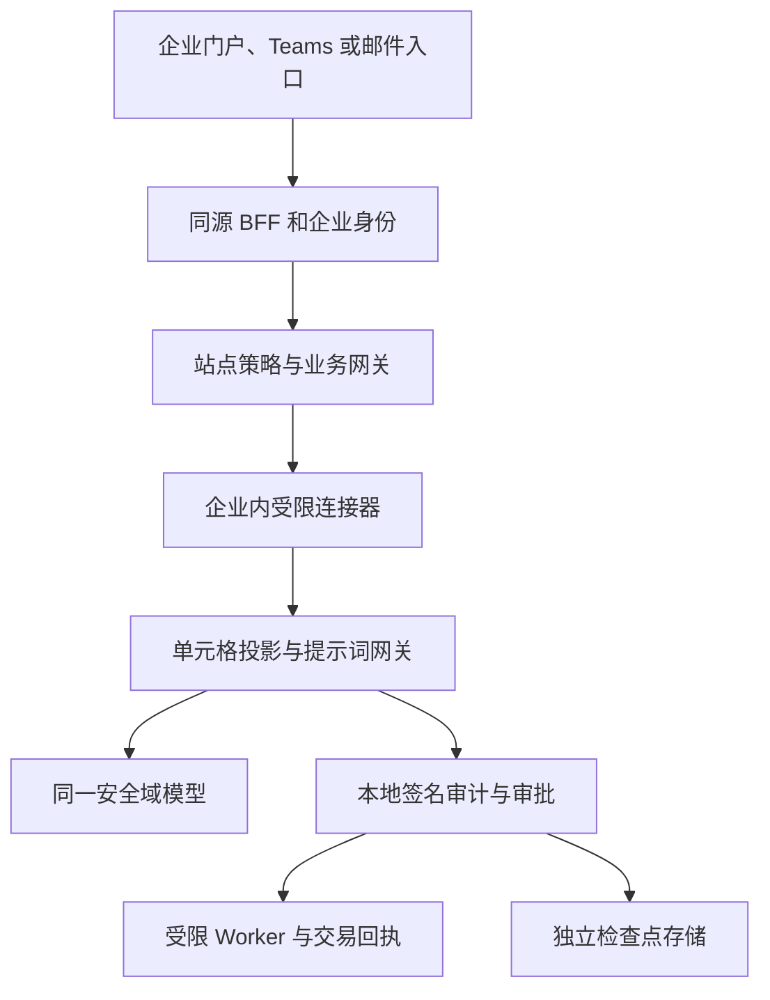

# 受控 AI 业务运营平台与前端交接

[English](governed-assurance.md)

AIOS 作为现有 ERP、WMS、QMS、CRM、HCM 与办公工具之间的流程中枢。核心系统继续负责业务主数据和权威交易，AIOS 保存映射、审查案件、审批轨道、签名审计和执行回执。零迁移指客户核心库和应用继续原位运行。AIOS 自己仍需持久化和升级，客户也要配身份、连接和映射。

## 能力和交付边界

| 目标 | 现有基线 | 本轮代码 | 上线条件 |
|---|---|---|---|
| 数据可用、敏感字段不可见 | 租户 RLS、域能力、仓库与对象检查 | `assurance_policy.py` 按租户、站点、案件、人员能力做行级准入，并叠加字段白名单与逐案单元格拒绝，可分别限制员工和模型。未知字段不投影 | 真实字段分类、来源视图、法人及工厂映射、跨域关系和禁止聚合推断规则 |
| 提示词实时拦截 | 类型化工具网关 | `assurance_gateway.py` 检查指令，只接受预登记任务。只向已配置的同域模型传经授权的结构化事实与候选分类，输出只接受枚举。提示词注入识别属于辅助层 | 接公司批准的内网模型，接原文前必须做文档隔离、字段提取、对抗评测和出网测试 |
| 采购、来料、合同 | 订单草稿、单一审批和 ERP Outbox | `assurance.py` 新增案件规则、多轨审批、异人批准、摘要与源版本重查、并发事务、留置和拒绝。合成演示覆盖采购、来料、合同三个流程 | 审批门槛、质量规程、合同条款模板、原始凭证映射。所有外部写入需逐动作联调与复核 |
| 输入输出审计 | 事务审计、追踪 ID | `assurance_audit.py` 用 AES-GCM 加密正常上限内的模型输入输出原字节，SHA-256 链接事件，Ed25519 签名，提供检查点及离线验证。应用角色可追加，无权读改审计正文 | 独立签名服务、检查点写入独立 WORM、密钥轮换与双人取证、备份和恢复演练 |
| 自动建模与接入 | REST 工具和部分 ERP 桥接 | `assurance_catalog.py` 用本地 OpenAPI、PostgreSQL／SQLite 元数据、Excel 导出的 CSV 表头生成分类、关系和映射草案。销售、采购、生产、报销、合同、HR 是建模模板 | 正式字段含义、状态机、权限和写回方向由业务与系统负责人复核。完整 XLSX、Kafka 消费、RPA 和真实办公集成仍需对接 |

行级策略和列级 GRANT 在数据源侧先缩小权限，单元格策略在已知对象上做最终投影。模型得到的是员工可见范围与模型字段白名单的交集。代码支持增加逐案拒绝，拒绝不可被模型或前端覆盖。数据源如果能提供专用视图或受限 API，应先裁剪再投影；后台通用账号或原始 SQL 不能成为员工工具。OWASP 提醒提示词检测无法消除注入风险，因此独立的授权和输出约束是执行前提。[PostgreSQL RLS](https://www.postgresql.org/docs/16/ddl-rowsecurity.html) · [权限检查视图](https://www.postgresql.org/docs/16/sql-createview.html) · [OWASP 提示词注入](https://genai.owasp.org/llmrisk/llm01-prompt-injection/)

## 私有化和混合部署



| 形态 | 安全边界与数据流 | 验收 |
|---|---|---|
| 纯本地机房 | IdP、BFF、连接器、模型、数据库、密钥、备份与遥测全部在企业机房。镜像和模型权重在隔离环境验签后导入，业务运行默认关闭公网 egress | 断外网演练、DNS／代理／日志出区检查、模型负载及恢复 |
| 专有云 | 客户专属 VPC 或私有云，私有服务端点、私网连接和客户 KMS／HSM。模型服务与审计存储同域，附件和数据库保留在批准域 | 验证数据落点、私有 DNS、维护链路及供应商访问权限 |
| 多工厂混合云 | 工厂独立数据面、模型网关、审计链存储和密钥。同一控制面只推签名策略包并接收批准的最小健康指标。默认各站点不共享案件正文、向量、日志或模型上下文 | 专线或具有工作负载身份的 mTLS，工厂断链保持本地预审。连接恢复先核对策略版本与外部回执，跨厂业务需单独授权 |

代码校验连接器记录的租户、站点、案件 ID 和安全域，模型绑定由部署配置决定。这里的安全域标记只约束应用选择，机房防火墙、网络策略、证书、备份和遥测出区需由实际部署验证。Teams 和云邮件若位于边界外，仅可在客户批准后发送无敏感数据的短时深链接或状态通知。纯离线模式用内部门户或已在域内的消息系统。[SPIFFE 架构](https://spiffe.io/docs/latest/spire-about/) · [Microsoft Graph 权限](https://learn.microsoft.com/en-us/graph/permissions-overview)

## 审批、提示词与审计职责

- **采购**。检查供应商、报价数量、币种和金额，按规则进采购及财务轨。样例用货币最小单位，非 HKD 走人工财务复核。**来料**。校验抽样数量、缺陷数和证明，关键缺陷或缺证停在 `HELD`，由具权人员处置。**合同**。依据已提取的条款特征触发法务及采购轨。当前输入是类型化证据，不包含全文解析。
- 始终由规则产生必要轨道。模型输出只是提示，不决定审批人、写数据库、放行质检或签合同。各轨必须独立批准，申请人不可自批，同一批准人不可跨轨替代他人。业务源版本变化后重新开审。当前 `APPROVED` 代表内部审批完成，ERP 提交仍需接入受限 Worker 和真实回执流程。
- 业务界面不给模型、浏览器或任意 SQL 共享后台凭据。审计中的模型输入在调用前持久化，正常响应在发布前加密持久化。模型接口上限 16 KiB，超限拒绝并保留大小和摘要，拒绝的员工指令记录原因和指纹。模型异常无可用输出时记录失败。已记录输入但进程在记回包前崩溃的运行需在外部模型网关对账，模型和审计数据面之间没有分布式原子提交。
- 签名和哈希使事后修改可检测。独立保留的签名检查点可检测其覆盖范围被截尾，单靠数据库里最新的检查点无法识别整库回滚。生产须用独立签名主体、两把独立用途密钥、WORM 保留与限定读取身份。模型正文绝不进入普通日志、浏览器遥测或通知系统。[Ed25519](https://www.rfc-editor.org/rfc/rfc8032) · [WORM Object Lock 示例](https://docs.aws.amazon.com/AmazonS3/latest/userguide/object-lock.html)

## 零迁移连接和建模

| 接口 | 首客方案与风险控制 |
|---|---|
| REST/OpenAPI、ERP/CRM/HCM | 先录入契约与权限。只读采用委派或窄范围服务身份。预览绑定来源版本，已批准的写操作携带幂等键，单独回查。现有 ERP 桥接可复用，真实 API 或插件能力需逐系统确认 |
| 关系库直连 | 专用只读账户、白名单 schema/表、源侧受控视图、查询超时、参数化及审计。当前 CLI 只反射元数据，默认不取业务行。禁止由模型构造或执行生产 SQL |
| Kafka/CDC | 优先使用客户现有事件契约，再按需接 Debezium／Outbox，明确租户、来源版本、事件去重键、死信、重放和快照读回。Kafka 重放仍要和外部系统协调幂等与提交 |
| Excel | 先读 CSV 表头建模。真实文件需版本绑定、文件隔离、禁宏执行、公式与区域校验、并发锁及逐行回执。表格覆盖和核心库写回各走独立审核 |
| RPA | 只在没有支持 API 时作为经审批的专用动作。机器人账户限站点、应用和动作，固定选择器和回执，界面变更时停止并转人工 |
| 邮件、Teams | 优先用既有身份或授权的邮件机器人，员工任务用链接带回 BFF。渠道里提交的身份和按钮参数重新验权，事件去重，附件经隔离和授权 |

建模顺序为**批准清单 → 元数据快照 → 分类与关系草案 → 人工确认对象含义和权威源 → 影子试跑 → 允许只读 → 启用有限写入**。CLI 输出 `review_required`、`executable=false`，字段默认全部不公开。每次生成带 fingerprint 的草案，比较差异后再发布。只读先选一个工厂、一个来源、一个流程。流程跨系统等待、补偿或 SLA 升级确有需求时，再评估 Open Source Temporal；已有 PostgreSQL 与 Outbox 可继续覆盖短流程。[OpenAPI](https://spec.openapis.org/oas/) · [SQLAlchemy 反射](https://docs.sqlalchemy.org/en/20/core/reflection.html) · [Kafka 语义](https://kafka.apache.org/documentation/#semantics) · [Debezium Outbox](https://debezium.io/documentation/reference/stable/transformations/outbox-event-router.html) · [Temporal 活动](https://docs.temporal.io/activities)

## 前端联调与交付

| 页面 | API 和界面行为 |
|---|---|
| 预审案件 | `GET /v1/assurance/cases/{reference}`，只显示返回字段。区分证据、规则发现、模型建议和人工决定。来源没有返回的字段按不可用处理 |
| 发起预审 | `POST /v1/assurance/cases/{reference}/reviews`，提交 `client_id` 和可选受控 `instruction`。重复提交沿用同一 ID，源版本或指令变化使用新 ID。查看案件历史用同一路径 GET，按 `next` 继续 |
| 审批轨道 | `GET /v1/assurance/reviews/{id}` 展示 `tracks, decisions, state, stale, snapshot, expires_at, expired`。提交 `POST /v1/assurance/reviews/{id}/decisions`，JSON 为 `track, action, snapshot`。源版本变化或过期时禁用新审批，403 显示权限提示，`HELD` 显示处置原因 |
| 治理与审计 | 审计员调用 `GET /v1/assurance/audit/checkpoint`，界面显示序号、摘要、签名和密钥 ID。独立归档端保存检查点。前端不下载审计正文，不显示未经核实的“不可篡改”状态 |
| 建模和运行状态 | 第一版允许管理员导入 CLI 生成的草案进行字段分类与对照。部署审批、目录映射和草案发布 API 需后续实现。界面区分未配置、已注册、已验收，不静默降级到外网 |

利用同源 BFF 处理登录、会话和 CSRF，沿用 `/v1/me` 和原工作台框架。前端不缓存受限输出，切换租户清空页面数据，模型文字仅以纯文本渲染。422 显示稳定错误码，429 按 `Retry-After` 退避，502／503 保留人工处理入口。详情关联 `X-Request-ID`。开放 API 以本地 `/openapi.json` 为准。[工作台交接](workbench-handoff.zh-CN.md)

### 无客户数据、无 LLM 本地启动

```bash
python -m pip install -r requirements-platform.txt
export AIOS_PROFILE=demo
export AIOS_PLANNER=demo
export AIOS_PLATFORM_STATE_DIR="$(mktemp -d)"
export AIOS_DEMO_SECRET="$(python -c 'import secrets; print(secrets.token_urlsafe(32))')"
export AIOS_ASSURANCE_DEMO_KEY_FILE="$AIOS_PLATFORM_STATE_DIR/assurance-keys.json"
python -m aios_platform.assurance_audit keygen "$AIOS_ASSURANCE_DEMO_KEY_FILE" \
    --public-out "$AIOS_PLATFORM_STATE_DIR/assurance-public.json"
python -m uvicorn aios_platform.api:create_app --factory --host 127.0.0.1 --port 8760
```

用演示 Bearer `$AIOS_DEMO_SECRET.operator` 发起 `PO-100`、`QA-200`、`CT-300`。采购用 `manager` 与 `finance` 分轨，来料用 `quality`，合同用 `legal`，审计检查点用 `admin`。只读建模可用 `python -m aios_platform.assurance_catalog --template procurement --openapi source.json`；数据库从专用 `AIOS_DISCOVERY_DSN` 环境变量取连接，要求 `--table` 白名单；Excel 试验用 `--csv-headers headers.csv`。签名验证由独立身份取按序 JSON Lines（`seq,envelope,digest,signature`），运行 `python -m aios_platform.assurance_audit verify TENANT --ledger ledger.jsonl --checkpoint checkpoint.json --public-key public.json`。公钥必须从可信配置取得。

## 异常恢复与并发压力

`client_id` 按租户、案件和申请人隔离。一次提交期间保留该 ID，重试时原样提交。已完成请求的重试返回 `201` 和原预审记录。`expires_at` 为 Unix 秒，是否接受新审批由服务端的 `expired` 决定。迁移前缺少可信有效期的待审批、待处置记录按已过期处理，已经完成的决定仍可查。无模型模式把规则预审结果与签名事件一起提交。将来绑定模型时，先持久化调用归属，模型输入完成审计后才发送。

| HTTP 状态与 `detail.code` | 前端与值班操作 |
|---|---|
| `409 REVIEW_IN_PROGRESS` | 显示处理中。以原请求和原 ID 按 `Retry-After` 加少量随机延迟重试，限制重试时长。 |
| `409 REVIEW_OUTCOME_UNKNOWN` 或 `REVIEW_ATTEMPT_FAILED` | 转人工核查。把 `detail.run_id`、`X-Request-ID` 和案件号交给值班人员。先查签名审计与模型服务回执，再决定能否发起替代预审。没有回执时，结果仍待确认。 |
| `409 REVIEW_REQUEST_CONFLICT`、`REVIEW_SNAPSHOT_CONFLICT`、`REVIEW_SOURCE_CHANGED`、`REVIEW_EXPIRED` | 刷新证据并说明原因。员工确认后可为过期或已变化的证据重新发起预审。历史决定继续绑定原快照。 |
| `429 MODEL_BUDGET_EXHAUSTED` | 模型尚未调用。沿用原 ID，按 `Retry-After` 加随机延迟重试。 |
| `503 ASSURANCE_OVERLOADED`、`ASSURANCE_SOURCE_UNAVAILABLE` 或 `STORAGE_UNAVAILABLE` | 保留输入与原 ID，按 `Retry-After` 有限退避。持续故障期间转只读或人工处理。 |
| `502 MODEL_OUTPUT_BLOCKED` 或 `503 MODEL_UNAVAILABLE` | 保留关联 ID，转人工核查。模型故障可能发生在请求已发出之后。 |

每个 API 进程默认同时处理八个预审相关请求（`AIOS_ASSURANCE_CONCURRENCY`，范围 1–32）。PostgreSQL 预审事务的锁等待上限为 1.5 秒，单语句上限为五秒。DSN 未指定超时时，PostgreSQL 默认对每个主机限定五秒连接时间。SQLite 演示中同类操作的锁等待为 0.5 秒。模型调用超过 120 秒未完成时，重复提交会报告 `REVIEW_OUTCOME_UNKNOWN`，原调用保留归属。无模型演示的审批有效期默认为 3,600 秒（`AIOS_ASSURANCE_REVIEW_TTL`，范围 1–86,400）。生产绑定需按负载配置审批有效期和连接器 I/O 时限。各时限作用于不同环节。[PostgreSQL 客户端超时](https://www.postgresql.org/docs/current/runtime-config-client.html) · [重试和随机退避](https://aws.amazon.com/builders-library/timeouts-retries-and-backoff-with-jitter/)

```bash
python -m pip install -r requirements-test.txt
python -m unittest discover -s tests -v
python scripts/assurance_load.py --clients 16 --reviews 100
```

压测使用合成数据和本地规则。每个 ID 在突发阶段提交两次，脚本报告延迟和限流情况，恢复阶段验证每个 ID 仅有一份预审结果和一条有效签名事件。用临时 PostgreSQL 数据库设置 `AIOS_PLATFORM_TEST_DSN`，执行 `test_platform.py` 验证实际行锁和角色分离。部署新 API 前由迁移角色执行 Alembic 至 `0006_assurance_runtime`，再应用 `deploy/platform/postgres-security.sql`。旧的待审批或待处置记录需要重新发起预审。

## 首客验收缺口

1. 提供首个站点的脱敏采购单、来料抽检和合同条款样例，绑定已有系统记录、角色与工厂映射、币种／质量／责任规则和历史人工结果。
2. 确认客户源系统 API／数据库的只读账户与沙盒，挑选允许写入的动作、版本和外部幂等回执。只读影子先验证闭环；上线窗口由客户授权及连接复杂度决定。
3. 签署安全域、字段与模型用途、保留和密钥责任。选定客户内本地模型与专用模型进程，验证拒绝出区、提示词和附件攻击、签名检查点及跨厂断链行为。
4. 执行客户侧验收，覆盖身份撤销、隐藏字段推断、源表漂移、跨站点黑名单、重复事件、陈旧或失败审批、外部写入回执、备份恢复。真实采购、制造、合同、报销及 HR 规则逐项签署，禁止把模板草案直接发布为权限或可执行流程。
5. 在目标部署验证租户限流、连接池容量、工作进程并发、审计留存和独立检查点。演练多进程流量突发、数据库恢复和故障转移、签名失败、时钟偏差。用有人工作业结果的历史样本测自动处理覆盖率、人工异常率、节省时间和误批率，再订服务指标。确认 ERP 支持条件写入和回执，接入有独立验收的适配器后才能按内部审批结果更新源系统。
