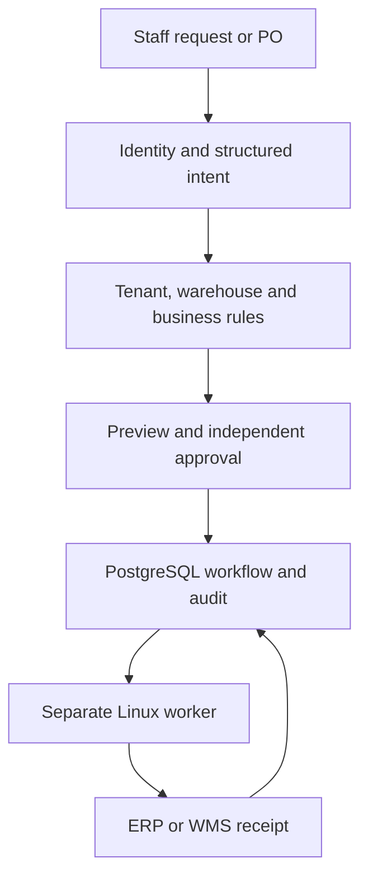

# SME AIOS backend architecture

[简体中文](platform.md) · [Workbench handoff](workbench-handoff.md)

The first release targets Hong Kong wholesalers and logistics operators. It supports sales-order drafts, shipment lookup and shipment rescheduling. Two synthetic tenants with different settings exercise the same business logic. ERP or WMS remains authoritative for orders, shipments, inventory and accounting. AIOS keeps evidence, proposals, approvals and receipts.

## Shared components and integration boundaries



| Component | Implemented | First-customer inputs |
|---|---|---|
| Identity and roles | Signed JWT with issuer, audience and expiry checks. Viewer reads, operator proposes, manager or admin approves within scope. Self-approval is denied | IdP, role and warehouse or legal-entity mapping, access lifecycle |
| Intent and tools | Bilingual rule planner, compatible HTTP adapter and optional Pydantic AI. Typed output cannot supply identities, shell commands, SQL or connector URLs | Model, approved fields, disambiguation vocabulary and language samples |
| Intake | Canonical PO JSON, tenant currency and amount limits, package conversion, batch validation and preparation. Enabled image layouts use local OCR | EDI, CSV and email samples, document layouts, buyer SKU and amount, tax and currency conventions |
| Business actions | Shipment lookup and rescheduling and sales draft creation. Draft totals use Decimal. Rescheduling binds the current ERP version | State definitions, time zone, required fields, permitted changes and inventory or transport constraints |
| Workflow | Digest approval, transactional enqueue, leases and epochs, bounded read-back, scoped counts and audit | Authorization matrix, SLAs, escalation and reconciliation ownership |
| ERP | Transactional local sandbox, Odoo JSON-2 and ERPNext/Frappe RPC clients. A customer deployment binds one tenant and connector | ERP version and plan, test tenant, read and write service accounts, bridge and reconciliation acceptance |
| Deployment | Separate systemd users and PostgreSQL roles, forced row-level security | Region, network allowlists, credential rotation and backup/recovery policy |
| Operations | Status, events, linked receipts and an exception queue scoped to warehouses | Alerting, optional telemetry backend, redaction, retention and restore exercises |

The [tenant profile sample](../deploy/platform/demo-profiles.json) shows the required configuration shape. Customer-specific logic belongs in the approved catalogue and ERP bridge. The platform stores normalized JSON or OCR evidence and a SHA-256 hash. The standalone workbench retains its demonstration image. Production retention and storage of originals require customer approval. Unknown formats can be mapped upstream to the canonical contract or reviewed manually. See the [pilot automation guide](pilot-automation.md).

## Open-source choices

| Tool | Status | Rationale |
|---|---|---|
| Linux and systemd | Used now | Separate Unix and PostgreSQL accounts. API carries read-only ERP and optional model credentials. Worker carries restricted write and receipt credentials |
| PostgreSQL and pgAdmin | PostgreSQL in production. Optional restricted pgAdmin administration | Transactional state, queue, audit and tenant isolation. API handles business operations. SQLite supports local demo |
| Keycloak or existing OIDC | Client implemented | Trusted issuer and API audience. Use a Keycloak broker or equivalent claims from the customer's IdP |
| Open Policy Agent | Optional additional deny gate | Receives only policy metadata. Unavailable or undefined decisions deny. Consider versioned bundles when customer policies grow |
| Pydantic AI and compatible endpoint | Two optional planners | Structured output. Business writes go through independent approval and worker. Evaluate validity, timeouts, latency and cost against synthetic instructions first |
| Tesseract and PaddleOCR | Tesseract used. PaddleOCR a benchmark candidate | Test structured EDI and local OCR first. Benchmark small print, multilingual layouts and tables with customer documents. Crops or redacted fields require approval before external transmission |
| Temporal | Conditional | Consider when long-running cross-system workflows, compensation and scheduling justify it. ERP idempotency and receipts still apply |
| OpenTelemetry and OpenBao | Deployment extensions | Add redacted traces and central rotation when scale warrants it. Verify systemd credentials and restore procedures first |
| Odoo, ERPNext and Business Central | First two transports implemented. Business Central is a candidate | Business Central ETags can protect concurrency. Replay and receipt contracts still need verification |

Sources. [Keycloak OIDC](https://www.keycloak.org/securing-apps/oidc-layers) · [PostgreSQL RLS](https://www.postgresql.org/docs/17/ddl-rowsecurity.html) · [pgAdmin licensing](https://www.pgadmin.org/licence/) · [OPA integration](https://www.openpolicyagent.org/docs/integration) · [OPA log masking](https://www.openpolicyagent.org/docs/management-decision-logs) · [systemd.exec](https://www.freedesktop.org/software/systemd/man/253/systemd.exec.html) · [Pydantic AI](https://pydantic.dev/docs/ai/production/) · [PaddleOCR](https://www.paddleocr.ai/main/en/index.html) · [Temporal Activities](https://docs.temporal.io/activity-definition) · [OpenTelemetry sensitive data](https://opentelemetry.io/docs/security/handling-sensitive-data/) · [OpenBao](https://openbao.org/docs/2.5.x/secrets/transit/) · [Business Central ETag](https://learn.microsoft.com/en-us/dynamics365/business-central/dev-itpro/api-reference/v2.0/api/dynamics_salesorder_update)

## Start and call the API

```bash
python -m pip install -r requirements-platform.txt
export AIOS_PROFILE=demo
export AIOS_DEMO_SECRET="$(python -c 'import secrets; print(secrets.token_urlsafe(32))')"
uvicorn aios_platform.api:create_app --factory --host 127.0.0.1 --port 8760
```

The local sandbox exposes `/docs`. A bearer token uses the random secret followed by a role suffix, such as `$AIOS_DEMO_SECRET.operator`. Accounts include `viewer`, `operator`, `manager`, `admin`, `other-manager` and `island-manager`. Launch the separate worker with `python -m aios_platform.run_worker`. The demo admin can also tick the worker once. [platform_smoke.py](../scripts/platform_smoke.py) exercises both verticals with disposable databases and no provider credentials.

| Endpoint | Contract |
|---|---|
| `POST /v1/actions` | `text` and optional OCR `overrides`. Returns clarification, a lookup result or a proposal with before/after, digest and operation ID |
| `POST /v1/intakes/{warehouse}` | Upload PNG/JPEG for a tenant with a supported layout. Returns OCR evidence |
| `POST /v1/intakes/{warehouse}/structured` | Canonical order with `po, buyer, currency, delivery, total, lines`. Each line has `sku, unit, quantity, unit_price, amount` |
| `POST /v1/intakes/{warehouse}/structured/batch` | Validate and prepare orders in bulk without a model. Results are per item |
| `POST /v1/proposals/{id}/approve` | An independent manager submits the proposal digest to approve and queue |
| `POST /v1/proposals/approve-batch` | Independently checks and approves multiple digests, with per-item results |
| `GET /v1/proposals/{id}` | State, approver, receipt and audit timeline |
| `GET /v1/operations/summary` | Manager sees counts across granted warehouses |
| `GET /v1/operations/exceptions` | Paginated pending reconciliation and operator cases within assigned warehouses |

### Model setup

Set `AIOS_PLANNER=compatible`, `AIOS_LLM_BASE_URL` (typically ending in `/v1`), `AIOS_LLM_MODEL` and server-side `AIOS_LLM_API_KEY_FILE`. Only the service account or credential manager reads the file. For Pydantic AI install `requirements-platform-harness.txt` and select `AIOS_PLANNER=pydantic-ai`. Test schema conformance, invalid actions, timeouts, latency and spend with synthetic inputs. The planner receives user text and an action schema. Original images use local OCR. The customer must approve the scope of any employee text transmitted to a provider. [OWASP LLM guidance](https://cheatsheetseries.owasp.org/cheatsheets/LLM_Prompt_Injection_Prevention_Cheat_Sheet.html) · [Hong Kong PCPD AI framework](https://www.pcpd.org.hk/english/resources_centre/publications/files/ai_protection_framework.pdf)

### ERP bridge contract

Odoo 19 opens a transaction for each JSON-2 call. Apply and receipt persistence therefore belong in a single bridge call. ERPNext uses whitelisted Frappe RPC methods and a token account. Configure tenant-bound read and write credentials, `AIOS_ERP_KIND=odoo|erpnext`, `AIOS_ERP_URL` and `AIOS_CONNECTOR_TENANT`. Odoo also uses `AIOS_ODOO_DATABASE`. Frappe tokens use `key:secret`. The customer installs the bridge and verifies business mappings and permissions. [Odoo JSON-2](https://www.odoo.com/documentation/19.0/developer/reference/external_api.html) · [Frappe REST](https://docs.frappe.io/framework/user/en/api/rest) · [Frappe transactions](https://docs.frappe.io/framework/user/en/api/database)

| Method | Arguments and result |
|---|---|
| `aios_read_shipment` | `tenant, shipment_id`. Returns tenant, ID, warehouse, date, state and monotonic version, or null |
| `aios_apply` | `tenant, operation_id, digest, plan`. Authenticate the tenant, verify warehouse, rights, version and digest, and commit the write and receipt atomically. Replay requires the same digest |
| `aios_receipt` | `tenant, operation_id`. Returns `tenant, operation_id, plan_digest, target, remote_id` or null |

The bridge returns `{"status":"ok","result":…}`. A trusted bridge can use `{"status":"rejected"}` only after establishing that no mutation took place. Frappe wraps the object in `message`. An unknown response causes read-back. An expired send lease is recovered as read-only reconciliation. Three unsuccessful checks escalate. The ERP must reject a reused operation ID with a different digest and use a version guard on rescheduling. [Transactional outbox guidance](https://docs.aws.amazon.com/prescriptive-guidance/latest/cloud-design-patterns/transactional-outbox.html)

## Production isolation and acceptance

1. Run `python -m alembic upgrade head` as a separate migration owner. Create the `aios_api` and `aios_worker` logins, then apply `deploy/platform/postgres-security.sql`. Tenant scope is transaction-local. Application principals cannot update or delete audit history. A sensitive deployment should consider a dedicated database and application instance.
2. Configure the OIDC audience, bearer type and administrator-managed `aios_tenant`, `aios_role`, `aios_warehouses`, and `aios_grants` claims. Use a suitable token TTL. Workers check local account suspension before dispatch. The customer's IdP lifecycle must feed that control.
3. Give the [Linux units](../deploy/platform/) separate UIDs, logins and ERP credentials. Put TLS, body caps and rate limits at the gateway. Restrict service outbound destinations. A customer-side bridge can keep the ERP admin surface on the private network.
4. Collect de-identified POs, real SKU and package mappings, role examples and sandbox access. Compare shadow-mode proposals with manual entries first. Then verify draft writes and bounded rescheduling. Test lost responses, concurrent edits, wrong warehouses, replay, partial batches and reconciliation. Inventory movement, payments and financial postings need their own action contracts and risk approval.
5. Measure backlog, unknown receipts, latency and operator effort. Acceptance includes customer-side ERP, IdP, policy, network and a database restore exercise. [Production runbook](production-readiness.en.md)
