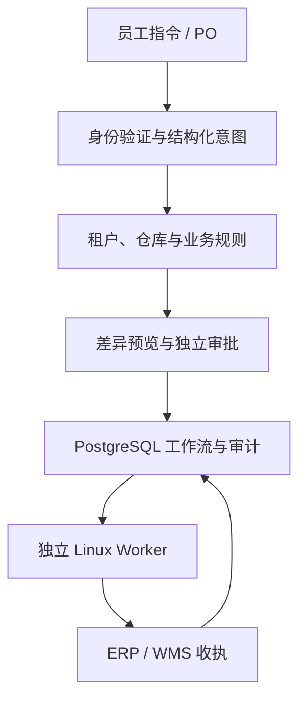

# SME AIOS 后端架构

[English](platform.en.md)

面向香港批发商和物流企业，第一版覆盖订单草稿与运单查询/改期。代码以两个配置不同的合成租户验证同一套业务内核。客户 ERP 或 WMS 保留订单、运单、库存和财务的权威状态。AIOS 保存单据证据、提案、审批和回执。

## 共用内核与接入边界



| 模块 | 当前代码 | 首客需要提供 |
|---|---|---|
| 身份和角色 | JWT 签名、issuer、audience、expiry，租户、岗位、仓库；viewer 可查，operator 可提案，manager/admin 可独立审批。没有自我审批 | IdP、客户岗位与仓库/法人映射、访问权限、离职撤权流程 |
| 意图与工具 | 双语规则 planner、OpenAI-compatible HTTP、可选 Pydantic AI；动作 schema 阻止模型指定身份、任意命令、SQL 或连接器地址 | LLM 提供商与模型、可以外发的字段、消歧词汇和语言样本 |
| 数据接入 | 标准 PO JSON 与租户级价格上限、货品、箱件单位映射；图像入口按模板启用，搭载现有本地 OCR；已标准化订单可批量校验和生成提案 | EDI/CSV/邮件样本、版式、买方 SKU、单位、币种、行金额及税费口径 |
| 业务动作 | 运单查询、运单改期、创建销售订单草稿。草稿金额用 Decimal 计算，改期绑定 ERP 当前版本 | 单据状态与时区定义、必填字段、可改范围、库存/运输约束 |
| 工作流 | 预览摘要、审批与队列同事务、租约和 epoch、读回重试上限、操作审计与仓库级状态计数 | 审批矩阵、SLA、高风险动作和人工对账责任人 |
| ERP 连接 | 本地事务型仿真；Odoo JSON-2 和 ERPNext/Frappe RPC 客户端。每个企业部署钉住一个租户与连接器 | ERP 版本/方案、测试租户、业务对象归属、专用读写账户、客户域 bridge 和对账验收 |
| 部署 | systemd 分开 API 与 Worker 用户，PostgreSQL 最小权限和 RLS SQL | 数据区域、内网和出站允许列表、凭据轮换、备份恢复指标和部署窗口 |
| 运维 | 状态及事件可查，提案和回执关联；核心测试覆盖隔离、复核、并发状态与错误恢复 | OTel 后端、告警、留存与脱敏要求、备份与恢复演练 |

配置文件使用 [租户配置样例](../deploy/platform/demo-profiles.json) 的结构。通过自有主数据及客户 ERP bridge 处理客户特有逻辑。内部档号仅接受受限字符。原件映像在现有 PO 演示服务中保留。平台服务当前保存已规范化的 PO 或 OCR 证据及原始 SHA-256，首次部署要接经客户批准的对象存储和保留周期管理。图像识别只有示例模板。更多批量接口及异常处理见[试点自动化指南](pilot-automation.zh-CN.md)。未知格式可由上游 EDI/CSV 映射到标准合同，或排队做人工复核。现有采购单演示独立运行。

## 选型与引入顺序

| 开源工具/机制 | 决策 | 理由和切换条件 |
|---|---|---|
| Linux systemd | 现在使用 | API 带只读 ERP 凭据和可选模型凭据。Worker 只带 ERP 写/回执凭据。两端使用不同 Unix 用户和 PostgreSQL 登录账户。凭据经 systemd credential 传入 |
| PostgreSQL 与 pgAdmin | 现在采用 PostgreSQL 事务/RLS。pgAdmin 用于受限管理 | 业务读写走 API。工作流状态、入队与审计在单个事务提交。pgAdmin 由运维通过受控私网管理数据库。SQLite 用于本地演示 |
| Keycloak / 现有 OIDC | client 接入就绪 | 验证受信 issuer 的公钥及 API audience。客户已有 IdP 时，可用 Keycloak broker 或实现相同 claims 映射 |
| OPA | 可选第二层拒绝 | Rego 只收到动作与权限元数据。业务内核会拒绝越权、自审批和过期提案。外部策略启用后超时或不明确则拒绝。客户策略增加后再引入版本化 bundle |
| Pydantic AI / 兼容端点 | 两个 planner 接口可选 | Harness 管理结构化输出。ERP 改动必须经过后端审批和可审计的 Worker。先用规则运行，收到模型后用合成样本验证 JSON、超时、延迟和调用成本 |
| Tesseract / PaddleOCR | 当前 Tesseract。PaddleOCR 后续基准 | 先测试本地 OCR 和结构化 EDI。多语言、小字与复杂表格按客户样本评估 PaddleOCR，模型只处理获准的裁剪或脱敏字段 |
| Temporal | 达到条件后引入 | 长时间运行的多系统流程、信号、定时任务和补偿开始增加时考虑自托管。现有 ERP 幂等和读回合同继续有效 |
| OpenTelemetry / OpenBao | 运维扩展 | 上线后接收红线指标和去敏追踪。多企业或多机部署时评估 OpenBao 集中轮换。先验证 Linux 凭据和 PostgreSQL 恢复 |
| Odoo / ERPNext / Business Central | 前两者有传输实现，第三个列为适配候选 | 同一 ERP 接口可以承载兼容不同版本的 bridge。Business Central 原生 ETag 可作为并发条件，仍要验证业务操作的重放与回执能力 |

官方资料。[Keycloak OIDC](https://www.keycloak.org/securing-apps/oidc-layers) · [PostgreSQL RLS](https://www.postgresql.org/docs/17/ddl-rowsecurity.html) · [pgAdmin 许可](https://www.pgadmin.org/licence/) · [OPA 集成](https://www.openpolicyagent.org/docs/integration) · [OPA 日志遮罩](https://www.openpolicyagent.org/docs/management-decision-logs) · [systemd.exec](https://www.freedesktop.org/software/systemd/man/253/systemd.exec.html) · [Pydantic AI 生产架构](https://pydantic.dev/docs/ai/production/) · [PaddleOCR](https://www.paddleocr.ai/main/en/index.html) · [Temporal Activity 幂等](https://docs.temporal.io/activity-definition) · [OpenTelemetry 敏感数据](https://opentelemetry.io/docs/security/handling-sensitive-data/) · [OpenBao](https://openbao.org/docs/2.5.x/secrets/transit/) · [Business Central ETag](https://learn.microsoft.com/en-us/dynamics365/business-central/dev-itpro/api-reference/v2.0/api/dynamics_salesorder_update)

## 启动与接口

```bash
python -m pip install -r requirements-platform.txt
export AIOS_PROFILE=demo
export AIOS_DEMO_SECRET="$(python -c 'import secrets; print(secrets.token_urlsafe(32))')"
uvicorn aios_platform.api:create_app --factory --host 127.0.0.1 --port 8760
```

沙盒启动 `/docs` 提供 API。Bearer 令牌由本机随机串和角色组成，例如 `$AIOS_DEMO_SECRET.operator`。演示账户包括 `viewer`、`operator`、`manager`、`admin`、`other-manager`、`island-manager`。可用 `python -m aios_platform.run_worker` 启动独立 Worker，沙盒中也可用 admin 调试接口手动运行一步。脚本 [platform_smoke.py](../scripts/platform_smoke.py) 使用临时库顺序执行物流和批发两条链路，无需模型凭据。

| 接口 | 约定 |
|---|---|
| `POST /v1/actions` | 输入 `text` 和可选 OCR `overrides`。返回澄清、就地查询结果，或含 `before` / `after`、审批摘要和操作 ID 的提案 |
| `POST /v1/intakes/{warehouse}` | 向已启用模板的租户上传 PNG/JPEG，读取 OCR 证据 |
| `POST /v1/intakes/{warehouse}/structured` | 已标准化 JSON。订单字段 `po, buyer, currency, delivery, total, lines`，订单行字段 `sku, unit, quantity, unit_price, amount` |
| `POST /v1/intakes/{warehouse}/structured/batch` | 批量生成提案，逐条返回结果，无需模型 |
| `POST /v1/proposals/approve-batch` | 独立主管逐条校验并批量放行，结果按项返回 |
| `GET /v1/operations/exceptions` | 按仓库与租户分页列出回执待查及需人工处理的提案 |
| `POST /v1/proposals/{id}/approve` | 独立主管提交 `digest`。登记审批与放行队列 |
| `GET /v1/proposals/{id}` | 状态、审批人、回执和审计时间线 |
| `GET /v1/operations/summary` | 主管可读授予仓库范围内的提案状态计数 |

### 模型接入

配置 `AIOS_PLANNER=compatible`、`AIOS_LLM_BASE_URL`（兼容接口根路径，通常含 `/v1`）、`AIOS_LLM_MODEL` 和服务器凭据 `AIOS_LLM_API_KEY_FILE`。凭据文件只由服务账号/系统凭据管理读取。要切换 Pydantic AI，可安装 `requirements-platform-harness.txt`，再选 `AIOS_PLANNER=pydantic-ai`。首次用合成指令测试结构化响应、无效动作、超时和费用。模型只取得用户指令和 action schema，传输不会包含访问令牌、完整上传原件或 ERP 全量数据。采购单图片继续走本地 OCR。员工指令本身也可能含客户资料，生产必须明确哪些内容能发送给模型供应商。参考 [OWASP](https://cheatsheetseries.owasp.org/cheatsheets/LLM_Prompt_Injection_Prevention_Cheat_Sheet.html) 与 [香港 PCPD AI 个人资料保障框架](https://www.pcpd.org.hk/english/resources_centre/publications/files/ai_protection_framework.pdf)。

### ERP bridge 合同

Odoo 19 对每个 JSON-2 调用启动单独事务，所以 `aios_apply` 必须在一个服务器端请求中完成受权业务写入和回执持久化。ERPNext 使用 Frappe whitelist RPC 与 token 专户。同一租户连接配置使用只读与受限写账户，`AIOS_ERP_KIND=odoo|erpnext`、`AIOS_ERP_URL` 和 `AIOS_CONNECTOR_TENANT`。Odoo 另设 `AIOS_ODOO_DATABASE`，Frappe 凭据采用 `key:secret`。当前仓库已实现客户端。客户端模块、字段映射与权限在试点实例实施。出处。[Odoo JSON-2](https://www.odoo.com/documentation/19.0/developer/reference/external_api.html) · [Frappe REST](https://docs.frappe.io/framework/user/en/api/rest) · [Frappe 事务](https://docs.frappe.io/framework/user/en/api/database)

| 方法 | 参数与结果 |
|---|---|
| `aios_read_shipment` | `tenant, shipment_id` → 运单 ID、仓库、日期、状态、单调版本，或 null |
| `aios_apply` | `tenant, operation_id, digest, plan` → 成功状态。服务端从身份确认租户，复核 warehouse、权限、版本和摘要，同事务写操作回执。重复 ID 只允许相同摘要 |
| `aios_receipt` | `tenant, operation_id` → `tenant, operation_id, plan_digest, target, remote_id`，或 null；证明写操作，而非推测最新状态 |

桥接返回 `{"status":"ok","result":…}`。仅在已确定无写入发生时返回 `{"status":"rejected"}`。Frappe 对象在 `message` 封装里。无法判断的 HTTP 错误、断线、超时或回执无效进入查询。每次发送前持久化租约，过期发送只进入读回，三次读回失败后交给人工。幂等键打开重复回执，ERP 应拒绝相同键的不同摘要。交期写入通过 ERP 版本防止旧预览覆盖新数据。参考 [事务 outbox](https://docs.aws.amazon.com/prescriptive-guidance/latest/cloud-design-patterns/transactional-outbox.html)。

## 生产隔离与首客验收

1. 独立 migration owner 运行 `python -m alembic upgrade head`，创建专用 `aios_api` 和 `aios_worker` 登录账户，再执行 `deploy/platform/postgres-security.sql`。API 事务在使用租户前设置 transaction-local scope。审计表不可由这些角色更新或删除。数据库角色和 SQL 执行入口由受信应用管理，RLS 不能抵消被攻破的应用凭据。高敏客户首选独立数据库与租户部署。
2. Keycloak 配置 audience、Bearer token 和管理员管理的 `aios_tenant`、`aios_role`、`aios_warehouses` claims。设置业务允许的 token TTL。排队动作在派发前重查 AIOS 账户停权。客户 IdP 撤权向 AIOS 同步仍需接入。试点上线前确定账户撤销、在途停写和异常接管流程。
3. 使用 [Linux units](../deploy/platform/) 分配独立 UID、数据库登录和读取/写入凭据。API 仅监听本机，内网反代负责 TLS、请求体限额和速率。生产网络限制 ERP/API/IdP/模型等配置目的地。客户内网 ERP 可以通过本地受控网关接入，避免对公网开放 ERP 管理面。
4. 首次接入取得脱敏 PO、实际 SKU 与包装、两种仓库岗位、只读测试 ERP。先按只读 shadow 对照人工录入，再上草稿与有限改期。确认 ERP 写成功而客户端断线、并发改单、跨仓权限、重复传、批次不完整和对账最终状态。库存扣减、自动付款和财务过账需另做动作合同与风险审批。
5. 运营按租户记录排队量、未知回执数量、延迟和 OCR 复核成本。生产验收用数据库恢复实测与 CI 以外的真 ERP、Keycloak、OPA 和网络部署验证。不把 demo 的正确性、性能或覆盖率外推到客户单据。
