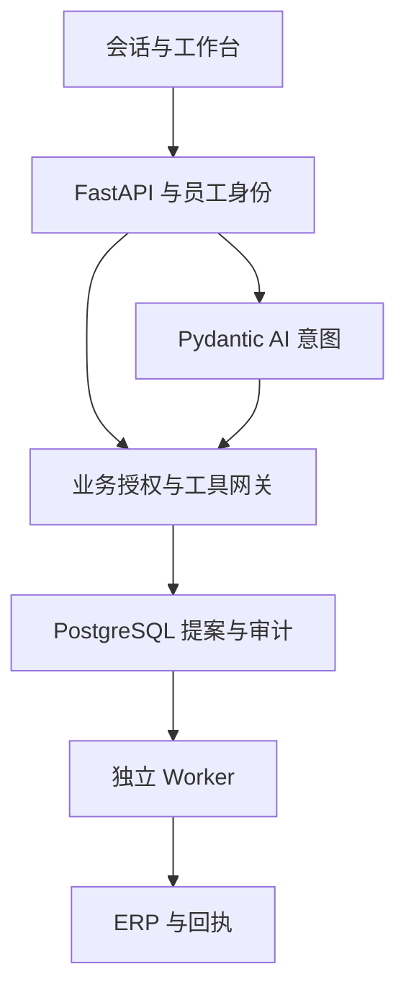

# SME AIOS 工作台后端与授权

## 部署边界

继续使用 FastAPI、Keycloak/OIDC、PostgreSQL 和独立 ERP Worker。把授权、提案、审批和审计放在同一个事务数据库中。API 水平扩容，Worker 按配置的租户和连接器独立调度。外部 ERP 写凭据只交给 Worker。浏览器部署走同源 BFF，由 BFF 保管访问令牌、校验 CSRF、代理固定的业务 API。租户、员工主体、角色和可用站点来自验证过的身份与服务端配置。



## 模块、动作与数据范围

| 模块 | 本次实现的动作 | 数据边界 |
|---|---|---|
| 订单 | `order.read` 查看进件和有权打开的提案。加 `order.work` 后可进件、准备草稿和提交。写操作保留操作员及以上角色要求 | 当前租户和授权仓库。非主管只能查看自己的提案，订单进件按授权站点共享 |
| 调度 | `shipment.read` 查看。加 `shipment.reschedule` 后可生成改期提案。写操作保留操作员及以上角色要求 | 当前租户、仓库、运单身份及连接器投影 |
| 发票审阅 | `finance.read` 查看已有发票投影 | 当前租户、仓库、发票身份与投影字段 |
| 仓库概览 | `decision.read` 查看已有仓库汇总 | 只查询授予的仓库。汇总许可不授予底层提案许可 |
| 审批 | `workbench.approve.orders` 和 `workbench.approve.shipments` 分别控制两种提案，仍须具备主管或管理员身份。批准需检查最新摘要和独立审批人 | 当前租户、仓库、动作种类和提案版本。单独开通审批不会授予进件或改期权限 |

管理员须具备 `admin`、`workbench.access.manage`，以及本租户所有已配置仓库的范围。因为每次保存替换该员工整个模块的显式策略，首版使用租户级授权管理员。站点级委派可在按站点拆分授权记录后引入。员工使用验证过的身份首次访问时进入租户内的可授权名单。当前名单仅存稳定 `subject`，显示名和在职状态预留给企业目录接入。

无显式配置的模块继承当前身份给予的原有访问。显式配置替换该模块的继承权限。生效范围取租户配置、OIDC 仓库范围和模块指定仓库的交集。过期或保存空权限会把该模块的显式有效权限降为零。前端可以另存布局偏好来隐藏已开通的模块。此偏好不参与授权。

| 接口 | 用途 |
|---|---|
| `GET /v1/workbench/module-access/catalog` | 身份可管理的模块、动作和仓库 |
| `GET /v1/workbench/module-access/employees` | 租户内已访问过的员工，按稳定主体游标分页 |
| `GET /v1/workbench/module-access/employees/{subject}` | 员工的显式配置，缺少的模块按继承显示 |
| `PUT /v1/workbench/module-access/employees/{subject}/{module}` | `version=0` 新建。更新时带当前版本。空动作和空仓库用于撤权。可选 `expires_at` 为 Unix 秒 |
| `GET /v1/workbench/capabilities` | 工具、可用连接器、逐工具仓库、订单读取仓库和逐动作审批仓库。用于构建员工工作台和安全的快捷入口 |

PUT 示例，给已登录过的操作员开通 HK01 的发票查看：

```json
{"version":0,"grants":["finance.read"],"warehouses":["HK01"]}
```

同版本并发保存只有一次成功，其他请求收到 `409`，页面重新取配置后请用户复核。管理员不能自我授权，不能写别的租户或站点，也不能从客户端定义模块或任意动作。赋权与审计同事务提交。生产数据库对员工、授权表启用强制 RLS。API 可修改限定字段，Worker 只读取授权表。

## 自然语言请求和权限变化

1. 服务端验证租户与员工身份，读实时生效权限。从静态工具目录投影可用操作。规则能识别的语句本地解析，复杂语句可走受限 Pydantic AI。模型只输出已验证的动作及参数，无法调用 ERP、执行审批、查权限或直接返回业务答案。
2. 工具执行之前检查动作、站点和权限。返回前对连接器提供的对象身份、字段投影和当前授权再次核对。配置规划器返回后重新读取授权；事务写入和批准时在 PostgreSQL 中按员工持有短时事务锁，与授权修改协调。SQLite 演示使用数据库写事务串行化。
3. 越权访问返回可机器解析的短状态码。前端用本地化文案和功能列表渲染下一步。对不存在或不可见的对象使用同样的响应。前端不在报错卡、通知、日志或链接预览里附带受限对象的存在性、标题、引用、计数或原始规划器输出。
4. 识别到「批准提案」时，只返回受权审批的预览。实际批准由独立接口提交当前 `digest`，经办人不能审批自己的提案。Worker 发送前复核暂停、租户、租约、审批有效期、主体停用以及请求人和审批人的适用模块。撤权后尚未派发的受影响作业进入 `REJECTED` 并记录原因。已发请求继续按原操作 ID 核查回执。数据库和 ERP 之间没有原子撤回能力。
5. 前端打开旧业务卡时调用深链接重新鉴权。权限变化或账号切换时清理相关缓存和已打开的面板。未来做持久 Agent 线程时，业务消息保存为可重鉴权的对象/字段引用。附来源的投影和摘要按当前 ACL 重建或失效。实时订阅上线前，要给每个订阅及数据帧验证当前权限。权限撤销无法收回此前已交付的数据。

| 情况 | 接口结果和前端显示 |
|---|---|
| 模块、动作或站点不可用 | 工作台返回 `403 ACCESS_RESTRICTED`。提示目前可用范围，并以能力接口的数据构建快捷操作 |
| 指定对象无权读取或不存在 | Agent 返回 `404 RECORD_UNAVAILABLE`。显示「当前账号无法访问这条记录」 |
| 有单据读权但无法批准 | Agent 返回 `403 ACTION_NOT_ALLOWED` 和 `view_proposal`。只提供查看现有提案的入口 |
| 可批准 | Agent 返回 `approval_preview`。先看变更和依据，再显式提交决定 |
| 请求过程中权限变化 | 在相应入口返回 `ACCESS_RESTRICTED` 或 `ACCESS_CHANGED`，刷新能力后重试 |
| 数据源不可用 | `503`，显示暂不可用并给重试入口 |
| 询问跨站点业务汇总 | 现有汇总工具只接受单一站点。请员工选择自己的可用站点。多站点聚合上线时必须在查询前对站点和行做授权并注明覆盖范围 |

## 开源组件和采用顺序

| 项目 | 决策 |
|---|---|
| [Keycloak OIDC](https://www.keycloak.org/securing-apps/oidc-layers) | 沿用身份验证、JWKS 和已验证 claims。生产使用短会话、正确的 issuer/audience、管理员独立角色。离职即时生效依赖目录事件触发现有停用入口，不能只等 JWT 过期 |
| [PostgreSQL RLS](https://www.postgresql.org/docs/16/ddl-rowsecurity.html)、[事务锁](https://www.postgresql.org/docs/16/explicit-locking.html)、Alembic | 本次直接复用。数据库隔离保证租户边界，服务端再收紧到站点、记录、动作和字段。策略表命中主键，队列在 SQL 中先按动作与仓库过滤再分页 |
| [Pydantic AI Structured Output](https://ai.pydantic.dev/output/) | 工作台接入真实 harness。复用同一个强类型工具和审批入口。模型和 API 密钥仅存在于服务配置 |
| [Open Policy Agent](https://www.openpolicyagent.org/docs/management-decision-logs) | 保留现有提案/审批附加否决网关。需要跨服务统一规则时再接入版本化 Rego 策略；遮蔽决策日志字段。现有模块授权继续在业务服务中执行 |
| [OpenFGA](https://openfga.dev/docs/modeling/roles-and-permissions) | 客户确有跨团队、层级继承或逐文档共享需求时采用。届时用 outbox 同步关系并明确撤权一致性，切换前比较两套决策。权限新鲜度有要求时评估 [higher consistency](https://openfga.dev/blog/query-consistency-options-announcement) |
| [Temporal](https://docs.temporal.io/activities) | 业务跨多个长流程、外部系统或多日补偿时再评估。当前提案表即 durable queue，保留单事务入队、幂等操作 ID、租约恢复和先查回执的行为 |
| [Prometheus](https://prometheus.io/docs/practices/instrumentation/)、[OpenTelemetry](https://opentelemetry.io/docs/) | 保留现有 HTTP 状态和延时指标。接入追踪时只采集受控的动作类别、结果、耗时和关联 ID。关闭提示词、文档内容和凭据采集 |

授权原则参考 [OWASP Authorization Patterns](https://cheatsheetseries.owasp.org/cheatsheets/Authorization_Patterns_Cheat_Sheet.html)、[OWASP Excessive Agency](https://genai.owasp.org/llmrisk/llm062025-excessive-agency/) 和 [RFC 9110 §15.5.4–5](https://www.rfc-editor.org/rfc/rfc9110.html#section-15.5.4)。

## 其余功能的服务边界

| 功能 | 建议数据与接口 |
|---|---|
| 员工和 Agent 个性化 | 各用独立的 `(tenant, subject)` 资料记录和版本。由 `GET/PATCH /v1/profile` 与 `GET/PATCH /v1/agent-profile` 各自处理当前员工的资料。头像进入私有对象存储，重新编码并去除元数据后再关联头像 ID。会话列表、气泡与个人设置读取同一投影。显示名与头像不参与身份判定 |
| 岗位队列 | 各模块提供带排序游标的受权投影，返回对象 ID、原因、截止时间及当前可用操作。统一待办按对象去重，保留独立职责状态。详情和依据沿现有深链接契约解析，审批、数量差异、经营趋势和运行状态复用受权对象数据 |
| Agent 历史、日报与通知 | `agent_thread` 和 `agent_message` 按员工范围存储，将业务引用指向对象、字段、来源版本。按当前权限重放。业务状态和可靠通知同事务写入 outbox，消费者按事件 ID 去重。通知只发送通用标题与受权深链，来源解析发生在用户打开时。详见 [Transactional outbox](https://docs.aws.amazon.com/prescriptive-guidance/latest/cloud-design-patterns/transactional-outbox.html) |
| 合同、采购、质量、法务 | 沿用 Assurance 的分轨权限、字段投影和快照摘要。按模块定义可管理的业务 grant，再接企业连接器。完整正文、段落证据、财务复核、合同批准各自校验 |
| 真人会话与日历 | 真人房间继续走成员关系。只将用户显式选择且仍有权读的消息带入 Agent 上下文。外部日历按账户绑定，建立会议草稿后经员工确认发送，并按提供方事件 ID 去重与核对回执 |
| 权限申请 | 仅为允许自助申请且员工本来就可知的模块展示入口。记录申请人、动作、站点、用途和到期时间，交独立管理员批准。批准时重新校验申请人状态和可委派范围，调用同一模块写入与审计路径。敏感对象的拒绝卡不给按对象申请的入口 |
| 权限变化与实时面板 | 变更通知只带员工自身的授权版本，页面刷新 `/capabilities` 和活动卡，关闭失效订阅。订阅端在推送前重新校验，延迟或丢失通知时重新打开对象也会复核授权 |

## 部署、验证与下一阶段

1. 备份数据库并跑 `alembic upgrade head`（迁移 `0007_module_access`）。执行 `deploy/platform/postgres-security.sql`，用分别受限的 API 与 Worker 登录启动服务。滚动切换期间暂停 ERP 派发，等所有 Worker 都部署新版本后再恢复。旧 Worker 会忽略模块撤权规则。
2. 本地演示用 `access-admin` 配置模块，普通 `admin` 继续演示运维。验证 HK01 授权生效、HK02 范围限制、其他租户不可见、并发修改冲突、审批和撤权后未派发作业拦截。
3. 默认 `AIOS_WORKBENCH_PLANNER=local`。启用云端时安装 `requirements-platform-harness.txt`，设定 `AIOS_WORKBENCH_PLANNER=pydantic-ai`，以服务端密钥设施配置 `AIOS_LLM_BASE_URL`、`AIOS_LLM_MODEL`、`AIOS_LLM_API_KEY`。试点前确认客户允许把输入发给所选处理方，先用合成数据验证。受控预审启用时继续保持仓库的独立治理边界。试点前验证超时、拒绝、结构化错误和模型标识无法从客户接口看到。
4. 按受权对象和操作接真合同、采购、法务、质量、日历及 ERP/WMS 运行探针，同时为员工和 Agent 各建独立资料 API。现有 Assurance 分轨审批、真人会话权限和运维授权仍由原服务各自执行。随后接员工目录、岗位模板、授权审批、访问申请以及带对象引用的 Agent 历史。为各模块补接安装、撤权和细粒度投影测试，再面向客户开放。
5. 上线门槛包括真实 IdP、真实客户 ERP 的受控联调，数据库备份恢复，租户级禁写演练，授权与写入事故可追踪，以及用目标租户真实流量基线验证 p95 响应、队列积压、错误率和数据库连接预算。先确认瓶颈，再按现有生产指南引入 PgBouncer 或独立运行平台。
