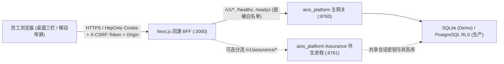

# SME AIOS 企业工作台前端交付与部署文档

> **代码路径**：`web/`（Next.js App Router + TypeScript + 同源 BFF）、`deploy/demo/`（低成本演示部署模板）  
> **后端基线**：`aios_platform/`（含同源浏览器会话、员工模块动态授权、协作房间、站内日历、通知简报、受控预审 Assurance）  
> **相关文档**：[后端与前端交接](workbench-handoff.zh-CN.md) · [协作与同源会话契约](workbench-collaboration.zh-CN.md) · [受控预审交接](governed-assurance.zh-CN.md) · [生产就绪指南](production-readiness.md)

---

## 1. 架构概览与设计原则

### 1.1 同源 BFF 与零信任边界

所有浏览器流量统一进入 Next.js 同源入口（`:3000`），**不直接暴露**后端 FastAPI（`:8760` / `:8761`）或 `/openapi.json`：



核心安全护栏：
1. **无客户端凭证与密钥**：`AIOS_DEMO_SECRET`、`AIOS_BROWSER_SESSION_KEY`、`AIOS_LLM_API_KEY`、`AIOS_BFF_OIDC_CLIENT_SECRET` 全部留在服务端环境变量，代码库严禁出现任何 `NEXT_PUBLIC_*` 密钥配置。
2. **输出白名单脱敏（`web/src/lib/bff/sanitize.ts`）**：
   - `/v1/workbench/capabilities` 强制剔除 `planner` 字段。
   - 递归剥离所有模型/规划器内部键（`reasoning`、`chain_of_thought`、`thought`、`raw_tokens`、`prompt`、`system_prompt`、`tool_args`、`internal_args`、`model_name`、`llm_model`、`provider`、`usage`、`token_usage`、`api_key`、`secret`、`traceback`、`stack`）。
   - 所有 `404`（含批量审批逐项 `404`）统一掩码为 `{"detail":{"code":"RECORD_UNAVAILABLE","message":"当前账号无法访问这条记录。"}}`，绝不泄露对象是否存在。
   - `422` 校验错误剔除原始回显 `input` / `ctx` / `url`；`5xx` 仅输出安全业务错误码与 `X-Request-ID`。
   - 所有 `/v1/*` 与 `/api/*` 响应强制加注 `Cache-Control: no-store`。
3. **认证代次防脏读（`authGeneration`）与纯内存态**：
   - `csrf_token`、对话草稿、单据详情与本地 OCR 图片预览 `blob:` URL 仅存内存，严禁写入 `localStorage` / `sessionStorage`。
   - 发生 `401`、账号停权、退出登录或切换本地演示身份时，立即递增 `authGeneration`、中止所有在途 `AbortController` 请求、丢弃旧代次迟到响应、清空草稿与选中单据，并立即调用 `URL.revokeObjectURL(...)`。

### 1.2 视觉规范与去 AI 味动效

- **统一色彩与几何**：暖纸灰底色（`#F4F3EF`）、纯白单据面板（`#FFFFFF`）、暖灰导航平面（`#ECEAE4`）、深石墨正文（`#14181F`）、单一冷青蓝强调色（`#0C6E91`），全站采用 `1px` 建筑级细线、`2px–6px` 利落圆角与 `.tabular-nums` 等宽数字对齐；状态采用「颜色 + 图标 + 中文文案」三重绑定（琥珀 `#B86E00` 临期/待确认、绛红 `#C03235` 阻塞/拒绝/撤销、松绿 `#1A7F4B` 已核验/健康）。
- **三维动效克制应用**：
  - `ArchitecturalRelayCanvas`：源自奇直 3D 光学架构视觉语言，仅限 `/login` 深曜石舞台（`#070B12`），展示四层企业信任架构（租户隔离 → 策略闸门 → 个人 Agent 工作台 → ERP 回执账本），支持阻尼视角倾斜、键盘切换与 `prefers-reduced-motion` 静态降级。
  - `StatePulseBeacon` 与 `ExecutionTopologyRibbon`：等待 `/v1/workbench/turns` 时严格仅显示单行「正在处理请求…」，不伪造阶段与进度百分比；提案时间线严格映射后端真实状态机。
- **三栏协作与键盘可访问性**：桌面端采用「会话列表｜主工作区｜按需展开右侧业务面板（360–440px）」，支持 `⌘.` / `Ctrl+.` 切换、`Esc` 关闭并恢复焦点，面板收放期间保留对话滚动与输入草稿；窄屏（`<1024px`）使用底部主导航与独立详情返回路径。

---

## 2. 启动命令与环境变量参考

### 2.1 模式 A：零密钥本地开发 / 单进程演示（推荐默认，含本地规则 + Assurance）

```bash
# 在仓库根目录执行（自动生成 0600 权限的 Assurance 演示密钥与服务端会话密钥）
./deploy/demo/start-local-demo.sh
```

常用参数：
- `./deploy/demo/start-local-demo.sh --reset-state`：重置本地 SQLite 演示库后启动。
- `./deploy/demo/start-local-demo.sh --prod`：使用 `next start` 生产构建模式启动。
- `./deploy/demo/start-local-demo.sh --worker`：同时拉起后台 `run_worker`（不传此参数时，可在 `/admin` 以 `admin` 身份点击「推进 Worker」逐帧演示 `QUEUED → VERIFIED`）。

### 2.2 模式 B：双端口云端大模型 + 受控预审（Cloud LLM `:8760` + Assurance `:8761`）

> `aios_platform/api.py` 强制禁止在同一后端进程内同时启用 `AIOS_WORKBENCH_PLANNER=pydantic-ai` 与 `AIOS_ASSURANCE_*KEY_FILE`。双端口模式让两个进程共享同一 `AIOS_PLATFORM_STATE_DIR`、`AIOS_BROWSER_SESSION_KEY`、`AIOS_BROWSER_ORIGIN` 和 `AIOS_DEMO_SECRET`，由 Next.js BFF 按路径将 `/v1/assurance/*` 透明转发至 `:8761`。

```bash
export AIOS_LLM_BASE_URL="https://api.deepseek.com"   # 必须为 https://
export AIOS_LLM_MODEL="deepseek-chat"
export AIOS_LLM_API_KEY="sk-your-server-only-key"

./deploy/demo/start-local-demo.sh --mode dual
```

### 2.3 模式 C：生产级 Keycloak OIDC + HTTPS 部署

1. **后端 FastAPI（`AIOS_PROFILE=oidc`）**：
   - `AIOS_PLATFORM_DSN_FILE`（强制 `postgresql://` + Alembic `0008_collaboration` + `deploy/platform/postgres-security.sql` 强制 RLS）
   - `AIOS_OIDC_ISSUER`（`https://...`）、`AIOS_OIDC_AUDIENCE`
   - `AIOS_BFF_OIDC_CLIENT_ID`、`AIOS_BFF_OIDC_CLIENT_SECRET_FILE`（Keycloak 回调白名单配置为 `{AIOS_BROWSER_ORIGIN}/v1/session/callback`）
   - `AIOS_BROWSER_ORIGIN=https://workbench.example.com`（后端将签发 `__Host-aios_session; Secure; HttpOnly; SameSite=Lax`）
   - `AIOS_BROWSER_SESSION_KEY_FILE`（32 字节 64 位十六进制密钥，多副本共享同一密钥）
2. **前端 Next.js BFF（`web/`）**：
   - `AIOS_API_BASE_URL=http://127.0.0.1:8760`
   - `AIOS_BROWSER_ORIGIN=https://workbench.example.com`
   - `AIOS_ENABLE_DEMO_AUTH=0`（关闭本地演示登录入口）
   - `AIOS_OIDC_LOGIN_ENABLED=1`（`/login` 展示企业 OIDC 单点登录入口 `GET /v1/session/login`）

### 2.4 环境变量速查表

| 变量名 | 所属进程 | 是否必填 | 说明 |
|---|---|---|---|
| `AIOS_PROFILE` | FastAPI | 是 | `demo`（本地/演示）或 `oidc`（生产） |
| `AIOS_PLATFORM_STATE_DIR` | FastAPI | Demo | SQLite 状态库目录（`store.sqlite`、`erp.sqlite`） |
| `AIOS_DEMO_SECRET` | FastAPI + BFF | Demo | `>=32` 位且**不能含英文句点 `.`**；严禁下发浏览器 |
| `AIOS_BROWSER_ORIGIN` | FastAPI + BFF | 是 | 浏览器访问的精确源（本地 `http://localhost:3000`，公网必须为 `https://<域名>`） |
| `AIOS_BROWSER_SESSION_KEY` | FastAPI | 是 | 64 位十六进制（32 字节）AES-256-GCM 会话加密密钥 |
| `AIOS_WORKBENCH_PLANNER` | FastAPI | 可选 | `local`（默认本地规则）或 `pydantic-ai`（需配置 `AIOS_LLM_*`） |
| `AIOS_ASSURANCE_DEMO_KEY_FILE` | FastAPI | 可选 | `0600` 权限 JSON 密钥文件路径（由 `python -m aios_platform.assurance_audit keygen` 生成）；不可与 `pydantic-ai` 同进程启用 |
| `AIOS_API_BASE_URL` | Next.js BFF | 是 | 主后端地址，默认 `http://127.0.0.1:8760` |
| `AIOS_ASSURANCE_API_BASE_URL` | Next.js BFF | 可选 | 双端口模式下的 Assurance 后端地址（如 `http://127.0.0.1:8761`），未设置时回退到 `AIOS_API_BASE_URL` |
| `AIOS_ENABLE_DEMO_AUTH` | Next.js BFF | Demo | 仅演示环境设为 `1`，生产环境必须为 `0` |
| `AIOS_OIDC_LOGIN_ENABLED` | Next.js BFF | 可选 | `1` 显示企业 OIDC 登录按钮；未设置时在关闭 demo 登录后自动开启 |

---

## 3. 已接入 API 与同源 BFF 核对清单

| 模块 | 前端路由 | 已接入后端接口 | BFF 与前端关键行为 |
|---|---|---|---|
| 身份与会话 | `/login`、全局 `AppShell` | `GET /api/auth/demo-personas`、`POST /api/auth/demo-login`、`GET/DELETE /v1/session`、`GET /v1/session/login`、`GET /v1/session/callback`、`GET /v1/me`、`GET /v1/workbench/capabilities` | 演示登录由 BFF 服务端持 `AIOS_DEMO_SECRET` 换取 HttpOnly Cookie；`capabilities.planner` 强制剥离；`GET/DELETE /v1/session` 不转发 `Authorization` 头；所有变更请求强制校验 `Origin` + `X-CSRF-Token` |
| 个人资料与 Agent 资料 | `/settings/profile`、`/settings/agent` | `GET/PATCH /v1/profile`、`GET/PUT/DELETE /v1/profile/avatar`、`GET/PATCH /v1/agent-profile`、`GET/PUT/DELETE /v1/agent-profile/avatar` | 乐观锁 `version`（`409` 刷新重提）；原始图片字节 `application/octet-stream`（`<= 2 MiB`）透传；保存后通过 `avatarVersion` 实时同步侧边栏、顶栏与置顶 Agent 行 |
| 个人 Agent 对话与历史 | `/inbox`、`/inbox/assistant` | `POST /v1/workbench/turns`、`GET /v1/workbench/history`、`GET /v1/workbench/history/{id}`、`GET /v1/workbench/brief` | 带 `client_id` 时**严禁**同时发 `Idempotency-Key`（避免后端 `422`）；重试复用原 `client_id`；历史条目按需重查鉴权，遇 `403 ACCESS_CHANGED` / `404` 立即清除敏感字段 |
| 统一工作台与角色模块 | `/work`、右侧业务面板 | `GET /v1/workbench/tasks?lane=assigned\|submitted`、`GET /v1/workbench/approvals`、`POST /v1/workbench/calls` | 双游标分页（`after_due` + `after_id`）；审批列表严禁逐行并发扇出详情；提案类 tool call（`order.draft.prepare`、`shipment.reschedule`）强制携带 `Idempotency-Key` |
| 订单进件与 OCR 依据 | `/orders/new` | `POST /v1/intakes/{warehouse}/structured`、`POST /v1/intakes/{warehouse}/structured/batch`、`POST /v1/intakes/{warehouse}`（`application/octet-stream`）、`GET /v1/intakes/{id}` | 支持 `FE-DEMO-001` 一键预填、批量进件逐项状态展示、8 MB 图片上传 + 原生 `<svg viewBox>` OCR 边框高亮（`blob:` URL 在登出/切换身份时即时释放） |
| 提案详情与审批执行 | `/proposals/[id]` | `GET /v1/proposals/{id}`、`POST /v1/proposals/{id}/approve`、`POST /v1/proposals/approve-batch`、`POST /v1/proposals/{id}/review` | 深链接每次重鉴权；纵向差异比对 + 全屏模态对比；批准/退回/拒绝/分派/释放均带显式确认框；`403 ACTION_NOT_ALLOWED` 保持只读查看；非终态执行中采用有界轮询并遵守 `Retry-After` |
| 员工模块动态授权 | `/admin/people`、`/admin/people/[subject]` | `GET /v1/workbench/module-access/catalog`、`GET /v1/workbench/module-access/employees`、`GET /v1/workbench/module-access/employees/{subject}`、`PUT /v1/workbench/module-access/employees/{subject}/{module}` | 严格要求 `workbench.access.manage` 与全站点范围（`access-admin` 可见，普通运维 `admin` 不可访问）；支持 5 类模块、4 种状态、写依赖读校验、禁止自改、`version=0` 首次保存、`409` 冲突刷新及空数组撤销 |
| 运维监控与异常核查 | `/admin`、`/admin/exceptions` | `GET /healthz`、`GET /readyz`、`GET /v1/operations/summary`、`GET /v1/operations/exceptions`、`PUT /v1/operations/write-control`、`POST /v1/proposals/{id}/reconcile`、`POST /v1/demo/worker-tick`、`PUT /v1/operations/subjects/{subject}/suspension` | 严格要求 `operations.manage`；停写开关与停权操作均带范围确认对话框；`/v1/demo/worker-tick` 仅在演示模式且 `admin` 身份可见并明确标识来源 |
| 员工聊天、日历与通知 | `/inbox/[roomId]`、`/calendar`、顶栏通知 | `GET/POST /v1/chat/rooms`、`GET /v1/chat/rooms/{id}/members`、`PUT /v1/chat/rooms/{id}/members/{subject}`、`GET /v1/chat/rooms/{id}/members/{subject}/profile(/avatar)`、`GET/POST /v1/chat/rooms/{id}/messages`、`GET/POST /v1/calendar/events`、`GET/PATCH /v1/calendar/events/{id}`、`POST /v1/calendar/events/{id}/cancel`、`GET /v1/workbench/notices`、`GET /v1/workbench/notices/{id}`、`PUT /v1/workbench/notices/{id}/read` | 房间消息按 `seq` 增量拉取并与 Agent 上下文隔离；会议入口先预览草稿再确认，稳定 `client_id` + 按钮防抖确保双击仅建一条日程；通知列表不泄露 `kind`/`reference`，点开时实时复核权限 |
| 受控预审（Assurance） | `/work`（采购/质检/法务模块） | `GET /v1/assurance/cases`、`GET /v1/assurance/cases/{ref}`、`POST/GET /v1/assurance/cases/{ref}/reviews`、`GET /v1/assurance/reviews/{id}`、`POST /v1/assurance/reviews/{id}/decisions` | 字段按角色细胞级投影（如 `finance` 可见 `supplier_bank`）；支持 `PO-100` 多轨独立审批与 `stale`/`expired` 禁用保护；后端未启用时优雅降级提示 |

---

## 4. 真实能力 vs 合成演示数据对照表

为确保对外演示与客户验收完全诚实透明，下表严格区分**真实运行接口**、**后端内置合成数据源**与**前端明确标注的演示展示卡**：

| 能力 / 视图 | 数据与执行性质 | 界面来源标签 | 说明 |
|---|---|---|---|
| 同源会话、CSRF、Origin、角色与跨租户/跨仓隔离 | **100% 真实后端执行** | — | 由 `aios_platform` SQLite/PostgreSQL 与 `BrowserSessions` 实时鉴权与强隔离 |
| 员工模块动态授权与撤权阻断（含待派发提案拦停） | **100% 真实后端执行** | — | 写入 `aios_module_access`，即时影响 `/v1/me`、`/v1/workbench/capabilities`、历史回查与 Worker 派发前复检 |
| 订单进件（结构化 / 批量 / OCR）、提案审批、ERP 写入与回执核对 | **真实状态机 + 本地模拟 ERP 账本** | `ERP`（本地 `erp.sqlite`） | 完整经过 Outbox、摘要锁、幂等写入与只读回查核验；生产试点时切换至 Odoo/ERPNext 连接器 |
| 员工房间聊天、站内日历、个人与 Agent 资料/头像、站内通知与简报 | **100% 真实后端持久化** | `站内记录` | 全部读写 `aios_platform` 数据库，刷新页面与重登后持久保留 |
| 发票 `INV-100`、收件箱 `MAIL-101/102`、仓库概览（`HK01=23 / HK02=8 / ISL=4`） | **真实鉴权接口 + 后端合成数据** | `合成数据` | 由 `aios_platform/workbench_tools.py:SyntheticWorkData` 提供，经过完整租户/仓库/模块权限校验 |
| 受控预审案件 `PO-100` / `QA-200` / `CT-300` / `PO-401` | **真实策略与签名审计链 + 后端合成案件** | `合成数据` | 由 `DemoCaseSource` 与 `SignedAudit` 提供真实多轨裁决、硬性留置（`QA-200`）与字段投影 |
| `/orders/new` 一键预填 `FE-DEMO-001` | **前端快捷预填样本 → 提交真实接口** | — | 便于快速演示，点击提交后写入真实 `aios_intake` 与 `aios_proposal` |
| `/work` 调度页仓内履约节点卡（待收待发/短收/破损/签收）与财务页合同付款里程碑卡 | **前端合成展示卡（无独立后端写入接口）** | 明确标注 `合成数据` | 仅用于展示完整岗位工作台布局，清晰标注「合成数据」，绝不冒充实时 WMS/财务过账数据 |
| `/admin` 演示 Worker 步进按钮（`POST /v1/demo/worker-tick`） | **仅 Demo 模式可用的真实 Worker 单步触发** | `本地演示 Worker 推进` | 仅在 `AIOS_PROFILE=demo` 且 `admin` 身份展示，生产环境使用独立 `aios-worker.service` |

---

## 5. 最小成本公开演示与生产升级方案

### 5.1 三档成本拓扑对比

| 档位 | 适用场景 | 预估费用 | 部署架构与模板文件 |
|---|---|---|---|
| **Tier 0 · 零成本现场演示** | 临时发公网链接给客户/投资人试玩 | **$0 / 月** | 本机 Mac 运行 `./deploy/demo/start-local-demo.sh --prod --tunnel`（`cloudflared` Quick Tunnel 自动分配 HTTPS 链接；若已有域名可用免费 Named Tunnel + Cloudflare Zero Trust Access 邮件门禁） |
| **Tier 1 · 最低成本 24/7 公网演示** | 需要随时可访问的固定域名演示环境 | **¥25–50 / 月**（~$4–6/月）+ 域名 ¥30–90/年 | 单台 2C2G / 2C4G Ubuntu 24.04 VPS（推荐腾讯云 Lighthouse 香港/新加坡节点**免备案**，或 Hetzner CX22/CX23）；总内存占用仅 **~350 MB**。直接使用 `deploy/demo/` 模板：`Caddyfile` + `aios-demo-api.service` + `aios-demo-web.service`（双端口模式加启 `aios-demo-assurance.service`） |
| **Tier 2 · 客户生产试点** | 正式内网/专属云上线 | 视客户云资源而定 | PostgreSQL 16/17 强制 RLS（`alembic upgrade head` + `deploy/platform/postgres-security.sql`）+ Keycloak OIDC + `deploy/platform/aios-api.service` & `aios-worker.service` + 真实 Odoo/ERPNext 与客户桥接 `AIOS_WORKSPACE_SOURCE_URL` |

### 5.2 Tier 1 VPS 一键部署步骤摘要（`deploy/demo/`）

1. 在 VPS 上安装 Python 3.11+、`tesseract-ocr`、`tesseract-ocr-eng`、Node.js 22+/26、Caddy 2 与 `sqlite3`。
2. 创建受限系统用户 `aios-demo` 与持久化目录 `/var/lib/aios/state`（权限 `0700`）、`/etc/aios/secrets`（权限 `0700`）。
3. 生成 Assurance 演示密钥（`0600`）：
   ```bash
   sudo -u aios-demo /opt/aios/.venv/bin/python -m aios_platform.assurance_audit keygen /etc/aios/secrets/assurance-demo-key.json
   ```
4. 按 `deploy/demo/aios-demo-*.service` 文件头部注释创建 `/etc/aios/demo-common.env`、`/etc/aios/demo-api.env`、`/etc/aios/demo-web.env`（权限 `0640 root:aios-demo`）。
5. 构建并同步 Next.js standalone 产物到 `/opt/aios-web/`：
   ```bash
   pnpm --dir web build
   rsync -a web/.next/standalone/ /opt/aios-web/
   rsync -a web/.next/static/     /opt/aios-web/.next/static/
   ```
6. 安装并启用 systemd 单元与 Caddy：
   ```bash
   sudo cp deploy/demo/Caddyfile /etc/caddy/Caddyfile
   sudo cp deploy/demo/aios-demo-api.service deploy/demo/aios-demo-web.service /etc/systemd/system/
   # 若启用双端口 Cloud LLM + Assurance，一并复制：
   # sudo cp deploy/demo/aios-demo-assurance.service /etc/systemd/system/
   sudo systemctl daemon-reload
   sudo systemctl enable --now aios-demo-api aios-demo-web caddy
   ```
7. 配置每日凌晨 SQLite 热备定时任务（见 `deploy/demo/aios-demo-web.service` 注释中的 `/etc/cron.d/aios-demo-backup` 片段，使用 `sqlite3 ... ".backup ..."` 安全在线备份并保留 14 天）。

### 5.3 用户侧准备清单（按需准备）

- **仅做本机或临时外网演示（$0）**：无需购买服务器或域名；本机执行 `brew install cloudflared` 即可启动临时 HTTPS 演示链接（演示期间用 `caffeinate -dimsu` 防止 Mac 休眠）。
- **如需 24/7 稳定自定义域名演示**：
  1. 准备一台 2C2G / 2C4G Ubuntu 24.04 VPS（香港/新加坡免 ICP 备案，¥25–50/月）。
  2. 准备一个已解析 `A` 记录到 VPS 的域名（如 `demo.yourdomain.com`）。
  3. *（可选）* 如需自由自然语言对话，准备一个 HTTPS OpenAI 兼容 API Key（如 DeepSeek 充值 ¥10–30 即可支撑数千次演示；启用双端口模式保留 Assurance）。

---

## 6. 自动化验收报告与关键截图（已实测通过）

> **实测环境**：真实 `aios_platform` FastAPI 网关（`127.0.0.1:8760`，`AIOS_PROFILE=demo`、`AIOS_WORKBENCH_PLANNER=local` + `0600` 权限 `AIOS_ASSURANCE_DEMO_KEY_FILE`）+ 真实 Next.js 16.4.6 Standalone 同源 BFF（`node web/.next/standalone/server.js`，`127.0.0.1:3000`），Chromium 159（Playwright `1.65.x`），桌面 `1440×900` + 移动 `390×844` 顺序全量联调。

### 6.1 实测命令与总览结果

| 验证项 | 命令 | 结果 |
|---|---|---|
| 严格 TypeScript 检查 | `pnpm --dir web typecheck` (`tsc --noEmit`) | **PASS（0 errors）** |
| 生产 Standalone 构建 | `pnpm --dir web build`（Next.js 16.4.6 Turbopack） | **PASS（14 UI + 5 BFF = 19 路由全部通过）** |
| 全量 Playwright 联调回归 | `PLAYWRIGHT_BASE_URL=http://localhost:3000 pnpm --dir web test:e2e` | **PASS（15 / 15 通过，耗时 18.2s，0 失败）** |
| 静态安全与泄露扫描 | `grep` 扫描 `web/src/` | **CLEAN**：`NEXT_PUBLIC_*` = 0、`localStorage`/`sessionStorage` 调用 = 0、`dangerouslySetInnerHTML` = 0 |
| 运行时网络/DOM/存储审计 | `05-security-errors-resilience.spec.ts` | **PASS**：0 `capabilities.planner` 泄露、0 敏感键/密钥泄露、全部 `/v1/*` 带 `Cache-Control: no-store`、浏览器持久化存储无业务载荷 |
| 启动脚本语法检查 | `bash -n deploy/demo/start-local-demo.sh` | **PASS（exit 0）** |

### 6.2 分套件用例实测明细（15 / 15 PASS）

| 套件文件 | 覆盖验收项 | 用例数 | 实测结果 |
|---|---|---|---|
| `web/e2e/01-auth-shell-profile.spec.ts` | `/login` QZT 3D 舞台渲染与受控登录、`/v1/me` 与置顶 Agent 行、本人/Agent 资料改名刷新持久化、键盘 `⌘./Ctrl+.` 与 `Esc` 焦点恢复与草稿保留、`390×844` 移动端导航与返回 | 4（含 `@mobile`） | **4 / 4 PASS** |
| `web/e2e/02-order-approval-receipt.spec.ts` | `operator` HK01 提交 `FE-DEMO-001` 生成提案 → 自批被拒（`403 ACTION_NOT_ALLOWED` + 保持只读）→ `manager` 核对 `digest`/数量/单位换算（`2 CASE → 48 EACH`）/纵向差异并确认批准（`202`）且重复提交不双写 → `admin` 校验 `/healthz`/`/readyz`/汇总并步进 `worker-tick` 至 `VERIFIED` 显示真实 ERP 回执 | 1 | **1 / 1 PASS** |
| `web/e2e/03-module-access-and-isolation.spec.ts` | 普通 `admin` 不可进 `/admin/people` → `access-admin` 为 `operator` 开通 HK01 发票审阅 → `operator` 查 `INV-100` 成功 → `other-manager` 跨仓拦截 → `island-manager` 跨租户深链统一 `404 RECORD_UNAVAILABLE` → 撤权后老历史卡/新提问/直调三重失效 → 待派发提案在撤权后派发被阻断（`MODULE_ACCESS_REVOKED_BEFORE_SEND`） | 1 | **1 / 1 PASS** |
| `web/e2e/04-collaboration-roles-calendar.spec.ts` | `finance` 读发票成功且订单写入被拒 + 合成合同卡明确标注 `合成数据`；真人房间建房/发消息/刷新持久化 + 会议草稿快速双击仅建 1 条日程；通知列表无未授权 `kind`/`reference` 泄露；Assurance `PO-100` 实时双轨审批（`operator` 发起 → `manager` 采购轨批准 → `finance` 核对 `SYNTHETIC-BANK-ONLY` 并批准 → `APPROVED`） | 4 | **4 / 4 PASS** |
| `web/e2e/05-security-errors-resilience.spec.ts` | 全站网络/DOM/Console/Storage 零泄露审计 + 故障注入矩阵（`authGeneration` 旧代次迟到响应丢弃、`401` 跳转清态、`403 ACCESS_CHANGED` 即时清卡并刷新能力、`404` 统一文案、`409` 乐观锁刷新快照、`422` 就地校验错误、`429`/`503` 遵守 `Retry-After` 无死循环、`OUTCOME_UNKNOWN` 回执核查提示） | 5 | **5 / 5 PASS** |

### 6.3 视觉走查与关键流程截图清单（已逐张人工核验）

实测视觉走查期间定位并修复了 2 处窄屏细节（`Button.tsx` 补齐 `shrink-0 whitespace-nowrap` 防止 `390px` 窄行按钮换行溢出；`Avatar.tsx` `xs` 尺寸收敛中文单字防 `24×24` 裁切），重新构建并复测全部 9 张截图均清晰无遮挡：

- `web/e2e/screenshots/01-login-3d-stage.png` — `/login` 分栏认证视图与 QZT 四层 3D 光学架构舞台
- `web/e2e/screenshots/02-inbox-assistant.png` — `/inbox` 置顶个人 Agent（`AGENT` 标识）与暖灰建筑级三栏外壳
- `web/e2e/screenshots/03-proposal-detail-operator.png` — `operator` 视角订单提案详情（只读核对模式，不可自批）
- `web/e2e/screenshots/04-manager-approval-diff.png` — `manager` 独立审批差异比对、`2 CASE → 48 EACH` 换算与 SHA-256 摘要锁
- `web/e2e/screenshots/05-admin-ops-monitor.png` — `admin` 运维监控中心（`API 存活 (up)`、`数据库就绪 (ready)`、`QUEUED: 1`、ERP 停写闸门）
- `web/e2e/screenshots/06-proposal-verified-receipt.png` — `VERIFIED` 终态、7 步审计时间线与已核验 ERP 回执卡片
- `web/e2e/screenshots/07-admin-people-access.png` — `access-admin` 员工模块授权页（`invoice-review` `已显式配置 v1`、`finance.read` + `HK01`）
- `web/e2e/screenshots/08-mobile-inbox.png` — `390×844` 移动端个人助手视图、单行 `刷新索引`、底部主导航与返回路径
- `web/e2e/screenshots/09-assurance-po100.png` — 受控治理预审 `PO-100` 采购/财务分轨详情与按岗字段投影

---

## 7. 剩余后端接口、未验证项与生产准入门槛

1. **当前未接入或仅限运维侧的后端接口**：
   - `GET /metrics`：面向 Prometheus 抓数（需 `AIOS_METRICS_TOKEN` Bearer 凭据），刻意不经前端 BFF 暴露。
   - `POST /v1/actions`：旧版无显式仓库参数的兼容动作入口；新工作台全面使用类型化 `POST /v1/workbench/turns` 与 `POST /v1/workbench/calls`。
   - `GET /v1/assurance/audit/checkpoint`：防篡改审计检查点由独立审计验签 CLI（`python -m aios_platform.assurance_audit verify`）使用，不在员工工作台直接暴露原始审计信封。
2. **Demo 环境尚未覆盖、生产试点前必须现场实测的项**：
   - 真实企业 Keycloak / IdP 的 `RS256` JWKS 验签、`GET /v1/session/login` → `callback` PKCE 闭环、角色声明映射与单点登出。
   - 客户真实 ERP（Odoo 19 / ERPNext）沙盒的读写隔离、丢失回包核查、幂等去重与字段映射验收。
   - 客户只读业务桥接（`AIOS_WORKSPACE_SOURCE_URL`）承载真实财务账套、企业邮箱与组织目录。
   - PostgreSQL 16/17 强制 RLS 迁移（`0008_collaboration`）与 `aios_api` / `aios_worker` 双受限角色备份恢复演练。
   - 若客户启用外部云端 LLM（`AIOS_WORKBENCH_PLANNER=pydantic-ai`），需先完成输入脱敏、数据出境与合规留存审批，并坚持与受控预审进程隔离部署。
