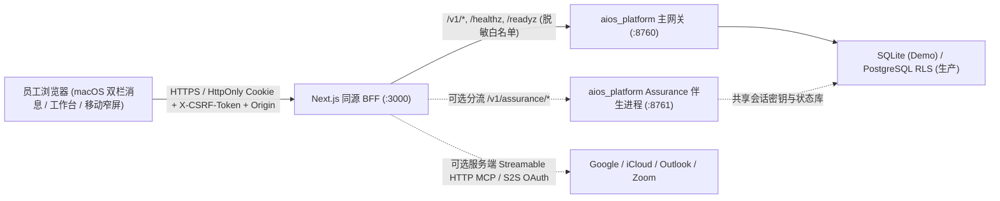

# SME AIOS 企业工作台前端交付与部署文档（v2）

> **代码路径**：`web/`（Next.js 16 App Router + TypeScript + 同源 BFF + Server-Side MCP Bridge）、`deploy/demo/`（低成本演示部署模板）  
> **后端基线**：`aios_platform/`（含同源浏览器会话、员工模块动态授权、协作房间、站内日历、通知简报、受控预审 Assurance）  
> **相关文档**：[后端与前端交接](workbench-handoff.zh-CN.md) · [协作与同源会话契约](workbench-collaboration.zh-CN.md) · [受控预审交接](governed-assurance.zh-CN.md) · [生产就绪指南](production-readiness.md)

---

## 1. v2 架构概览与设计原则

### 1.1 同源 BFF、MCP 服务端桥接与零信任边界

所有浏览器流量统一进入 Next.js 同源入口（`:3000`），**不直接暴露**后端 FastAPI（`:8760` / `:8761`）、`/openapi.json` 或任何外部 MCP / Zoom 凭据：



核心安全护栏：
1. **无客户端凭证与密钥**：`AIOS_DEMO_SECRET`、`AIOS_DEMO_LOGIN_PASSWORD`、`AIOS_BROWSER_SESSION_KEY`、`AIOS_LLM_API_KEY`、`AIOS_BFF_OIDC_CLIENT_SECRET` 及所有 `AIOS_MCP_*` / `ZOOM_*` 凭据全部留在服务端环境变量，代码库严禁出现任何 `NEXT_PUBLIC_*` 密钥配置。
2. **输出白名单脱敏（`web/src/lib/bff/sanitize.ts`）**：
   - `/v1/workbench/capabilities` 强制剔除 `planner` 字段。
   - 递归剥离所有模型/规划器内部键（`reasoning`、`chain_of_thought`、`thought`、`raw_tokens`、`prompt`、`system_prompt`、`tool_args`、`internal_args`、`model_name`、`llm_model`、`provider`、`usage`、`token_usage`、`api_key`、`secret`、`traceback`、`stack`）。
   - 所有 `404`（含批量审批逐项 `404`）统一掩码为 `{"detail":{"code":"RECORD_UNAVAILABLE","message":"当前账号无法访问这条记录。"}}`，绝不泄露对象是否存在。
   - `422` 校验错误剔除原始回显 `input` / `ctx` / `url`；`5xx` 仅输出安全业务错误码与 `X-Request-ID`。
   - 所有 `/v1/*` 与 `/api/*` 响应强制加注 `Cache-Control: no-store`。
3. **认证代次防脏读（`authGeneration`）与纯内存态**：
   - `csrf_token`、对话草稿、单据详情与本地 OCR 图片预览 `blob:` URL 仅存内存，严禁写入 `localStorage` / `sessionStorage`。
   - 发生 `401`、账号停权、退出登录或切换本地演示身份时，立即递增 `authGeneration`、中止所有在途 `AbortController` 请求、丢弃旧代次迟到响应、清空草稿与选中单据，并立即调用 `URL.revokeObjectURL(...)`。

### 1.2 统一视觉规范：Frosted Alabaster & Porcelain

- **全站单一浅色瓷釉色系（零深浅割裂）**：
  - 全局画布 `#F5F6F8`、macOS Sequoia 磨砂侧边栏 `rgba(246, 247, 249, 0.82)`（`backdrop-filter: blur(20px) saturate(180%)`）、纯白浮层卡片 `#FFFFFF`、深墨正文 `#111318` / 辅助灰 `#525B6C` / 注释灰 `#667085`、单一 AA 对比度海洋钴蓝强调色 `#1668E3`（与纯白达 `5.09:1`），全站统一使用语义化圆角 Token（`rounded-xs`/`sm`/`tile`/`card`/`xl`/`full`）、层次化环境投影与 `.tabular-nums` 等宽数字。
  - 状态严格采用「色彩 + 图标 + 中文语义」三重绑定（松绿 `#127A46` 已入账/正常、琥珀 `#B26200` 待审批/待确认、绛红 `#C92A37` 拦截/拒绝/撤销）。
- **克制 3D 物理交互与真实进度链**：
  - `ArchitecturalRelayCanvas`：升级为浅色瓷釉 3D 光学架构舞台，位于 `/` 与 `/login` 右侧并与登录卡上下基线齐平（`maxTilt={0}` 避免与画布视差叠加），清晰呈现「租户隔离 → 策略闸门 → Agent 工作台 → ERP 核验」四层信任架构，并支持 `prefers-reduced-motion` 静态降级。
  - `Interactive3DCard`：零 React 重渲染 rAF 阻尼微倾斜（默认 `maxTilt <= 3°` 并按卡片宽度自动衰减），静态展示卡采用 `interactive={false}` 仅保留细腻瓷釉光泽，杜绝伪交互倾斜。
  - `BriefProgressChain`：请求在途时严格仅显示单行「正在处理请求…」，完成后折叠展示 2–3 步真实业务核验记录（零原始 CoT、零伪造百分比）。
- **原生 macOS 双栏消息 + Muse 极简 Agent + 角色分层工作台**：
  - **根路径 `/` 账号密码登录**：未登录访问 `/` 直接呈现企业账号 + 密码登录卡（默认折叠 11 角色测试演示快速填入），已登录自动跳转 `/inbox`。
  - **macOS Sequoia 双栏消息（`/inbox*`）**：移除冗余外层 60px 图标轨与顶栏，保留 300px 磨砂侧栏（`⌘K` 统一检索同事与会话、全公司联系人通讯录弹窗、置顶个人 Agent 瓷釉卡、带实时最后一条消息预览与相对时间的同事会话列表、极简单行底部账户坞）+ 右侧主会话画布。
  - **Muse 风格个人 Agent 画布**：60px 磨砂顶栏仅保留「左侧自定义 Agent 头像与名称」和「右上角『工作台』胶囊按钮」（按 `⌘.` / `Ctrl+.` 唤出磨砂右侧业务核对抽屉）；底部悬浮胶囊输入框仅保留左下「`+ 添加上下文`」与右下圆形钴蓝发送键；消息气泡使用无缝 SVG 尾部与物理弹簧入场动效。
  - **角色权限分层工作台（`/work`）**：顶栏收束为 5 控件磨砂导航（`返回会话` + 能力门控分段导航 + 角色切换/通知/抽屉图标/头像菜单）；工作台按服务端真实授权动态呈现 4 层权限导航（`执行与进件层` / `专业复核层` / `审批与经营层` / `管理与治理层`）、真实 KPI 卡片、人性化单据标题与中文化审计时间线。

---

## 2. 启动命令与环境变量参考

### 2.1 模式 A：零密钥本地开发 / 单进程演示（推荐默认，含本地规则 + Assurance + `.ics`）

```bash
# 在仓库根目录执行（自动生成 0600 权限的 Assurance 演示密钥与服务端会话密钥）
./deploy/demo/start-local-demo.sh
```

打开 **http://localhost:3000/** 即可使用账号密码登录（如 `operator` / `aios2026`、`manager` / `aios2026`、`admin` / `aios2026`、`access-admin` / `aios2026`），或展开「测试演示账号快速填入」一键切换 11 个受控演示身份。

常用参数：
- `./deploy/demo/start-local-demo.sh --reset-state`：重置本地 SQLite 演示库后启动。
- `./deploy/demo/start-local-demo.sh --prod`：使用 `next build` Standalone 生产构建模式启动。
- `./deploy/demo/start-local-demo.sh --worker`：同时拉起后台 `run_worker`（不传此参数时，可在 `/admin` 以 `admin` 身份点击「推进 Worker」逐帧演示 `QUEUED → VERIFIED`）。

### 2.2 模式 B：双端口云端大模型 + 受控预审（Cloud LLM `:8760` + Assurance `:8761`）

> `aios_platform/api.py` 强制禁止在同一后端进程内同时启用 `AIOS_WORKBENCH_PLANNER=pydantic-ai` 与 `AIOS_ASSURANCE_*KEY_FILE`。双端口模式让两个进程共享同一 `AIOS_PLATFORM_STATE_DIR`、`AIOS_BROWSER_SESSION_KEY`、`AIOS_BROWSER_ORIGIN` 和 `AIOS_DEMO_SECRET`，由 Next.js BFF 按路径将 `/v1/assurance/*` 透明转发至 `:8761`。

```bash
export AIOS_LLM_BASE_URL="https://api.deepseek.com"   # 必须为 https://
export AIOS_LLM_MODEL="deepseek-chat"
export AIOS_LLM_API_KEY="sk-your-server-only-key"

./deploy/demo/start-local-demo.sh --mode dual
```

### 2.3 模式 C：生产级 Keycloak OIDC + HTTPS + 真实 MCP 日历/Zoom 部署

1. **后端 FastAPI（`AIOS_PROFILE=oidc`）**：
   - `AIOS_PLATFORM_DSN_FILE`（强制 `postgresql://` + Alembic `0008_collaboration` + `deploy/platform/postgres-security.sql` 强制 RLS）
   - `AIOS_OIDC_ISSUER`（`https://...`）、`AIOS_OIDC_AUDIENCE`
   - `AIOS_BFF_OIDC_CLIENT_ID`、`AIOS_BFF_OIDC_CLIENT_SECRET_FILE`（Keycloak 回调白名单配置为 `{AIOS_BROWSER_ORIGIN}/v1/session/callback`）
   - `AIOS_BROWSER_ORIGIN=https://workbench.example.com`（后端签发 `__Host-aios_session; Secure; HttpOnly; SameSite=Lax`）
   - `AIOS_BROWSER_SESSION_KEY_FILE`（32 字节 64 位十六进制密钥，多副本共享同一密钥）
2. **前端 Next.js BFF（`web/`）**：
   - `AIOS_API_BASE_URL=http://127.0.0.1:8760`
   - `AIOS_BROWSER_ORIGIN=https://workbench.example.com`
   - `AIOS_ENABLE_DEMO_AUTH=0`（关闭本地演示登录入口）
   - `AIOS_OIDC_LOGIN_ENABLED=1`（`/` 与 `/login` 展示企业 OIDC 单点登录入口 `GET /v1/session/login`）
   - 按需配置下方 2.4 节中的外部 Google / iCloud / Outlook / Zoom MCP 服务端变量。

### 2.4 环境变量速查表

#### 核心平台与认证变量

| 变量名 | 所属进程 | 是否必填 | 说明 |
|---|---|---|---|
| `AIOS_PROFILE` | FastAPI | 是 | `demo`（本地/演示）或 `oidc`（生产） |
| `AIOS_PLATFORM_STATE_DIR` | FastAPI | Demo | SQLite 状态库目录（`store.sqlite`、`erp.sqlite`） |
| `AIOS_DEMO_SECRET` | FastAPI + BFF | Demo | `>=32` 位且**不能含英文句点 `.`**；严禁下发浏览器 |
| `AIOS_DEMO_LOGIN_PASSWORD` | Next.js BFF | Demo 可选 | `POST /api/auth/login` 本地演示登录密码（默认 `aios2026`），严禁加 `NEXT_PUBLIC_` 前缀 |
| `AIOS_BROWSER_ORIGIN` | FastAPI + BFF | 是 | 浏览器访问的精确源（本地 `http://localhost:3000`，公网必须为 `https://<域名>`） |
| `AIOS_BROWSER_SESSION_KEY` | FastAPI | 是 | 64 位十六进制（32 字节）AES-256-GCM 会话加密密钥 |
| `AIOS_WORKBENCH_PLANNER` | FastAPI | 可选 | `local`（默认本地规则）或 `pydantic-ai`（需配置 `AIOS_LLM_*`） |
| `AIOS_ASSURANCE_DEMO_KEY_FILE` | FastAPI | 可选 | `0600` 权限 JSON 密钥文件路径；不可与 `pydantic-ai` 同进程启用 |
| `AIOS_API_BASE_URL` | Next.js BFF | 是 | 主后端地址，默认 `http://127.0.0.1:8760` |
| `AIOS_ASSURANCE_API_BASE_URL` | Next.js BFF | 可选 | 双端口模式下的 Assurance 后端地址（如 `http://127.0.0.1:8761`） |
| `AIOS_ENABLE_DEMO_AUTH` | Next.js BFF | Demo | 仅演示环境设为 `1`，生产环境必须为 `0` |
| `AIOS_OIDC_LOGIN_ENABLED` | Next.js BFF | 可选 | `1` 显示企业 OIDC 登录按钮；未设置时在关闭 demo 登录后自动开启 |

#### 外部日历与 Zoom MCP 服务端接入变量（均可选，零密钥默认提供真实站内日历 + `.ics`）

| 连接器 | 环境变量（全部仅限 Next.js BFF 服务端读取） | 默认行为（未配置时） |
|---|---|---|
| **Google Calendar MCP** | `AIOS_MCP_GOOGLE_CALENDAR_URL`、`AIOS_MCP_GOOGLE_CALENDAR_TOKEN`、`AIOS_MCP_GOOGLE_CALENDAR_ID`（默认 `primary`）、`AIOS_MCP_GOOGLE_CALENDAR_TOOL`（默认 `create-event`） | 状态显示「待配置 MCP」，点击「连接」查看接入变量，支持一键导出 `.ics` 导入 Google Calendar |
| **Apple iCloud CalDAV MCP** | `AIOS_MCP_ICLOUD_CALENDAR_URL`、`AIOS_MCP_ICLOUD_CALENDAR_TOKEN`、`AIOS_MCP_ICLOUD_CALENDAR_TOOL`（默认 `create_event`） | 状态显示「待配置 MCP」，支持标准 RFC 5545 / 7986 `.ics` 直接导入 Apple 日历 |
| **Outlook / M365 Graph MCP** | `AIOS_MCP_OUTLOOK_CALENDAR_URL`、`AIOS_MCP_OUTLOOK_CALENDAR_TOKEN`、`AIOS_MCP_OUTLOOK_CALENDAR_TOOL`（默认 `create-calendar-event`） | 状态显示「待配置 MCP」，支持标准 `.ics` 直接导入 Outlook / Microsoft 365 |
| **Zoom 视频会议**（MCP 优先 / S2S OAuth 备选） | 方案 A：`AIOS_MCP_ZOOM_URL`、`AIOS_MCP_ZOOM_TOKEN`、`AIOS_MCP_ZOOM_TOOL`（默认 `create_meeting`）<br/>方案 B：`ZOOM_ACCOUNT_ID`、`ZOOM_CLIENT_ID`、`ZOOM_CLIENT_SECRET`、`ZOOM_HOST_USER_ID`（默认 `me`） | 诚实展示 `Zoom 沙盒预览`（绝不伪造假会议链接），真实写入 `/v1/calendar/events` 站内日程、通知协作房间并生成单条 `.ics` |

---

## 3. 已接入 API 与同源 BFF 核对清单

| 模块 | 前端路由 | 已接入接口（FastAPI `/v1/*` + BFF `/api/*`） | BFF 与前端关键行为 |
|---|---|---|---|
| 账号密码登录与会话 | `/`、`/login`、全局 `AppShell` | `POST /api/auth/login`、`GET /api/auth/demo-personas`、`POST /api/auth/demo-login`、`GET/DELETE /v1/session`、`GET /v1/session/login`、`GET /v1/me`、`GET /v1/workbench/capabilities` | 恒定时间密码校验 + 防枚举 `401` + 滑动窗口防暴力 `429`；BFF 换取 HttpOnly Cookie；`capabilities.planner` 强制剥离；所有变更请求强制校验 `Origin` + `X-CSRF-Token` |
| 全公司联系人目录与 1:1 发起 | `/inbox` 侧栏检索与通讯录弹窗 | `GET /api/directory/contacts?q=...`、`POST /api/directory/direct-room` | 严格按实时 `/v1/me` 返回的 `actor.tenant` 过滤同企业同事（跨租户如 `island-manager` 零泄露）；一键发起或复用 1:1 房间并自动准入成员 |
| 个人资料与 Agent 资料 | `/settings/profile`、`/settings/agent` | `GET/PATCH /v1/profile`、`GET/PUT/DELETE /v1/profile/avatar`、`GET/PATCH /v1/agent-profile`、`GET/PUT/DELETE /v1/agent-profile/avatar` | 乐观锁 `version`（`409` 刷新重提）；原始图片字节透传；保存后实时同步置顶 Agent 瓷釉卡、Muse 顶栏与底部账户菜单 |
| Muse 个人 Agent 对话与历史 | `/inbox`、`/inbox/assistant` | `POST /v1/workbench/turns`、`GET /v1/workbench/history`、`GET /v1/workbench/history/{id}`、`GET /v1/workbench/brief` | 带 `client_id` 时**严禁**同时发 `Idempotency-Key`；重试复用原 `client_id`；历史通过「`+ 添加上下文` → `历史活动记录`」打开磨砂核验弹窗，展开时实时复核权限并在 `403 ACCESS_CHANGED` / `404` 时立即清卡 |
| 日历 MCP 同步与自然语言 Zoom 订会 | `/calendar`、Agent 聊天内联卡片 | `GET /api/integrations/mcp/status`、`POST /api/integrations/zoom/book`（`parse`/`preview` → `confirm`）、`POST /api/integrations/calendar-sync`、`GET /api/calendar/ics`、`GET/POST/PATCH/cancel /v1/calendar/events` | 支持中英双语自然语言解析时间/主题/同租户同事（跨租户人名拒绝并预警）→ 可编辑预览卡 → 显式确认后先真实写入 `/v1/calendar/events`（失败即熔断不调外部 MCP），再并发执行 Zoom 与外部日历同步并生成 RFC 5545/7986 `.ics` |
| 角色权限分层工作台 | `/work`、右侧滑出业务面板（`⌘.`） | `GET /v1/workbench/tasks?lane=assigned\|submitted`、`GET /v1/workbench/approvals`、`POST /v1/workbench/calls` | 4 层能力门控导航 + 真实 KPI 瓷釉卡；双游标分页（`after_due` + `after_id`）；审批列表零 N+1；提案类 tool call 强制携带 `Idempotency-Key` |
| 订单进件与 OCR 依据 | `/orders/new` | `POST /v1/intakes/{warehouse}/structured`、`POST /v1/intakes/{warehouse}/structured/batch`、`POST /v1/intakes/{warehouse}`、`GET /v1/intakes/{id}` | 支持 `FE-DEMO-001` 一键预填、批量进件（≤50 条）、8 MB 单据图片 OCR + 原生 `<svg viewBox>` 边框高亮 |
| 提案详情与审批执行 | `/proposals/[id]` | `GET /v1/proposals/{id}`、`POST /v1/proposals/{id}/approve`、`POST /v1/proposals/approve-batch`、`POST /v1/proposals/{id}/review` | 人性化单据标题 + 可复制短单号 + 齐平 5 步执行进度轨 + 折叠核验明细 + 纵向差异比对 + 中文化审计时间线（如 `自审批已拦截`）+ 已核验 ERP 回执瓷釉卡 |
| 员工模块动态授权 | `/admin/people`、`/admin/people/[subject]` | `GET /v1/workbench/module-access/catalog`、`GET /v1/workbench/module-access/employees`、`GET/PUT /v1/workbench/module-access/employees/{subject}[/{module}]` | 严格要求 `workbench.access.manage` 与全站点范围（`access-admin` 可见，普通运维 `admin` 不可访问）；中文快捷有效期（永久/7 天/30 天 + `YYYY-MM-DD HH:MM`）与自定义钴蓝胶囊多选 |
| 运维监控与异常核查 | `/admin`、`/admin/exceptions` | `GET /healthz`、`GET /readyz`、`GET /v1/operations/summary`、`GET /v1/operations/exceptions`、`PUT /v1/operations/write-control`、`POST /v1/proposals/{id}/reconcile`、`POST /v1/demo/worker-tick`、`PUT /v1/operations/subjects/{subject}/suspension` | 严格要求 `operations.manage`；3 张可行动核心指标卡 + 9 态紧凑图例 + 停写熔断闸门 + 演示 `worker-tick` |
| 受控预审（Assurance） | `/work`（采购/质检/法务模块） | `GET /v1/assurance/cases`、`GET /v1/assurance/cases/{ref}`、`POST/GET /v1/assurance/cases/{ref}/reviews`、`GET /v1/assurance/reviews/{id}`、`POST /v1/assurance/reviews/{id}/decisions` | 细胞级按岗字段投影（如 `finance` 可见 `supplier_bank`）、人性化货币金额（`HKD 12,000.00`）与布尔值（`是`/`否`）、多轨独立表决与 `stale`/`expired` 保护 |

---

## 4. 真实能力 vs 合成演示数据对照表

为确保对外演示与客户验收完全诚实透明，下表严格区分**真实运行接口**、**后端内置合成数据源**、**服务端可选 MCP 沙盒**与**前端明确标注的演示展示卡**：

| 能力 / 视图 | 数据与执行性质 | 界面来源标签 | 说明 |
|---|---|---|---|
| 同源会话、账号密码校验、CSRF、Origin、跨租户通讯录与跨仓隔离 | **100% 真实后端执行** | — | 由 `aios_platform` + Next.js BFF 实时鉴权与强隔离 |
| 员工模块动态授权与撤权阻断（含待派发提案拦停） | **100% 真实后端执行** | — | 写入 `aios_module_access`，即时影响 `/v1/me`、能力列表、历史重查与 Worker 派发前复检 |
| 订单进件、提案审批、ERP 写入与回执核对 | **真实状态机 + 本地模拟 ERP 账本** | `ERP`（本地 `erp.sqlite`） | 完整经过 Outbox、摘要锁、幂等写入与只读回查核验；生产试点切换至 Odoo/ERPNext 连接器 |
| 员工房间聊天、1:1 私聊、站内日历、`.ics` 导出、个人/Agent 资料、通知与简报 | **100% 真实后端持久化** | `站内记录` | 全部读写 `aios_platform` 数据库与标准 RFC 5545/7986 生成器，刷新重登持久保留 |
| Google / iCloud / Outlook / Zoom MCP 同步 | **配置服务端变量后 100% 真实调用；未配置时诚实沙盒降级** | `待配置 MCP` / `Zoom 沙盒预览` / `已连接` | 绝不伪造 Zoom 链接或成功状态；未配置时站内日历依然真实入库并提供 `.ics` 一键导入 |
| 发票 `INV-100`、收件箱 `MAIL-101/102`、仓库概览（`HK01=23 / HK02=8 / ISL=4`） | **真实鉴权接口 + 后端合成数据** | `合成数据` | 由 `aios_platform/workbench_tools.py:SyntheticWorkData` 提供，经过完整租户/仓库/模块权限校验 |
| 受控预审案件 `PO-100` / `QA-200` / `CT-300` / `PO-401` | **真实策略与签名审计链 + 后端合成案件** | `合成数据` | 由 `DemoCaseSource` 与 `SignedAudit` 提供真实多轨裁决、硬性留置（`QA-200`）与字段投影 |
| `/work` 调度页仓内履约节点卡与财务页合同付款里程碑卡 | **前端合成展示卡（无独立后端写入接口）** | 明确标注 `合成数据` | 仅用于展示完整岗位工作台布局，绝不冒充实时 WMS/财务过账数据 |

---

## 5. 最小成本公开演示与生产升级方案

### 5.1 三档成本拓扑对比

| 档位 | 适用场景 | 预估费用 | 部署架构与模板文件 |
|---|---|---|---|
| **Tier 0 · 零成本现场演示** | 临时发公网链接给客户/投资人试玩 | **$0 / 月** | 本机 Mac 运行 `./deploy/demo/start-local-demo.sh --prod --tunnel`（`cloudflared` Quick Tunnel 自动分配 HTTPS 链接；已有域名可用免费 Named Tunnel + Cloudflare Zero Trust Access） |
| **Tier 1 · 最低成本 24/7 公网演示** | 需要随时可访问的固定域名演示环境 | **¥25–50 / 月**（~$4–6/月）+ 域名 ¥30–90/年 | 单台 2C2G / 2C4G Ubuntu 24.04 VPS（推荐香港/新加坡免备案节点）；总内存占用仅 **~350 MB**。直接使用 `deploy/demo/` 模板：`Caddyfile` + `aios-demo-api.service` + `aios-demo-web.service`（双端口模式加启 `aios-demo-assurance.service`） |
| **Tier 2 · 客户生产试点** | 正式内网/专属云上线 | 视客户云资源而定 | PostgreSQL 16/17 强制 RLS + Keycloak OIDC + `deploy/platform/aios-api.service` & `aios-worker.service` + 真实 ERP 连接器 + 外部 MCP 节点 |

### 5.2 Tier 1 VPS 一键部署步骤摘要（`deploy/demo/`）

1. 在 VPS 上安装 Python 3.11+、`tesseract-ocr`、`tesseract-ocr-eng`、Node.js 22+/26、Caddy 2 与 `sqlite3`。
2. 创建受限系统用户 `aios-demo` 与持久化目录 `/var/lib/aios/state`（`0700`）、`/etc/aios/secrets`（`0700`）。
3. 生成 Assurance 演示密钥（`0600`）：
   ```bash
   sudo -u aios-demo /opt/aios/.venv/bin/python -m aios_platform.assurance_audit keygen /etc/aios/secrets/assurance-demo-key.json
   ```
4. 按 `deploy/demo/aios-demo-*.service` 头部注释创建 `/etc/aios/demo-common.env`、`/etc/aios/demo-api.env`、`/etc/aios/demo-web.env`（`0640 root:aios-demo`），按需加入 MCP / Zoom 服务端变量。
5. 构建并同步 Next.js standalone 产物到 `/opt/aios-web/`：
   ```bash
   pnpm --dir web build
   rsync -a web/.next/standalone/ /opt/aios-web/
   rsync -a web/.next/static/     /opt/aios-web/.next/static/
   ```
6. 复制 `deploy/demo/Caddyfile` 与 `aios-demo-*.service` 并 `systemctl enable --now aios-demo-api aios-demo-web caddy`。

---

## 6. Opus 5.5 视觉审计、Polish Round 2 与全量自动化验收报告

### 6.1 Opus 5.5 Medium 深度视觉审计与 Polish Round 2 改进摘要

在 Wave 7A 首次 19/19 联调截图基础上，先由 QA 视觉走查定位并修复了 Tailwind v4 `translate` 与 `tokens.css` `@keyframes aios-modal-in` 叠加导致的弹窗左上偏移问题（并补充弹窗居中几何断言防回归）；随后由主设计师角色（Claude Opus 5.5 Medium）逐帧审查全部 12 张实机截图与核心源码，完成 **Polish Round 2** 四模块并行精修：

- **设计底座与动效物理（`tokens.css`、`Interactive3DCard`、`ArchitecturalRelayCanvas`、`BriefProgressChain`、`ExecutionTopologyRibbon`、`AppShell`、`LoginView`）**：
  - 全站彻底清除任意 `rounded-[Npx]` 偏离，统一收敛至 `rounded-card`（`18px`）/ `rounded-tile`（`14px`）/ `rounded-sm` / `rounded-xs`；新增 `.aios-row-in` 纯位移入场类与 `Button variant="quiet"`；`Avatar` 收敛为 4 种低饱和瓷釉色 + 单字中文兜底。
  - `Interactive3DCard` 降幅至 `≤3°` 并按宽阻尼、修复归位中途重入跳变、对静态卡片启用 `interactive={false}`；登录页 3D 展台取消卡片双视差并与左侧登录卡上下齐平；工作台顶栏由 7 控件精简为 5 控件；步骤条改为贯穿圆心齐平轨道并支持内联 `核验明细`。
- **macOS 消息、Muse Agent 与 MCP 日历（`InboxShell`、`AssistantWorkspace`、`ContactsDirectoryModal`、`McpCalendarConnectorsPanel`、`ZoomBookingCard`、`CalendarWorkspace`）**：
  - `/inbox/assistant` 顶栏彻底移除多余抽屉图标，仅保留自定义 Agent 头像/名称与右上角「工作台」按钮；iMessage 气泡去除尾部阴影接缝；侧栏单行底部账户坞折叠演示角色切换器，会话行补齐实时最后一条消息预览与相对时间戳，空态去框化；通讯录行 CTA 降噪为轻钴蓝按钮。
  - MCP 连接器统一单色瓷釉视觉（未配置时显示诚实「连接」入口而非伪同步按钮），去除重复 `.ics` 导出按钮与冗余未配置状态芯片。
- **工作台、提案与运维权限管理（`WorkbenchView`、`UnifiedQueuesPanel`、`ProposalInspectorPanel`、`AssurancePanel`、`AdminOpsOverview`、`EmployeeAccessDetailView`）**：
  - 修复工作台权限层按钮垂直对齐并移除 `"N 项"` 冗余计数，H1 展示真实中文姓名（如「陈志远 · 工作台」）；队列与提案页改以业务标题 + 短单号主导，`待审批` 统一琥珀色，审计时间线全面中文化（如 `APPROVAL_DENIED` → `自审批已拦截`），ERP 回执卡去重；Assurance `PO-100` 金额按币种格式化为 `HKD 12,000.00` 且布尔值显示「是/否」。
  - `/admin` 统一瓷釉页头并将 9 格彩虹状态卡重构为「3 张核心可行动指标卡 + 9 态紧凑单行图例」；`/admin/people/[subject]` 移除美式原生 `mm/dd/yyyy` 与原生复选框，升级为中文快捷有效期选择 + 钴蓝胶囊站点开关 + 去工程化版本号文案。

### 6.2 实测命令与总览结果（Polish Round 2 终验）

> **实测环境**：真实 `aios_platform` FastAPI 网关（`127.0.0.1:8760`，`AIOS_PROFILE=demo`、`AIOS_PLANNER=demo`、`AIOS_WORKBENCH_PLANNER=local` + `0600` 权限 `AIOS_ASSURANCE_DEMO_KEY_FILE`）+ 真实 Next.js 16.4.6 Standalone 同源 BFF（`node web/.next/standalone/server.js`，`127.0.0.1:3000`），Chromium（Playwright `1.65.x`），桌面 `1440×900` + 移动 `390×844` 全量顺序联调。

| 验证项 | 命令 | 结果 |
|---|---|---|
| 严格 TypeScript 检查 | `pnpm --dir web typecheck` (`tsc --noEmit`) | **PASS（0 errors）** |
| 生产 Standalone 构建 | `rm -rf web/.next && pnpm --dir web build` | **PASS（28 路由全部通过，0 errors）** |
| 全量 Playwright 联调回归 | `PLAYWRIGHT_BASE_URL=http://localhost:3000 pnpm --dir web test:e2e` | **PASS（19 / 19 通过，0 失败）** |
| 静态安全与护栏扫描 | 扫描 `web/src/**` | **CLEAN**：`NEXT_PUBLIC_*` = 0、`localStorage`/`sessionStorage` = 0、`dangerouslySetInnerHTML` = 0、偏离圆角 Token = 0 |
| 运行时网络/DOM/存储审计 | `01`–`06` 挂载 `attachRuntimeAudit` | **PASS**：0 `capabilities.planner` / `provider` / `prompt` 泄露、全部 `/v1/*` 与 `/api/*` 带 `Cache-Control: no-store`、浏览器存储零业务载荷 |

### 6.3 分套件用例实测明细（19 / 19 PASS）

| 套件文件 | 覆盖验收项 | 用例数 | 实测结果 |
|---|---|---|---|
| `web/e2e/01-auth-shell-profile.spec.ts` | 根 `/` 账号密码登录与浅色 3D 展台、`/v1/me` 与 `/inbox` 2 栏 macOS 外壳、纯净 Muse 顶栏（零多余按钮）、本人/Agent 资料改名刷新持久化、键盘 `⌘./Ctrl+.` 与 `Esc` 抽屉焦点恢复及草稿保留、`390×844` 移动端 iMessage 对话与返回路径 | 4（含 `@mobile`） | **4 / 4 PASS** |
| `web/e2e/02-order-approval-receipt.spec.ts` | `operator` HK01 提交 `FE-DEMO-001` → 自批被拒（`403 ACTION_NOT_ALLOWED` + 保持只读）→ `manager` 角色分层工作台 KPI/人性化队列 → 提案页核对 `digest`/`2 CASE → 48 EACH`/中文化 `自审批已拦截` 并批准（`202`）且重复提交不双写 → `admin` 运维监控推进 `worker-tick` 至 `VERIFIED` 显示真实 ERP 回执 | 1 | **1 / 1 PASS** |
| `web/e2e/03-module-access-and-isolation.spec.ts` | 普通 `admin` 不可进 `/admin/people` → `access-admin` 为 `operator` 开通 HK01 发票审阅 → `operator` 查 `INV-100` 成功 → `other-manager` 跨仓拦截 → `island-manager` 跨租户深链统一 `404 RECORD_UNAVAILABLE` → 撤权后经「`+ 添加上下文` → `历史活动记录`」重查失败且新提问/直调三重失效 → 待派发提案在撤权后派发阻断（`MODULE_ACCESS_REVOKED_BEFORE_SEND`） | 1 | **1 / 1 PASS** |
| `web/e2e/04-collaboration-roles-calendar.spec.ts` | `finance` 读发票成功且订单写入被拒 + 合成合同卡明确标注 `合成数据`；真人房间建房/发消息/刷新持久化 + 会议草稿快速双击仅建 1 条日程；通知列表无未授权 `kind`/`reference` 泄露；Assurance `PO-100` 格式化金额（`HKD 12,000.00`）与实时双轨审批（`APPROVED`） | 4 | **4 / 4 PASS** |
| `web/e2e/05-security-errors-resilience.spec.ts` | 全站网络/DOM/Console/Storage 零泄露审计 + 故障注入矩阵（`authGeneration` 旧代次迟到响应丢弃、`401` 跳转清态、`403 ACCESS_CHANGED` 即时清卡并刷新能力、`404` 统一文案、`409` 乐观锁刷新快照、`422` 就地校验错误、`429`/`503` 遵守 `Retry-After` 无死循环、`OUTCOME_UNKNOWN` 回执核查提示） | 5 | **5 / 5 PASS** |
| `web/e2e/06-v2-login-contacts-mcp-zoom.spec.ts` | 根 `/` 账号密码错误 `401` + `operator`/`aios2026` 成功登录 `/inbox`；全公司通讯录弹窗居中校验、严格租户隔离（`island-manager` 零泄露）与 `manager` 1:1 房间消息持久化；Muse 顶栏/悬浮输入框/`+ 添加上下文` 交互与直达 `/work`；`/calendar` 4 张 MCP 连接器卡、有效 `text/calendar` `.ics` 导出及自然语言 Zoom 订会（预览 → 确认 `201` → 真实 `/v1/calendar/events` 入库 + 单条 `.ics` + 零敏感键审计） | 4 | **4 / 4 PASS** |

### 6.4 完整 v2 实机截图清单（12 张均已逐张视觉核验）

- `web/e2e/screenshots/01-login-3d-stage.png` — `/` 账号密码登录卡 + 齐平瓷釉 3D 光学架构展台 + 折叠演示助手
- `web/e2e/screenshots/02-inbox-assistant.png` — `/inbox` macOS Sequoia 2 栏消息外壳、单行底部账户坞、置顶 Agent 与纯净 Muse 空态画布
- `web/e2e/screenshots/02b-inbox-active-chat-context.png` — 活跃 Agent 对话（无缝 iMessage 气泡、真实会话预览与时间、`BriefProgressChain`、3D 运单卡与展开的 `+ 添加上下文` 菜单）
- `web/e2e/screenshots/02c-contacts-directory.png` — 居中磨砂全公司联系人目录弹窗（单字瓷釉头像、站点筛选与轻钴蓝「发起对话」CTA）
- `web/e2e/screenshots/03-workbench-tiered.png` — `/work` 角色权限分层工作台（5 控件磨砂顶栏、真实姓名页头、KPI 瓷釉卡、4 层导航与人性化待办队列）
- `web/e2e/screenshots/04-manager-approval-diff.png` — `/proposals/[id]` 主管审批视图（人性化标题、齐平 5 步执行轨 + 折叠核验明细、字段差异与中文化「自审批已拦截」时间线）
- `web/e2e/screenshots/05-admin-ops-monitor.png` — `/admin` 瓷釉运维监控中心（健康探针、熔断闸门、3 张核心可行动指标卡 + 9 态紧凑图例 + 聚焦拓扑轨）
- `web/e2e/screenshots/06-proposal-verified-receipt.png` — `/proposals/[id]` `VERIFIED` 全链路已入账、7 步中文化时间线与去重后的 ERP 回执瓷釉卡
- `web/e2e/screenshots/07-admin-people-access.png` — `/admin/people/operator` 员工模块动态授权页（自定义钴蓝复选与站点胶囊、中文快捷有效期与「第 1 版配置」保存回执）
- `web/e2e/screenshots/08-mobile-inbox.png` — `390×844` 移动端原生 iMessage 对话视图与 Muse 底部悬浮输入框
- `web/e2e/screenshots/09-assurance-po100.png` — 受控治理预审 `PO-100` 详情（`HKD 12,000.00` 格式化金额、清晰中文布尔值与岗位投影）
- `web/e2e/screenshots/10-calendar-mcp-zoom.png` — `/calendar` 自然语言 Zoom 预约确认卡、4 张单色瓷釉 MCP 连接器卡（诚实「待配置 MCP / 连接」）与实时站内日程

---

## 7. 剩余后端接口与生产试点准入门槛

1. **刻意不经前端暴露的运维/兼容后端接口**：`GET /metrics`（Prometheus Bearer 抓数）、`POST /v1/actions`（旧版兼容入口，已由类型化 `/v1/workbench/turns` 与 `/v1/workbench/calls` 取代）、`GET /v1/assurance/audit/checkpoint`（仅由离线审计验签 CLI 调用）。
2. **生产试点前必测项**：真实企业 Keycloak/IdP `RS256` JWKS 与 PKCE 闭环、真实 ERP（Odoo 19 / ERPNext）沙盒回执核查与字段映射、客户外部 MCP（Google / iCloud / Outlook / Zoom）服务端凭据联调、PostgreSQL 16/17 强制 RLS 迁移与备份恢复演练。
