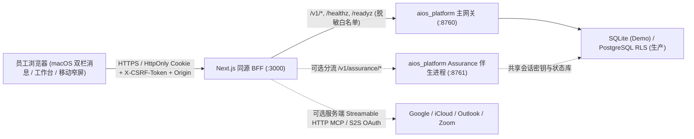

# SME AIOS 企业工作台前端交付与部署文档（v2.1 · 三语与深色模式终验版）

> **代码路径**：`web/`（Next.js 16 App Router + TypeScript + 同源 BFF + Server-Side MCP Bridge + 全站三语 i18n & Apple Sequoia 深色模式）、`deploy/demo/`（本地/低成本演示模板）、`deploy/integrai/`（加固型云端演示发布脚本与运维手册）  
> **后端基线**：`aios_platform/`（含同源浏览器会话、员工模块动态授权、协作房间、站内日历、通知简报、受控预审 Assurance）  
> **相关文档**：[后端与前端交接](workbench-handoff.zh-CN.md) · [协作与同源会话契约](workbench-collaboration.zh-CN.md) · [受控预审交接](governed-assurance.zh-CN.md) · [IntegrAI 云端部署手册](../deploy/integrai/RUNBOOK.zh-CN.md) · [生产就绪指南](production-readiness.md)

---

## 1. v2 架构概览与设计原则

### 1.1 同源 BFF、MCP 服务端桥接与零信任边界

所有浏览器流量统一进入 Next.js 同源入口（`:3000`），**不直接暴露**后端 FastAPI（`:8760` / `:8761`）、`/openapi.json` 或任何外部 MCP / Zoom 凭据：



核心安全护栏：
1. **无客户端凭证与密钥**：`AIOS_DEMO_SECRET`、`AIOS_DEMO_LOGIN_PASSWORD`、`AIOS_BROWSER_SESSION_KEY`、`AIOS_LLM_API_KEY`、`AIOS_BFF_OIDC_CLIENT_SECRET` 及所有 `AIOS_MCP_*` / `ZOOM_*` 凭据全部留在服务端环境变量，代码库严禁出现任何 `NEXT_PUBLIC_*` 密钥配置。
2. **输出白名单脱敏（`web/src/lib/bff/sanitize.ts`）**：
   - `/v1/workbench/capabilities` 强制剔除 `planner` 字段。
   - 递归剥离所有模型/规划器内部键（`reasoning`、`chain_of_thought`、`thought`、`raw_tokens`、`prompt`、`system_prompt`、`tool_args`、`internal_args`、`model_name`、`llm_model`、`provider`、`usage`、`token_usage`、`api_key`、`secret`、`traceback`、`stack`）。
   - 所有 `404`（含批量审批逐项 `404`）统一掩码为 `{"detail":{"code":"RECORD_UNAVAILABLE","message":"当前账号无法访问这条记录。"}}`，绝不泄露对象是否存在。
   - `422` 校验错误剔除原始回显 `input` / `ctx` / `url`；`5xx` 仅输出安全业务错误码与 `X-Request-ID`。
   - 所有 `/v1/*` 与 `/api/*` 响应强制加注 `Cache-Control: no-store`。
3. **认证代次防脏读（`authGeneration`）与纯内存态**：
   - `csrf_token`、对话草稿、单据详情与本地 OCR 图片预览 `blob:` URL 仅存内存，严禁写入 `localStorage` / `sessionStorage`。
   - 发生 `401`、账号停权、退出登录或切换本地演示身份时，立即递增 `authGeneration`、中止所有在途 `AbortController` 请求、丢弃旧代次迟到响应、清空草稿与选中单据，并立即调用 `URL.revokeObjectURL(...)`。

### 1.2 统一视觉规范：Frosted Alabaster（浅色）& Obsidian Porcelain（Apple Sequoia 深色）与全站三语引擎

- **双主题原生设计系统（零闪烁 SSR Cookie 持久化）**：
  - **浅色瓷釉（Light · Frosted Alabaster）**：全局画布 `#F5F6F8`、macOS Sequoia 磨砂侧边栏 `rgba(246, 247, 249, 0.82)`（`backdrop-filter: blur(20px) saturate(180%)`）、纯白浮层卡片 `#FFFFFF`、深墨正文 `#111318`、单一 AA 对比度海洋钴蓝强调色 `#1668E3`（`5.09:1`）。
  - **深色黑曜瓷釉（Dark · Obsidian Porcelain，`html[data-theme="dark"]`）**：三层黑曜深度分离（`--bg-app: #0C0E13` → `--bg-sheet: #141822` → `--bg-surface: #1E2332`）、高对比正文 `#F2F4F8` / 辅助 `#B4BCCB` / 注释 `#8E98AA`、AA+ 拆分钴蓝强调 Token（按钮实心填充 `--accent-solid: #1F6FEB` 达 `4.63:1`，浅底文字 `--accent-ink: #6AA6FF` 达 `5.52:1`），杜绝霓虹刺眼与纯黑死白。
  - **零 FOUC 与零浏览器存储**：`RootLayout`（`web/src/app/layout.tsx`）于 SSR 阶段直接读取 `aios_locale` 与 `aios_theme` Cookie，首字节即输出 `<html lang="..." data-theme="...">`、本地化 `<title>` 与动态 `themeColor`；`localStorage` 与 `sessionStorage` 全程保持 `0` 键。
  - **全站原生三语（简体中文 `zh-CN` / 繁體中文 `zh-HK` / `English`）**：
    - `web/src/lib/i18n/` 提供编译期全覆盖字典（`common` / `messenger` / `workbench` / `admin`）、基于 `Intl.PluralRules` 的复数格式化器 `tp()`、香港字体栈 `:lang(zh-HK)`（优先 `PingFang HK` / `PingFang TC` 避免港繁退回简体字形）、统一 HKT 时间格式化（`formatTimeOnly` / `formatUnixTime`）与全站统一术语（`仓库` / `倉庫` / `Warehouse`，单位 `箱` / `件` / `Case` / `Each`）。
    - 自然语言 Zoom 订会解析器（`web/src/lib/mcp/nl-meeting.ts`）完整支持 `zh-CN` / `zh-HK` / `en`（含 `後天`、`週`、`點`、`開` 等港繁语法及自提及剥离），协作房间标题与系统订会消息以语言无关结构化格式（`DM · ...`、`Meeting · ...`、`[[aios:meeting-booked|...]]`）持久化并按查看者语言实时本地化渲染。
  - 状态严格采用「色彩 + 图标 + 语义」三重绑定（松绿已入账/正常、深琥珀 `#A35A00` / `#FBBF24` 待审批/待确认、绛红拦截/拒绝/撤销），全站统一使用语义化圆角 Token 与 `.tabular-nums`。
- **克制 3D 物理交互与真实进度链**：
  - `ArchitecturalRelayCanvas`：支持浅色瓷釉 / 深色黑曜实时重绘与三语 1:1 架构图例同步，位于 `/` 与 `/login` 右侧并与登录卡居中平衡（`maxTilt={0}`），支持 `prefers-reduced-motion` 静态降级。
  - `Interactive3DCard`：零 React 重渲染 rAF 阻尼微倾斜（默认 `maxTilt <= 3°` 并按卡片宽度自动衰减），静态展示卡采用 `interactive={false}` 仅保留细腻光泽。
  - `BriefProgressChain` 与 `ExecutionTopologyRibbon`：在途严格单行真实状态，完成后折叠展示 2–3 步真实核验记录；步骤条已完成节点采用 `color-mix` 不透明底色，彻底消除贯穿线穿透 ✓ 图标问题。
- **原生 macOS 双栏消息 + Muse 极简 Agent + 角色分层工作台**：
  - **根路径 `/` 账号密码登录**：右上角悬浮磨砂 `简 / 繁 / EN` + 日夜切换胶囊；未登录访问 `/` 直接呈现企业账号 + 密码登录卡（默认折叠 11 角色测试演示快速填入），已登录自动跳转 `/inbox`。
  - **macOS Sequoia 双栏消息（`/inbox*`）**：300px 磨砂侧栏（`⌘K` 统一检索、全公司联系人目录弹窗、置顶个人 Agent 瓷釉卡、本地化实时消息预览与相对时间、底部单行语言/主题控制与账户坞）+ 右侧主会话画布。
  - **Muse 风格个人 Agent 画布**：60px 磨砂顶栏仅保留「左侧自定义 Agent 头像/名称」与「右上角『工作台』胶囊」（`⌘.` 唤出右侧核对抽屉）；无缝 iMessage 气泡 SVG 尾翼与物理弹簧入场；悬浮胶囊输入框保留安全区留白与 `+ 添加上下文` / 发送双控件。
  - **角色权限分层工作台（`/work`）**：居中 CSS Grid 磨砂顶栏（`< 640px` 自动收纳语言/主题至账户菜单，零重叠）、真实 `/v1/workbench/approvals` 驱动的「待我审批」KPI、4 层能力门控导航、人性化审计时间线（`系统执行器` / `系統執行器` / `System worker`）与按依存排序的员工 ACL 治理页。

---

## 2. 启动命令与环境变量参考

### 2.1 模式 A：零密钥本地开发 / 单进程演示（推荐默认，含本地规则 + Assurance + `.ics`）

```bash
# 在仓库根目录执行（自动生成 0600 权限的 Assurance 演示密钥与服务端会话密钥）
./deploy/demo/start-local-demo.sh
```

打开 **http://localhost:3000/** 即可使用账号密码登录（如 `operator` / `aios2026`、`manager` / `aios2026`、`admin` / `aios2026`、`access-admin` / `aios2026`），或展开「测试演示账号快速填入」一键切换 11 个受控演示身份。

常用参数：
- `./deploy/demo/start-local-demo.sh --reset-state`：重置本地 SQLite 演示库后启动。
- `./deploy/demo/start-local-demo.sh --prod`：使用 `next build` Standalone 生产构建模式启动。
- `./deploy/demo/start-local-demo.sh --worker`：同时拉起后台 `run_worker`（不传此参数时，可在 `/admin` 以 `admin` 身份点击「推进 Worker」逐帧演示 `QUEUED → VERIFIED`）。

### 2.2 模式 B：双端口云端大模型 + 受控预审（Cloud LLM `:8760` + Assurance `:8761`）

> `aios_platform/api.py` 强制禁止在同一后端进程内同时启用 `AIOS_WORKBENCH_PLANNER=pydantic-ai` 与 `AIOS_ASSURANCE_*KEY_FILE`。双端口模式让两个进程共享同一 `AIOS_PLATFORM_STATE_DIR`、`AIOS_BROWSER_SESSION_KEY`、`AIOS_BROWSER_ORIGIN` 和 `AIOS_DEMO_SECRET`，由 Next.js BFF 按路径将 `/v1/assurance/*` 透明转发至 `:8761`。

```bash
export AIOS_LLM_BASE_URL="https://api.deepseek.com"   # 必须为 https://
export AIOS_LLM_MODEL="deepseek-chat"
export AIOS_LLM_API_KEY="sk-your-server-only-key"

./deploy/demo/start-local-demo.sh --mode dual
```

### 2.3 模式 C：生产级 Keycloak OIDC + HTTPS + 真实 MCP 日历/Zoom 部署

1. **后端 FastAPI（`AIOS_PROFILE=oidc`）**：
   - `AIOS_PLATFORM_DSN_FILE`（强制 `postgresql://` + Alembic `0008_collaboration` + `deploy/platform/postgres-security.sql` 强制 RLS）
   - `AIOS_OIDC_ISSUER`（`https://...`）、`AIOS_OIDC_AUDIENCE`
   - `AIOS_BFF_OIDC_CLIENT_ID`、`AIOS_BFF_OIDC_CLIENT_SECRET_FILE`（Keycloak 回调白名单配置为 `{AIOS_BROWSER_ORIGIN}/v1/session/callback`）
   - `AIOS_BROWSER_ORIGIN=https://workbench.example.com`（后端签发 `__Host-aios_session; Secure; HttpOnly; SameSite=Lax`）
   - `AIOS_BROWSER_SESSION_KEY_FILE`（32 字节 64 位十六进制密钥，多副本共享同一密钥）
2. **前端 Next.js BFF（`web/`）**：
   - `AIOS_API_BASE_URL=http://127.0.0.1:8760`
   - `AIOS_BROWSER_ORIGIN=https://workbench.example.com`
   - `AIOS_ENABLE_DEMO_AUTH=0`（关闭本地演示登录入口）
   - `AIOS_OIDC_LOGIN_ENABLED=1`（`/` 与 `/login` 展示企业 OIDC 单点登录入口 `GET /v1/session/login`）
   - 按需配置下方 2.4 节中的外部 Google / iCloud / Outlook / Zoom MCP 服务端变量。

### 2.4 环境变量速查表

#### 核心平台与认证变量

| 变量名 | 所属进程 | 是否必填 | 说明 |
|---|---|---|---|
| `AIOS_PROFILE` | FastAPI | 是 | `demo`（本地/演示）或 `oidc`（生产） |
| `AIOS_PLATFORM_STATE_DIR` | FastAPI | Demo | SQLite 状态库目录（`store.sqlite`、`erp.sqlite`） |
| `AIOS_DEMO_SECRET` | FastAPI + BFF | Demo | `>=32` 位且**不能含英文句点 `.`**；严禁下发浏览器 |
| `AIOS_DEMO_LOGIN_PASSWORD` | Next.js BFF | Demo 可选 | `POST /api/auth/login` 本地演示登录密码（默认 `aios2026`），严禁加 `NEXT_PUBLIC_` 前缀 |
| `AIOS_BROWSER_ORIGIN` | FastAPI + BFF | 是 | 浏览器访问的精确源（本地 `http://localhost:3000`，公网必须为 `https://<域名>`） |
| `AIOS_BROWSER_SESSION_KEY` | FastAPI | 是 | 64 位十六进制（32 字节）AES-256-GCM 会话加密密钥 |
| `AIOS_WORKBENCH_PLANNER` | FastAPI | 可选 | `local`（默认本地规则）或 `pydantic-ai`（需配置 `AIOS_LLM_*`） |
| `AIOS_ASSURANCE_DEMO_KEY_FILE` | FastAPI | 可选 | `0600` 权限 JSON 密钥文件路径；不可与 `pydantic-ai` 同进程启用 |
| `AIOS_API_BASE_URL` | Next.js BFF | 是 | 主后端地址，默认 `http://127.0.0.1:8760` |
| `AIOS_ASSURANCE_API_BASE_URL` | Next.js BFF | 可选 | 双端口模式下的 Assurance 后端地址（如 `http://127.0.0.1:8761`） |
| `AIOS_ENABLE_DEMO_AUTH` | Next.js BFF | Demo | 仅演示环境设为 `1`，生产环境必须为 `0` |
| `AIOS_OIDC_LOGIN_ENABLED` | Next.js BFF | 可选 | `1` 显示企业 OIDC 登录按钮；未设置时在关闭 demo 登录后自动开启 |

#### 外部日历与 Zoom MCP 服务端接入变量（均可选，零密钥默认提供真实站内日历 + `.ics`）

| 连接器 | 环境变量（全部仅限 Next.js BFF 服务端读取） | 默认行为（未配置时） |
|---|---|---|
| **Google Calendar MCP** | `AIOS_MCP_GOOGLE_CALENDAR_URL`、`AIOS_MCP_GOOGLE_CALENDAR_TOKEN`、`AIOS_MCP_GOOGLE_CALENDAR_ID`（默认 `primary`）、`AIOS_MCP_GOOGLE_CALENDAR_TOOL`（默认 `create-event`） | 状态显示「待配置 MCP」，点击「连接」查看接入变量，支持一键导出 `.ics` 导入 Google Calendar |
| **Apple iCloud CalDAV MCP** | `AIOS_MCP_ICLOUD_CALENDAR_URL`、`AIOS_MCP_ICLOUD_CALENDAR_TOKEN`、`AIOS_MCP_ICLOUD_CALENDAR_TOOL`（默认 `create_event`） | 状态显示「待配置 MCP」，支持标准 RFC 5545 / 7986 `.ics` 直接导入 Apple 日历 |
| **Outlook / M365 Graph MCP** | `AIOS_MCP_OUTLOOK_CALENDAR_URL`、`AIOS_MCP_OUTLOOK_CALENDAR_TOKEN`、`AIOS_MCP_OUTLOOK_CALENDAR_TOOL`（默认 `create-calendar-event`） | 状态显示「待配置 MCP」，支持标准 `.ics` 直接导入 Outlook / Microsoft 365 |
| **Zoom 视频会议**（MCP 优先 / S2S OAuth 备选） | 方案 A：`AIOS_MCP_ZOOM_URL`、`AIOS_MCP_ZOOM_TOKEN`、`AIOS_MCP_ZOOM_TOOL`（默认 `create_meeting`）<br/>方案 B：`ZOOM_ACCOUNT_ID`、`ZOOM_CLIENT_ID`、`ZOOM_CLIENT_SECRET`、`ZOOM_HOST_USER_ID`（默认 `me`） | 诚实展示 `Zoom 沙盒预览`（绝不伪造假会议链接），真实写入 `/v1/calendar/events` 站内日程、通知协作房间并生成单条 `.ics` |

---

## 3. 已接入 API 与同源 BFF 核对清单

| 模块 | 前端路由 | 已接入接口（FastAPI `/v1/*` + BFF `/api/*`） | BFF 与前端关键行为 |
|---|---|---|---|
| 账号密码登录与会话 | `/`、`/login`、全局 `AppShell` | `POST /api/auth/login`、`GET /api/auth/demo-personas`、`POST /api/auth/demo-login`、`GET/DELETE /v1/session`、`GET /v1/session/login`、`GET /v1/me`、`GET /v1/workbench/capabilities` | 恒定时间密码校验 + 防枚举 `401` + 滑动窗口防暴力 `429`；BFF 换取 HttpOnly Cookie；`capabilities.planner` 强制剥离；所有变更请求强制校验 `Origin` + `X-CSRF-Token` |
| 全公司联系人目录与 1:1 发起 | `/inbox` 侧栏检索与通讯录弹窗 | `GET /api/directory/contacts?q=...`、`POST /api/directory/direct-room` | 严格按实时 `/v1/me` 返回的 `actor.tenant` 过滤同企业同事（跨租户如 `island-manager` 零泄露）；一键发起或复用 1:1 房间并自动准入成员 |
| 个人资料与 Agent 资料 | `/settings/profile`、`/settings/agent` | `GET/PATCH /v1/profile`、`GET/PUT/DELETE /v1/profile/avatar`、`GET/PATCH /v1/agent-profile`、`GET/PUT/DELETE /v1/agent-profile/avatar` | 乐观锁 `version`（`409` 刷新重提）；原始图片字节透传；保存后实时同步置顶 Agent 瓷釉卡、Muse 顶栏与底部账户菜单 |
| Muse 个人 Agent 对话与历史 | `/inbox`、`/inbox/assistant` | `POST /v1/workbench/turns`、`GET /v1/workbench/history`、`GET /v1/workbench/history/{id}`、`GET /v1/workbench/brief` | 带 `client_id` 时**严禁**同时发 `Idempotency-Key`；重试复用原 `client_id`；历史通过「`+ 添加上下文` → `历史活动记录`」打开磨砂核验弹窗，展开时实时复核权限并在 `403 ACCESS_CHANGED` / `404` 时立即清卡 |
| 日历 MCP 同步与自然语言 Zoom 订会 | `/calendar`、Agent 聊天内联卡片 | `GET /api/integrations/mcp/status`、`POST /api/integrations/zoom/book`（`parse`/`preview` → `confirm`）、`POST /api/integrations/calendar-sync`、`GET /api/calendar/ics`、`GET/POST/PATCH/cancel /v1/calendar/events` | 支持中英双语自然语言解析时间/主题/同租户同事（跨租户人名拒绝并预警）→ 可编辑预览卡 → 显式确认后先真实写入 `/v1/calendar/events`（失败即熔断不调外部 MCP），再并发执行 Zoom 与外部日历同步并生成 RFC 5545/7986 `.ics` |
| 角色权限分层工作台 | `/work`、右侧滑出业务面板（`⌘.`） | `GET /v1/workbench/tasks?lane=assigned\|submitted`、`GET /v1/workbench/approvals`、`POST /v1/workbench/calls` | 4 层能力门控导航 + 真实 KPI 瓷釉卡；双游标分页（`after_due` + `after_id`）；审批列表零 N+1；提案类 tool call 强制携带 `Idempotency-Key` |
| 订单进件与 OCR 依据 | `/orders/new` | `POST /v1/intakes/{warehouse}/structured`、`POST /v1/intakes/{warehouse}/structured/batch`、`POST /v1/intakes/{warehouse}`、`GET /v1/intakes/{id}` | 支持 `FE-DEMO-001` 一键预填、批量进件（≤50 条）、8 MB 单据图片 OCR + 原生 `<svg viewBox>` 边框高亮 |
| 提案详情与审批执行 | `/proposals/[id]` | `GET /v1/proposals/{id}`、`POST /v1/proposals/{id}/approve`、`POST /v1/proposals/approve-batch`、`POST /v1/proposals/{id}/review` | 人性化单据标题 + 可复制短单号 + 齐平 5 步执行进度轨 + 折叠核验明细 + 纵向差异比对 + 中文化审计时间线（如 `自审批已拦截`）+ 已核验 ERP 回执瓷釉卡 |
| 员工模块动态授权 | `/admin/people`、`/admin/people/[subject]` | `GET /v1/workbench/module-access/catalog`、`GET /v1/workbench/module-access/employees`、`GET/PUT /v1/workbench/module-access/employees/{subject}[/{module}]` | 严格要求 `workbench.access.manage` 与全站点范围（`access-admin` 可见，普通运维 `admin` 不可访问）；中文快捷有效期（永久/7 天/30 天 + `YYYY-MM-DD HH:MM`）与自定义钴蓝胶囊多选 |
| 运维监控与异常核查 | `/admin`、`/admin/exceptions` | `GET /healthz`、`GET /readyz`、`GET /v1/operations/summary`、`GET /v1/operations/exceptions`、`PUT /v1/operations/write-control`、`POST /v1/proposals/{id}/reconcile`、`POST /v1/demo/worker-tick`、`PUT /v1/operations/subjects/{subject}/suspension` | 严格要求 `operations.manage`；3 张可行动核心指标卡 + 9 态紧凑图例 + 停写熔断闸门 + 演示 `worker-tick` |
| 受控预审（Assurance） | `/work`（采购/质检/法务模块） | `GET /v1/assurance/cases`、`GET /v1/assurance/cases/{ref}`、`POST/GET /v1/assurance/cases/{ref}/reviews`、`GET /v1/assurance/reviews/{id}`、`POST /v1/assurance/reviews/{id}/decisions` | 细胞级按岗字段投影（如 `finance` 可见 `supplier_bank`）、人性化货币金额（`HKD 12,000.00`）与布尔值（`是`/`否`）、多轨独立表决与 `stale`/`expired` 保护 |

---

## 4. 真实能力 vs 合成演示数据对照表

为确保对外演示与客户验收完全诚实透明，下表严格区分**真实运行接口**、**后端内置合成数据源**、**服务端可选 MCP 沙盒**与**前端明确标注的演示展示卡**：

| 能力 / 视图 | 数据与执行性质 | 界面来源标签 | 说明 |
|---|---|---|---|
| 同源会话、账号密码校验、CSRF、Origin、跨租户通讯录与跨仓隔离 | **100% 真实后端执行** | — | 由 `aios_platform` + Next.js BFF 实时鉴权与强隔离 |
| 员工模块动态授权与撤权阻断（含待派发提案拦停） | **100% 真实后端执行** | — | 写入 `aios_module_access`，即时影响 `/v1/me`、能力列表、历史重查与 Worker 派发前复检 |
| 订单进件、提案审批、ERP 写入与回执核对 | **真实状态机 + 本地模拟 ERP 账本** | `ERP`（本地 `erp.sqlite`） | 完整经过 Outbox、摘要锁、幂等写入与只读回查核验；生产试点切换至 Odoo/ERPNext 连接器 |
| 员工房间聊天、1:1 私聊、站内日历、`.ics` 导出、个人/Agent 资料、通知与简报 | **100% 真实后端持久化** | `站内记录` | 全部读写 `aios_platform` 数据库与标准 RFC 5545/7986 生成器，刷新重登持久保留 |
| Google / iCloud / Outlook / Zoom MCP 同步 | **配置服务端变量后 100% 真实调用；未配置时诚实沙盒降级** | `待配置 MCP` / `Zoom 沙盒预览` / `已连接` | 绝不伪造 Zoom 链接或成功状态；未配置时站内日历依然真实入库并提供 `.ics` 一键导入 |
| 发票 `INV-100`、收件箱 `MAIL-101/102`、仓库概览（`HK01=23 / HK02=8 / ISL=4`） | **真实鉴权接口 + 后端合成数据** | `合成数据` | 由 `aios_platform/workbench_tools.py:SyntheticWorkData` 提供，经过完整租户/仓库/模块权限校验 |
| 受控预审案件 `PO-100` / `QA-200` / `CT-300` / `PO-401` | **真实策略与签名审计链 + 后端合成案件** | `合成数据` | 由 `DemoCaseSource` 与 `SignedAudit` 提供真实多轨裁决、硬性留置（`QA-200`）与字段投影 |
| `/work` 调度页仓内履约节点卡与财务页合同付款里程碑卡 | **前端合成展示卡（无独立后端写入接口）** | 明确标注 `合成数据` | 仅用于展示完整岗位工作台布局，绝不冒充实时 WMS/财务过账数据 |

---

## 5. 最小成本公开演示与生产升级方案

### 5.1 三档成本拓扑对比

| 档位 | 适用场景 | 预估费用 | 部署架构与模板文件 |
|---|---|---|---|
| **Tier 0 · 零成本现场演示** | 临时发公网链接给客户/投资人试玩 | **$0 / 月** | 本机 Mac 运行 `./deploy/demo/start-local-demo.sh --prod --tunnel`（`cloudflared` Quick Tunnel 自动分配 HTTPS 链接；已有域名可用免费 Named Tunnel + Cloudflare Zero Trust Access） |
| **Tier 1 · 最低成本 24/7 公网演示** | 需要随时可访问的固定域名演示环境 | **¥25–50 / 月**（~$4–6/月）+ 域名 ¥30–90/年 | 单台 2C2G / 2C4G Ubuntu 24.04 VPS（推荐香港/新加坡免备案节点）；总内存占用仅 **~350 MB**。直接使用 `deploy/demo/` 模板：`Caddyfile` + `aios-demo-api.service` + `aios-demo-web.service`（双端口模式加启 `aios-demo-assurance.service`） |
| **Tier 2 · 客户生产试点** | 正式内网/专属云上线 | 视客户云资源而定 | PostgreSQL 16/17 强制 RLS + Keycloak OIDC + `deploy/platform/aios-api.service` & `aios-worker.service` + 真实 ERP 连接器 + 外部 MCP 节点 |

### 5.2 Tier 1 VPS 一键部署步骤摘要（`deploy/demo/`）

1. 在 VPS 上安装 Python 3.11+、`tesseract-ocr`、`tesseract-ocr-eng`、Node.js 22+/26、Caddy 2 与 `sqlite3`。
2. 创建受限系统用户 `aios-demo` 与持久化目录 `/var/lib/aios/state`（`0700`）、`/etc/aios/secrets`（`0700`）。
3. 生成 Assurance 演示密钥（`0600`）：
   ```bash
   sudo -u aios-demo /opt/aios/.venv/bin/python -m aios_platform.assurance_audit keygen /etc/aios/secrets/assurance-demo-key.json
   ```
4. 按 `deploy/demo/aios-demo-*.service` 头部注释创建 `/etc/aios/demo-common.env`、`/etc/aios/demo-api.env`、`/etc/aios/demo-web.env`（`0640 root:aios-demo`），按需加入 MCP / Zoom 服务端变量。
5. 构建并同步 Next.js standalone 产物到 `/opt/aios-web/`：
   ```bash
   pnpm --dir web build
   rsync -a web/.next/standalone/ /opt/aios-web/
   rsync -a web/.next/static/     /opt/aios-web/.next/static/
   ```
6. 复制 `deploy/demo/Caddyfile` 与 `aios-demo-*.service` 并 `systemctl enable --now aios-demo-api aios-demo-web caddy`。

### 5.3 IntegrAI 云端演示主机标准化发布方案（`deploy/integrai/`）

针对 2C2G Ubuntu 24.04 云主机（零公网暴露端口，通过 Cloudflare Named Tunnel 承载 HTTPS）的完整生产级演示运维套件位于 `deploy/integrai/`，详见 [deploy/integrai/RUNBOOK.zh-CN.md](../deploy/integrai/RUNBOOK.zh-CN.md)：

- `01-preflight.sh`：只读宿主机体检（Python / Node 22 / pnpm 11 / `cloudflared` / Swap `vm.swappiness=10` / 防火墙 / 非回环端口监听零泄露检查）。
- `02-init-secrets.sh`：交互/自动生成 `0600` 权限 Assurance 密钥、会话加密密钥与 `.env` 文件（严禁回显密钥）。
- `03-deploy-release.sh`：双端口（`:8760` Cloud LLM + `:8761` Assurance + `:3000` Next.js Standalone）原子发布与 systemd 托管切换。
- `04-sqlite-backup.sh` & `05-restore-drill.sh`：在线 SQLite 一致性热备与恢复演练脚本。
- `06-verify-live.sh`：上线后自动核验 `/healthz`、`/readyz`、同源 BFF 脱敏与公网 Tunnel 连通性。

---

## 6. Claude Opus 5.5 High 超严苛全量视觉审计、Polish Round 3 与全量自动化验收报告

### 6.1 Opus 5.5 审计与 Polish Round 2 → Round 3 演进摘要

在完成 Polish Round 2（19/19 联调）并上线全站三语（`zh-CN` / `zh-HK` / `en`）与 Apple Sequoia 深色模式后，由 **Claude Opus 5.5 (High)** 对全部 20 张多语言/双主题实机截图（4–6× 像素放大核查）、全量 AST 三语字典扫描及 `tokens.css` 对比度公式进行了零宽容超严苛审计，并由四模块并行完成 **Polish Round 3** 全量落地：

- **P0 级缺陷清零（4/4）**：
  - **P0-1（港繁自然语言订会解析）**：补齐 `lib/mcp/nl-meeting.ts` 繁体与口语规则（`後天`/`週`/`點`/`開`/`視像` 等），实测 `「後天上午10點和finance開INV-100對帳會」` 精准解析为 `+2 天 HKT 10:00`、参会人 `finance`、标题 `INV-100對帳會`；同时修复英文自提及残留标题（`M-3`）。
  - **P0-2（结构化跨语种房间与系统消息）**：`zoom/book` 与 `direct-room` 改为持久化语言无关前缀（`DM · <subject>` / `Meeting · <title>`）与结构化令牌 `[[aios:meeting-booked|...]]`，前端侧栏预览与聊天流按当前语言实时渲染，英文/港繁视图彻底消除残留简体中文或原始令牌泄露。
  - **P0-3（深色模式 AA+ 强调色对比度）**：拆分 `--accent-solid`（深色 `#1F6FEB` 与白字达 `4.63:1`）与 `--accent-ink`（深色 `#6AA6FF` 在浅底达 `5.52:1`），拉开深色三层表面梯度（`#0C0E13` / `#141822` / `#1E2332`）并提升 `--ink-muted`（`#8E98AA`）。
  - **P0-4（不透明步骤条圆点）**：`ExecutionTopologyRibbon` 已完成节点改用 `color-mix` 不透明底色 + 加粗 ✓，彻底消除轨道线穿透圆圈。
- **核心架构、消息日历、工作台与权限治理全面精修（C-3..C-17、M-3..M-16、W-1..W-8、A-1..A-7、S-1..S-4）**：
  - **底层与壳层**：`:lang(zh-HK)` 港繁字体栈、16 个缺失 BFF 错误码全量三语兜底、居中 CSS Grid 顶栏（并修复 `< 640px` 移动端 `PreferencesBar` 显示类冲突）、真实姓名 Avatar 首字母与角色切换器一致、`PreferencesControls` 无障碍属性与大触控区、`ArchitecturalRelayCanvas` 三语 1:1 映射与锁高两行说明。
  - **消息与日历**：无缝 iMessage 气泡圆角/SVG 尾翼消除暗角、去除英文重复 `Personal Agent Agent` 标签、统一 `ZoomBookingCard` 诚实状态与选中态外部日历胶囊、移除界面裸露幂等键、修复 `Outlook / M365` 截断与 `Google 日历` 命名、移动端输入框 `env(safe-area-inset-bottom)` 安全区适配。
  - **工作台与审批**：**W-1 数据修复**——「待我审批 / Pending Approval」KPI 独立绑定真实 `/v1/workbench/approvals` 接口计数；审计时间线人性化（`worker` → `系统执行器` / `系統執行器` / `System worker`，移除界面裸露大写枚举码）；订单单位本地化（`箱`/`件`/`Case`/`Each`）与对称复制按钮；全站清理 `站点`/`站點`/`Site` 漂移统一为 `仓库`/`倉庫`/`Warehouse`，并以 `tp()` 统一英文单复数。
  - **运维与 ACL 治理**：`/admin/people/[subject]` 人性化 H1 员工姓名、未配置英文版本标识改用 `Default`、权限复选按读→写依存排序、`/admin` 零计数提升至 `--ink-muted` AA 对比度且 `REJECTED > 0` 警示绛红、港繁「API 進程存活」改为地道「API 服務存活」。

### 6.2 实测命令与总览结果（Polish Round 3 终验）

> **实测环境**：真实 `aios_platform` FastAPI 网关（`127.0.0.1:8760`，`AIOS_PROFILE=demo`、`AIOS_PLANNER=demo`、`AIOS_WORKBENCH_PLANNER=local` + `0600` 权限 `AIOS_ASSURANCE_DEMO_KEY_FILE`）+ 真实 Next.js 16.4.6 Standalone 同源 BFF（`node web/.next/standalone/server.js`，`127.0.0.1:3000`），Chromium（Playwright），桌面 `1440×900` + 移动 `390×844` 全量顺序联调。

| 验证项 | 命令 | 结果 |
|---|---|---|
| 严格 TypeScript 检查 | `pnpm --dir web typecheck` (`tsc --noEmit`) | **PASS（0 errors）** |
| 生产 Standalone 洁净构建 | `rm -rf web/.next && pnpm --dir web build` | **PASS（全部路由动态 SSR，0 errors）** |
| 全量 Playwright 联调回归 | `PLAYWRIGHT_BASE_URL=http://localhost:3000 pnpm --dir web test:e2e` | **PASS（26 / 26 通过，0 失败，53.0s）** |
| 静态安全与护栏扫描 | 扫描 `web/src/**` | **CLEAN**：`NEXT_PUBLIC_*` = 0、`localStorage`/`sessionStorage` = 0、`dangerouslySetInnerHTML` = 0、`en` CJK 泄露 = 0、`zh-HK` 简体字泄露 = 0 |
| 运行时网络/DOM/存储/SSR 审计 | `01`–`07` 挂载 `attachRuntimeAudit` + 原始 SSR HTML 核验 | **PASS**：0 Console/Page 错误、0 `capabilities.planner`/`provider`/`prompt` 泄露、全部 `/v1/*` 与 `/api/*` 带 `Cache-Control: no-store`、刷新首字节 `<html lang=... data-theme=...>` 零 FOUC、`localStorage.length === 0` & `sessionStorage.length === 0` |

### 6.3 分套件用例实测明细（26 / 26 PASS）

| 套件文件 | 覆盖验收项 | 用例数 | 实测结果 |
|---|---|---|---|
| `web/e2e/01-auth-shell-profile.spec.ts` | 根 `/` 账号密码登录与浅色 3D 展台、`/v1/me` 与 `/inbox` 2 栏 macOS 外壳、纯净 Muse 顶栏、本人/Agent 资料改名刷新持久化与自动还原、键盘 `⌘./Ctrl+.` 与 `Esc` 抽屉焦点恢复及草稿保留、`390×844` 移动端 iMessage 对话与返回路径 | 4（含 `@mobile`） | **4 / 4 PASS** |
| `web/e2e/02-order-approval-receipt.spec.ts` | `operator` HK01 提交 `FE-DEMO-001` → 自批被拒（`403 ACTION_NOT_ALLOWED` + 保持只读）→ `manager` 角色分层工作台 KPI/人性化队列 → 提案页核对 `digest`/`2 CASE → 48 EACH`/中文化 `自审批已拦截` 并批准（`202`）且重复提交不双写 → `admin` 运维监控推进 `worker-tick` 至 `VERIFIED` 显示真实 ERP 回执 | 1 | **1 / 1 PASS** |
| `web/e2e/03-module-access-and-isolation.spec.ts` | 普通 `admin` 不可进 `/admin/people` → `access-admin` 为 `operator` 开通 HK01 发票审阅 → `operator` 查 `INV-100` 成功 → `other-manager` 跨仓拦截 → `island-manager` 跨租户深链统一 `404 RECORD_UNAVAILABLE` → 撤权后历史重查/新提问/直调三重失效 → 待派发提案撤权阻断（`MODULE_ACCESS_REVOKED_BEFORE_SEND`） | 1 | **1 / 1 PASS** |
| `web/e2e/04-collaboration-roles-calendar.spec.ts` | `finance` 读发票成功且订单写入被拒 + 合成合同卡明确标注 `合成数据`；真人房间建房/发消息/刷新持久化 + 会议草稿快速双击仅建 1 条日程；通知列表无未授权 `kind`/`reference` 泄露；Assurance `PO-100` 格式化金额（`HKD 12,000.00`）与实时双轨审批（`APPROVED`） | 4 | **4 / 4 PASS** |
| `web/e2e/05-security-errors-resilience.spec.ts` | 全站网络/DOM/Console/Storage 零泄露审计 + 故障注入矩阵（`authGeneration` 旧代次丢弃、`401` 跳转清态、`403 ACCESS_CHANGED` 即时清卡并刷新能力、`404` 统一文案、`409` 乐观锁、`422` 就地校验错误、`429`/`503` 遵守 `Retry-After`、`OUTCOME_UNKNOWN` 回执核查提示） | 5 | **5 / 5 PASS** |
| `web/e2e/06-v2-login-contacts-mcp-zoom.spec.ts` | 根 `/` 账号密码错误 `401` + `operator`/`aios2026` 登录 `/inbox`；通讯录弹窗居中校验、严格租户隔离（`island-manager` 零泄露）与 `manager` 1:1 房间持久化；Muse 顶栏/`+ 添加上下文`/直达 `/work`；`/calendar` 4 张 MCP 连接器卡、有效 `text/calendar` `.ics` 导出及自然语言 Zoom 订会闭环 | 4 | **4 / 4 PASS** |
| `web/e2e/07-i18n-and-dark-mode.spec.ts` | 全路由 `zh-CN` ↔ `zh-HK` ↔ `en` 与浅色/深色实时切换、原始 SSR HTML `<html lang=... data-theme="dark">` 零 FOUC 刷新持久化、深色 `body` `#0C0E13` 背景与零存储校验、英文零 CJK UI 残余审计、移动端 `390×844` 零横向溢出与顶栏防重叠；**Round 3 专项**：港繁 NL Zoom 解析（`+2 天 HKT 10:00` / `finance` / `INV-100對帳會`）、英文房间与侧栏零简体/零令牌泄露、`Pending Approval` 真实计数对齐 `/v1/workbench/approvals`、深色英文 `VERIFIED` 提案不透明步骤条与 `System worker` 时间线 | 7（含 `@mobile`） | **7 / 7 PASS** |

### 6.4 完整 23 张实机截图矩阵（Light + Dark + 三语 + 移动端 + Round 3 专项）

- **12 张核心浅色（`zh-CN`）截图**：
  - `web/e2e/screenshots/01-login-3d-stage.png` — `/` 账号密码登录卡 + 浅色瓷釉 3D 架构展台 + 悬浮三语/深浅切换胶囊
  - `web/e2e/screenshots/02-inbox-assistant.png` — `/inbox` macOS Sequoia 2 栏消息外壳、底部语言/主题与账户坞、置顶 Agent 与无孤字 Muse 空态
  - `web/e2e/screenshots/02b-inbox-active-chat-context.png` — 活跃 Agent 对话（无缝 iMessage 气泡与尾翼、`BriefProgressChain`、3D 运单卡与带图标的 `+ 添加上下文` 菜单）
  - `web/e2e/screenshots/02c-contacts-directory.png` — 居中磨砂全公司联系人目录弹窗（单层聚焦环、一致仓库计数胶囊与轻钴蓝 CTA）
  - `web/e2e/screenshots/03-workbench-tiered.png` — `/work` 角色权限分层工作台（居中顶栏、真实姓名页头、KPI 瓷釉卡、4 层导航与人性化待办队列）
  - `web/e2e/screenshots/04-manager-approval-diff.png` — `/proposals/[id]` 主管审批视图（不透明步骤条、本地化单位换算、对称复制与「自审批已拦截」时间线）
  - `web/e2e/screenshots/05-admin-ops-monitor.png` — `/admin` 运维监控中心（探针、熔断闸门、AA 对比度 3 张核心指标卡 + 9 态图例 + 不透明拓扑轨）
  - `web/e2e/screenshots/06-proposal-verified-receipt.png` — `/proposals/[id]` `VERIFIED` 全链路已入账、人性化时间线与 ERP 回执卡
  - `web/e2e/screenshots/07-admin-people-access.png` — `/admin/people/operator` 员工模块动态授权页（人性化员工 H1、依存有序复选、仓库胶囊与中文快捷有效期）
  - `web/e2e/screenshots/08-mobile-inbox.png` — `390×844` 移动端原生 iMessage 对话视图与安全区底部悬浮输入框
  - `web/e2e/screenshots/09-assurance-po100.png` — 受控治理预审 `PO-100` 详情（`HKD 12,000.00` 格式化金额、清晰中文布尔值与岗位投影）
  - `web/e2e/screenshots/10-calendar-mcp-zoom.png` — `/calendar` 诚实 Zoom 预约确认卡、磨砂包裹的 4 张 MCP 连接器卡与实时站内日程
- **8 张深色模式与多语种截图**：
  - `web/e2e/screenshots/11-login-dark-en.png` — `/` 深色黑曜瓷釉 + English 登录卡与 3D 架构展台
  - `web/e2e/screenshots/12-inbox-dark-zh-HK.png` — `/inbox/assistant` 深色模式 + 繁體中文（港繁字形）活跃对话与侧栏
  - `web/e2e/screenshots/13-inbox-light-en.png` — `/inbox/assistant` 浅色模式 + English 活跃对话与 `+ Add Context` 菜单
  - `web/e2e/screenshots/14-workbench-dark-zh-CN.png` — `/work` 深色模式 + 简体中文角色分层工作台与实态待办队列
  - `web/e2e/screenshots/15-calendar-dark-en.png` — `/calendar` 深色模式 + English MCP 连接器与自提及剥离后的 Zoom 预览卡
  - `web/e2e/screenshots/16-admin-dark-zh-HK.png` — `/admin` 深色模式 + 繁體中文运维监控中心（`API 服務存活`、实时提案分布）
  - `web/e2e/screenshots/17-people-dark-en.png` — `/admin/people/operator` 深色模式 + English 权限编辑器（人性化 `Mingzhe Lin` H1、`Default` 标识）
  - `web/e2e/screenshots/18-mobile-dark-zh-HK.png` — `390×844` 移动端深色模式 + 繁體中文 Messenger 对话
- **3 张 Opus 5.5 High Round 3 专项核验截图**：
  - `web/e2e/screenshots/19-zh-hk-nl-parse.png` — `/calendar` 港繁自然语言解析 `「後天上午10點和finance開INV-100對帳會」`（`+2d HKT 10:00`、`周婉清 finance`、`INV-100對帳會`）
  - `web/e2e/screenshots/20-en-system-message.png` — `/inbox/[roomId]` 英文视图下侧栏预览与聊天流实时本地化结构化订会消息（零简体残留、零原始令牌泄露）
  - `web/e2e/screenshots/21-dark-en-proposal-stepper.png` — `/proposals/[id]` 深色模式 + English `VERIFIED` 提案页（不透明 5 步执行条、本地化单位与 `System worker` 审计时间线）

---

## 7. 剩余后端接口与生产试点准入门槛

1. **刻意不经前端暴露的运维/兼容后端接口**：`GET /metrics`（Prometheus Bearer 抓数）、`POST /v1/actions`（旧版兼容入口，已由类型化 `/v1/workbench/turns` 与 `/v1/workbench/calls` 取代）、`GET /v1/assurance/audit/checkpoint`（仅由离线审计验签 CLI 调用）。
2. **生产试点前必测项**：真实企业 Keycloak/IdP `RS256` JWKS 与 PKCE 闭环、真实 ERP（Odoo 19 / ERPNext）沙盒回执核查与字段映射、客户外部 MCP（Google / iCloud / Outlook / Zoom）服务端凭据联调、PostgreSQL 16/17 强制 RLS 迁移与备份恢复演练。
