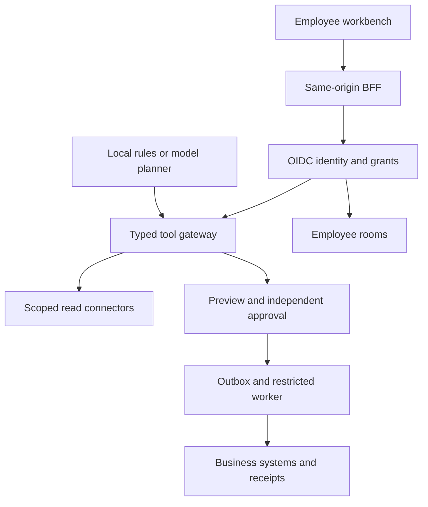

# Enterprise AI workbench architecture and frontend handoff

[简体中文](workbench-handoff.zh-CN.md)

AIOS gives each employee one entry point that carries their business permissions into connected systems. Reuse deterministic tools for data entry, shipment lookup, reconciliation and fixed metrics. Language selects a registered action and clarifies its parameters. ERP, WMS/TMS, accounting and mail remain authoritative for their own records.

## Architecture and isolation



| Layer | Runs locally | Production integration boundary |
|---|---|---|
| Identity | Signature, issuer, audience, expiry, tenant and suspension checks. Use `aios_tenant`, `aios_role`, `aios_warehouses` and `aios_grants`. An access token without grants has an empty business capability set | Customer IdP, directory and revocation. Assign least-privilege grants before rolling out the code. The worker rechecks local suspension before dispatch. Synchronize role-specific revocation into execution for a customer rollout |
| Tool gateway | Fixed tools and Pydantic schemas. Each call enforces role, grant, tenant, warehouse and object scope. Capability discovery drives UI hints. Legacy routes enforce grants as well | Confirm legal entities, warehouses, customer assignments, fields, amounts, ownership and delegation. The finance sample uses warehouses. Real finance must authorize by legal entity, ledger, account and relevant dimensions |
| Planner | Local rules by default. Inject a `WorkbenchPlanner` that receives current user text and offered tool names. Its output goes through the same validation and authorization. A configured planner consumes the tenant budget | Provider, redaction, retention, evaluation, budget and timeouts. Tool results, mail, documents and chat require separate approval before they can become model context |
| Reads and actions | ERP checks scope before the lookup and verifies the returned shipment ID, warehouse and remote tenant. Finance, mail and decisions use typed projections with result-scope checks. Shipment and draft proposals reuse approval, dispatch, receipts and write pause | ERP version, mapping and sandbox. Finance, mail and decision fixtures are demo-only. Bind production adapters to read-only credentials, stable IDs, employee mappings and upstream permissions |
| Employee chat | Private rooms, membership, ordered cursors and idempotent sends. Members read from their admission sequence. Removal blocks further reads and sends. PostgreSQL applies forced tenant RLS and message-level subject, membership and sequence checks. The ERP worker has zero access to chat tables | Live chat requires a directory and approved retention. The current backend stores server-readable plain text and exposes REST paging. Rich media, push, federation and E2EE depend on the selected chat product and customer policy |
| Deployment | FastAPI/Pydantic, PostgreSQL/Alembic, separate systemd users, optional OPA for writes, and Prometheus. Sensitive API responses disable caching and validation errors omit inputs | Dedicated customer data plane, credential rotation, fixed egress destinations, restore exercises, approval integrity and retention require acceptance in the customer's environment |

The effective permission is the **intersection of employee identity, object authorization and connector rights**. Role governs approvals. Grants select actions. Warehouse or legal entity bounds data. Room membership and mailbox ownership bound objects. Browser and model callers do not supply trusted identities or credentials. The API sets tenant context in database transactions. Runtime database identities are never exposed as employee query tools. Revocation cannot recall writes already sent or content already displayed. [NIST Zero Trust](https://csrc.nist.gov/pubs/sp/800/207/final) · [OWASP Excessive Agency](https://genai.owasp.org/llmrisk/llm062025-excessive-agency/) · [PostgreSQL RLS](https://www.postgresql.org/docs/16/ddl-rowsecurity.html)

## Open-source choices

| Component | Decision |
|---|---|
| PostgreSQL, Alembic, FastAPI, Pydantic, Prometheus and systemd | Reused now. Workflow and chat share database infrastructure with separate API and worker roles |
| Keycloak or corporate OIDC, OPA | Existing OIDC adapter and optional OPA checks for writes. Code and connector enforcement remain independent. Keep the customer's IdP when available |
| Pydantic AI | Existing optional planner and a new replaceable workbench planning interface. Typed and deferred tools can help orchestrate later. AIOS continues to validate approval identity, digest and idempotency |
| OpenFGA | Evaluate when organizational hierarchies, shared mailboxes, projects and cross-team ACLs require relationship policies. Verify the model against the customer's allow/deny examples |
| Matrix/Synapse | Prefer integration when mobile push, sync or E2EE are needed. Decide directory mapping, room history, retention and federation first. Synapse is available under AGPL or a commercial license. Review the applicable terms with the delivery model |
| MCP and Temporal | MCP can serve as a controlled connector protocol. Validate token audience and use separate downstream credentials. Temporal is a candidate for long-running cross-system work and compensation. Fixed actions reuse the present outbox |

Sources. [Keycloak token exchange](https://www.keycloak.org/securing-apps/token-exchange) · [OPA integration](https://www.openpolicyagent.org/docs/integration) · [Pydantic AI deferred tools](https://github.com/pydantic/pydantic-ai/blob/main/docs/deferred-tools.md) · [OpenFGA](https://openfga.dev/) · [Matrix client specification](https://spec.matrix.org/latest/client-server-api/) · [Synapse](https://github.com/element-hq/synapse) · [MCP security](https://modelcontextprotocol.io/specification/2025-11-25/basic/security_best_practices) · [Temporal Activities](https://docs.temporal.io/activity-definition)

## Frontend implementation

Use the customer's login and a same-origin Web application. For production, the BFF holds OAuth access tokens. The browser uses an HttpOnly and Secure session cookie. The BFF implements CSRF protection, logout and session expiration. The BFF itself is an integration deliverable. Build four work areas under the shared authenticated shell. [OAuth Security BCP](https://www.rfc-editor.org/rfc/rfc9700) · [Browser OAuth BFF](https://www.rfc-editor.org/rfc/rfc10017.html)

| Screen | API and behavior |
|---|---|
| Shell and assistant | `GET /v1/me` for role, warehouses and grants. `GET /v1/workbench/capabilities` for tools, `available`, `source` and `chat_available`. Submit `{"text":"Show shipment SHP-1001 in HK01"}` to `POST /v1/workbench/turns`. Structured forms use `POST /v1/workbench/calls`. Render responses by `kind` |
| Business work area | Show source, warehouse, timestamp and authorized fields. Render `kind=result` as `data` and `kind=clarification` as plain text. Reuse intake APIs for PO ingestion. Proposal tools require `Idempotency-Key`. Keep the key on retry and create a new key when the target or payload changes |
| Approvals and exceptions | `GET /v1/workbench/approvals` shows eligible, unexpired proposals. Continue with `next.after_due` and `next.after_id`. Use `GET /v1/proposals/{id}` for diff, digest, receipt and audit. An independent approver submits the exact `digest` to `POST /v1/proposals/{id}/approve`. Poll after 202. Show confirmed write only after `VERIFIED`. Operations cases use `GET /v1/operations/exceptions` |
| Employee chat | `GET/POST /v1/chat/rooms` lists or creates rooms with `client_id,title`. `GET /v1/chat/rooms/{id}/members` lists members. Room owner sets `active` via `PUT /v1/chat/rooms/{id}/members/{subject}`. `GET/POST /v1/chat/rooms/{id}/messages` reads or sends `client_id,text`. Dedupe within a room by `seq`, start at `after=0` and poll after the highest received sequence. Clear local room state when switching users or losing access |

For 401 initiate sign-in. For 403 show the scope decision. For 404 use the same missing or unavailable state for hidden objects. For 409 reload the preview or identify the conflicting client ID. Show field errors for 422. For 429 honor `Retry-After`. For 503 display service or connector unavailability. Surface `X-Request-ID` for support. Keep sensitive responses in memory and clear state on tenant or user change. Render user, model and connector text as plain text. Rich text needs its own sanitization.

### Local frontend integration

```bash
python -m pip install -r requirements-platform.txt
export AIOS_PROFILE=demo
export AIOS_PLATFORM_STATE_DIR="$(mktemp -d)"
export AIOS_DEMO_SECRET="$(python -c 'import secrets; print(secrets.token_urlsafe(32))')"
python -m uvicorn aios_platform.api:create_app --factory --host 127.0.0.1 --port 8760
```

Open local `/docs` or `/openapi.json`. Use demo bearer tokens such as `$AIOS_DEMO_SECRET.operator`. The operator can look up and propose a shipment change, manager can approve and admin can trigger the demo worker. Test finance with `Show invoice INV-100 in HK01`, executive with `Summary for warehouse HK02`, and `island-manager` for tenant isolation. Local language handles registered phrases. Structured calls are equivalent. Generate client types from the local OpenAPI endpoint. Production does not expose a public OpenAPI endpoint.

## Dependencies and release gates

| Dependency | Minimum information or acceptance |
|---|---|
| Directory and approval | Directory, employee roles, warehouse and legal-entity assignments, individual grants, role changes and suspension events, least-privilege accounts, independent approval thresholds and step-up authentication |
| ERP/WMS/TMS | Sandbox and API version, read and write accounts, PO and shipment samples, catalogue, versioned records, receipt idempotency, partial receipt and dispatch, revision and cancellation rules. Return the tenant from the bridge and test lost replies and stale versions |
| Finance and decisions | Ledgers, legal entities, accounts, currencies, tax and field restrictions. Approved metrics, sources, windows and drill-down limits. Start with read-only invoices and defined aggregates before adding accounting or payment operations |
| Mail | Provider, consent, shared mailbox relations, minimum read scopes, allowed body and attachment access. The sample returns headers only. Outbound mail needs its own recipient, attachment and approval contract. [Microsoft Graph](https://learn.microsoft.com/en-us/graph/permissions-overview) · [Gmail scopes](https://developers.google.com/workspace/gmail/api/auth/scopes) |
| LLM and data | Provider endpoint, model name, server credential, approved input/output and retention, plus evaluation for ordinary, ambiguous and unauthorized requests. Measure false acceptance, clarification, manual minutes and cost per order |
| Chat and rollout | Directory mapping, owner replacement, retention and export, existing chat vs. Matrix, message quotas, TLS and restores. Load-test on representative customer data, recover faults and exercise permissions |

Local integration and shadow trials are ready to begin. Production acceptance requires actual connectors, customer policy mapping and failure drills. Regulatory communications, payments, accounting posts, outbound mail, grant administration and complex scheduling need independent action contracts and risk rules. [Platform architecture](platform.en.md) · [Production acceptance](production-readiness.en.md) · [Wholesale pilot](pilot-automation.md)
