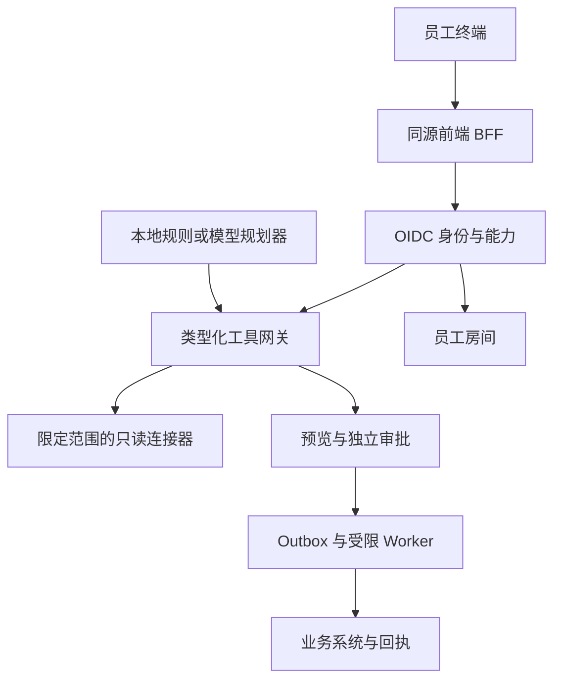

# 企业 AI 工作台后端与前端交接

[English](workbench-handoff.md) · [受控预审与部署交接](governed-assurance.zh-CN.md)

AIOS 给每位员工一个统一入口，沿用该员工的业务权限连接各系统。录单、查运单、对账和固定统计先复用现成接口与确定性工具。自然语言负责找到合适的动作和补齐参数。ERP、WMS/TMS、财务和邮箱分别保留其业务记录的权威来源。

## 架构与隔离



| 层 | 本地可运行的控制 | 生产接入边界 |
|---|---|---|
| 入口身份 | 复用签名、issuer、audience、expiry、租户和停权检查。OIDC 采用 `aios_tenant`、`aios_role`、`aios_warehouses`、`aios_grants`。旧 token 缺少 `aios_grants` 时业务能力为空 | 客户 IdP、目录变更和撤权集成。滚动升级前先给现有主体配最小 grants。对待执行写入，当前 Worker 在派发前查 AIOS 停权；客户岗位按项撤权仍需同步到执行边界 |
| 工具网关 | 固定工具、Pydantic schema、租户、仓库、对象、角色和能力检查。工具列表只是 UI 提示，实际调用逐次判断。旧接口也使用业务能力检查 | 每客户确认法人、仓库、负责客户、字段、金额、货权与委托边界。对财务，仓库是样例范围，真实授权以法人／账套／科目等为主 |
| 规划器 | 默认本地规则。可注入 `WorkbenchPlanner`，输入限员工这一回合的文本和当下可用工具名，输出还要校验并走同一授权路径。配置外部规划器时复用租户预算 | 实际 LLM、输入脱敏及保留策略、输出测试、预算、超时。工具输出、邮箱、附件和聊天内容仍是业务数据，未来须单独获准才能作为模型上下文 |
| 读取与执行 | ERP 工具读取前检查仓库，响应再验运单号和仓库。远程 ERP bridge 还须返回匹配租户。财务、邮箱和决策用类型化视图，核对结果范围后才输出。ERP 改期和订单草稿复用审批、派发、回执与停写 | 接实际 ERP 版本、字段映射和沙盒。财务、邮件、仓库汇总默认仅在 demo 有合成数据。接入后由客户只读凭据、稳定外部 ID、主体映射和连接器再做一层授权 |
| 员工聊天 | 私有房间、成员、顺序游标、消息重投去重。加入时从当时的序号开始读，移除后无法继续读写。PostgreSQL 按租户强制 RLS，消息另按主体、成员身份和起始序号过滤，ERP Worker 无聊天权限 | 企业目录及保留规则接入前，生产聊天不可用。当前房间存储为服务端可读文本，使用 REST 分页。富媒体、推送、联邦和 E2EE 需要聊天产品与客户策略确认 |
| 部署 | FastAPI/Pydantic、PostgreSQL/Alembic、systemd 双运行身份、可选 OPA 写动作审核、Prometheus。接口不缓存受限视图，校验错误省略输入值 | 首客独立数据面、凭据轮换、只允许固定出站目的地、恢复演练、审批完整性和日志留存均需在他方沙盒验证 |

关键边界是**员工身份、对象授权和连接器支持的权限取交集**。角色决定能否审批，能力决定能否做某类事，仓库或法人限定数据范围，房间成员或邮箱所有者限定对象。浏览器和模型不能提交受信身份、授权或系统凭据。数据库自身的租户上下文由可信 API 设置，运行角色不能暴露为用户查询工具。已经送到 ERP 的写请求、已经展示给员工的内容，无法靠后续撤权召回。参考 [NIST Zero Trust](https://csrc.nist.gov/pubs/sp/800/207/final) · [OWASP Excessive Agency](https://genai.owasp.org/llmrisk/llm062025-excessive-agency/) · [PostgreSQL RLS](https://www.postgresql.org/docs/16/ddl-rowsecurity.html)

## 开源选型

| 工具 | 目前的决定 |
|---|---|
| PostgreSQL、Alembic、FastAPI、Pydantic、Prometheus、systemd | 直接复用。租户隔离、工作流和聊天使用同一数据库基础设施，API 与 Worker 角色不同 |
| Keycloak / 企业 OIDC，OPA | 已保留 OIDC 适配和可选 OPA 写动作策略。函数内鉴权和连接器权限持续独立。客户已有 IdP 可保留 |
| Pydantic AI | 仓库已有可选 planner，工作台新增可替换规划接口。接模型时，用类型化和延迟工具能力辅助编排，审批身份、摘要和去重仍由后端验证 |
| OpenFGA | 多层组织、共享邮箱、项目组和跨团队 ACL 关系复杂后评估。先用客户权限样例做 allow/deny 对照，再迁移关系模型 |
| Matrix/Synapse | 需要移动推送、消息同步或 E2EE 时优先集成现成开源聊天，先确定目录、房间历史、保留和联邦。Synapse 为 AGPL 或可选商业授权，发布前按产品交付形式核对条款 |
| MCP、Temporal | MCP 可作受控连接器协议，服务端验证 token audience 并换成下游专用凭据。Temporal 用于长流程和跨系统补偿。当前固定动作先复用已有 Outbox |

选型资料。[Keycloak token exchange](https://www.keycloak.org/securing-apps/token-exchange) · [OPA 集成](https://www.openpolicyagent.org/docs/integration) · [Pydantic AI deferred tools](https://github.com/pydantic/pydantic-ai/blob/main/docs/deferred-tools.md) · [OpenFGA](https://openfga.dev/) · [Matrix 客户端规范](https://spec.matrix.org/latest/client-server-api/) · [Synapse](https://github.com/element-hq/synapse) · [MCP 安全建议](https://modelcontextprotocol.io/specification/2025-11-25/basic/security_best_practices) · [Temporal Activities](https://docs.temporal.io/activity-definition)

## 前端怎么做

重用客户登录体系，新工作台部署为同源 Web 应用。生产由 BFF 持有 OAuth 访问令牌，浏览器使用 HttpOnly、Secure 会话 Cookie，并由 BFF 完成 CSRF 校验、登出和会话失效。BFF 层仍需实现。第一版做四个工作区，共用任何角色都可打开的登录后外壳。参考 [OAuth 安全 BCP](https://www.rfc-editor.org/rfc/rfc9700) · [Browser OAuth BFF](https://www.rfc-editor.org/rfc/rfc10017.html)

| 页面 | API 与交互 |
|---|---|
| 入口和助手 | `GET /v1/me` 取岗位、仓库、能力。 `GET /v1/workbench/capabilities` 取工具、`available`、`source`、`chat_available`。 `POST /v1/workbench/turns` 提交 `{"text":"Show shipment SHP-1001 in HK01"}`。结构化表单走 `POST /v1/workbench/calls`，都按 `kind` 展示 |
| 业务工作区 | 显示工具来源、仓库、时间和已授权字段。 `kind=result` 展示 `data`，`kind=clarification` 渲染纯文本并让员工补参数。订单接入用已有 intake 接口。通过工具创建变更预览时附 `Idempotency-Key`，网络重试复用原键，改目标或参数生成新键 |
| 审批与异常 | `GET /v1/workbench/approvals` 取当前用户可审批的未过期提案。列表用 `next.after_due` 和 `next.after_id`。 `GET /v1/proposals/{id}` 打开前后差异、审批摘要、回执与审计。独立主管通过 `POST /v1/proposals/{id}/approve` 提交原 `digest`。202 后轮询状态，收到 `VERIFIED` 才显示已写入核对。运维异常用 `GET /v1/operations/exceptions` |
| 员工聊天 | `GET/POST /v1/chat/rooms` 列表／创建，创建发送 `client_id,title`。 `GET /v1/chat/rooms/{id}/members` 显示成员，房主 `PUT /v1/chat/rooms/{id}/members/{subject}` 传 `active`。 `GET/POST /v1/chat/rooms/{id}/messages` 拉取或发送 `client_id,text`。按房间内 `seq` 去重，初页从 `after=0` 开始，后续以最高已见序号增量拉取。换人或被移除后清空页面记录 |

API 错误应映射到可恢复的状态。401 走重新登录。403 显示权限限制。404 对未知或不再可见的对象统一提示。409 重新读预览或区分客户端 ID 冲突。422 显示对应字段错误。429 等待 `Retry-After`，503 标注连接器或规划器不可用。显示服务端 `X-Request-ID` 供运维定位。企业数据及对话用内存态，切换账号或租户清空状态，浏览器持久缓存不保存敏感响应。工作台内容、消息和外部文本按纯文本渲染，富文本需要独立净化。

### 前端本地联调

```bash
python -m pip install -r requirements-platform.txt
export AIOS_PROFILE=demo
export AIOS_PLATFORM_STATE_DIR="$(mktemp -d)"
export AIOS_DEMO_SECRET="$(python -c 'import secrets; print(secrets.token_urlsafe(32))')"
python -m uvicorn aios_platform.api:create_app --factory --host 127.0.0.1 --port 8760
```

访问本机 `/docs` 或 `/openapi.json`，使用服务器生成的本地 Bearer 样例 `$AIOS_DEMO_SECRET.operator`。用 `operator` 查运单及提出改期，`manager` 审批，`admin` 可触发演示 Worker，`finance` 用 `Show invoice INV-100 in HK01` 验证财务，`executive` 用 `Summary for warehouse HK02` 验证聚合，`island-manager` 验证第二租户。工作台本地规则只识别登记的短句，结构化调用可作为等价入口。前端可在本机生成 API 类型，生产项目不提供公开 OpenAPI。

## 外部接入前还缺什么

| 依赖 | 最小资料或验收 |
|---|---|
| 员工身份和审批 | 组织目录、员工角色与仓库／法人映射、具体能力、岗位变更和停权信号、最小权限账号、独立审批金额及 MFA 要求 |
| ERP/WMS/TMS | 沙盒版本和接口文档、读写账号、PO 和运单样例、主数据、版本号和幂等回执、部分收发和改单／撤单规则。桥接响应须附租户并通过丢回复和陈旧版本测试 |
| 财务／决策 | 账套、法人、科目、币种、税费及字段遮蔽规则，已审核的指标定义、来源、时间窗和可钻取范围。先接只读发票和已定义聚合，再讨论过账、付款或自动决策 |
| 邮件 | 邮箱供应商、员工同意、共享邮箱授权关系、最小读取 scope、是否允许读正文及附件。当前邮箱样例只返回头部投影，外发需要单独的收件人、附件与审批合同。参考 [Microsoft Graph](https://learn.microsoft.com/en-us/graph/permissions-overview) · [Gmail scopes](https://developers.google.com/workspace/gmail/api/auth/scopes) |
| LLM 和数据 | 模型地址、模型名和服务器端凭据，批准的输入、输出和保留范围，含普通指令、歧义、错误对象和越权尝试的评分样本。正式使用前量化误放行率、澄清率、每单人工时间与模型成本 |
| 聊天和上线 | 员工目录映射、房主替换、留存和导出策略、选用现有私有聊天或 Matrix、消息配额、TLS 和备份恢复。按首客的真实容量压测、故障恢复并做权限演练 |

现阶段可上线的是本地联调和影子试点。生产接入验收以真实连接器、客户权限映射和故障演练为准。监管沟通、付款、过账、外发邮件、账号授权和复杂排程均需各自的独立业务合同和风险规则。[平台架构](platform.md) · [生产验收](production-readiness.md) · [批发试点](pilot-automation.zh-CN.md)
